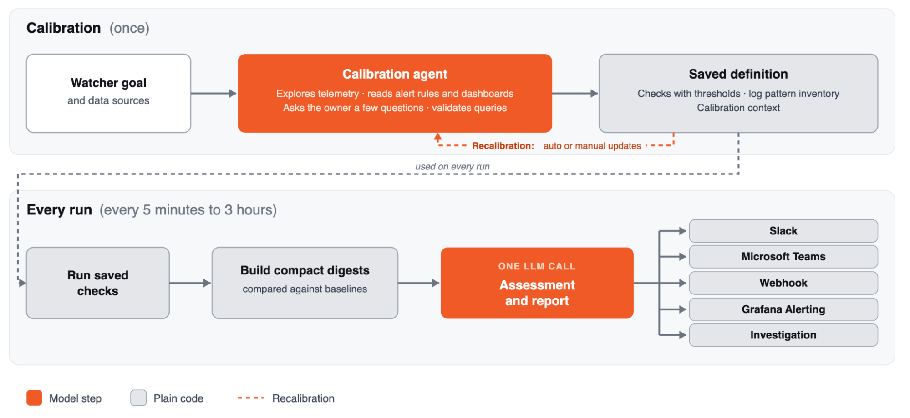

[Run cost-effective, always-on agents to monitor your environment: the engineering behind Watchers](https://grafana.com/blog/run-cost-effective-always-on-agents-to-monitor-your-environment-the-engineering-behind-watchers/) · Grafana Labs · 2026-11-09

让 Agent 每十分钟完整调查一次服务，成本可能先于覆盖率失控。Grafana 的内部实验中，一次完整 agentic investigation 花费 $0.56–$1.26；若每月执行 4,320 次，单个监控目标就达到数千美元。这篇工程说明的贡献是重新分配推理：强 Agent 决定检查什么，普通代码反复检查，小模型只判断这次变化是否值得通知。

## 校准产生可执行检查，也产生判断上下文

创建 Watcher 时，后台 calibration agent 探索所选数据源，优先读取已有告警和 dashboard，因为它们编码了团队认可的阈值、严重性与故障经验。范围不明确时，它会向用户确认，例如多个生产集群应分别判断还是聚合。

它在过去一周的多个时点测量信号，考虑日常与每周流量周期，避免把周日晚低流量误判为事故。每项检查先在真实数据上测试，再保存查询、阈值、日志 pattern inventory，以及紧凑的 calibration context：服务背景、用户决定、部署习惯、正常范围和已知噪声。

<a class="note-image-link" href="/assets/images/tech/grafana-watchers/architecture.png" target="_blank" rel="noopener" aria-label="Grafana Watchers：把持续巡检拆成一次校准与一次判断 · 查看原图 ↗">查看原图 ↗</a>

*上方校准保存检查与上下文；下方每轮用代码生成摘要，再由一次 LLM 调用决定报告与升级。*

因此一次校准的输出不只是长提示。它将以后每轮能用代码确定的工作固定下来，并给不能完全公式化的最终判断准备上下文。配置发生变化或基线过时时需要重新校准；一次性探索摊薄成本的前提，是它保存的检查仍然对应真实环境。

## 每轮先压缩证据，再做一次无工具判断

运行时不再启动探索循环。指标由代码与昨天同一时间及统计基线比较，应用校准后的阈值；模型读结论，不承担大量数值计算。日志利用 Loki patterns API 在摄取时形成的模式分组，Watcher 持续维护已见模式，重点取新模式和频率显著变化的例子。部署检查提供时间关系，帮助区分“部署后开始”与无关波动。

健康检查压成一行，异常保留证据，整个 digest 只进入一次小模型调用，不开放工具。输出是结构化的 OK/warning/critical、简短报告、持续跟踪的问题与依据，以及是否通知或发起进一步 Investigation。这样小模型处理的是有限问题：新日志模式与错误率上升是否共同构成需要打断人的变化。

较重的 Investigation 成为升级路径，不是每个周期的默认成本。它仍单独计费，校准费用也在周期运行成本之外。把这个结构迁移到自建系统时，必须保留成本边界，不能只计算那一次小模型 token。

## 内部成本与真实发现提供了什么证据

按文中每百万 token $2 的价目折算，内部 43 个 Watcher 月运行成本中位数低于 $5，41 个低于 $10，最贵一个含 43 项检查、每十五分钟运行，略高于 $20。频率可在五分钟到三小时之间调整，所以这些是其内部实例及频率的观察，不是任何监控目标的固定套餐价。

作者称过去几个月，监视 Assistant 本身的 Watcher 找到十余起影响客户的生产缺陷，包括 Teams 集成 crashloop、报告损坏、新区域 webhook 凭据缺失和未送达 Alertmanager 的通知。它们解释了价值来自哪些信号：新错误模式若同时关联错误率和新部署，比单独一条陌生日志更值得注意。

但发现异常和判断根因仍需分开。文中给出一个 MySQL 资源耗尽案例：Watcher 发现真实故障，却归因错误，工程师后来发现可能相关的昂贵查询计划。它的职责是发现并提供证据，后续由人或 Investigation 深挖，不能将“找到十余事故”写成“自动正确诊断十余根因”。

## 适用边界是校准覆盖与升级质量

文中称候选模型通过生产决策回放，当前常用模型没有漏掉所测 critical case，单次决策成本约为替换前的一半。但没有公开样本数、标签构成与误报分布，不能据此推算总体漏报率为零。

这套设计最值得 AgentOps 关注之处，是让模型能力匹配工作阶段：探索用强模型、重复执行用代码、局部判断用小模型。它仍依赖可访问的数据源、校准代表性、日志模式变化的可见性，以及异常升级能否带来可操作证据。Watchers 补充告警规则；现有明确阈值的故障，仍适合用确定性告警直接捕获。
