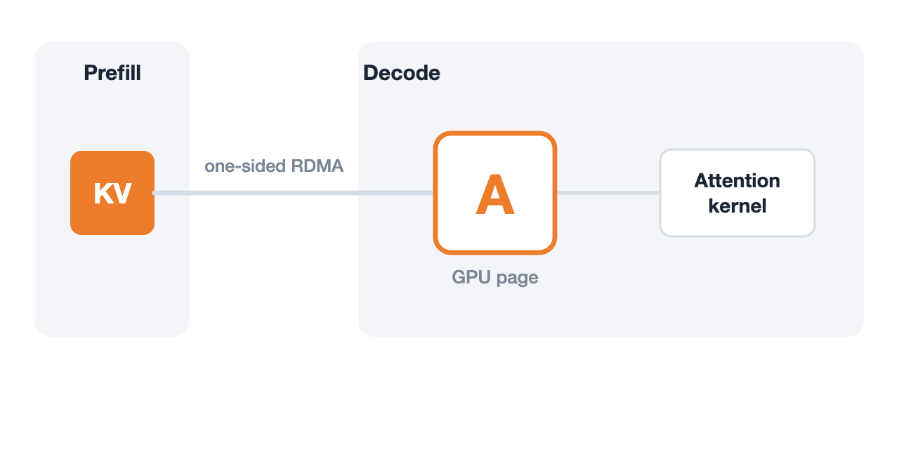

[Towards Verifiable LLM Infra](https://haoailab.com/blogs/verifiable-llm-infra/)  
Yuxuan Zhang, Minshen Zhang, Junda Su, Yi Sun, Junda Chen, Hao Zhang · 2026-11-10

推理引擎返回 HTTP 200，并不意味着它使用了正确请求的 KV。Hao AI Lab 讨论的危险发生在 PD 分离服务：Decode 因超时释放某请求的页，随后把它分给新请求，但 Prefill 侧排队的 GPUDirect RDMA 写入仍会到达。此时内存地址合法、服务也没崩溃，内容却可能属于另一个用户。

这篇文章的实质是两项相连的工程工作：vstack 组织 Agent 建模与验证，veriserve 则以明确的 KV 页生命周期设计一个原型。前者减少“模型证明通过但问题被假设掉”的风险，后者把请求取消与硬件访问结束分开处理。

## 先固定要证明的要求，再建立抽象

vstack 从真实 issue、修复和 GPU kernel 前置条件提取要求，把规范文件按哈希固定。Agent 不能为了让检查变绿而悄悄削弱 invariant、删掉超时分支或加入排除竞态的假设。接下来建立 TLA+ 和 Z3 模型，将状态转移对应到具体代码版本的位置，并拆开跨线程、跨节点的非原子操作。

模型忠实性有独立门槛：历史有缺陷版本应该失败，修复版本应该通过；去掉非冗余保护应再次暴露错误；真实执行轨迹应能在模型中逐步回放。只有这些关卡之后，才使用 TLC 搜索有界反例，以及 Apalache、Z3、TLAPS 检查或证明相应性质。最后将检查加入后续变更验证，并把部分前置条件变成运行时检查。

这个顺序的意义在于，证明可以非常严格地证明一个错误模型。固定目标、要求修复前后可区分、让实际事件能被抽象模型解释，是把形式化工作与正在演化的引擎联系起来的必要证据；它们仍不等于实现代码的完整精化证明。

## 本地超时无法证明远端硬件已停止

作者报告了三类问题：RDMA 尚未完成就复用传输身份或 KV 块；被竞态污染的页进一步进入共享前缀缓存；失效租约或丢失 abort 通知使 Decode 持页等待。这些问题分别跨越传输、缓存和调度的所有权边界。原文报告在 GB200 上复现部分 RDMA 路径，在 CPU 上复现控制面死锁，并提出六个上游 PR；不能把“提出修复”写成“所有版本已经修复”。

其核心不可能性结论带有条件：在无界异步延迟、相同本地观察无法区分硬件是否仍会访问，而且没有可信停止或撤销证据时，仅依赖本地判断的策略不能同时保证安全隔离和页最终回收。短一点的 timeout 不能消除这个信息缺口。

## PdLedger 把请求结束与页回收拆开

veriserve 基于 mini-sglang 和 Mooncake，用 `(page, gen)` 票据跟踪每个物理页。六种状态包括 Free、Private、Shared、Draining、Quarantined 和 Dup，版本号帮助阻止旧消息操作新一代请求的状态。

<a class="note-image-link" href="/assets/images/tech/haoailab-vstack-verifiable-llm-infra/pdledger.gif" target="_blank" rel="noopener" aria-label="无停止证据的页进入 Quarantined；有停止证据的取消路径经 Draining 回到 Free。图省略前缀共享状态。">查看原图 ↗</a>

*无停止证据的页进入 Quarantined；有停止证据的取消路径经 Draining 回到 Free。图省略前缀共享状态。*

有待完成 RDMA 或 kernel 访问的页先进入 Draining；收到全部受跟踪访问停止的证据后才能回到 Free。超时却拿不到停止证据时，受影响请求可以结束，但该物理页在进程生命期内进入 Quarantined，不再分给新请求，也不发布进前缀缓存。迟到写入仍可能到达，只是落在隔离区域。

这不是免费恢复：隔离保住正确性，却牺牲可用容量，反复故障可能不断消耗页。Shared 和 Dup 涉及的前缀共享生命周期也不能被超时路径的简图替代。整个设计的可取之处是把这些资源去向显式记账，而不是用一个“请求完成”标志概括硬件、缓存和调度三种不同结束条件。

## 证明范围与实测范围分别看

作者报告有界 TLC 检查遍历超过 2,100 万个可达状态；在显式 Sizes 与 Design 假设下，TLAPS 证明包含 226 个模块、516,973 条义务，覆盖 64 个协议动作和 54 个归纳不变量。Z3 另检查模型中的 GPU KV 地址运算。这些是抽象设计模型的安全性证据，不证明 Python、GPU kernel 或 RDMA provider 无 bug，也不能由安全证明条数推出所有活性性质已经成立。

实现与模型的连接包括同步前置条件检查、故障变异测试和边界事件回放。八次正常服务运行的 22,104 个已映射事件全部通过 TLC 回放；八次单页共享与逐出测试中的 540 个 KV checksum 无不一致，并捕获三个注入的胶合层错误。这些检查增强了连接证据，但有限轨迹不覆盖所有实现行为。

GB200 上 Qwen3-32B 的六组配对实验，以绕过 ledger 检查的版本为基线，HTTP p50 TPOT 的平均开销为 +0.18%，95% 区间为 −0.32% 到 +0.68%。每步 ledger 的 CPU 检查 p50 为 0.33 ms，不能直接除以 13.6 ms TPOT 就当端到端开销，因为两者存在执行重叠。最值得关注的是“停止证据才能回收”这一生命周期约束；小开销结果则限于所测原型和负载。
