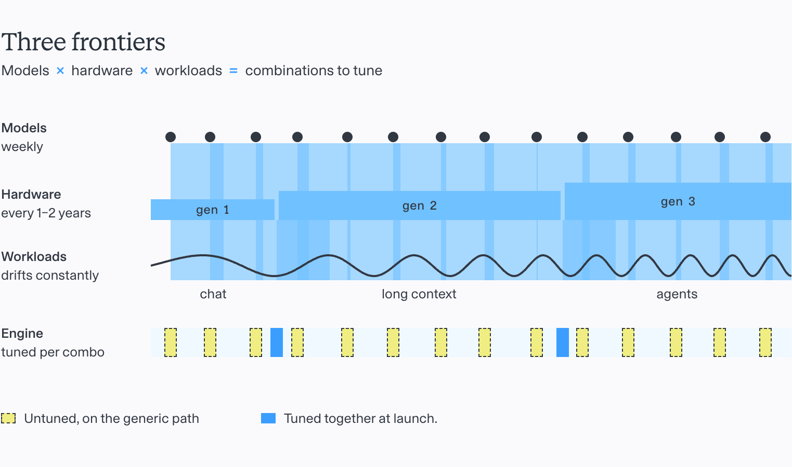

模型接入当天能跑通的服务，未必能承受最终检查点带来的输出长度变化。Simon Mo 讲述的 MiniMax M3.1 Flash 接入过程里，负载从长上下文编码转向短输入长输出，最终检查点又让输出长度翻倍，瓶颈逐渐转移到解码。同一组内核在本地测得的优势，可能被真实请求的形状完全改变。Inferact 将自主推理系统的目标落在两个已投入使用的环节：让候选修改接受真实流量检验，以及让不同调查路线共同追踪质量回退。

## M3.1 从局部验证走向线上影子评测

M3.1 同时引入带索引器的稀疏注意力、大型 MoE、视觉输入与原生 DSpark。团队把开源引擎和生产修改放在同一分支，切流前将全部线上 M3 流量镜像给 M3.1。候选先过本地检查，再拿这批影子请求评估。镜像给新版本的价值在于保留真实请求的组合，同时继续由现有服务给用户响应。作者报告首个未分离预填充与解码的端点 p50 首 token 用时为 1.5 秒，生产配置为 0.8 秒。专家并行预填充补丁的 TTFT 改善为 60%–70%，流水线并行预填充相对张量并行的吞吐改善为 19%–46%。这些数字有各自的基线，不能连乘。

<a class="note-image-link" href="/assets/images/tech/inferact-autonomous-inference-system/figure.png" target="_blank" rel="noopener" aria-label="模型、硬件和工作负载各自变化，验证一项引擎优化需要同时固定三者。">查看原图 ↗</a>

*模型、硬件和工作负载各自变化，验证一项引擎优化需要同时固定三者。*

## 同一请求换一批邻居，质量为何会变

Kimi K3.1 的异常只在某些批次发生。如果只盯总吞吐，可能把错误当成正常的服务加速。Inferact 报告，16 个并行调查智能体复现了退化，把原因定位到随批次组成而变化的注意力路由分支。修复后 DeepSWE 从 0.558 升至 0.602，回到团队引用的参考水平。这里质量分数承担了上线验收的作用：正确性取决于服务路径，也取决于与当前请求一起执行的其他请求。

## 优化的运行时间与优化后的服务时间

Agent V 接收 Slack 中的任务，在沙箱内探索候选方案。K3.1 在 GB300 上的另一次搜索用了 24 小时，使 800K 上下文的首 token 阶段加速 2.78 倍；另一轮持续 30 小时，p99 每输出 token 用时下降 35%。数十小时是工程搜索所花的时间，后两个数字描述的是选中配置的服务性能。从九月中到十月底，每卡生产吞吐从约每分钟 77 万 token 升至 140 万，这段跨周变化也不能归因于某一次补丁。

## 今天能验证的流量与明天的流量

文章描绘了系统根据失败记录主动重排检查顺序的未来流程。作者同时指出，目前能观察的主要是自营部署、客户授权和社区分享的流量，对尚未到来的请求缺少可信模拟。因此，真实案例支持影子评测、质量诊断和多候选搜索的价值；系统能否自行改写自己的工程流程并持续安全地上线，仍取决于能否构造足够有代表性的反馈。

Simon Mo · 2026-11-18 · [Building an Autonomous Inference System](https://inferact.ai/news/building-autonomous-inference-system)
