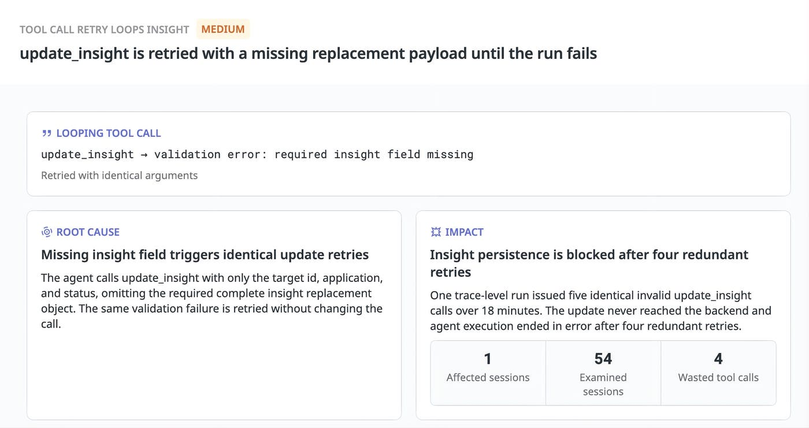

Agent 可观测性的下一步，是把轨迹中的问题转成可验证的修改。Datadog 用 Insights 分析 Insights 背后的 Agent，提供了几个具体例子：搜索返回太多内容、动态上下文破坏缓存前缀、缺参数的调用反复重试，以及模型猜错技能资源名。它们的共同点是，单次报错或总 token 数都不足以说明应该改哪里。

原文：[How we use Insights to improve the agent behind Insights](https://www.datadoghq.com/blog/improving-insights-agent-observability/) · Alex Barksdale, Miguel Tulla Lizardi, Zhengda Lu · Datadog · 2026-10-30。

## 工具结果如何变成后续成本

Agent 用 `search_llmobs_spans` 检索轨迹证据。查询太宽时，工具返回大段内容；一旦原样进入对话，后续模型请求又把它们带上。作者检查的两次运行中，五次搜索共返回约 80,000 token；其中一条结果向一个 97,000 输入 token 的请求贡献了 19,000 token。这些数字描述所观察到的请求，并不是已经实现的节省量。

最直接的改法是缩窄过滤条件、缩小分页并按需取回更多内容。问题后来再次出现，建议进一步变成“先返回紧凑预览”。预览必须保留检索完整 span 所需的标识符，不能只做一段无法回溯的摘要。这样，Agent 能先选择证据，再为确实需要的细节支付上下文成本。

评估修改也需要沿这条链走：工具返回多少内容、模型实际使用多少 token、调查是否仍完整正确。只看到 token 减少，并不能区分“更有效的取证”和“漏掉了决定性证据”。文章提出回放受影响调查进行比较，没有给出统一的修复后节省百分比。

## 缓存命中取决于请求的排列

另一条生产洞察发现，任务专属信息排在稳定工具定义之前。任务信息变化，会使后面本来相同的内容失去可复用前缀，类似请求反复写入几乎整个提示词。建议把稳定系统指令和工具定义放前面，任务细节与对话放后面。

原文估算这一调整在所分析请求中每天可节省 91.14 美元，按 30 天推算约每月 2,734 美元，明确说尚未测量实际节省。收益取决于重复请求、缓存资格和提供商计费。图表筛选的还是特定模型及提供商下、输入超过 1,024 token 的请求；它不能作为所有服务通用的缓存门槛或成本承诺。

这项观察的可迁移之处是：缓存不是“打开某个开关”就结束，消息构造方式本身就是性能接口。对 AgentOps，缓存读写、请求前缀和任务变化应能关联到同一条运行证据，而不只是显示一个全局命中率。

## 重试之前，先分清错误会不会自行消失

<a class="note-image-link" href="/assets/images/tech/insights-agent-observability/overview.jpg" target="_blank" rel="noopener" aria-label="Insights 对缺少 insight 字段导致重复调用的诊断截图 · 查看原图 ↗">查看原图 ↗</a>

*左侧指出缺失完整替换对象；右侧把相同参数重试与一次运行失败关联起来。这里需要修正请求，重复发送不能消除缺参。*

一个案例在约 18 分钟内五次以相同参数调用 `update_insight`。Agent 提供了 ID、应用和状态，却没有提交替换旧对象所需的完整 insight。校验在到达后端前就拒绝请求，四次重复重试后整次运行报错。因此问题不是后端暂时不可用，而是 Agent 没有根据错误修正输入。

另一个样本在 193 个会话中出现资源名称被猜测或改写的行为。指令本已要求使用技能加载器返回的精确名字，单纯再强调提示词并不能确保遵守。文章建议工具执行前对照允许列表，不匹配就返回有效选项；随后回放相关轮次，观察是否还会请求不存在资源并重复失败。

这两类案例都把约束从自然语言要求推进到可执行接口检查。但工具校验与模型补救是两部分：检查能拒绝错误输入，错误反馈还需要足够具体，才能引导下一次调用真正改变。

## 从洞察到 PR，中间仍有验证

“Fix with Bits”把发现、建议和 trace 引用交给编码 Agent，为紧凑搜索预览准备 PR。原文描述该改动保留完整内容的检索标识、支持追加分页，并包含新取回结果与缓存结果的测试。这使修改有明确证据来源和行为目标，便于人工审查。

这篇文章的贡献是可追踪的工程闭环案例，而非证明 Agent 已能自主优化一切。证据包含具体失败与提议修改，但还缺长期、受控的修复收益比较。优先阅读工具结果膨胀与无效重试两段：它们展示了如何从一次请求扩展到跨轮次机制，同时保留“观测到的浪费”“估算的收益”“已准备的修改”三个不同阶段。
