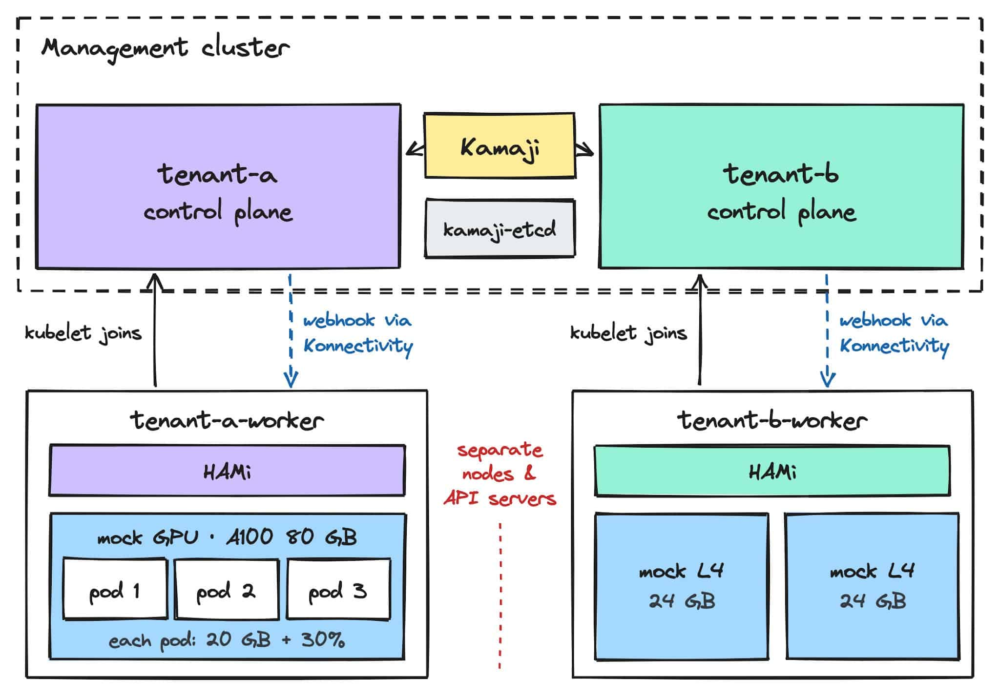
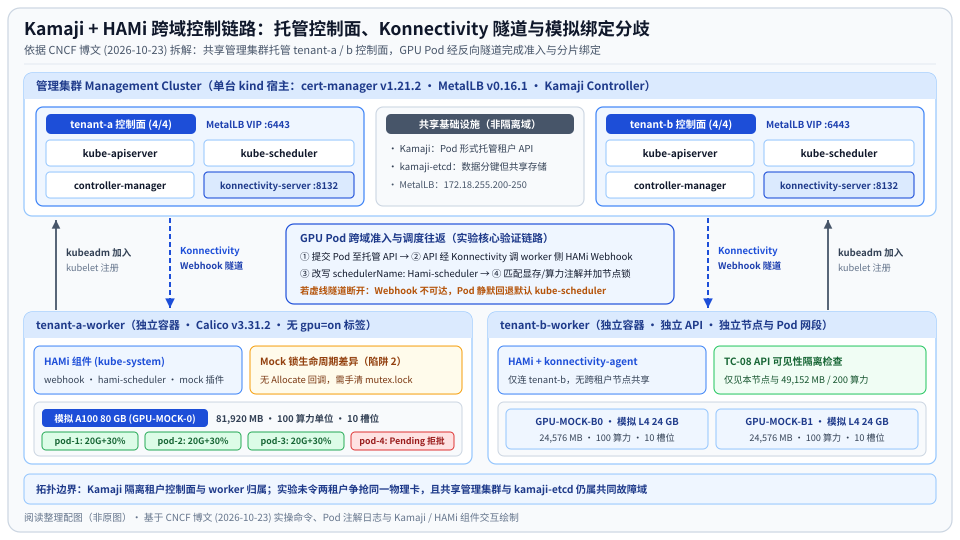
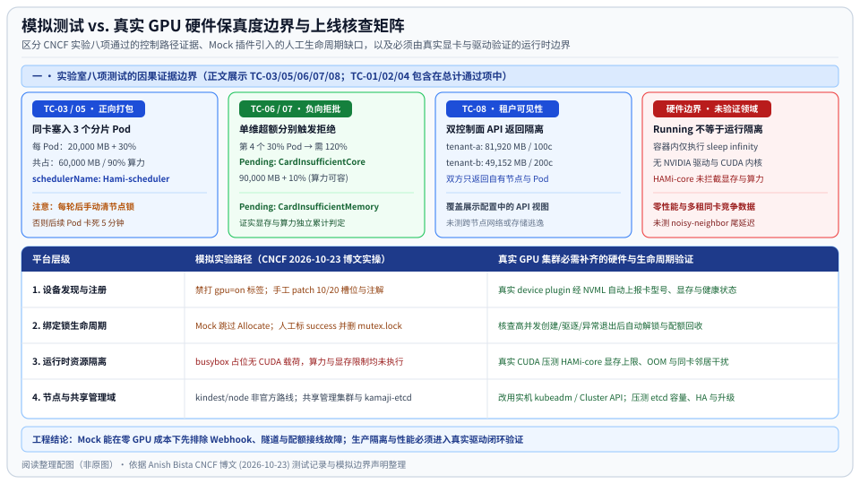

Anish Bista（CNCF Golden Kubestronaut）· 原文发布于 2026-10-23 · [CNCF 官方技术博文](https://www.cncf.io/blog/2026/10/23/multi-tenant-gpu-kubernetes-on-simulated-hardware-with-kamaji-and-hami/) · 相关开源项目：[Clastix Kamaji](https://github.com/clastix/kamaji) · [HAMi](https://github.com/Project-HAMi/HAMi) · [HAMi Mock Device Plugin](https://github.com/Project-HAMi/mock-device-plugin)

搭建多租户 GPU Kubernetes 平台时，架构师通常会撞上一道“三难”挤压：给每个团队单独部署完整集群，就要为每个团队白白付出独立控制面机器与运维成本；把所有团队放进同一个大集群，命名空间与 RBAC 隔离又偏弱；更麻烦的是，原生 Kubernetes 按整卡粒度分配 GPU，一个仅需 4 GB 显存的小任务也会把整张 80 GB 显卡锁死。2026 年 10 月 23 日发表于 CNCF 博客的这篇文章给出了一套**零物理 GPU 硬件前提下的前置验证路线**——把 **Kamaji**（托管租户控制面）与 **HAMi**（异构算力虚拟化与分片调度）组合在单台 Linux 宿主机上，用 `mock-device-plugin` 检验“托管 API server 能否穿透 Konnectivity 反向隧道调到租户侧 HAMi 准入 webhook，并正确落盘分片配额与租户隔离视图”。

> **证据口径与来源边界**：本文完全基于 Anish Bista 于 2026 年 10 月 23 日在 CNCF 博客发布的实验记录（冻存原文含完整 `kind` / `Helm` / `kubectl` 命令与测试输出）重写。原文展示的是一次**纯控制路径与调度接线验证**：工作负载容器内仅运行 `busybox` 的 `sleep infinity`，**未接入 NVIDIA 驱动，未执行任何 CUDA 内核，也未产出吞吐、延迟或 noisy-neighbor（同卡噪声邻居）基准数据**。下文中关于架构分层、具体版本、命令陷阱与八项通过范围的叙述均严格出自原文；末尾“分阶段硬件交接核查清单”及部分机理拆解则明确标出为基于原文模拟边界所作的工程推导。

## 架构分层与关键跨域跳：Kamaji、HAMi 与 Konnectivity 隧道

Kamaji 与 HAMi 之所以能在几乎不写胶水代码的情况下拼在一起，根本原因在于它们切分的是集群栈中互不重叠的两个层级：

- **Kamaji 负责“控制面与租户集群边界”**：借助 `kamaji.clastix.io/v1alpha1` 的 `TenantControlPlane` 资源，Kamaji 把每个租户的 Kubernetes 控制面作为轻量 Pod 运行在中央管理集群（Management Cluster）内。在本次实验里，管理集群跑在一个名为 `kamaji` 的单机 `kind` 集群中，命名空间 `tenants` 里的 `tenant-a` 与 `tenant-b` 控制面 Pod 均呈现 `4/4` 就绪容器——`kube-apiserver`（经 MetalLB `LoadBalancer` 暴露在 `6443` 端口）、`kube-scheduler`、`kube-controller-manager` 以及 `konnectivity-server`（监听 `8132` 端口）。两个租户的 API server、scheduler 与数据节点完全分开，共享的只有管理集群底座以及按租户分片保存状态的 `kamaji-etcd` 存储服务。
- **HAMi 负责“租户内部的 GPU 分片粒度”**：在各自租户集群的 `kube-system` 命名空间内部署 HAMi 后，Pod 无需整卡申请，而是可以在资源限制中声明显存（`nvidia.com/gpumem`，单位 MB）与算力比例（`nvidia.com/gpucores`，按单卡百分比计算），从而将多个工作负载打包塞入同一张 GPU。

<figure class="note-figure">
  <a class="note-image-link" href="/assets/images/tech/kamaji-hami/architecture.jpg" target="_blank" rel="noopener" aria-label="查看原文官方架构图：共享管理集群与分离租户 worker 的 Kamaji、HAMi 实验拓扑">
    
    <span class="note-image-action">点击放大 ↗</span>
  </a>
  <figcaption>原文原图（保留原件，出自 Anish Bista CNCF 2026-10-23 博文）：上方管理集群托管两个独立控制面与 kamaji-etcd；下方分离的租户 worker 运行 HAMi 与模拟 GPU，蓝色虚线标示经 Konnectivity 隧道回访的 webhook 路径。</figcaption>
</figure>

把这两个项目放到一起时，真正决定成败的既不是 Kamaji 能不能拉起控制面 Pod，也不是 HAMi 在普通单集群里能不能切片，而是原文用蓝色虚线标出的**跨域往返调用（cross-boundary round trip）**：

1. 用户向托管在**管理集群**里的租户 `kube-apiserver` 提交一个申请 GPU 分片的 Pod。
2. 触发准入控制时，处于管理集群内的 `kube-apiserver` 必须反过来访问部署在**租户 worker 节点**网络里的 HAMi Mutating Webhook。由于租户节点位于独立网络边界之后，这一跳必须依赖 `konnectivity-server`（管理侧）与运行在 worker 节点上的 `konnectivity-agent` DaemonSet 建立的反向代理隧道。
3. HAMi Webhook 拦截并改写 Pod 的 `spec.schedulerName` 为 `Hami-scheduler`，使后续调度不再走托管控制面内置的默认 `kube-scheduler`，而是交由租户侧的 `hami-scheduler` 按显存与算力配额做节点筛选（Filtering）与设备绑定（Binding）。
4. 原文作者直言，“证明这条路径通畅正是本实验的首要目标”：一旦 Konnectivity 反向隧道失效，GPU Pod 创建时请求根本触不到 HAMi Webhook，就会**静默回退到默认 `kube-scheduler`**，让 HAMi 完全形同虚设。

<figure class="note-figure">
  <a class="note-image-link" href="/assets/images/tech/kamaji-hami/kamaji-hami-control-plane-zh.svg" target="_blank" rel="noopener" aria-label="放大查看 Kamaji 与 HAMi 跨域控制链路图">
    
    <span class="note-image-action">点击放大 ↗</span>
  </a>
  <figcaption>阅读整理配图（非原图）：将 CNCF 博文（2026-10-23）中的管理集群、4 容器 TenantControlPlane、Konnectivity 准入往返路径及 Mock 绑定锁分歧展开为可核对的控制面视图。</figcaption>
</figure>

为了避免把“组件各跑各的”误读成“整体强隔离”，下表按组件层级厘清本架构中每一层的真实职责与隔离边界：

| 平台层级与组件 | 在本实验中的具体位置与形态 | 承担的核心职责 | 隔离范围与共享风险边界（按原文核对） |
| :--- | :--- | :--- | :--- |
| **管理集群与 `kamaji-etcd`** | 单机 `kind` 集群（`kamaji`）与共享存储服务 | 承载 `cert-manager`、MetalLB、Kamaji 控制器及租户状态存储 | 租户数据在 `kamaji-etcd` 内分开保存，但管理节点与存储引擎本身仍属两租户的**共同基础设施故障域** |
| **Kamaji `TenantControlPlane`** | 管理集群 `tenants` 命名空间内 4/4 Pod | 为每个租户提供独立的 `kube-apiserver`、默认调度器与控制器 | 租户间 API 端点、kubeconfig 与对象列表互不可见；依赖 MetalLB VIP（`:6443`）向外暴露 |
| **Konnectivity 反向隧道** | 控制面 `konnectivity-server`（`:8132`）+ 节点 DaemonSet `konnectivity-agent` | 维持 worker 向管理控制面主动建立的双向反向隧道 | 使处于管理集群的 API server 能穿透租户边界调用 worker 侧的 HAMi Webhook（最关键的集成风险点） |
| **HAMi Webhook 与调度器** | 部署于租户集群 `kube-system` 命名空间 | Webhook 改写 `schedulerName: Hami-scheduler`；调度器累计配额并写绑定注解 | 在模拟实验里走**真实软件调度路径**；若 Webhook 不可达，Pod 会悄然退回默认调度器 |
| **Device Plugin（真实 vs. Mock）** | 实验部署 `Project-HAMi/mock-device-plugin`（禁打 `gpu=on`） | Mock 读节点注解注册虚假显存/算力；真实插件还负责 NVML 发现、`Allocate` 与驱动拦截 | Mock 跳过硬件发现与 `Allocate` 回调，既**不释放 `mutex.lock`**，也**不注入 `HAMi-core`** 执行真实显存/算力限制 |

## 无 GPU 复现链路拆解：单机容器拓扑、Mock 资源模型与两个实战陷阱

Anish Bista 将整套实验压在一台无物理显卡的 Linux 宿主机上运行（给出建议基线为 **4 核 CPU、8 GB 可用内存、20 GB 磁盘**），并通过五个明确版本化的步骤完成可复现搭建：

1. **底座与四层入口**：建立名为 `kamaji` 的 `kind` 管理集群，依次安装 `cert-manager v1.21.2` 与 `metallb v0.16.1`（`metallb-frr-k8s.yaml`），为租户控制面的 `LoadBalancer` Service 划出 IPv4 地址池 `172.18.255.200-172.18.255.250`。
2. **托管控制面控制器**：通过 `clastix/kamaji` Helm Chart（`--version 0.0.0+latest`，`--set 'resources=null'`）在 `kamaji-system` 命名空间部署 Kamaji。
3. **双租户声明式控制面**：在 `tenants` 命名空间下为 `tenant-a` 和 `tenant-b` 创建 `TenantControlPlane`（Kubernetes 版本固定为 `v1.36.4`，`replicas: 1`，`podCidr: 10.244.0.0/16`，开启 `coreDNS`、`kubeProxy` 以及带 DaemonSet Agent 的 `konnectivity` 插件），再从 Secret 提取各自的 `admin.conf` 生成 `tenant-a.kubeconfig` 与 `tenant-b.kubeconfig`。
4. **独立工作节点与租户内 CNI**：由于 Kamaji 没有现成的 `kind` worker 辅助命令，作者直接以特权 Docker 容器方式启动版本匹配的 `kindest/node:v1.36.4`（分别命名为 `tenant-a-worker` 与 `tenant-b-worker`）接入同一个 `kind` Docker 网络，通过标准 `kubeadm token create --print-join-command` 与 `kubeadm join ... --ignore-preflight-errors=all` 注册进对应租户控制面，随后**在租户内部（而非管理集群）**安装网段对齐 `10.244.0.0/16` 的 `Calico v3.31.2`。
5. **安装 HAMi 并刻意绕开真实驱动发现**：向各租户部署 `hami-charts/hami` 时，原文特别警示**绝不能给 worker 打上 `gpu=on` 标签**——因为该标签会拉起真实的 NVIDIA device plugin，而在没有显卡驱动的容器里它会直接启动失败。取而代之的是部署 `Project-HAMi/mock-device-plugin`（`k8s-mock-rbac.yaml` 与 `k8s-mock-plugin.yaml`），并用 `kubectl patch --subresource=status` 与 `kubectl annotate` 向节点注入假卡参数。

理解这一步的**Mock 资源模型语义**非常关键，否则极易把共享槽位误看成物理显卡数量：

- **`tenant-a`（模拟 1 张 NVIDIA A100 80 GB）**：节点注解 `hami.io/node-nvidia-register` 中注册 `id: "GPU-MOCK-0"`、`type: "NVIDIA-A100-SXM4-80GB"`、`devmem: 81920`（MB）、`devcore: 100`、`count: 10`、`mode: "hami-core"`；同时向节点状态补丁写入 `nvidia.com/gpu: "10"`。大约 30 秒后，节点广告出的可调度资源为：`nvidia.com/gpu: "10"`、`nvidia.com/gpucores: "100"`、`nvidia.com/gpumem: "81920"`、`nvidia.com/gpumem-percentage: "100"`。这里的 `10` 不是“10 张卡”，而是这 1 张模拟卡允许同时切分出的 **10 个共享槽位（sharing slots）**，每个请求分片的 Pod 默认消费其中 `1` 个 `nvidia.com/gpu` 槽位。
- **`tenant-b`（模拟 2 张 NVIDIA L4 24 GB）**：注解中描述两张卡 `GPU-MOCK-B0` 与 `GPU-MOCK-B1`（每张 `24,576 MB`、100 个计算单位），并将节点 `nvidia.com/gpu` 容量设为 `20`（即 2 卡共 20 个共享槽位），最终节点汇总上报为 `nvidia.com/gpucores: "200"`、`nvidia.com/gpumem: "49152"`（MB）、`nvidia.com/gpumem-percentage: "200"`。

在亲手跑通这套单机拓扑时，作者披露了两个极具实操价值的排障现场（Gotchas）：

- **陷阱一：双栈 `kind` 网络导致 MetalLB 地址池配置语法错误**：按照 Kamaji 文档查询网关时，如果 `kind` 网络同时存在 IPv6 与 IPv4 网关，命令会把两个地址拼接打印成 `fc00:f853:ccd:e793::1172.18.0.1`，直接破坏后续地址段推导。作者的修复非常直接：改用 `docker network inspect kind | grep Subnet` 读取 IPv4 子网，手动显式写出 `172.18.255.200-172.18.255.250`。
- **陷阱二：第二个 GPU Pod 卡死在 `node lock contention`**：第一个分片 Pod 调度成功后，后续 Pod 持续处于 `Pending`，事件输出 `Warning BindingFailed hami-scheduler node tenant-a-worker has been locked within 5m0s: node lock contention`。这并非 Kamaji 或 HAMi 的生产缺陷，而是**Mock 插件生命周期残缺引起的连锁反应**：HAMi 调度器在绑定一个 Pod 时，会给节点加上并发互斥锁注解 `hami.io/mutex.lock`，并在 Pod 上写入 `hami.io/bind-phase: allocating`；在真实硬件节点上，kubelet 调起真实 device plugin 执行 `Allocate` 完成后，插件会负责把状态更新为成功并释放节点锁，而 `mock-device-plugin` 根本没有实现这段完成回调，导致节点锁必须熬满 **5 分钟**超时才会自动过期。作者在循环脚本里加入两行手工补偿来绕过阻塞（仅限实验室模拟，生产环境若手工删锁会破坏多 Pod 并发分片时的序列化保护）：

```bash
kubectl annotate pod gpu-share-1 hami.io/bind-phase=success --overwrite
kubectl annotate node tenant-a-worker hami.io/mutex.lock-
```

## 八项验证与负向测试逻辑：哪些已被证实，哪些仍属盲区

原文在摘要与正文开头均宣布“全部八项测试通过（all eight tests passed）”。在正文展示的命令与输出中，作者具体列出了 **TC-03、TC-05、TC-06、TC-07、TC-08** 五组编号用例的清单、注解与事件日志（注：TC-01、TC-02、TC-04 包含在作者统计的八项通过总数内，但博文正文未单独印出这三项的命令抄本）。仅就完整披露日志的五组核心用例而言，它们共同构成了一条比单纯“Pod 跑起来了”严密得多的控制路径证据链：

- **TC-03 与 TC-05（正向同卡打包验证）**：在 `tenant-a` 上循环创建 `gpu-share-1`、`gpu-share-2`、`gpu-share-3` 三个 `busybox` Pod（每个申请 `nvidia.com/gpu: 1`、`nvidia.com/gpumem: 20000`、`nvidia.com/gpucores: 30`，每次调度后手动释放节点锁）。检查显示，三者均被 Webhook 改写为 `spec.schedulerName: Hami-scheduler`，写有 `hami.io/vgpu-devices-allocated: GPU-MOCK-0,NVIDIA,20000,30:;` 与 `hami.io/vgpu-node: tenant-a-worker` 注解，事件均记录 `FilteringSucceed` 与 `BindingSucceed`，最终三个 Pod 同时在 `tenant-a-worker` 上达到 `1/1 Running`，合计在模拟卡上账面占用 **60,000 MB 显存与 90% 算力**。
- **TC-06 与 TC-07（单维超额负向拒批验证）**：接着提交第 4 个完全相同规格的 `gpu-share-4`（将把算力推高到 `120 / 100`），该 Pod 保持 `Pending`，`hami-scheduler` 明确报错 `FailedScheduling` / `FilteringFailed`，理由为 **`CardInsufficientCore`**（且无抢占对象）。随后再提交 `gpu-mem-big`：仅申请 `nvidia.com/gpucores: 10`（恰好能放进剩余的 10% 算力余量里），却申请 `nvidia.com/gpumem: 90000`（超过整卡 81,920 MB 上限）；该 Pod 同样停在 `Pending`，这次精确触发 **`CardInsufficientMemory`**。
- **为什么负向测试比 `Running` 更有信息量**：如果只看三个 `busybox` 容器变成 `Running`，工程上其实无法排除“Webhook 根本没工作、默认 `kube-scheduler` 凑巧把带扩展资源的 Pod 放行了（或节点资源未按分片累计）”的假阳性；只有当**算力超额触发 `CardInsufficientCore`** 与**在算力恰好够用前提下显存超额触发 `CardInsufficientMemory`** 双双出现，再对照 `schedulerName` 和分配注解，才足以证明请求确实经由 Konnectivity 到达了 HAMi Webhook、交给了 `Hami-scheduler`，并且显存与算力两条配额记账线各自独立生效。
- **TC-08（跨租户 API 可见性隔离检查）**：脚本分别用 `tenant-a.kubeconfig` 与 `tenant-b.kubeconfig` 执行完全相同的 `get nodes`、`get pods -A` 与 `status.allocatable` 查询。结果显示，`tenant-a` 只看得到 `tenant-a-worker`、`gpu-share-1..3` 和 `81920 MB / 100 cores`；`tenant-b` 只看得到 `tenant-b-worker`、0 个 `gpu-*` Pod 和 `49152 MB / 200 cores`。这证实了托管在同一个管理集群内的两个控制面之间具备**API 对象与资源视图隔离**。

<figure class="note-figure">
  <a class="note-image-link" href="/assets/images/tech/kamaji-hami/simulated-vs-physical-gpu-fid-zh.svg" target="_blank" rel="noopener" aria-label="放大查看模拟测试与真实 GPU 硬件保真度边界图">
    
    <span class="note-image-action">点击放大 ↗</span>
  </a>
  <figcaption>阅读整理配图（非原图）：把 CNCF 博文中八项测试支持的控制路径结论与缺失的 Mock 生命周期、CUDA 驱动执行隔离及硬件验证门槛分开对照。</figcaption>
</figure>

同时，原文非常坦率地在 *What this lab does not prove* 一节划出了四条硬边界，加上控制面安全维度的衍生约束，可以整理为如下保真度对照矩阵：

| 验证主题 / 宣称对象 | 实验室已观测的直接证据 | 模拟条件引入的残缺与人工干预 | 进入真实生产前仍待补齐的验证 |
| :--- | :--- | :--- | :--- |
| **托管 API → Worker Webhook 连通** | Pod 获得 `schedulerName: Hami-scheduler` 与 `FilteringSucceed` / `BindingSucceed` 事件 | 单机 Docker `kind` 网络内部连通；无跨 VPC、公网 NAT 或真实防火墙丢包 | 跨可用区 / 跨机房网络下 Konnectivity 断连重连、TLS 证书轮转与超时的 Webhook 容错行为 |
| **显存与算力分片配额调度** | 3 个 `20G + 30%` 同卡成功；第 4 个 `30%` 报 `CardInsufficientCore`；`90G + 10%` 报 `CardInsufficientMemory` | 节点容量（`10`/`20` 槽位）与设备注解手工注入；且每次绑定后手删 `hami.io/mutex.lock` | 真实设备插件自动写注解、`Allocate` 释放锁、高并发创建/驱逐与节点重启后的状态自愈 |
| **多租户隔离边界** | `tenant-a` 与 `tenant-b` 分别查 API 仅见各自节点、Pod 与 GPU 容量 | 两租户使用**不同 worker 容器**（未争抢同一张卡）；管理集群与 `kamaji-etcd` 共享；未测试恶意 RBAC 或网络渗透 | 管理平面 HA/故障半径评估、租户间 CNI `NetworkPolicy` 隔离；若同机混部还要评估共享内核与硬件级（如 MIG）隔离 |
| **容器内部 GPU 运行时隔离与性能** | 无——所有工作负载运行 `busybox sleep infinity` | 无 NVIDIA 驱动，因此 `HAMi-core` 未介入容器内 CUDA 调用 | 真实 CUDA 矩阵/推理压测：超出 `gpumem` 时是否精准 OOM、`gpucores` 限流实效以及 noisy-neighbor 尾延迟退化 |

## 从模拟实验走向真实 GPU 集群：工程落地的分阶段验证清单

把 Anish Bista 的实验结论与原文明确的“四不证明”放在一起看，这篇博文的工程价值其实非常清晰：**它把原本要等昂贵 GPU 服务器上架之后才会暴露的控制面、隧道与调度器接线问题，零硬件成本地前移到了笔记本或单台测试虚机上解决**。但它验证的是“平台调度控制路径可工作”，而不是“平台已经具备生产级多租户 GPU 运行时隔离”。

以下结合原文结尾局限性与系统可靠性工程考量（属于基于模拟边界的工程推导，并非原文实测步骤），给出一套从零卡实验平滑交接到真实 GPU 集群的四阶段推进清单：

1. **第一阶段（硬件采购前）**：用 Mock 拓扑锁死控制链路回归基线。直接复用本文拓扑检查 MetalLB（注意规避双栈 `kind` 网关拼接问题）、`TenantControlPlane` 就绪、Konnectivity 隧道连通性、`Hami-scheduler` 分片打包，以及**单维度隔离的负向拒批测试**（分别压爆 `gpucores` 与 `gpumem`）。这一步成本极低，适合纳入平台团队的 CI 冒烟回归。
2. **第二阶段（替换实验型节点路径）**：落地受支持的工作节点接入与管理域评估。如作者所提醒的，`kindest/node` 容器加入只是实验室权宜之计，Kamaji 官方支持的生产路径是在真实虚机或裸金属上执行 `kubeadm join`，或接入 **Cluster API（`KamajiControlPlane`）**。同步评估管理集群与 `kamaji-etcd` 的容量、备份恢复与版本升级窗口，确认单个租户控制面突发大量 Pod 事件时不会拖垮同池其他租户的 API 延迟。
3. **第三阶段（拔掉 Mock 拐杖）**：切换真实 NVIDIA 驱动与自动设备生命周期。撤下 `mock-device-plugin`，为真实 GPU 节点打上 `gpu=on` 标签，让 HAMi 真实 device plugin 接管 NVML 设备发现与节点注解注册。**务必删掉所有手工解除 `hami.io/mutex.lock` 的脚本**，重点测试并发提交 10 个以上分片 Pod 时的锁串行队列、Pod 正常退出或强杀后的显存/算力回收，以及触发驱动 Xid 报错或卡掉线时节点健康字段的自动摘除。
4. **第四阶段（真卡隔离压测）**：用真实 CUDA 负载测量边界与干扰。在多 Pod 共享同一张卡的场景下，跑真实推理或训练内核去刻意冲击 `gpumem` 上限与 SM 算力上限，实测 `HAMi-core` 的显存硬截断和算力时间片限制是否如配额预期生效，并量化同卡多 Pod 并发下的 P95/P99 延迟抖动（noisy-neighbor）。同时明确决策拓扑红线：沿用本实验“每租户独占 worker（Kamaji 隔控制面、HAMi 在租户内分片）”相对安全得多；若未来计划让**不同租户共享同一台物理机甚至同一张 GPU**，则仅靠 Kubernetes API 隔离远远不够，必须进一步评估硬件分区（如 MIG）与驱动级隔离策略。

---

### 参考来源与核对链接

- 主阅读原文（CNCF 官方工程实验）：Anish Bista, *[Multi-tenant GPU Kubernetes on simulated hardware with Kamaji and HAMi](https://www.cncf.io/blog/2026/10/23/multi-tenant-gpu-kubernetes-on-simulated-hardware-with-kamaji-and-hami/)*, CNCF Blog, 2026-10-23。
- 托管控制面项目：Clastix, *[Kamaji Repository](https://github.com/clastix/kamaji)* 与 *[Kamaji Documentation](https://kamaji.clastix.io/)*。
- 异构 GPU 共享调度项目：*[Project-HAMi / HAMi](https://github.com/Project-HAMi/HAMi)* 与 *[HAMi Documentation](https://project-hami.io/)*。
- 无显卡模拟插件：*[Project-HAMi / mock-device-plugin](https://github.com/Project-HAMi/mock-device-plugin)*（文中部署 `k8s-mock-rbac.yaml` 与 `k8s-mock-plugin.yaml`）。

> **AI 辅助整理 · 归档注记**：本篇中文深度解析与配套英文版（[English note](/tech/en/kamaji-hami/)）均由助手对照冻存的 CNCF 博文全文逐项核对重写，保留原 `id`、`date: '2026-10-25'`、`permalink`、`published_at` 与 `systems-reliability`、`inference-serving` 标签。文中保留原始官方配图 `architecture.jpg`，并新增两幅助手绘制的 `v3-blue` 架构与保真度边界图解（`kamaji-hami-control-plane-zh.svg` 与 `simulated-vs-physical-gpu-fid-zh.svg`）。仅链接经核验的官方项目与原始出处地址，未在缺少实测支撑的模拟环境上外推任何 CUDA 运行时性能或硬件隔离结论。
