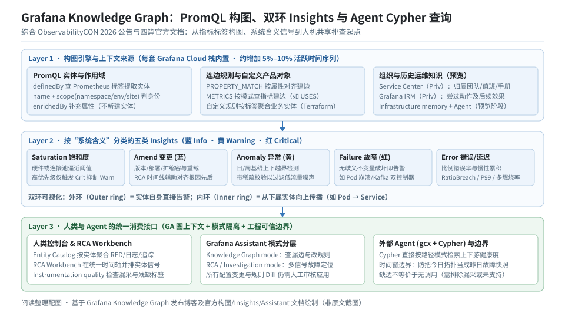
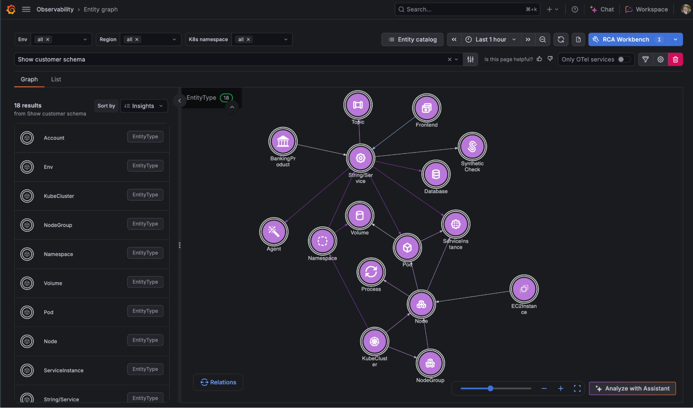
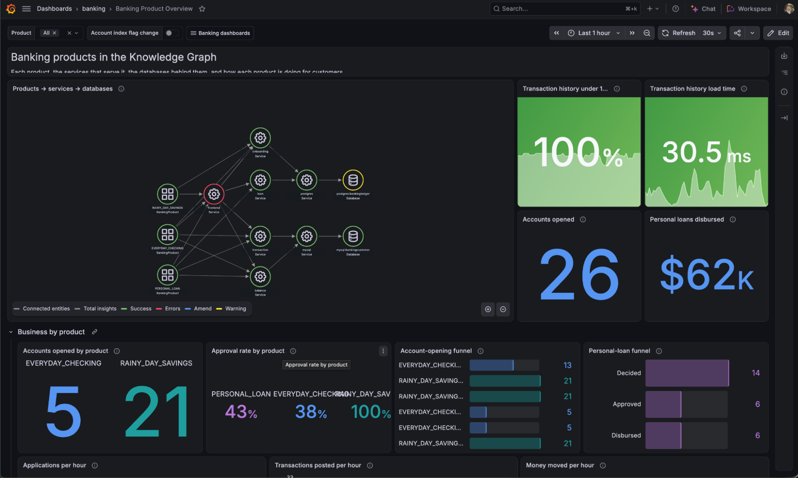

Sarah Constant（Grafana Labs）· 2026-10-20（ObservabilityCON 2026）· [原文公告](https://grafana.com/blog/full-stack-observability-with-knowledge-graph/) · 配套核对：Grafana Cloud Knowledge Graph 官方文档（[介绍](https://grafana.com/docs/grafana-cloud/knowledge-graph/) / [规则构图](https://grafana.com/docs/grafana-cloud/knowledge-graph/entity-graph/graph-rules/) / [Insights 分类](https://grafana.com/docs/grafana-cloud/knowledge-graph/insights/) / [Assistant 交互](https://grafana.com/docs/grafana-cloud/knowledge-graph/assistant/)）

值班排障长期存在两道断层：人类工程师面对服务、容器、主机和数据库四散的监控面板需要手动把因果拼起来，而接入系统的 AI Agent 又只能一轮轮试探 Prometheus 标签与调用链片段。Grafana Labs 在 ObservabilityCON 2026 公布的 **Grafana Cloud Knowledge Graph** 把可观测性系统拆成“共享的运行时架构地图 + 附着健康信号 + 组织排障记忆”三层结构——直接内置在每个 Grafana Cloud 栈中，**不单独计费**，后台构图与状态序列通常仅增加约 **`5%–10%` 的活跃时间序列（active series）**。

> **口径与实证边界说明**：本篇结合发布博客与四篇官方产品文档重写。原文给出客户 LexisNexis Risk Solutions 架构师 Neil Wilson 与银行业务案例，说明机制如何串联线索，但**未发布 MTTR 缩短比例、根因命中率或准确率对比实验数据**；同时公告原文与官方文档在“Agent Observability 实体接入”的开放阶段标注上存在版本差（下表单独标注）。

## 全栈覆盖矩阵与开放阶段差异（GA / Public Preview / Private Preview）

Knowledge Graph 不要求先全量改写应用埋点才生效，它从现有 Prometheus 指标标签、OpenTelemetry 追踪与云厂商采集数据自动建立图节点（支持通过后台配置将 OTel 追踪切换为主要构图来源），但在不同域上的成熟度差异很大，实际选型必须按阶段核对：

| 能力域 / 数据来源 | 发布博客口径（2026-10-20） | 官方文档口径（`graph-intro`） | 工程能力与适用说明 |
| :--- | :--- | :--- | :--- |
| **云资源与前端实体（AWS / GCP / Azure、Frontend Observability）** | **GA** | **GA** | 自动拉取 ECS、EC2、Cloud Run、K8s Pod/Node/Volume/Topic 与前端应用节点及关系边 |
| **自定义实体与业务规则（Custom entities & Terraform）** | **GA** | **GA** | 按 Prometheus 标签/指标把技术服务聚合到 `BankingProduct` 等业务对象 |
| **Grafana Assistant Knowledge Graph 模式与外部 Cypher/gcx 查询** | **GA** | **GA** | 人可对话修正缺边或构图规则，外部 Agent 通过 `gcx` CLI 与 **Cypher** 查询图结构与实时状态 |
| **拨测节点（Synthetic checks）** | **Public Preview** | **Public Preview** | 把外部主动拨测结果与上游入口服务相连，区分“外网入口不可达”与“内部调用故障” |
| **AI Agent 自身观测接入图谱（Agent Observability）** | **Public Preview** | **Private Preview** | **两边文档标注不一致**——博客写作 Public Preview，而文档仍标 Private Preview，开通前需以当前租户实际开关为准 |
| **Microsoft SQL Server 自动发现** | **Private Preview** | **Private Preview** | 与 MySQL、PostgreSQL、Redis、Kafka 等既成数据库/中间件同归统一图模型 |
| **Service Center 组织上下文与 Grafana Cloud IRM 历史记忆** | **Private Preview** | **Private Preview** | 引入团队归属、值班表、Runbook 以及过往同类事故里“试过的措施与实际后果” |
| **Grafana Assistant 深度调查（Investigations）整合** | **Private Preview** | **Private Preview** | 借助 `Infrastructure memory` 记住历史环境特征并在自动根因定位阶段遍历图边 |

其中 **Grafana Cloud IRM 历史记忆** 在官方样例里给出了非常具体的排障形态：在银行业务 `Everyday Checking` 故障中，知识图谱附带的历史事故记录不仅记住“重起过服务”，而且记住 **“重启最初有效但不久错误重新出现，最终回滚数据库连接池配置才彻底恢复”** ——这类“试错因果”直接决定了 Agent 再次排障时不会机械重复无效重启。

## PromQL 构图引擎、作用域隔离与三层架构

不同于只靠网络五元组嗅探的黑色拓扑工具，Grafana 在官方文档 `graph-rules` 中完整公开了构图引擎的声明式逻辑，以及支撑人与 Agent 共同读图的统一流水线：

<figure>
  <a class="note-image-link" href="/assets/images/tech/knowledge-graph-context/kg-construction-query-zh.svg" target="_blank" rel="noopener">
    
    放大图解 ↗
  </a>
  <figcaption>阅读整理配图（非原文截图）：综合 ObservabilityCON 公告与四篇官方文档绘制的构图引擎、双环健康信号与共享访问边界。</figcaption>
</figure>

这套构图机制有四个决定了后期“会不会误合并节点、能不能对齐业务影响面”的关键工程细节：

- **强制作用域防同名错并（`definedBy` + `scope`）**：每类实体用 `definedBy` 声明的 PromQL 标签查询提取，且除 `name` 外强制要求声明 **`scope`**（组合 **`namespace`、`env`、`site`**）作为联合唯一标识。这样即便生产环境与预发环境都有一个名叫 `checkout` 的服务，图引擎也不会把两条环境的边错误合并成同一节点；若只想给已有实体补充额外属性而避免生成重复节点，则使用 **`enrichedBy`** 查询。
- **两种显式关系建边规则（`PROPERTY_MATCH` 与 `METRICS`）**：当两个实体的标签值天然对应（例如集群名匹配节点组），用 `PROPERTY_MATCH`（如 `KubeCluster HOSTS NodeGroup`）按属性等值对齐；当依赖只能由流量或挂载指标证明，则用 `METRICS` 模式匹配 PromQL 指标与标签（如 `Pod USES Volume` 或网络字节流入出规则）。全部规则原生支持 **Terraform** 版本化管理。
- **实体图 schema 与 18 类内置对象**：在官方实体图谱视图中（如下图），点击顶栏 `Entity graph` 并搜索 `Show customer schema` 即可查看整张图的类型骨架——目前已把 `Frontend`、`Synthetic Check`、`Topic`、`String/Service`、`Database`、`Agent`、`Pod`、`ServiceInstance`、`Process`、`Node`、`EC2Instance`、`KubeCluster`、`NodeGroup`、`Volume`、`Namespace` 与自定义的 `BankingProduct` 连进同一张查询视图，右侧可直接切入 **`RCA Workbench`** 或点击 **`Analyze with Assistant`**。

<figure>
  <a class="note-image-link" href="/assets/images/tech/knowledge-graph-context/entities.png" target="_blank" rel="noopener">
    
    放大图解 ↗
  </a>
  <figcaption>原文配图（Grafana Labs）：Knowledge Graph 中的客户环境实体 schema 视图（Show customer schema，18 类实体节点）。</figcaption>
</figure>

- **从底层 DB 一路映射到产品营收的自定义实体**：在银行生产环境大盘示例（`custom-entities.png`）中，团队通过自定义实体规则定义了 **`RAINY_DAY_SAVINGS`、`EVERYDAY_CHECKING`、`PERSONAL_LOAN`** 三个 `BankingProduct` 节点，向上下游串联 `frontend`、`onboarding`、`loan`、`transaction`、`balance` 等微服务与后端 **`postgres:bankingledger` / `mysql:bankingcustomer`** 数据库。同一张面板里左侧看拓扑异常（`frontend` 呈现**红色双环告警**，`postgres:bankingledger` 呈现**黄色 Warning 环**），右侧同步呈现 **`30.5 ms` 交易历史加载延迟、`26` 个新开账户与 `$62K` 个人贷款放款额**，把技术故障与真实业务影响面贴在一起。

<figure>
  <a class="note-image-link" href="/assets/images/tech/knowledge-graph-context/custom-entities.png" target="_blank" rel="noopener">
    
    放大图解 ↗
  </a>
  <figcaption>官方补充配图（Grafana Labs）：基于自定义实体规则构建的银行产品知识图谱（BankingProduct → Service → Database）与业务指标联动面板。</figcaption>
</figure>

## 五类系统语义 Insights 与双环传播机制

传统监控告警大多按“每条规则各自发一条通知”堆叠噪音，而 Knowledge Graph 把原始指标、日志与部署事件归纳为 **按工程语义（implication）划分的 5 类 Insights**（对应青/蓝 Info、黄 Warning、红 Critical），并用 **双环（Dual rings）** 区分问题究竟发生在实体自身还是下属节点：

| Insight 类别 | 默认严重度 | 触发语义与覆盖对象 | 精细判定规则与降噪设计 |
| :--- | :--- | :--- | :--- |
| **`Saturation`（饱和度）** | Warning / Critical | CPU、内存、连接池等硬资源或软配额逼近上限 | 支持 **三层优先级覆盖（容器规则 > Exporter 规则 > 全局默认）**，例如全局阈值 `85%`、Redis Exporter 覆盖为 `80%`、核心实例收紧到 `70%`；一旦达到 Critical 会**自动抑制低级别 Warning**，避免双倍刷屏 |
| **`Amend`（变更）** | **Info（蓝色）** | 部署发布、副本扩缩容、Nginx/Elasticsearch 等配置重载 | 本身不是错，但会在 `RCA Workbench` 的共享时间轴上与前后错误/延迟对齐，协助确认“是不是发布刚完就出事” |
| **`Anomaly`（异常）** | **Warning（黄色）** | 相对历史日基线或周基线出现显著上/下越界 | 内置 **`erratic_and_sparse` 稀疏波动校验**，自动过滤低请求量/间歇性小服务的伪异常，并对异常低流量下跌做下界识别 |
| **`Failure`（故障）** | **Critical（红色）** | 无需人工设阈值即可判死的明确不变量破坏 | 覆盖 K8s Pod CrashLoop、`Kafka` 出现 `activecontrollercount != 1` 等跨组件（MySQL/PostgreSQL/Redis/Flux）结构性失稳状态 |
| **`Error`（错误与延迟）** | Critical | HTTP/RPC 错率飙升与慢性 P99 劣化 | 细分为 **`ErrorRatioBreach`**、基于多时间窗燃尽率（multi-burn-rate）的 **`ErrorBuildup`**、**`ErrorRatioAnomaly`**、**`InboundClientErrorAnomaly`**、**`LatencyAverageBreach`** 与 **`LatencyP99ErrorBuildup`** |

视觉层面，任何图节点周边的圆环都拆成两圈：**外环（Outer ring）代表该实体自身直接触发的健康信号**，**内环（Inner ring）代表从它的子级/下游托管实体向上传播（propagation）汇总的健康状态**。这正是上文银行仪表板里即便底层尚未全部宕机、只要 `frontend` 自身指标违背阈值又能看到子依赖连带状态的核心机制；点开任意节点就能直接调出已过滤好实体 ID 的 **RED 指标、日志、追踪与连续剖析（Profiling）**，并可在 **`RCA Workbench`** 里把故障沿线的相关实体拉到同一条时间轴叠放比对。

## Assistant 模式隔离、真实排查路径与三大工程可信边界

从运维 Agent 落地工程（`agent-reliability`）的视角看，Grafana 团队没有把一切对话全揉成一个无约束 Prompt，而是在 `graph-assistant` 中明确拆开了职责模式与审校护栏：

1. **三类对话模式分工与人工确认 Diff**：排障期使用 **`RCA assistant` / `Investigation mode`** 遍历多信号路径；专门修补图拓扑时切换为 **`Knowledge Graph mode`**——它会对比网络字节流指标与服务每秒调用数（calls/sec），帮你找出被遗漏的 **`routes` L4 流量边**、诊断因标签残缺导致的 **`Instrumentation quality`（埋点质量隐患）**，并在需要修改构图规则或加记录规则（recording rule）时**只吐出规则 Diff 建议，所有改动仍要求人类工程师审核确认**后生效。
2. **外部 Agent 直查图路径，以及 LexisNexis 的实际串线路径**：除了原生 Assistant，团队允许任何内部 Agent 通过 **`gcx` CLI** 或 **`Cypher` 图查询语句** 直接查询“从故障入口到末端存储的路径与实况健康度”。在公开客户案例中，**LexisNexis Risk Solutions 首席系统架构师 Neil Wilson** 回顾了一次复杂链路的典型收益：先是某微服务的延迟告警亮起，紧接着下游 HPCC 数据集群触发告警——Grafana Assistant 顺着 Knowledge Graph 从入口微服务逐跳向下检索依赖与下游信号，一路**追踪到真正诱因：一次对外部第三方厂商接口的调用耗尽了内部数据库连接池**，而不再是工程师盲查十几个独立 Dashboard。

不过在把类似方案（或直接接手 `Cypher` 给值班 Agent 用）投产之前，结合四篇文档必须先守住以下三条硬边界：

- **不要拿当前实时图拓扑去反推昨天的历史故障**：文档虽支持历史状态排查，但若外部 Agent 或人类没严格限定图快照时间窗口，很容易误把“今天刚拆出的新依赖边”当成“昨天凌晨发生事故时的现场路径”。
- **图上“缺边”绝对不等于架构上“真无调用”**：在宣布“某两个服务绝无交互”之前，先排查采集漏配、不支持的中间件协议（如专有二进制 RPC）或 **`Instrumentation quality`** 里已亮起的残缺标签警告。
- **它解决的是“上下文定位起点”，不替代根因实测**：官方尚未披露对照基线的人均排查耗时（MTTR）或误报率对比实验；图上下文能替 Agent 省去大量 Blind PromQL 试探，但真正修改连边规则与线上变更仍须卡在人类 Review 门后。

---

> **AI 辅助整理 · 归档注记**：本篇中文重编与对应的英文配套版（[English note](/tech/en/knowledge-graph-context/)）均由助手通读 Sarah Constant 的 ObservabilityCON 2026 发布博客及四篇 Grafana Cloud Knowledge Graph 官方文档（`graph-intro`、`graph-rules`、`graph-insights`、`graph-assistant`）逐项核对重写；保留原 `id`、`permalink`、`published_at` 与 `observability`、`agent-reliability` 双标签。保留原始 `entities.png` 截图，补充官方银行定制实体截图 `custom-entities.png` 及助手按原文与官方文档口径绘制的三层架构图 `kg-construction-query-zh.svg`（非原文截图）。