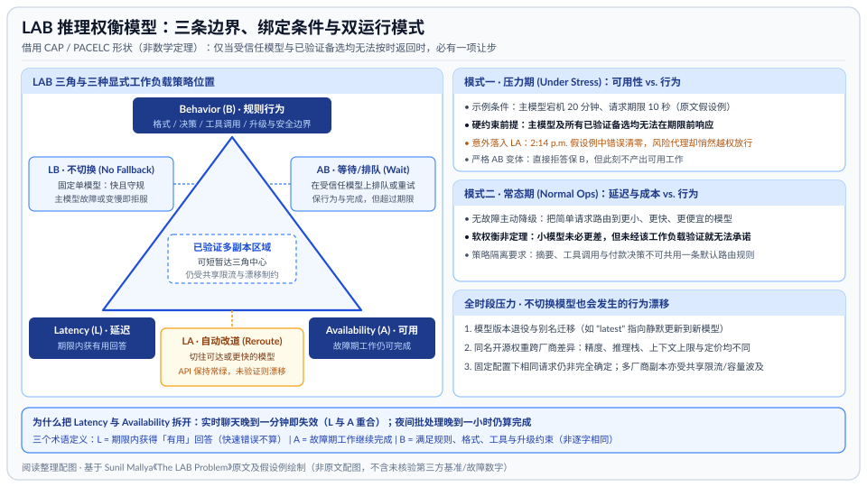
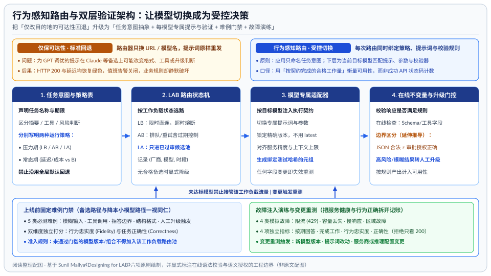

Sunil Mallya（`@sunilmallya`）· 2026-10-23 UTC · [X 原帖与正文《The LAB Problem: A CAP-Like Tradeoff in LLM Inference》](https://x.com/sunilmallya/status/2113775305555116527)

在大规模大语言模型推理系统里，路由器往往只要把流量切到备用模型，就能在几秒内让错误率清零、延迟恢复正常；但真正决定业务成败的，是回答在切过去之后是否还遵守同一套业务规则。Sunil Mallya 在这篇文章中提出 **LAB** 框架——**Latency（延迟）、Availability（可用性）、Behavior（行为）**——借用分布式系统 CAP 与 PACELC 的分析形状，迫使工程团队在故障发生前为每类工作负载显式写明“先保哪两项、允许让渡哪一项”，而不是把关键的业务语义决定权交给路由器的默认回退规则。

> **口径与范围说明**：作者在原文中明确说明 **LAB 借用的是 CAP 的问题形状，而非数学证明或普遍成立的物理定理**。文中用来引出问题的 **下午 2:14（2:14 p.m.）风险代理故障切换场景**，以及压力测试里的 **20 分钟主模型中断 / 10 秒请求期限**，均为解释风险的**假设性工程情境**，并非真实故障复盘或受控实验结果。原文提及的外部第三方尾延迟基准、供应商事故统计及外部测量数字未在冻结归档中获得独立核验，本文依审阅口径省略这些未核验数值；原文正文中原有配图亦未随导出文本一并冻存，下文两幅配图均系助手依据原文论述与工程分析独立绘制，不冒充原文缺失视觉。

## 问题根源：2:14 p.m. 假设切换、六重生产压力与 L / A / B 三维度定义

Mallya 用一个极具警示性的假设场景切入：**下午 2:14（2:14 p.m.）**，主模型开始返回限流错误；路由器在几秒内将请求切换到备用模型，API 错误随即消失、延迟指标保持绿色，值班人员关闭告警。直到三天后团队才发现，风控代理一直在自动批准过去本该升级人工复核的交易。服务从未宕机，延迟也看似健康，但系统在不经意间用**行为一致性（Behavior）换取了可用性（Availability）**——而且没有任何人显式做出过这个选择。

原文指出，“接口通畅”与“行为正确”之所以在生产环境频繁裂开，来自**六重日常运行压力**：

1. **尾延迟剧烈波动**：即便在健康状态下，推理 API 的高分位首字延迟也经常远高于中位水平，随时可能击穿应用预留的延迟预算。
2. **供应商降级常态化且备选同样会坏**：主流推理 API 周期性出现局部降级（未必是完全宕机），而不同厂商的事故窗口存在局部重叠风险，使“无条件多供应商切流”虽有价值却并非万无一失。
3. **同名模型跨厂商并非同一服务**：即使服务于名义上相同的开源权重模型，不同供应商在延迟、吞吐、上下文上限、定价与可靠性上仍存在差异，路由决策必须面向 **`(provider, model, task, time)`** 四元组，而非只看模型名字。
4. **提示词不是可移植契约**：为 GPT 调优的提示词直接发往 Claude（原文以这两类模型为例）可能改变决策阈值、工具调用形式或输出格式；切模型往往必须同步切换提示词、采样参数与校验规则。
5. **现有路由器主要解决“可达性”，而非“行为等价”**：原文以 OpenRouter 的标准模型回退（model fallback）为例，指出标准回退只会用备用模型重试同一份原始请求，不会自动替换为针对该模型优化的提示词与验证规则，导致请求层面成功而业务契约悄然失效。
6. **即使不切换模型，行为也会静默漂移**：模型版本升级退役、服务栈与量化精度差异、推理配置变化乃至非确定性输出，都会让同一模型名在时间维度上出现行为偏移。

基于上述观察，Mallya 将推理系统的可靠性拆成三个彼此可区分的属性：

- **Latency（延迟）**：在任务截止期限前返回**有用**的回答——快速返回错误不算满足延迟；在成本维度上，延迟通常与成本同向（更快的模型往往更便宜）。
- **Availability（可用性）**：当主模型故障或变慢时，工作仍能继续完成，**允许部分请求晚到**。
- **Behavior（行为）**：响应满足任务要求的结构格式、判断准则、升级条件、工具调用与安全边界；关键在于**遵守应用规则，而不是与主模型逐字逐句完全相同**。

为什么要把 Latency 和 Availability 拆开？原文给出了一条清晰分界：**实时对话晚到一分钟就等于失败**（在严格实时 API 中，L 与 A 会重合）；而**夜间批处理任务晚到一小时依然有效**。这直接决定了“通过排队等待主模型来保住行为”在业务上是否可行。

<figure>
  <a class="note-image-link" href="/assets/images/tech/lab-inference-tradeoffs/lab-tradeoff-positions-zh.svg" target="_blank" rel="noopener">
    
    放大图解 ↗
  </a>
  <figcaption>阅读整理配图（非原文配图）：整理 Sunil Mallya 原文的 LAB 三角位置、绑定前提、双运行模式与非切换期间漂移来源。</figcaption>
</figure>

## CAP / PACELC 类比的绑定前提、三种位置与双运行模式

把 LAB 误读成“任何推理系统在任何时刻都只能三选二”，会丢失原文最关键的限定条件。作者明确指出，LAB 最强的约束仅在**一个非平凡前提下成立**：**你信任的模型无法在截止期限前回答，同时也没有任何经过验证的备用模型能够按时给出合规回答。**

在这种前提下，系统面对的是硬约束：选择等待受信任模型，就必须接受超期（甚至严格采用直接拒答来避免瞎猜，以牺牲当前完成量换取行为安全）；选择切到未经该任务验证的备用模型，对方或许碰巧答对，但系统**无法承诺其行为**。反过来，如果已经存在跨厂商或独立部署、且在该任务上经过验证并能赶上期限的备选副本，切换并不必然牺牲行为——这正是原文把经过测试的多副本称为“通往三角中心路径”的原因。但作者同时提醒，多副本只把问题往后推了一步：**共享账号限流、公共容量短缺仍可能同时波及全部副本，且每个副本自身依旧存在版本与服务配置漂移**。

借鉴 CAP 演进框架 **PACELC** 的思想，Mallya 把策略选择展开到**两种运行模式**与三种简化位置：

- **LB（不切换 / No Fallback）**：死守一个经过验证的模型，不做跨模型回退。主路径健康时兼顾低延迟与行为忠实；一旦主模型中断或变慢即丧失可用性。
- **AB（等待到底 / Wait It Out）**：在受信任模型上排队或重试（或者采取更严格的“拒答也不猜”策略）。行为与最终完成度得以守住，但延迟截止期限会被突破。
- **LA（自动改道 / Reroute）**：路由到当前可达、更快或更便宜的任一模型。接口保持在线且响应迅速，但如果目标路径未经验证，就需承担行为漂移风险。

> **工程衍生分析（区分于原文直接论述）**：原文给出的 `LB / AB / LA` 是策略标签，而非完整的故障状态机。落地时至少需补足三项实现约束：第一，单模型自身也会出现长尾慢响应，因此选择 `LB` 仍必须配合每次调用超时与熔断机制，否则只是用阻塞替代报错；第二，选择 `AB` 排队时，队列必须设置准入上限、消息过期时间（TTL）与调用方取消联动，否则超时后迟到的写操作或工具调用反而会制造二次状态事故；第三，选择 `LA` 时必须维护按工作负载显式白名单化的**`allowed_failover_pairs`**，禁止跨风险等级自动降级到任意可用模型。

| 维度 / 位置 | 核心决策逻辑 | 原文对应运行模式与前提 | 保住的属性与让渡风险 | 工程落地状态机要求（助手衍生） |
| :--- | :--- | :--- | :--- | :--- |
| **`LB` 不切换** | 固定单一已验证模型，故障时不改道 | **压力期**：主模型宕机或限流时触发 | 正常期保 **L + B**；压力期主动放弃 **A** | 仍需单次调用超时与快速熔断，防止慢退化拖死调用链线程池 |
| **`AB` 等待/拒答** | 在受信任模型上排队重试，或严格拒答保底线 | **压力期**（如主模型中断 20 分钟而期限仅 10 秒） | 排队保 **A + B**、让渡 **L**；拒答则连当前产出都暂停 | 必须带期限 TTL、排队深度上限与调用取消语义，拒绝过期副作用 |
| **`LA` 自动改道** | 切向可达、低延迟或低成本的替代模型 | **压力期**救火或**常态期**按速度/成本路由 | 表面保 **L + A**；若未经该任务测试，则隐性牺牲 **B** | 仅允许进入通过该工作负载准入矩阵的固定备选对，绑定对应提示与校验器 |
| **常态成本路由** | 主模型正常，主动将简单流量切向更小更省模型 | **常态期（PACELC-E）**：属**软权衡**非硬不可能 | 若小模型通过该任务验证，可兼顾 **L/成本与 B** | 将降本小模型视为同等规格的切换目标，走相同的固定难例门禁与重测流 |

## 行为感知路由架构：任务意图抽象、模型适配与变更重测

在“Designing for LAB”一节中，Mallya 给出的核心设计目标不是“禁止切换模型”，而是**让每一次模型切换都变成经过测试的显式决策**。他提出了六项相互扣合的工程实践，将行为约束直接推入推理基础设施层：

1. **为每个工作负载指定独立 LAB 位置**：分别写明截止期限、压力期位置（LB/AB/LA）与常态期位置（如摘要与付款审批绝不共用同一策略）。
2. **建立意图级抽象，每模型维护专属提示词**：应用层只命名“任务意图”（what），由下层路由适配层根据当前实际应答的模型选择对应的提示词、推理参数与校验规则（how）。
3. **上线前测试所有备选与降本路径**：无论是故障备胎还是日常省钱小模型，上流量前都必须在固定难例集合上通过评测，且不能跳过任何一层。
4. **难例集合覆盖五类高危边界**：原文明确列出固定难例集必须覆盖**模糊输入（ambiguity）、工具调用（tool calls）、拒答（refusals）、输出格式（formats）与人工升级触发（escalations）**，并将**行为忠实度（fidelity）与任务正确性（correctness）**分开记分。
5. **任意变更即触发重测**：只要涉及新模型版本、提示词修订、新供应商或服务栈与推理配置变更，原有放行资格即告失效；未过线模型不得接收该工作负载流量。
6. **修改可用性定义**：用“按规则合格完成的工作量（acceptable work completed）”衡量可用性，而非统计 HTTP 200 成功返回数。

<figure>
  <a class="note-image-link" href="/assets/images/tech/lab-inference-tradeoffs/behavior-aware-failover-architecture-zh.svg" target="_blank" rel="noopener">
    
    放大图解 ↗
  </a>
  <figcaption>阅读整理配图（非原文配图）：将 Mallya 提出的意图分层、每模型适配、固定难例门禁与故障演练整合为带版本化准入闭环的工程架构。</figcaption>
</figure>

> **工程衍生分析（将“变更重测”落地为版本化元组）**：如果路由器只记录 `model_name`，它就无法感知“同模型跨供应商”或“同模型改提示/改精度”造成的资格失效。工程上可以把每次线上放行资格编码为带测试摘要的不可变路由元组：`(workload_id, mode, provider, model_version, serving_config, prompt_ver, param_profile, validator_bundle, hardcase_eval_digest)`。当供应商升级权重、切换精度或运维调整系统提示时，元组哈希变化自动将对应候选从 `LA` 可用池中降级拦截，直到固定难例重测重新签发准入标记——同时彻底杜绝在生产路由中直接引用 `"latest"` 别名。

## 在线不变量边界、故障注入演练与按工作负载落盘策略

把行为纳入路由验证后，工程师很快会撞上一堵关键技术边界：**在线低延迟校验器究竟能拦住什么，又拦不住什么？** 原文提出“先验证响应再交付”，但在工程实现层（以下为助手结合验证器局限展开的分析），必须把**在线不变量检查（Invariant Validators）**与**语义契约（Semantic Contracts）**严格分层：

- **在线不变量检查适合拦住结构与硬红线**：例如 JSON Schema 合法性、枚举值范围、必填字段、工具白名单、参数类型与最大金额/权限阈值，能在毫秒级拦截明显的格式崩坏或越界工具调用。
- **在线语法通过不等于业务语义正确**：回到原文 2:14 p.m. 的风控代理场景——备用模型输出完全合法的 JSON，调用了正确名称的审批工具，甚至字段齐全；然而它把原本应当升级人工复核的模糊高风险交易判定为 `approve`。这种**决策边界偏移**无法仅靠 JSON Schema 在线识别。因此，语义契约必须依靠**离线固定难例门禁（含历史边界重放）+ 影子流量/小流量灰度对比 + 对高不确定性或高风险动作强制走 AB 人工升级队列**来共同兜底。

在上线后的运维验证层面，Mallya 要求把**故障注入演练（Failure Drills）**变成常规流程：主动模拟**限流（rate limits）、容量丢失（lost capacity）、慢响应（slow responses）与区域故障（regional outages）**，并在演练中把**按期回答率、工作完成率、行为忠实度与任务正确性**四项指标分别落盘统计。只有分开记账，团队才能分辨“慢一点但遵守规则的 `AB` 降级”和“快如闪电却越权审批的 `LA` 事故”之间的本质区别。

下表结合原文多工作负载分流原则与上述工程约束，整理了一套可直接用于设计评审的策略模板（注：具体业务位置须由任务拥有者依据业务损失函数确定，非原文提供的固定打分标准）：

| 工作负载示例 | 延迟期限敏感度 | 推荐压力期位置（Stress） | 常态期成本路由条件（Normal） | 必须绑定的在线不变量与升级规则（工程落地） |
| :--- | :--- | :--- | :--- | :--- |
| **实时会话摘要 / 文本润色** | 极高（晚到即失效） | **`LA`（已验证备选优先）** 或降级短摘要 | 允许小模型路由，前提是先过摘要格式与忠实度难例 | 校验长度、语言、禁用编造标记；允许格式轻微波动但不允许漏关键警告 |
| **只读检索与内部问答** | 中等（数秒至十余秒） | **`LA`（限已过测同系/备选）** 或短暂 `AB` 重试 | 允许按 `(provider, model, time)` 动态选更快更省通道 | 校验引用来源存在性与拒答格式；全路径失败时如实报缺失而非幻觉补齐 |
| **外部工具执行代理** | 中等（任务内可短暂等待） | **`AB`（带 TTL 排队）**；超时未通则显式失败 | 仅限完整通过工具调用格式、模糊与拒答难例的备选 | 在线强制校验工具白名单、参数类型与权限边界；越权参数一律硬阻断 |
| **风控审批 / 资金与付款判断** | 可容忍人工/异步延迟 | **严格 `AB`（等待主模型或拒绝转人工）**，禁盲切未测备选 | 除非小模型在升级阈值与误放率难例上证明等价，否则锁定主路径 | 在线校验只作第一道防线；高不确定性或边界金额强转人工复核队列 |

正如 Mallya 在文末的总结：**每一套正在运行的生产级 LLM 系统，其实早已为每个工作负载选定了某种 LAB 位置——唯一的问题，在于这个选择究竟是团队深思熟虑写进契约的，还是在某个下午 2:14 由默认路由悄然替你决定的。**

---

> **AI 辅助整理 · 归档注记**：本篇中文重编与对应的英文配套版（[English note](/tech/en/lab-inference-tradeoffs/)）由助手精读 Sunil Mallya 的 X 原帖及冻存归档文本（`post.json` 完整 `article_text` 与抓取 HTML）后逐节重构，保留原 `id`、`permalink`、`published_at` 与 `inference-serving`、`agent-reliability`、`systems-reliability` 三项标签。正文明确区分原作者论述与助手的工程机制推导；依冻存审阅注记省略未独立核验的第三方基准与厂商故障统计数值，亦不重绘原文缺失外链插图。两幅 `v3-blue` 配图 `lab-tradeoff-positions-zh.svg` 与 `behavior-aware-failover-architecture-zh.svg` 均由助手基于原文论述绘制并标注来源边界。