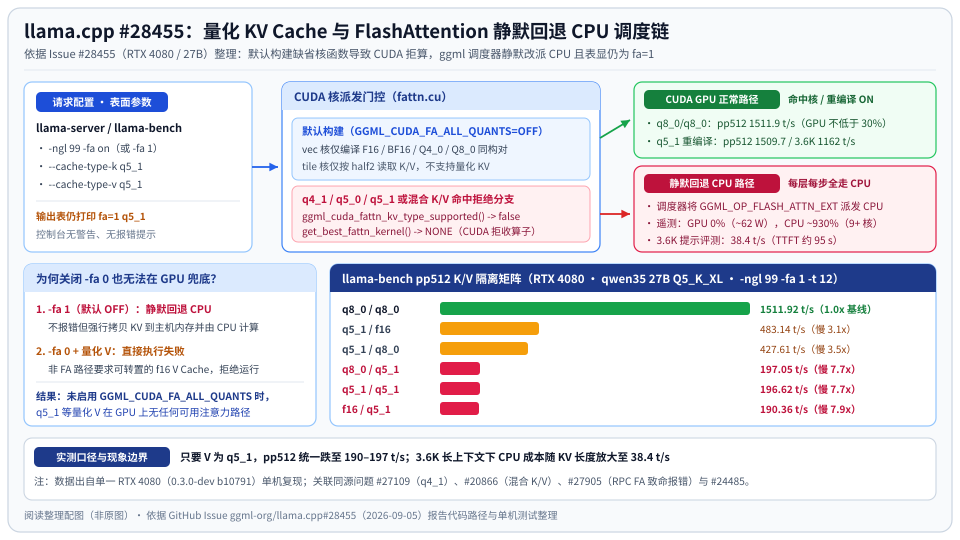
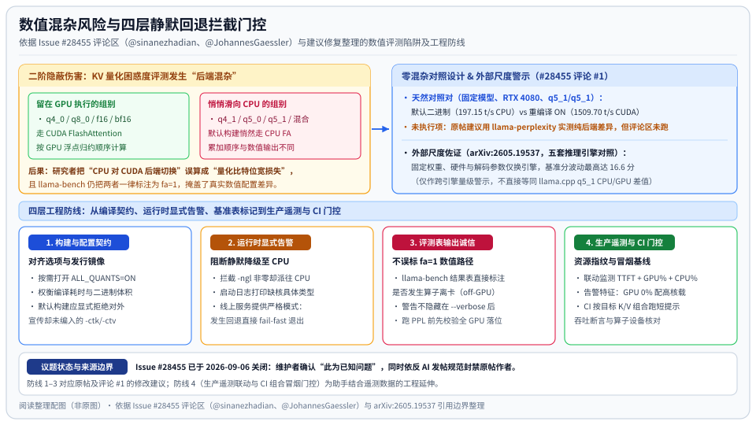

报告作者：`AhBumm` · 议题创建于 2026-09-05（2026-09-06 关闭）· [GitHub Issue #28455](https://github.com/ggml-org/llama.cpp/issues/28455) · 核心参与评论：`@sinanezhadian`（[评论 #1](https://github.com/ggml-org/llama.cpp/issues/28455#issuecomment-5554868313)）、`@JohannesGaessler`（维护者，[评论 #2](https://github.com/ggml-org/llama.cpp/issues/28455#issuecomment-5558436618)）

启动 `llama-server` 时明明传入了 `-ngl 99 -fa on`，`llama-bench` 的结果表里也赫然打印着 `fa=1 q5_1`，但请求一上长上下文，首字延迟（TTFT）却从约 `3 s` 暴涨到约 `95 s`，GPU 利用率跌至 `0%`、功耗停在约 `62 W`，而主机 CPU 却飙到约 `930%`。这份来自 `ggml-org/llama.cpp` 的问题报告揭示了一个极具欺骗性的工程陷阱：**命令行标志与基准输出表只记录了“你请求了什么配置”，并不保证对应算子“实际在哪颗硬件上执行”**。

> **口径界限与来源治理说明**：本文主来源为已冻存的 [GitHub Issue #28455](https://github.com/ggml-org/llama.cpp/issues/28455) 完整页面文本（标签 `bug-unconfirmed`，状态 `closed / completed`）。阅读时必须同时交待三项事实边界**：第一，议题治理上下文特殊**——原帖正文上方带有 `(USER WAS BANNED FOR THIS POST)` 标记，维护者 `@JohannesGaessler` 于 2026-09-06 引用仓库的 [AI 使用规范](https://github.com/ggml-org/llama.cpp/blob/master/CONTRIBUTING.md#ai-usage-policy)（严禁使用 AI 代写 bug 报告、PR 描述与讨论回复）封禁了原帖作者并关闭议题，但同时在评论中明确确认 **"This is a known issue."**，证明该静默回退机制本身属于已知真实缺陷；**第二，定量数据属于单机复现样本**——文中 `llama-bench`、`llama-server` 与 `top`/`nvidia-smi` 数据均由原帖作者在单台 Linux RTX 4080 机器（`0.3.0-dev` `b10791` / 提交 `95ef7fc16`，`27B` Q5_K 模型）上跨配置与一次重编译测得，并非官方跨硬件基准（早期原始收集队列中另有一则硬件与倍数不一致的社交帖，因不可互证已继续剔除）；**第三，困惑度影响尚属待测推论**——`@sinanezhadian` 结合 [arXiv:2605.19537](https://arxiv.org/abs/2605.19537) 指出了后端切换对数值与质量评测的混杂危害，但讨论串中并未实际运行 `llama-perplexity` 对照，下文对此作严格区分。

## 调度链根因：为何默认 CUDA 构建会把量化 KV 注意力静默交给 CPU

按原帖报告在 `0.3.0-dev`（`build 10791`，提交 `95ef7fc16`，作者另声称在当时的 `master` `6a1a922d2` / `b10819` 上依然存在）中对 `ggml/src/ggml-cuda/fattn.cu` 的源码拆解，问题并非某一版突然引入的回归，而是**编译期裁剪范围**与**运行时调度回退策略**叠加的结果：

1. **默认构建的向量核（vec kernel）白名单极窄**：当 CMake 维持默认设置 `GGML_CUDA_FA_ALL_QUANTS=OFF` 时，`fattn.cu` 仅通过 `FATTN_VEC_CASES_ALL_D` 实例化四组 K/V 同构数据类型组合——`(GGML_TYPE_F16, GGML_TYPE_F16)`、`(GGML_TYPE_Q4_0, GGML_TYPE_Q4_0)`、`(GGML_TYPE_Q8_0, GGML_TYPE_Q8_0)` 与 `(GGML_TYPE_BF16, GGML_TYPE_BF16)`。
2. **`supported()` 与 `get_best_fattn_kernel()` 联动拒收量化与混合类型**：在未定义 `GGML_CUDA_FA_ALL_QUANTS` 时，`ggml_cuda_fattn_kv_type_supported()` 对 `Q4_1`、`Q5_0`、`Q5_1` 以及不被包含的混合 K/V 组合统一返回 `false`，导致 `get_best_fattn_kernel()` 返回 `BEST_FATTN_KERNEL_NONE`。与此同时，另一条 `tile` FlashAttention 内核分支仅按 `half2` 格式读取 K/V，同样无法接手量化 KV Cache。
3. **CUDA 后端拒收后由 ggml 调度器静默改派 CPU**：当 CUDA 后端拒绝执行 `GGML_OP_FLASH_ATTN_EXT` 时，`ggml` 调度器并没有报错或中止，而是把模型**每一层、每一步推理**的 `GGML_OP_FLASH_ATTN_EXT` 算子静默分配给 **CPU 后端**执行。整个过程控制台不打印任何错误或警告。
4. **关闭 FlashAttention（`-fa 0`）同样走不通 GPU**：原帖进一步解释，当 V Cache 采用量化格式时，传入 `-fa 0` 会直接运行失败，因为非 FlashAttention 的 GPU 路径要求一个可转置的 `f16` V Cache。换言之，只要默认构建未开启 `GGML_CUDA_FA_ALL_QUANTS`，对于 `q5_1` 等量化 V 类型而言，**GPU 上根本没有任何一条可用的注意力执行路径**——开 `-fa on` 是静默退回 CPU 慢跑，关 `-fa 0` 则直接失败。

<figure class="note-figure">
  <a class="note-image-link" href="/assets/images/tech/llamacpp-kv-fallback/ggml-fa-quant-dispatch-fallback-zh.svg" target="_blank" rel="noopener" aria-label="放大查看 llama.cpp 量化 KV Cache 静默回退 CPU 调度链与 K/V 隔离实测图">
    
    点击放大 ↗
  </a>
  <figcaption>阅读整理配图（非原图）：梳理 Issue #28455 报告的 fattn.cu 编译矩阵过滤、ggml 静默回退路径、-fa 0 失效原因及六组 K/V 隔离测试表现。</figcaption>
</figure>

这一根因同样把原帖列出的几起社区关联议题串成了同一条技术脉络：原帖指出，`#24403` 早先将相关类型检查整合进 `supported()` 矩阵；`#27109` 报告的 RTX 3090 上 `qwen35` 混合架构用 `q4_1` KV 时 prefill 骤降、改用 `q4_0` 却正常的现象，正是因为 `Q4_1` 落在了与 `Q5_0`/`Q5_1` 相同的 `return false` 分支；`#20866` 反映的混合 K/V 无法驻留 GPU 源于同一份支持矩阵；`#27905` 则是 RPC 分布式场景遇到同一批未编译 KV 类型时直接触发 FA 致命错误而非退回本地 CPU；而早期提议默认打开 `GGML_CUDA_FA_ALL_QUANTS` 或增加警告的 `#24485` 曾因过期关闭，使这一陷阱得以持续留存。

从工程权衡视角看（此处为助手基于系统构建规律的补充分析，非原帖实测），`llama.cpp` 默认将 `GGML_CUDA_FA_ALL_QUANTS` 设为 `OFF` 并非无心之失：为所有 K 类型、V 类型笛卡尔组合与不同 head 维度全部生成 CUDA 模板核函数，会显著膨胀编译时间与二进制产物尺寸。真正引发生产可靠性事故的不是“默认少编译几种冷门量化核”，而是**“文档与 `--help` 对外支持这些 `-ctk/-ctv` 参数，运行时缺核却既不拒绝也不告警，反而悄悄跨 PCIe 把注意力搬回 CPU”**。

## 实测数据与尺度放大：`llama-bench` 矩阵、`llama-server` 长上下文坍塌与边界

为了证明瓶颈并非单纯由某种 KV 格式本身算力变慢所致，原帖报告者在同一台 Ubuntu 24.04 + RTX 4080（`CMAKE_CUDA_ARCHITECTURES=89`）机器上完成了四组对照观察，把表面开关、内核支持集合与硬件资源指纹彻底拆开：

- **K/V 组合隔离矩阵揭示明显的 `V` 端主导效应**：在 `llama-bench`（`pp512`，`-ngl 99 -fa 1 -t 12`，模型 `qwen35 27B Q5_K_XL`）中，同构 `q8_0 / q8_0` 跑出 `1511.92 t/s`；一旦换成任一未被默认矩阵覆盖的组合，吞吐全部断崖下跌。值得注意的是，从报告给出的数据分布来看（助手基于表内数值的规律归纳）：只要 **V Cache 为 `q5_1`**（无论是 `q8_0 / q5_1` `197.05 t/s`、`q5_1 / q5_1` `196.62 t/s` 还是 `f16 / q5_1` `190.36 t/s`），`pp512` 统一跌至 `190–197 t/s`（慢 `7.7×–7.9×`）；而 **K 为 `q5_1`、V 保持 `q8_0` 或 `f16`** 时（`427.61 t/s` 与 `483.14 t/s`），降幅为 `3.5×` 与 `3.1×`。同时，`llama-bench` 在打印这些明显跑在 CPU 上的测试行时，表格仍照常标注 `fa=1 q5_1`。
- **仅重编译 `GGML_CUDA_FA_ALL_QUANTS=ON` 即可令 `q5_1 / q5_1` 完全恢复**：在同机 `llama-bench` 对照（`qwen35 27B Q5_K - Medium`，并发列 `1`）中，保持命令和 `q5_1 / q5_1` 参数完全不变，默认构建（`ALL_QUANTS=OFF`）测得 `pp512 = 197.15 t/s`、`tg128 = 25.98 t/s`；使用 `-DGGML_CUDA=ON -DCMAKE_CUDA_ARCHITECTURES=89 -DGGML_CUDA_FA_ALL_QUANTS=ON` 重新编译后，同参数立刻回到 `pp512 = 1509.70 t/s`（约 `7.66×` 提升）与 `tg128 = 30.55 t/s`——几乎追平 `q8_0 / q8_0` 的 `1511.92 t/s`，且据报告者估算，相比 `q8_0` 还能节省约 `60%` 的 KV 显存开销。
- **`top` 与 `nvidia-smi` 给出零歧义的设备落位指纹**：在 `pp512` 运行 `q5_1` KV 时，GPU 利用率跌到 **`0%`**（功耗仅约 `62 W`），主机 CPU 占用却冲上约 **`930%`**（打满 9 个以上核心）；同一台机器跑 `q8_0` KV 时，GPU 利用率维持在 `≥ 30%`，CPU 仅占个位数百分比。这与“每次注意力前把 KV 从显存拷回主机内存、由 CPU 算完再交回”的跨设备行为高度吻合。
- **长上下文下 CPU 注意力按长度放大，把 `~7.7×` 差距拉爆成 `~30×–35×`**：在 `llama-server` 场景（`3.6K` token 提示词、`128` token 生成，命令含 `-c 131072 -np 4 --spec-type draft-mtp --spec-draft-n-max 3`）中，默认构建下 `q5_1` 的 prompt eval 跌到 **`38.4 t/s`**、decode 跌到 **`6.5 t/s`**，把原本约 `3 s` 的 TTFT 拖成约 `95 s`；同机默认构建 `q8_0` 为 `1348 t/s`（decode `30.1 t/s`），开启 `GGML_CUDA_FA_ALL_QUANTS=ON` 重编译后的 `q5_1` 则是 `1162 t/s`（decode `38.5 t/s`）。由于 CPU 注意力开销随 KV 序列长度线性增长，短 prompt 下的 7 倍多损失一旦放到数千 token 的生产对话里，极易让运维误以为“长上下文把显卡打崩了”。

| 测试工具与负载配置 | 构建选项与 K/V 类型 | 实测吞吐与延迟 / 资源指纹 | 相对基线差异与口径边界 |
| :--- | :--- | :--- | :--- |
| **`llama-bench` `pp512`（`qwen35 27B Q5_K_XL`）** | 默认 `OFF` · `q8_0 / q8_0` | `1511.92 t/s`；GPU `≥30%`、CPU 个位数% | `1.0×` 正常 GPU FA 基线（同机 RTX 4080） |
| **`llama-bench` `pp512`（混合 K/V：`K=q5_1`）** | 默认 `OFF` · `q5_1 / f16` 与 `q5_1 / q8_0` | `483.14 t/s` 与 `427.61 t/s` | 分别慢 `3.1×` 与 `3.5×`；表显仍为 `fa=1` |
| **`llama-bench` `pp512`（`V=q5_1` 三组）** | 默认 `OFF` · `q8_0/q5_1`、`q5_1/q5_1`、`f16/q5_1` | `197.05`、`196.62`、`190.36 t/s`；GPU `0%`（`~62 W`）、CPU `~930%` | 统一慢 `7.7×–7.9×`；`V=q5_1` 时整体坍塌 |
| **`llama-bench` 同参对比（`27B Q5_K - Medium`）** | 默认 `OFF` vs `ALL_QUANTS=ON`（均 `q5_1 / q5_1`） | `pp512`: `197.15` → `1509.70 t/s`；`tg128`: `25.98` → `30.55 t/s` | 固定模型、显卡与量化类型，仅靠重编译恢复 GPU 核（约 `7.66×`） |
| **`llama-server` 长提示（`3.6K` prompt, `128` gen）** | 默认 `OFF` `q5_1` vs `q8_0` vs 重编译 `ON` `q5_1` | prompt `38.4` vs `1348` vs `1162 t/s`；decode `6.5` vs `30.1` vs `38.5 t/s` | `q5_1` 默认 TTFT 由约 `3 s` 拖至约 `95 s`；含 `-np 4` 与 `draft-mtp` 配置 |

必须强调上述表格的使用边界：这五组数字全部出自单一 RTX 4080 硬件与单份 `27B` 量化权重上的单机测试，其中 `llama-server` 一组还跨了 KV 类型（`q5_1` 对比 `q8_0`）与重编译（`1162` 对比 `38.4 t/s`），**不能直接外推成“所有模型和显卡开启量化 KV 都会慢 35 倍”的通用常数**；真正可推广的是其**机制与尺度规律**：一旦发生静态核缺失引起的 CPU 回退，提示词越长、并发越高，吞吐劣化越剧烈。

## 隐蔽二阶伤害：数值等价破坏与 KV 量化质量评测混杂

如果说吞吐暴跌还能靠肉眼体感或监控曲线最终抓出来，评论区 `@sinanezhadian`（[评论 #1](https://github.com/ggml-org/llama.cpp/issues/28455#issuecomment-5554868313)）点破的二阶伤害则隐蔽得多：**静默回退 CPU 改变的不仅是速度，还有数值计算结果本身（numerics）**。

这一判断建立在三条清晰的技术推论上：

- **浮点累加顺序不同导致 logits 偏移**：CPU 端 FlashAttention 实现与 CUDA 端 FlashAttention 内核在浮点归约累加顺序与底层实现路径上并不相同。因此，在默认 CUDA 构建上运行 `-ctk q5_1 -ctv q5_1`，相比同构建的 `q8_0` 或真正的 GPU `q5_1`，输出的 logits 本质上来自**完全不同的计算后端**，而不只是“算得更慢的同一套结果”。
- **社区 KV 量化困惑度（perplexity）横评被系统性污染**：如果有人拿着默认编译的 CUDA `llama.cpp` 对各种 KV 量化类型跑困惑度对比，表面上看起来是在测“4-bit 对比 5-bit 对比 8-bit 量化到底损失多少质量”，实际上 `q4_0` 和 `q8_0` 留在了 **GPU CUDA 路径**，而 `q4_1`、`q5_0` 和 `q5_1` 却悄无声息地切换成了 **CPU 路径**——实验者把“CPU 对 CUDA 后端差异”误当成了“量化精度差异”。
- **为什么 `#28455` 已经免费搭好了理想对照组（但尚未实测）**：`@sinanezhadian` 指出，原帖在同一台 RTX 4080、同一份 `27B` 模型和完全相同的 `q5_1 / q5_1` 参数下，做出了默认二进制（`197.15 t/s` CPU）与重编译 `GGML_CUDA_FA_ALL_QUANTS=ON`（`1509.70 t/s` CUDA）这对对照样本——模型、硬件、量化格式全部固定，**唯一变量就是注意力执行后端**。在该对照对上运行 `llama-perplexity` 就能零混杂地测出纯后端数值差。不过需要如实标明**：该 `llama-perplexity` 对比在 `#28455` 关闭前并未有人实际运行，因此具体 PPL 差值目前仍属待测项，而非既定实测数值**。

为了说明“只换后端而不改权重与参数”究竟可能撬动多大幅度的评测波动，`@sinanezhadian` 在评论中援引了论文 [arXiv:2605.19537](https://arxiv.org/abs/2605.19537)（Pape、Evertz 与 Schönherr，*The Silent Hyperparameter: Quantifying the Impact of Inference Backends on LLM Reproducibility*）：在固定模型权重、解码参数和硬件的条件下，仅跨五套不同推理引擎切换后端，基准测试分数最高出现了 **16.6 个百分点**的漂移。`@sinanezhadian` 本人特意加上了严谨限定——**这是跨五套引擎在另一尺度上的结果，应视作“值得去测”的动机警示，而不能直接当作 `llama.cpp` CPU 对 CUDA FlashAttention 的预期困惑度差值**。但它足以说明：当工具链在基准表头写着 `fa=1 q5_1`、底层却悄悄换掉执行后端时，失真的不只是性能榜单，也包括所有质量与可复现性结论。

## 可观测性与工程门控：如何把“静默降级”拦截在上线与评测之前

结合原帖提出的三项上游修复建议、`@sinanezhadian` 对评测输出诚实性的补强，以及生产推理服务的通用工程护栏，可以把防范此类静默回退的措施收拢为四道递进门控：

<figure class="note-figure">
  <a class="note-image-link" href="/assets/images/tech/llamacpp-kv-fallback/silent-fallback-diagnostic-gates-zh.svg" target="_blank" rel="noopener" aria-label="放大查看数值混杂风险与四层静默回退工程防线图">
    
    点击放大 ↗
  </a>
  <figcaption>阅读整理配图（非原图）：汇总评论区揭示的困惑度后端混杂路径、arXiv 引用限定边界，以及从编译到 CI 的四层工程拦截点。</figcaption>
</figure>

| 防护层与切入时机 | 静默回退暴露出的缺口 | 证据出处与归属边界 | 可落地的检查与门控动作 |
| :--- | :--- | :--- | :--- |
| **1. 构建与镜像契约** | `--help`、文档与解析器均接受 `q4_1`/`q5_0`/`q5_1` 及混合 K/V，默认发行二进制却未编入核 | `#28455` 建议 1（支持与宣传对齐） | 按业务 KV 规格显式打开 `-DGGML_CUDA_FA_ALL_QUANTS=ON` 构建；若为控制包体积保持 `OFF`，则在参数校验阶段直接拒绝未编译类型 |
| **2. 运行时显式告警 / 严格模式** | CUDA 拒算后 `ggml` 调度器静默派 CPU，控制台零报错，用户误判为 GPU 本身慢 | `#28455` 建议 2 + 维护者确认已知问题 | 当 `-ngl > 0` 且 `-fa on` 但 `GGML_OP_FLASH_ATTN_EXT` 落到 CPU 时输出明确启动警告；线上推理建议加设“禁止关键算子回退 CPU”的 fail-fast 开关 |
| **3. 基准与质量评测表诚信** | `llama-bench` 仍打印 `fa=1 q5_1`，同时误导吞吐归因与数值/PPL 配置标识 | `@sinanezhadian` 评论 #1 + `#28455` 建议 3 | 将“算子是否离卡回退 CPU”的标记直接印在结果表行内而非仅藏于 `--verbose`；做 PPL 对比前先校验所有样本都在同一后端完成 |
| **4. 生产遥测指纹与 CI 冒烟** | 只看 TTFT 报警易在长上下文下误诊为“模型太大”，事后才发现显卡空转 | 助手基于 `#28455` 遥测与排查实践的工程延伸 | 监控面板关联 `TTFT`、`GPU 利用率/功耗` 与 `CPU 核载`（抓 `0% GPU` + `高 CPU` 特征）；CI 对每种上线 K/V 组合先跑短提示 `pp512` 吞吐与算子设备断言 |

对自建 `llama.cpp` 推理服务的团队而言，这起案例最值得沉淀为肌肉记忆的排查口诀只有一句话：**看到配置里写了 `-ngl 99 -fa on` 却出现异常长文本 TTFT 时，先看 `nvidia-smi` 利用率与主机 CPU 核数占用，再查当前二进制的 CMake 编译选项和算子实际落位，永远不要仅凭命令行参数或基准表头里的 `fa=1` 就默认注意力跑在 GPU 上**。

---

### 参考来源与核对记录

- 冻存一手主报告：`AhBumm`, *[Misc. bug: quantized KV cache (q5_x, q4_x) with -fa on silently fallback CPU attn](https://github.com/ggml-org/llama.cpp/issues/28455)*, `ggml-org/llama.cpp` GitHub Issue #28455（2026-09-05 创建，2026-09-06 关闭；内含原帖对关联议题 `#27109`、`#24485`、`#20866`、`#27905` 与 `#24403` 的交叉引用）。
- 数值等价与评测混杂评论：`@sinanezhadian`, [Issue #28455 Comment #1](https://github.com/ggml-org/llama.cpp/issues/28455#issuecomment-5554868313)（2026-09-05），及其引用的推理后端复现性研究：David Pape、Jonathan Evertz、Lea Schönherr, *[The Silent Hyperparameter: Quantifying the Impact of Inference Backends on LLM Reproducibility](https://arxiv.org/abs/2605.19537)*, arXiv:2605.19537。
- 维护者确认与治理规则：`@JohannesGaessler`, [Issue #28455 Comment #2](https://github.com/ggml-org/llama.cpp/issues/28455#issuecomment-5558436618)（2026-09-06），及仓库规范 [llama.cpp CONTRIBUTING.md — AI usage policy](https://github.com/ggml-org/llama.cpp/blob/master/CONTRIBUTING.md#ai-usage-policy)。

> **AI 辅助整理 · 归档注记**：本篇中文深度解析与配套英文版（[English note](/tech/en/llamacpp-kv-fallback/)）均由助手依据冻存的 GitHub Issue #28455 全文、两条核心评论及直接引用文献逐项核对重写，保留原 `id: llamacpp-kv-fallback`、`date: '2026-11-04'`、`permalink`、`source_url` 与规范标签（`inference-serving`、`systems-reliability`、`observability`）。原文未附官方配图，文中两幅 `v3-blue` 图解 `ggml-fa-quant-dispatch-fallback-zh.svg` 与 `silent-fallback-diagnostic-gates-zh.svg` 均由助手据报告代码路径、单机测试与评论区证据绘制，未将单机数值外推为全平台常数，亦未沿用原初收件箱中口径冲突的社交帖数字。
