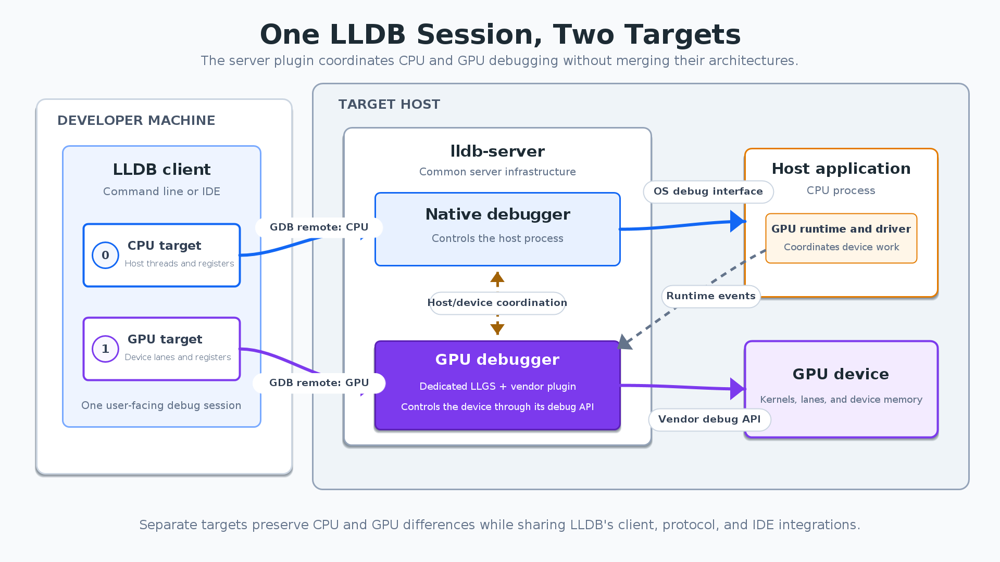

AI 应用中的错误会横跨 CPU 和 GPU：主机设置参数、加载模块、触发 kernel，设备内才发生异常。为每家 GPU 单独维护完整调试器，会重复实现命令、符号、远程协议和 IDE 集成。Meta 的这项 LLDB 扩展把公共调试基础设施与厂商设备控制拆开，让一次调试会话容纳不同架构。

原文：[Extending LLDB to Debug Applications That Span CPUs and GPUs](https://engineering.fb.com/2026/11/09/developer-tools/extending-lldb-to-debug-applications-that-span-cpus-and-gpus/)  
Greg Clayton、Satyanarayana Janga、Jeffrey Tan、Janet Yang、Bar Soloveychik、Chen Li、Vipul Bansal · 2026-11-09

## 为什么不能只增加一组 GPU 线程

传统调试器常假设一个进程对应一个指令架构和一致的内存视图。GPU 却有不同寄存器、执行 lane、模块和地址空间；相同数值地址在 CPU、GPU 可能指向完全不同对象。若强行合成一个进程，每次读内存、步进、设断点都必须额外判断目标设备，公共模型会变得难以维护。

这套方案在 LLDB 中建立两个 Target，各自关联独立的调试进程和架构。CPU 沿既有 native debugger 路径，GPU 则由加速器插件提供另一端连接。用户可以在一个 CLI/IDE 会话里切换观察对象，而内存、寄存器与停止原因仍归属于各自 Target。

<a class="note-image-link" href="/assets/images/tech/lldb-accelerators/official-1.png" target="_blank" rel="noopener" aria-label="一个 LLDB 会话中的 CPU/GPU 双 Target 与 server 插件 · 查看原图 ↗">查看原图 ↗</a>

*读图：左侧两个 Target 使用共享客户端；中间 native debugger 与 GPU 插件分别管理主机进程和设备，并通过运行时事件协调。*

## 插件如何跟上主机运行时

`lldb-server` 本来就控制主机进程并通过 GDB remote protocol 与客户端通信，因此插件放在这里最便于协调。开始时客户端发现可用插件；插件请求主机内部断点，等待 GPU runtime 达到能够初始化设备调试接口的时刻。主机命中断点后，server 通知插件，由它准备设备调试 endpoint，再让 LLDB 创建加速器 Target 并连接。

共享协议负责描述发现、初始化、模块和执行同步等动作，厂商后端把自己的设备 API 转换成线程、寄存器、内存和断点等 LLDB 概念。这样的可扩展性来自操作接口稳定，而非假设所有设备内部相同。只调 CPU 且未使用受支持 runtime 时，文章称保持既有执行路径，不引入设备调试的运行时计算开销。

## 证据是调试链路，而非吞吐倍率

原文给出一个 HIP 向量点积会话。CPU 为 x86-64 Target，设备为 amdgcn Target；GPU 函数断点起初 pending，模块加载后解析，再切到设备 Target 看到 `compute_element` 和 kernel 的调用栈。这个例子展示了模块生命周期、延迟断点与跨 Target 观察怎样串起来，比泛称“支持 GPU”更具体。

团队还提供无需专用硬件的 mock accelerator plugin，让 LLVM 测试覆盖插件发现、主机断点协调、连接创建与基本设备状态。共享测试减少公共基础设施对某家设备的依赖，但不能替代真实驱动、设备停止与内存访问的兼容测试。文章没有给出性能基准，也没有据此量化故障定位时间下降。

## 公共框架与设备实现的边界

架构覆盖实时调试与 GPU core dump，后者由公共基类承接 LLDB 集成，厂商填入设备线程、寄存器、内存与模块状态。文章称多数公共框架已经上游，余下部分仍计划提交；不能把它描述为所有 GPU 的现成完整支持。

对系统诊断，推进在于**一次会话内保留异构状态边界，同时共享可测试的基础设施**。开发者仍依赖相应厂商插件与受支持 runtime，无法用统一客户端弥补缺失的设备接口。值得跟踪后续插件覆盖、驱动兼容与 core dump 完整性，而不是把接口中立等价为底层行为一致。
