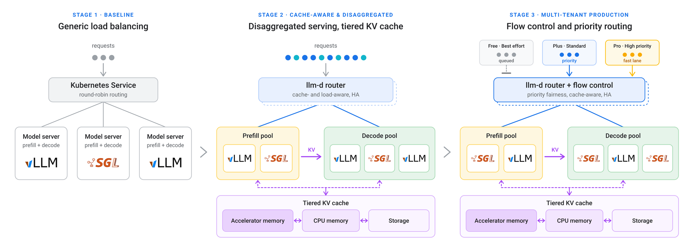
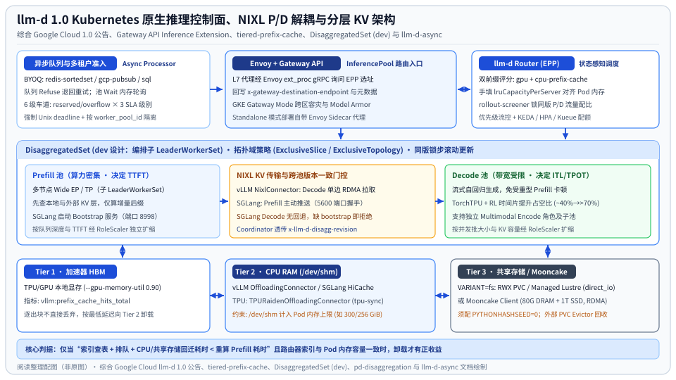
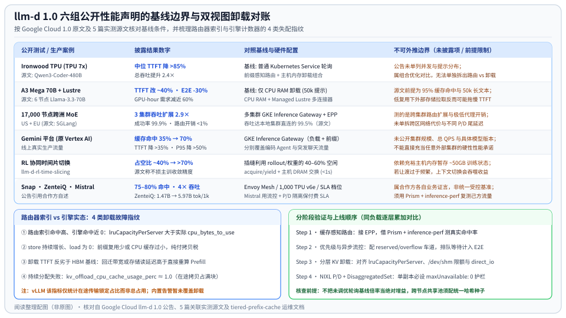

Mark Lohmeyer（VP & GM, AI & Computing Infrastructure）、Sean Horgan（Product Manager）· Google Cloud · 原文 JSON-LD 发布日期 `2026-10-20`（网页显示 `2026-10-21 +08:00`，PyTorch Conference 主题演讲发布）· [Google Cloud 1.0 官方公告](https://cloud.google.com/blog/topics/ai-infrastructure/llm-d-1-0-an-open-source-stack-for-distributed-inference/) · 配套冻存技术文档：[分层前缀缓存指南（v1.0）](https://llm-d.ai/docs/well-lit-paths/foundations/tiered-prefix-cache)、[DisaggregatedSet 设计文档（dev）](https://llm-d.ai/docs/dev/architecture/model-server-orchestration/disaggregatedset)、[Async Processor 用户指南](https://github.com/llm-d/llm-d-async)

当大模型流量从“一问一答”的聊天窗口转向多步工具调用的编码 Agent 与强化学习（RL）采样 rollout 时，推理系统的瓶颈就不再只是单台实例每秒能算多少 token。工具返回动辄携带数万 token 的重叠历史，请求按突发波峰涌入，后台批任务与交互会话又争抢同一批加速器。Google 与 Red Hat、IBM 等超过 25 个机构的 500 多位贡献者共同推动 CNCF Sandbox 项目 **llm-d 1.0** 发布，核心意图是把 PyTorch 模型服务器（`vLLM`、`SGLang`、`TorchTPU`）与 Kubernetes 调度原语（Gateway API Inference Extension、`LeaderWorkerSet`、Dynamic Resource Allocation）收拢进同一套可组合控制面，让“请求准入、缓存位置感知、阶段拆池与零中断升级”成为集群层的一等公民。

> **信源谱系与证据边界**：本文以冻存的 Google Cloud 公告正文及三份一手配套文档为骨架，并将可核验的外链实测与架构规范严格分层对待：第一层是 **1.0 发布公告与 PyTorch Conference 演讲演示**（含 GKE 上 1,000 个沙箱 Agent 演示及 Snap、ZenteiQ、Mistral 三方证言），以及公告内链的 5 篇关联博客/指南；第二层是 **v1.0 与发布版运维指南**（`tiered-prefix-cache` 与 `llm-d-async`），明确给出了 `lruCapacityPerServer` 换算公式、`/dev/shm` 容器内存耦合以及两级门控机制；第三层是标记为 **dev 未发布版本的 `DisaggregatedSet` 镜像文档**（同步自 `kubernetes-sigs/lws` 的 KEP-766/846/848/849/960/1022）及文中引用的 [`pd-disaggregation` 指南](https://llm-d.ai/docs/well-lit-paths/foundations/pd-disaggregation)——其高可用预算、滚更机制与 NIXL 握手规范在落地时必须对照实际部署版本核验，不可将公告中的“零中断升级”当作脱离配置的无条件保证。

## 请求路径与控制面：Envoy Inference Extension、EPP 调度与异步时间片

传统微服务负载均衡（例如普通 Kubernetes `Service` 轮询）假定所有后端副本无状态、处理耗时近似相同。在分布式 LLM 推理下，这种无状态假设会同时引发三重浪费：相同历史前缀在多个副本上反复重算 prefill，单卡 HBM 被重复的上下文副本塞满，以及后台高吞吐作业把交互式用户堵在队列后面。

<figure class="note-figure">
  <a class="note-image-link" href="/assets/images/tech/llm-d-1-0/serving.png" target="_blank" rel="noopener" aria-label="查看官方原图：llm-d 1.0 分布式推理能力演进示意图">
    
    查看原图 ↗
  </a>
  <figcaption>保留官方原图（出处：Google Cloud 2026-10-20 公告 Figure 1，serving.png）：展示从普通 Kubernetes 轮询到缓存/负载感知路由、P/D 解耦分层 KV 缓存与多租户优先级流控的能力演进；三列对比的是架构能力阶段，而非同负载下的受控消融曲线。</figcaption>
</figure>

在控制面实现上，`llm-d` 路由器构建于 Kubernetes 官方子项目 **Gateway API Inference Extension** 之上，利用 **`InferencePool`** 资源把同构或异构模型服务器聚合为可路由后端，并依托 **Envoy External Processing（`ext_proc`）** gRPC 协议改变请求流向：当推理请求到达 L7 网关（在 GKE 上即托管的 [GKE Inference Gateway](https://cloud.google.com/kubernetes-engine/docs/concepts/about-gke-inference-gateway#llm-d-router) 的 **Gateway Mode**；在通用 Kubernetes 上则可通过带 Envoy Sidecar 的 **Standalone Mode** 部署）时，代理并不盲目转发，而是先向 **llm-d Endpoint Picker（EPP）** 发起 `ext_proc` 调用；EPP 综合各副本的前缀命中、队列深度与预测延迟，将目标端点写回 `x-gateway-destination-endpoint` 响应头及 `dynamic_metadata`，再由 Envoy 直达最合适的模型实例。

在异构算力与多租户接入层，1.0 版本进一步补齐了三块拼图：

- **单端点纳管 TPU 与 GPU 混部**：在 PyTorch Conference 主题演讲中，Google 展示了 [Agent Substrate on GKE](https://cloud.google.com/blog/products/containers-kubernetes/bringing-you-agent-sandbox-on-gke-and-agent-substrate) 上 1,000 个沙箱 Agent 通过单个 `llm-d` 端点访问同时运行 `vLLM` 与 `SGLang` 的 Google Cloud TPU/GPU 混合池。借助 [TorchTPU](https://developers.googleblog.com/torchtpu-running-pytorch-natively-on-tpus-at-google-scale/)，PyTorch 模型无需重写即可直接跑在上游 `vLLM` 与 `SGLang` 内；`v1` API、会话感知路由、轮次优先级以及原生 Responses API 状态，使得扩缩池子或迁移加速卡型号都收口在平台层而非 Agent 代码中。
- **异步推理的 BYOQ 与两级门控**：针对端到端 SLO 在分钟级以上的延迟不敏感作业（如批量摘要、文本分类），[`llm-d-async-processor`](https://github.com/llm-d/llm-d-async) 采用“自带队列（BYOQ）”设计，支持 `redis-sortedset`（持久化优先级排序，生产推荐）、`gcp-pubsub`、`sql`（实验性 Postgres 分区租约，按截止时间排序）及已弃用的 `redis-pubsub`。其核心防过载机制把**队列级门控**与**池级门控**拆开：队列门控拒绝时直接返回 `ActionRefuse` 让 Broker 重投并释放 Worker；池级门控在共享推理池受限时返回 `ActionWait`，让 Worker 在**内存中驻留轮询**，避免频繁向消息队列 nack 造成重试风暴。配合 `classifying` 配额门控与 `tier` 标签（`interactive`、`async`、`batch`），每条 Worker Pool 合并通道按 `0: reserved/interactive` 到 `5: overflow/batch` 的 **6 条严格优先级车道**调度，并按 `worker_pool_id` 彼此隔离背压；每条消息强制携带 Unix `deadline`，仅在未超时前提下做指数退避重试，超时则明确落库为 `DEADLINE_EXCEEDED`。
- **RL 训练空闲周期的协同时间片**：强化学习后训练在 rollout 生成与梯度更新交替期间，加速器通常有 **40% 至 60%** 的空闲空转。[`llm-d-rl-time-slicing`](https://github.com/llm-d-incubation/llm-d-rl-time-slicing) 通过轻量化客户端的 `acquire()` 与 `yield()` gRPC 原语、集群级 Accelerator Orchestrator 以及节点级 Snapshot Agent，在训练阻塞间隙把约 50 GB 规模的设备状态与 CUDA 上下文快照至主机 DRAM（官方源文称切换在 1 秒内完成），把异步推理插缝塞入静默周期，从而将整体加速器占空比从约 **40% 基线提升至超过 70%**（[协同时间片专题博文](https://cloud.google.com/blog/products/containers-kubernetes/introducing-co-operative-time-slicing-for-rl-in-llm-d)）。

从工程口径来看，异步与时间片机制虽然保护了在线交互延迟，却也要求团队改变评估视角：异步任务的实际完成时间必须把 **`ActionWait` 与 Broker 重试队列里的排队等待**完整计入端到端耗时，而不是仅统计模型进入引擎后的生成耗时；同时在多租户压测时，必须分开记录交互流量的尾延迟与低优先级作业的完成率及超时丢弃率。

## 分层 KV 卸载与 NIXL P/D 解耦：内存耦合、跨池传输与双视图对账

当长上下文和多轮 Agent 会话把单卡 HBM 撑满后，`llm-d` 在存储卸载与阶段解耦两条线上协同演进，但两条路径都伴随着不可忽略的系统约束。

<figure class="note-figure">
  <a class="note-image-link" href="/assets/images/tech/llm-d-1-0/llmd-disaggregated-routing-stack-zh.svg" target="_blank" rel="noopener" aria-label="点击放大查看 llm-d 1.0 控制面、NIXL P/D 解耦与分层 KV 卸载全链路架构图">
    
    点击放大 ↗
  </a>
  <figcaption>阅读整理配图（非原图）：将 Google Cloud 1.0 公告、tiered-prefix-cache、DisaggregatedSet（dev）、pd-disaggregation 与 llm-d-async 五份规范中的控制面协议、NIXL 数据流与三级缓存约束整合为统一架构图。</figcaption>
</figure>

在**分层前缀缓存**侧，[v1.0 指南](https://llm-d.ai/docs/well-lit-paths/foundations/tiered-prefix-cache)支持三条连接器路径：`native`（推荐路径，GPU 上对应 vLLM `OffloadingConnector` 与 SGLang `HiCache`，TPU v6/v7 对应 TorchTPU 的 `TPURaidenOffloadingConnector` 即 `tpu-sync`）、`lmcache-connector`（LMCache）以及 `mooncake-store`（CPU 模式下为嵌入式 DRAM 池，加文件系统层则需部署独立的 Mooncake Client DaemonSet，将节点池配额由默认 40 GB DRAM + 500 GB SSD 调高至 **80 GB DRAM + 1 TB SSD** 并要求节点暴露 `rdma/ib: 1`）。其中四个实操细节直接决定了卸载是否真的有效：

1. **主机层 `/dev/shm` 直接计入 Pod 内存上限**：vLLM 将 CPU 卸载层存放在 `/dev/shm`，因此它和权重、运行时 RSS 共同受限于容器内存 limit。在指南的 TPU v7 单机模板（`Qwen/Qwen3.5-397B-A17B-FP8`，`DP=8 × TP=1`、262k 上下文）中，每个引擎固定 32 GiB 主机层外加 16 GiB `TPU_PREMAPPED_BUFFER_SIZE` 暂存区，Pod 需申请 `850Gi`（在 ~919 GiB 可分配内存的 `tpu7x-standard-4t` 节点上，若将单引擎扩到 64 GiB，实测 RSS 会攀升至 ~800 GiB，只余 ~50 GiB 安全垫）。
2. **共享存储层需要一致哈希、旁路页缓存与外部回收**：在 `VARIANT=fs`（支持 Managed Lustre、AWS EFS 或 CephFS 等 `ReadWriteMany` PVC）下，TPU7x `TPURaidenOffloadingConnector` 强制要求每个 Pod 设置 **`PYTHONHASHSEED=0`**——因为落盘键基于前缀块哈希生成，否则新起副本无法读取旧副本写入的 22k-token 前缀块；同时在 Lustre 等并行文件系统上必须开启 `direct_io=true` 绕过 Linux page cache，防止 KV 读取与模型权重争抢主机内存。更易被忽略的是**：连接器本身不会对共享存储层执行淘汰**，集群必须额外运行类似 `llm-d-kv-cache` 仓库中的参考 PVC Evictor 或靠存储侧配额清理陈旧块。
3. **路由器索引与引擎占用的“双视图”分裂风险**：为了把请求导向真正留有 CPU 缓存的副本，路由器会并排开启 `gpu-prefix-cache-producer` 与 `cpu-prefix-cache-producer` 两个评分器。但 **vLLM 并不会向路由器上报 CPU 层实际容量或占用率**——`vllm:kv_offload_cpu_cache_usage_perc` 指标统计的仅仅是**正在传输中的在途（in-flight）块占比**，而非静态总占用。因此运维人员必须按公式 `lruCapacityPerServer = 单 Pod CPU 层字节数 / (64 × 每 token KV 字节数)` 手工配置（例如 `Qwen3-32B` 每 token 256 KiB 时 16 MiB 对应 1 个 64-token 路由块，默认 300 GiB 对应 `19200`，100 GiB 对应 `6400`；TPU v7 262k 窗口则需把路由块改设为与 `--block-size` 对齐的 `4352` token）。一旦 `lruCapacityPerServer` 填得比实际 `cpu_bytes_to_use` 大，路由器就会把请求发往早已淘汰前缀的副本；指南更明确提示，SGLang `HiCache` 虽然导出了 `sglang:hicache_host_used_tokens / hicache_host_total_tokens`，但 vLLM 侧的内置告警规则目前尚未覆盖卸载路径。
4. **NIXL P/D 解耦的不对称传输协议**：在阶段拆分模式下，Compute-bound 的 Prefill 池与 Bandwidth-bound 的 Decode 池（及可选 Multimodal Encode 池）各自运行独立实例组，并通过 **NIXL** 经 RDMA（InfiniBand/RoCE/EFA，或降级 TCP）跨节点搬运 KV 状态。根据引用的 [`pd-disaggregation` 指南](https://llm-d.ai/docs/well-lit-paths/foundations/pd-disaggregation)，两大引擎的数据面语义并不相同**：vLLM（`NixlConnector`）采用拉取（Pull）模型**，Decode Worker 点对点直接通过单边 RDMA 从 Prefill 显存读取 KV 块，并在特定配置下保留本地自算回退能力；**SGLang 则采用推送（Push）模型**，依托 Prefill 侧的 Bootstrap 服务（默认 8998 端口）和 5600 端口侧信道完成握手后由 Prefill 主动推送 KV，且 `--disaggregation-mode=decode` 节点**没有任何本地 prefill 回退路径**——若请求未经过 Routing Proxy Sidecar 与 EPP 注入 `bootstrap_host`、`bootstrap_port` 与 `bootstrap_room` 字段，Decode 实例将直接拒收请求。

从系统工程权衡角度看（以下为依据原文机制的工程推导），分层缓存与 P/D 解耦各自遵循一条清晰的**收支平衡不等式**：只有当“索引查找耗时 + 排队等待 + CPU/Lustre 回迁传输时间”严格小于“在本地直接重算 Prefill 的时间”时，卸载才会降低 TTFT；同理，只有当“避免 Prefill 抢占 Decode 尾延迟的收益”足以覆盖“NIXL 跨节点 KV 传输耗时、额外 RDMA 网卡与协调运维复杂度”时，拆分池子才值得上场。

| 核心子系统 / 机制 | 关键协议、接口与配置面 | 必须对齐的边界与典型失效模式 |
| :--- | :--- | :--- |
| **Envoy + EPP 路由控制面** | Gateway API `InferencePool`；Envoy `ext_proc` gRPC；GKE Gateway Mode / Standalone Sidecar；回写 `x-gateway-destination-endpoint` | 若未统一启用长窗口与双前缀评分，长上下文请求仍可能落到仅存旧系统提示的冷节点 |
| **分层 KV 卸载（Tiered Prefix Cache）** | `CONNECTOR`（`native`、`lmcache-connector`、`mooncake-store`）× `VARIANT`（`cpu`、`fs`）；手工标定 `lruCapacityPerServer`；`PYTHONHASHSEED=0`、`direct_io=true` | `/dev/shm` 占满触发 Pod OOM；`lruCapacityPerServer` 偏大导致路由幻觉；共享 FS 无内置淘汰需外接 PVC Evictor；内置告警未覆盖卸载指标 |
| **NIXL P/D 角色解耦** | vLLM `NixlConnector`（Decode 单边 Pull）vs SGLang Bootstrap Push（端口 8998 / 5600）；Routing Proxy Sidecar 注入 rendezvous 元数据 | SGLang Decode 无本地回退，绕过 Proxy 必报拒收；RDMA 网络受限或低并发场景下跨池传输延迟可能吞噬解耦收益 |
| **DisaggregatedSet 编排（dev）** | `disaggregatedset.x-k8s.io/v1` 管辖子 `LeaderWorkerSet`；`ExclusiveSlice`/`ExclusiveTopology`；`RoleScaler` 与 `rollout-screener` | 默认 `maxUnavailable: 1` 会让单副本角色归零中断；跨版本 `Prefill`/`Decode` KV 不兼容需依赖 `x-llm-d-disagg-revision` 门控 |
| **Async Processor 与 RL 时间片** | `redis-sortedset`/`gcp-pubsub`/`sql`；Queue `Refuse` vs Pool `Wait`；6 级 `reserved`/`overflow` 车道；`acquire()`/`yield()` DRAM 快照 | 仅测引擎生成耗时却忽略 `ActionWait` 等待会严重低估任务端到端延迟；RL 换出 ~50 GB 状态依赖充足节点内存且忌过频切换 |

## 跨角色零中断升级：DisaggregatedSet 协调预算、分片与版本门控

当 Prefill、Decode 和 Encode 被拆成不同容器镜像、不同张量并行度乃至不同硬件代际的独立池后，“滚动升级”就不再是 Kubernetes `Deployment` 逐个替换 Pod 那么简单。在 [`DisaggregatedSet` 设计文档](https://llm-d.ai/docs/dev/architecture/model-server-orchestration/disaggregatedset)（**再次提醒：该文档明确标示为同步自 `kubernetes-sigs/lws` 的 `dev` 未发布版本规范**）中，控制面针对“局部健康但整体断流”的隐患设计了四层防线：

- **父子映射与拓扑域隔离**：`DisaggregatedSet` 并不取代 `LeaderWorkerSet`（LWS），而是作为上层编排器为每个角色生成独立子 LWS（命名遵循 `<ds>-<slice>-<rev>-<role>`，必须通过标签而非硬编码名称筛选）。借助 `spec.slices` 可把完整的 P/D/E 拓扑复制为多个独立故障域，再配合 `spec.placementPolicy` 控制调度：`ExclusiveSlice` 把同一 Slice 内的 Prefill 与 Decode 钉在同一低时延拓扑域（如 `topology.kubernetes.io/rack` 或 `cloud.google.com/gke-placement-group`）以保障 NIXL 高速互访，同时把不同 Slice 打散到不同机架隔离故障；`ExclusiveTopology` 则进一步通过注入 Pod 反亲和实现拓扑域与 Slice 的 1:1 独占（但需注意反亲和只拦截其他 `DisaggregatedSet`，若无节点污点仍可能与集群内非推理负载共享节点）。
- **单副本归零陷阱与百分比协调窗口**：LWS 沿袭的默认滚动策略 `maxSurge: 0, maxUnavailable: 1` 在多角色场景下极其危险——对于固定副本数的角色，其可用下限为 `max(0, replicas - maxUnavailable)`。如果某角色只有 1 个副本组，允许 `maxUnavailable: 1` 意味着控制器可以把唯一的旧 Prefill 摘掉，此时哪怕 Decode 池仍有多个 Ready Pod，整条服务路径也因为缺角色而**完全中断**。因此，单副本关键角色必须显式设置 `maxUnavailable: 0` 并配置正数 `maxSurge`（且集群需有富余加速卡）。此外，各角色组数通常不对称（文档以 `4 Encode、13 Prefill、7 Decode` 替换为例），控制器采用按最小非零角色组数倒数计算的**分数协调窗口**（该例宽度为 `1 / 4 = 25%`），防止某个轻量角色一马当先换完而重角色还在启动；并区分 `Deferred`（默认，等旧版彻底排空再缩容多余新版）与 `Immediate`（允许提前释放冗余旧副本或尚未调度的目标副本，但仍受 `effective desired - maxUnavailable` 保护，避免盲目删掉 Ready 组违背可用性下限）。
- **稳定扩缩靶点与子角色切分**：由于子 LWS 名称带动态 Revision Hash，直接把 HPA 或 KEDA 指向 LWS 会在每次升级时失效。`DisaggregatedSetRoleScaler`（KEP-849）为每个角色暴露持久稳定的 `/scale` 子资源 `<ds>-<role>`（目前限定在 `spec.slices: 1` 时可用）。对于共享相同镜像模板但需拆分路由池的场景，`subRoles`（KEP-960）可在同一父级 LWS 下划出如 `interactive: 3` 与 `batch: 1` 的虚拟子角色，通过 `disaggregatedset.x-k8s.io/subrole` 标签路由，并在 Hash 缩容时用 `PodDeletionCost` 尽量优先保留关键子角色（但 ReplicaSet 始终优先保活已调度的健康 Leader，属尽力而为语义）。
- **跨角色版本门控（`rollout-screener` + Coordinator）**：旧版 A 与新版 B 的 KV Cache 内存布局或 NIXL 传输协议可能互不兼容，绝对不能出现“新版 Prefill 把 KV 传给旧版 Decode”的跨版本混配。因此需要在 `llm-d` `EndpointPickerConfig` 中启用 `disaggregatedset-rollout-screener` 插件（`mode: max-role`，`requiredRoles: [prefill, decode]`）：只有当某个版本在**所有必需角色上都至少拥有 1 个 Ready Pod** 时，Screener 才允许向其导流，随后按所有合格版本中“Ready Pod 最多的那个角色”的 Pod 数量比例分配新请求概率（例如 A 有 6 个、B 有 4 个 Ready Decode Pod，则 B 分到 40% 流量——注意该权重只数 Pod 个数而非单 Pod GPU 数或实测吞吐）。如果部署了分离的 Prefill 路由器与 Decode 路由器，则由 Prefill 路由器选定版本，再由 **llm-d Coordinator** 把响应头 `x-llm-d-disagg-revision` 转发给 Decode 路由器锁定同版执行。

## 公开数字的证据边界与分阶段上线清单

Google Cloud 1.0 公告给出了多组颇具吸引力的性能倍数与生产案例，但把工程文章读厚的关键，在于**把每个百分比都放回它所对比的基线、负载特征与关联原链的限定条件中去**，而不把“从无缓存轮询到分层缓存”的收益误算成“任意已调优集群的净增量”。

<figure class="note-figure">
  <a class="note-image-link" href="/assets/images/tech/llm-d-1-0/llmd-kv-offload-benchmarks-zh.svg" target="_blank" rel="noopener" aria-label="点击放大查看 llm-d 1.0 六组公开性能基准边界与四类故障指纹图">
    
    点击放大 ↗
  </a>
  <figcaption>阅读整理配图（非原图）：逐项对齐 Google Cloud 1.0 公告及五篇关联源文中的测试基线、隐含前提与不可外推范围，并归纳 tiered-prefix-cache 的四类可观测性失配指纹。</figcaption>
</figure>

逐一核对公告正文及其超链指向的一手文档后，六组公开数字的真实有效边界如下表所示：

| 公开声明 / 案例 | 公告披露数字 | 对照基线与关联源文核对细节 | 工程外推时的有效边界与缺失信息 |
| :--- | :--- | :--- | :--- |
| **Ironwood TPU (TPU 7x) 编码 Agent** | 中位 TTFT 降幅 **超过 85%**；总吞吐增 **2.4×**（截至 2026-10） | 对比普通 Kubernetes `Service` 轮询基线；关联 [`qwen3-coder-480b` 指南](https://github.com/llm-d/llm-d/blob/main/guides/models/qwen3-coder-480b/README.md) 对应 `Qwen3-Coder-480B-A35B-Instruct-FP8`（路由标定 `peakPrefillThroughput: 16444` tok/s，长上下文多轮编码轨迹） | 公告未并列写出并发数与提示长度分布；该数字测试的是“前缀感知路由 + 主机内存卸载”**组合方案**相对基础轮询的落差，无法单独归因给路由或卸载，也不适用于无重复前缀的请求 |
| **A3 Mega 70B + Managed Lustre** | 相对仅 CPU RAM 卸载，TTFT 改善 **约 40%**、端到端延迟降 **30%**、GPU-hour 需求减近 **60%** | 50k-token 长提示场景；关联 [Managed Lustre 专题博文](https://cloud.google.com/blog/topics/developers-practitioners/scaling-llm-inference-multi-node-kv-cache-offloading-with-gke-managed-lustre) 说明实验运行在 6 节点 A3 Mega 上部署 `Llama-3.3-70B`，前提为 **95% 缓存命中率**（同时报告超 50% TCO 节省） | 强依赖超长输入且前缀复用率极高（95%）的场景；若工作负载复用率低或超出单节点读带宽，经过外部并行文件系统的冷读取反而可能劣于重算 |
| **17,000 节点跨洲 MoE 基准** | 3 集群吞吐扩展 **2.9×**；成功率 **99.9%**；路由开销 **低于 1%** | 美欧跨区域 GKE 部署 MoE 模型；关联 [多集群 IGW 博文](https://cloud.google.com/blog/products/containers-kubernetes/gpu-and-tpu-utilization-with-multi-cluster-gke-inference-gateway) 标注后端使用 SGLang，吞吐达到本地直连调用的 99.5% | 验证的是多集群 Gateway 控制面在大节点规模下的水平扩展性与极低代理损耗，未在公告中拆解跨区流量费用及不同 P/D 配比下的尾延迟 |
| **Gemini 平台（原 Vertex AI）生产流量** | 前缀缓存命中率 **35% → 70%**；编码 Agent TTFT 降幅 **超过 35%**；突发聊天 P95 TTFT 降幅 **超过 50%** | 线上真实流量接入 GKE Inference Gateway（负载 + 前缀感知路由）；关联 [Vertex AI 博文](https://cloud.google.com/blog/products/containers-kubernetes/how-gke-inference-gateway-improved-latency-for-vertex-ai) 在突发聊天场景报告了 52% P95 改善 | 未披露生产集群规模、总 QPS 与具体模型版本；反映 Google 自家托管平台从旧均衡升级后的内部实测，不可直接等同于外部集群的定额收益 |
| **RL 协同时间片切换** | 加速器总占空比从约 **40% 基线升至超过 70%** | 针对 RL rollout 与权重更新期间 40%–60% 空闲周期，利用 `acquire()`/`yield()` 与主机 DRAM 快照（约 50 GB 状态 <1s）插缝运行异步推理，[博文](https://cloud.google.com/blog/products/containers-kubernetes/introducing-co-operative-time-slicing-for-rl-in-llm-d) 声明主训收敛无损 | 要求宿主机拥有足够 DRAM 容纳被换出的训练器 CUDA 状态，且让渡点粒度过细时上下文切换开销会侵蚀净吞吐收益 |
| **Snap · ZenteiQ · Mistral 合作证言** | Snap：命中率最高 **75–80%**；ZenteiQ**：超过 4× 吞吐**（千卡 TPU v6e 日产从 **1.47B 升至 5.97B tokens**）；Mistral：高饱和下按商业优先级护航付费 SLO | 分别为三家工程团队在 Envoy Service Mesh、主权科学模型合成数据生成与商业 API 分级流量上的内部落地经验自述 | 属**合作方引述证言而非统一基线下的独立消融评测**；各自流量提示重复度与 SLA 容忍度迥异，无法替代本地复现 |

值得肯定的是，`llm-d` 社区同步提供了基于标准 [`llm-d-benchmark`](https://github.com/llm-d/llm-d-benchmark) 配方与 [`inference-perf`](https://github.com/kubernetes-sigs/inference-perf) 多轮负载的开源看板 [**Prism**](https://prism.llm-d.ai/)，允许工程师核查公布数字背后的精确 YAML 配置，或把自家集群的压测轨迹传上去横向比对吞吐、延迟与成本曲线——而不要在缺少条件对齐的情况下拿着某个倍数做容量预算。

结合公告末尾给出的四步采用路径以及冻存运维文档中的实测约束，自建推理平台在落地 `llm-d 1.0` 时最稳妥的**控变量递进顺序**如下（前 4 步结构源自原公告 Get Started 顺序，各步内的核查门控由三份一手子文档汇总提炼）：

1. **第一步只上缓存感知路由（EPP）并建立真实命中基线**：在现有 `vLLM` / `SGLang` 部署前挂接 `llm-d` 路由器，用真实多轮轨迹（务必保留工具调用之间的几十秒间隔，而非把多轮会话压成零间隔连发）测出 `vllm:prefix_cache_hits_total` 与端到端 TTFT，先确认自身业务是否存在显著重复前缀与冷热不均。
2. **第二步补齐优先级流控与异步排队边界**：一旦交互用户与批量作业混部，引入流控策略或 `llm-d-async-processor` 的 `reserved`/`overflow` 车道与固定 `worker_pool_id` 隔离，并将 `ActionWait` 与 Broker 重投等待**完整计入离线作业的端到端完成时间**，同时监控低优先级队列的 `DEADLINE_EXCEEDED` 比例。
3. **第三步按“双视图对账”上线分层 KV 卸载**：仅在 HBM 频繁淘汰长历史前缀时开启 `OffloadingConnector` / `HiCache` / `TPURaidenOffloadingConnector`。上线前把 `/dev/shm` 与暂存 buffer 算进 Pod 内存限额，手工校验 `lruCapacityPerServer` 与 `cpu_bytes_to_use` 一致，并在开启 `VARIANT=fs` 时锁死 `PYTHONHASHSEED=0`、`direct_io=true` 与外部 PVC Evictor。上线后持续比对路由器的 `llm_d_epp_prefix_indexer_hit_ratio` 与引擎的 `vllm:external_prefix_cache_hits_total`、`vllm:kv_offload_store_bytes_total / load_bytes_total / load_time_total` 及 `vllm:kv_offload_allocation_failure_total`，一旦发现“只写不读”或“卸载反拖慢 TTFT”立即止损回退。
4. **第四步最后再评估 NIXL P/D 解耦与 DisaggregatedSet 编排**：只有当长输入 Prefill 明显打断流式 Decode 的 TPOT/ITL、且 RDMA 带宽充足时，才拆出独立 Prefill 与 Decode 池；部署 `SGLang` 时严防请求绕过 Routing Proxy Sidecar 导致无回退拒收；采用仍处于 `dev` 文档阶段的 `DisaggregatedSet` 做滚更前，务必核查单副本角色已禁用 `maxUnavailable: 1`，并在 `EndpointPickerConfig` 中校验 `disaggregatedset-rollout-screener` 与 Coordinator 版本头转发生效，确保局部 Pod 就绪不会掩盖跨版本 KV 不兼容导致的全局断流。

---

### 参考来源与一手核对链接

- 主公告原文：Mark Lohmeyer & Sean Horgan, *[Announcing llm-d 1.0: Open distributed inference for agents on Google Cloud TPUs and GPUs](https://cloud.google.com/blog/topics/ai-infrastructure/llm-d-1-0-an-open-source-stack-for-distributed-inference/)*, Google Cloud Blog, 2026-10-20（页面显示 2026-10-21 +08:00）。
- 冻存一手子文档：
  - llm-d Docs (v1.0), *[Tiered Prefix Cache](https://llm-d.ai/docs/well-lit-paths/foundations/tiered-prefix-cache)*
  - llm-d Docs (dev, mirrored from `kubernetes-sigs/lws`), *[DisaggregatedSet](https://llm-d.ai/docs/dev/architecture/model-server-orchestration/disaggregatedset)*
  - llm-d GitHub, *[Async Processor (AP) - User Guide](https://github.com/llm-d/llm-d-async)*
- 公告内链引用的一手指南与基准源文：
  - llm-d Docs, *[Prefill/Decode Disaggregation](https://llm-d.ai/docs/well-lit-paths/foundations/pd-disaggregation)*；GitHub, *[Qwen3-Coder-480B Guide](https://github.com/llm-d/llm-d/blob/main/guides/models/qwen3-coder-480b/README.md)*；GitHub, *[llm-d](https://github.com/llm-d/llm-d)*、*[llm-d-benchmark](https://github.com/llm-d/llm-d-benchmark)*、*[inference-perf](https://github.com/kubernetes-sigs/inference-perf)*、*[llm-d-rl-time-slicing](https://github.com/llm-d-incubation/llm-d-rl-time-slicing)* 与 *[Prism](https://prism.llm-d.ai/)*。
  - Google Cloud / Developers 关联文章：*[Agent Substrate on GKE](https://cloud.google.com/blog/products/containers-kubernetes/bringing-you-agent-sandbox-on-gke-and-agent-substrate)*、*[GKE Inference Gateway](https://cloud.google.com/kubernetes-engine/docs/concepts/about-gke-inference-gateway#llm-d-router)*、*[TorchTPU](https://developers.googleblog.com/torchtpu-running-pytorch-natively-on-tpus-at-google-scale/)*、*[Co-operative Time-Slicing for RL](https://cloud.google.com/blog/products/containers-kubernetes/introducing-co-operative-time-slicing-for-rl-in-llm-d)*、*[How GKE Inference Gateway Improved Latency for Vertex AI](https://cloud.google.com/blog/products/containers-kubernetes/how-gke-inference-gateway-improved-latency-for-vertex-ai)*、*[Multi-Cluster GKE Inference Gateway](https://cloud.google.com/blog/products/containers-kubernetes/gpu-and-tpu-utilization-with-multi-cluster-gke-inference-gateway)* 与 *[Multi-Node KV Cache Offloading with GKE & Managed Lustre](https://cloud.google.com/blog/topics/developers-practitioners/scaling-llm-inference-multi-node-kv-cache-offloading-with-gke-managed-lustre)*。

> **AI 辅助整理 · 归档注记**：本篇中文深度解析与配套英文版（[English note](/tech/en/llm-d-1-0/)）由助手对照冻存的 Google Cloud 1.0 原文及三份一手配套技术文档逐项核对重写，保留原 `id`、`date: '2026-10-20'`、`permalink`、`published_at` 与 `inference-serving`、`systems-reliability` 规范标签；保留官方原始示意图 `serving.png`，并新增助手绘制的两幅 `v3-blue` 架构与证据边界配图（`llmd-disaggregated-routing-stack-zh.svg`、`llmd-kv-offload-benchmarks-zh.svg`）。文中明确区分了 `v1.0` 已验证指南、`dev` 镜像设计文档与未完全披露并发细节的公开基准，未补写任何未核验实验数据。
