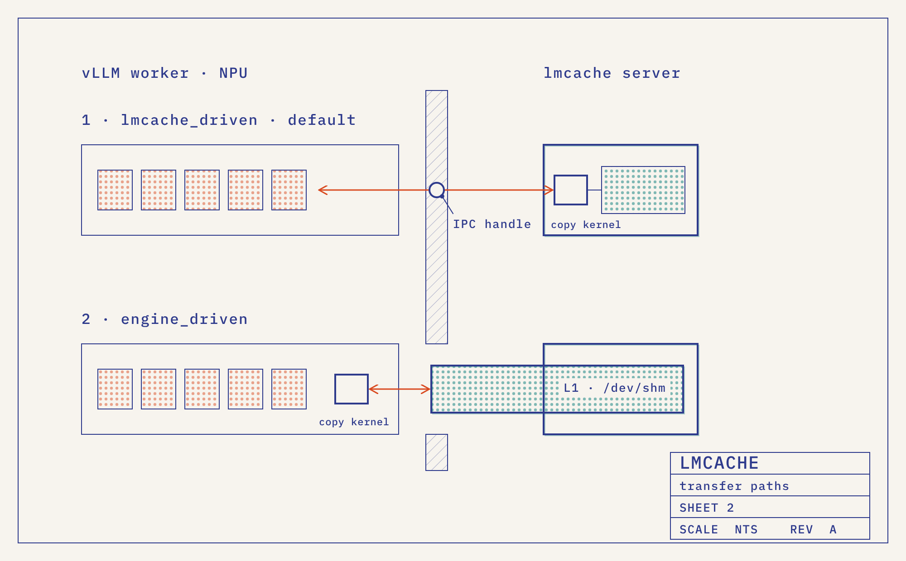

[LMCache × Ascend: Multi-Process Mode On Ascend NPUs](https://blog.lmcache.ai/en/2026/11/16/lmcache-x-ascend-part-two-multiprocess-mode-on-ascend-npus/)  
LMCache Team · 2026-11-16

LMCache 在 Ascend 上支持多进程模式，主要变化不是再加一种缓存命中算法，而是改变缓存归属：独立 lmcache server 保存 KV，vLLM 通过 LMCacheMPConnector 接入。worker 重启或退出时，仍存活的缓存服务可以保留积累的状态；多个引擎也能共享可匹配前缀。对运维而言，这将推理进程生命周期与缓存生命周期拆开。

## 为什么进程边界会改变服务行为

缓存放在引擎内部时，重启引擎通常连暖缓存一起失去。将存储、分块、取回和淘汰移入独立进程，还能把部分 Python GIL、CPU 和 I/O 工作移出调度及 decode 路径，必要的连接器协调仍留在引擎内。原文说 lookup 和 store 尽可能异步，并不意味着所有缓存操作都不阻塞。

这项设计有明确的故障边界：缓存可跨越 worker 生命周期，不等于缓存服务器自身故障后自动恢复，也不是已经完成跨节点副本容灾。共享缓存是否命中仍依赖前缀和模型配置兼容。把它理解为状态所有权的拆分，比“重启永不丢缓存”更准确。

## 两条数据路径，复制工作由谁承担

控制面默认使用轻量 ZMQ RPC，数据面有两种方式。NPU 默认的 lmcache_driven 中，worker 导出设备内存 IPC handle，服务器通过该 handle 访问 KV，并运行原生多层 block-transfer kernel 完成 gather/scatter。跨进程事件负责标明何时可以安全传输，控制消息与实际张量移动不是同一条路径。

<a class="note-image-link" href="/assets/images/tech/lmcache-ascend-mp/method.png" target="_blank" rel="noopener" aria-label="上方由服务器经 IPC 复制，下方由 worker 直接写共享 L1；控制面与张量路径分离。 · 查看原图 ↗">查看原图 ↗</a>

*上方由服务器经 IPC 复制，下方由 worker 直接写共享 L1；控制面与张量路径分离。*

engine_driven 则由 worker 自己做 gather/scatter，直接复制进双方映射的命名 /dev/shm 池，这个池就是服务器的 L1。共享内存避免额外主机中转复制，但不代表设备与主机之间没有数据搬运。它适用于单格式 GQA/MHA；DeepSeek-V4 的混合精度四平面 latent、rope、DSA indexer、scale 通过 lmcache_driven 原生处理，不需要主机重新打包或降级格式。

因此选择路径首先是布局与复制职责的匹配，不能在没有数字时认定某一路普遍更快。混合 Mamba/GDN 的状态也有自己的对齐和对象分组要求，不应当作普通 K/V 张量直接套用。

## 上游平台层与硬件插件怎样分工

这次工作把设备 IPC、跨进程事件、设备操作、多平面格式和传输模式协商纳入 LMCache 上游设备抽象，Ascend C kernel 继续由 LMCache-Ascend 提供。相比在插件中运行时打补丁，共享控制面和存储层可以沿用上游实现，硬件差异留在数据路径。

文章给出的验证范围是 Ascend 910B/910C、Atlas 800I A2/A3，模型包括 Qwen、DeepSeek-V4 和 GLM-5.3。软件配对也有要求，开发分支与发行版不能任意混搭；CANN 与插件依赖版本需要相符。DeepSeek-V4 还需要 4096-token 分块对齐，连接器会在会话开始前协商，而不是运行中任意解释块边界。

## 已验证的是功能边界，还不是性能承诺

官方验证办法通过重复长提示观察存入、取回和外部前缀命中，说明数据路径可用。文章没有报告吞吐、TTFT 或 worker 故障恢复时间的数值，所以目前不能量化“缓存进程独立”带来的端到端收益。示例关闭引擎内部前缀缓存是为了归因，不能误读为所有生产配置都应关闭它。

当前 MP 模式还不支持 CacheBlend 和 CacheGen；engine_driven 的压缩、混合布局扩展及多节点缓存仍在后续方向中。最值得关注的是可复用状态从计算进程中移出，以及两种设备传输职责如何落地。它与 Stint 的区别也清楚：Stint 保证被抢占请求恢复后有新输出机会，LMCache 此次工作解决跨引擎生命周期保存与共享，二者不能互相替代。
