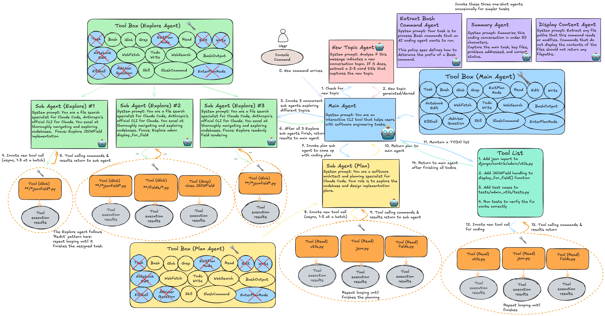
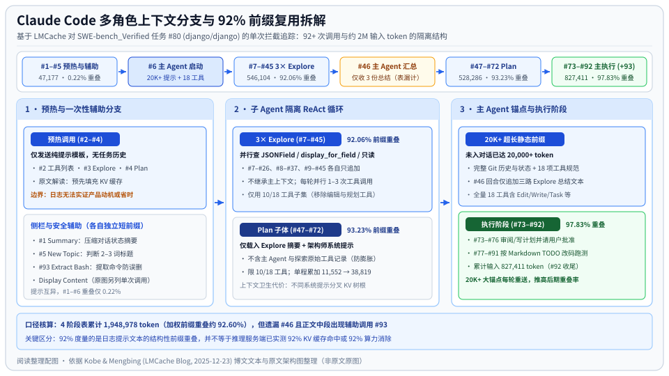
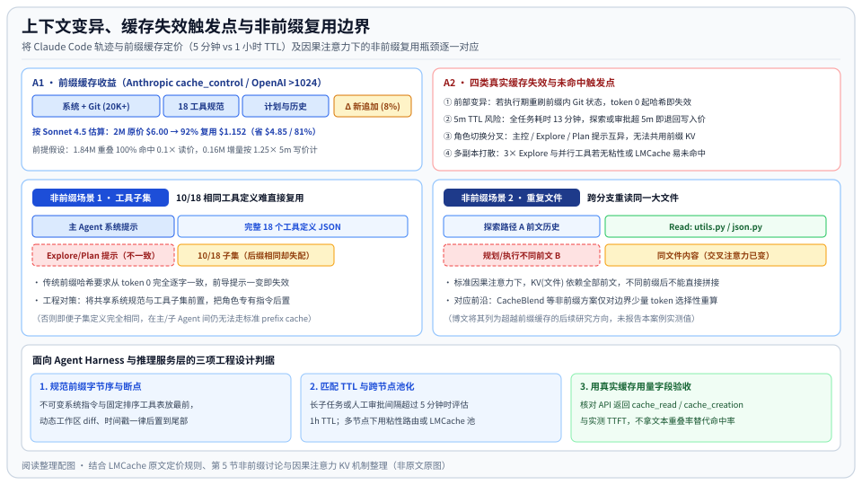

Kobe、Mengbing（LMCache Blog）· 原文发布于 2025-12-23 · [原始工程博文](https://blog.lmcache.ai/en/2025/12/23/context-engineering-reuse-pattern-under-the-hood-of-claude-code/) · 作者评论区补充追踪仓库与说明：[`kobe0938/claude-code-tracing`](https://github.com/kobe0938/claude-code-tracing) · [Notion 追踪实验笔记](https://wide-preface-8a2.notion.site/Claude-Code-tracing-30c13b4793fb80d7a26ac1def9c71388?pvs=74)

一个看起来很小的代码修复任务，背后也可能打出接近两百万 token 的累积输入流量。2025 年 12 月 23 日，LMCache 团队的 Kobe 与 Mengbing 利用 Claude Code 本地客户端可拦截流量的特性，完整录制了一次单次修复任务的 LLM 输入输出轨迹，并报告了 `92` 次调用、约 `2M` 输入 token、总耗时 `13` 分钟与 `92%` 前缀复用率。真正有工程价值的，不只是这个醒目的百分比，而是它暴露出的两层张力：**角色内只追加（append-only）循环如何造就极高的理论前缀重叠，而跨角色分支、TTL 窗口与前缀头变异又如何决定真实推理服务能不能拿到对应收益**。

> **口径与证据边界声明**：本文重写自冻存原始网页文本及原文配图 `figure.png`。需严格区分四类信源与推算层级**：第一**，样本仅为 `SWE-bench_Verified` 中随机抽取的 **1 条任务（`#80`，`django/django` 提交 `2e0f04507b17362239ba49830d26fec504d46978`）的单次运行**，不代表所有编码 Agent 或全量任务的均值分布。**第二**，原文存在一处清晰的统计口径差异：摘要与表头止于 `#92`，4 个阶段表格行（`#1–#6`、`#7–#45`、`#47–#72`、`#73–#92`）加总为 `1,948,978` token，**遗漏了主 Agent 接收探索摘要的 `#46` 调用**；而正文中段在执行期另点名了辅助调用 `#93`（`Extract Bash Command`），原文架构图 `figure.png` 还画出了一枚正文未单列编号的 `Display Content Agent`。**第三**，原文报告的 `92%` 复用率衡量的是 `claude_code_trace.jsonl` 中请求文本的**结构性前缀重叠度**，原文未报告来自服务端 API 的实测 `cache_read_input_tokens` 或实际 TTFT 延迟变化；文中 `$4.85`（降幅 `81%`）是按 Claude Sonnet 4.5 牌价做的假设性算术，而 `"5-10x"` TTFT 降幅属于行业背景叙述，并非该次实验的实测值。**第四**，作者在原文评论区给出的 LiteLLM 代理配置出现了较新的模型名（`claude-sonnet-4-6`、`claude-haiku-4-5-20251001`、`claude-opus-4-6`），属于后续回答读者复现提问时的环境配置，区别于 2025 年 12 月正文所用的 Sonnet 4.5 计价示例。

## 从本地流量拦截到多角色上下文拓扑：92+ 次调用的真实分解

与把内部调用完全隐藏在云端网关后的闭源产品（作者点名 Perplexity、Devin、Manus）不同，也不同于需要自行部署全套源码的完全开源 Agent（如 Mini SWE Agent、Terminus 2），Claude Code 采用的是“本地开源客户端 + 云端模型接口”的混合形态。作者团队借此在本地劫持流量并落盘为仅包含 LLM 输入与输出的 `claude_code_trace.jsonl`。在博文评论区回复读者询问时，作者具体披露了复现链路：在本地 `http://localhost:4000` 启动 **LiteLLM 代理服务器**，开启 `forward_client_headers_to_llm_api: true` 将 OAuth 鉴权头透传至 Anthropic，通过 `custom_callbacks.proxy_handler_instance` 落库 PostgreSQL，并在客户端设置 `ANTHROPIC_BASE_URL`、`ANTHROPIC_MODEL` 与 `ANTHROPIC_CUSTOM_HEADERS` 环境变量完成全量抓包。

被观测的任务本身非常具体：`SWE-bench_Verified` 数据集任务 `#80`，要求修复 `django/django` 仓库（commit `2e0f04507b17362239ba49830d26fec504d46978`）中后台只读 `JSONField` 渲染异常——例如 `{"foo": "bar"}` 被直接显示成 Python 字典字面量 `{'foo': 'bar'}`（非合法 JSON）；问题描述甚至已给出修复方向：在 `django.contrib.admin.utils.display_for_field` 中针对 `JSONField` 增加分支调用 `prepare_value`，而非直接调用 `json.dumps`，以兼容 `InvalidJSONInput` 情形。

即便提示已经如此聚焦，轨迹揭示的内部控制流仍远非单条对话线性推进，而是分化为三组彼此隔离的角色家族：

1. **前置预热与一次性辅助 Agent（`#1`–`#5` 及执行期辅助调用）**：真正的主工作开始之前，客户端先发出 5 次短小请求。`#1`（Summary Agent）与 `#5`（New Topic Agent）分别负责生成对话上下文摘要（原文流程图标注为控制在 50 字符内）和判断是否触发新会话标题（提取 2–3 词标题）。`#2`、`#3`、`#4` 则被作者标记为**“预热步骤（warm-up steps）”**——它们分别只输入工具列表（`#2`）、Explore 子 Agent（`#3`）和 Plan 子 Agent（`#4`）的纯提示文本，不带具体任务历史。**此处需保留来源归因边界**：作者将其解释为“为后续子 Agent 与工具表预先填充 KV 缓存以加快响应”，但仅凭输入输出日志只能证实“先发了空载提示模板”，既不能证明产品内部真实设计动机，也未给出预热前后的时延对比数据。此外，正文与原文流程图还记录了执行期按需触发的单次小模型/单轮工具策略体：包含防止未经确认误跑 `rm` 等危险指令的 **Extract Bash Command Agent（`#93`）**，以及仅在原文架构图顶部出现的 **Display Content Agent**（提取读写文件路径）。
2. **主 Agent 脊柱（`#6`、`#46`、`#73`–`#76`、`#77`–`#92`）**：主 Agent 在 `#6` 首次登场时即携带**超过 `20,000` token 的静态系统提示**（原文明确标注“尚不含对话历史”），内含完整 Git 仓库状态与历史、全部 **18 个工具**规范（原图逐一列出为 `Task`、`Bash`、`Glob`、`Grep`、`ExitPlanMode`、`Read`、`Edit`、`Write`、`NotebookEdit`、`WebFetch`、`TodoWrite`、`WebSearch`、`BashOutput`、`KillShell`、`AskUserQuestion`、`Skill`、`SlashCommand`、`EnterPlanMode`），以及执行阶段指令。它并不亲自逐个文件大海捞针，而是先分派探索，再在 `#46` 汇总探索摘要、在 `#73`–`#76` 审阅并写入 Markdown 计划（其间 `#74` 向用户澄清、`#76`–`#77` 退出规划模式等待用户交互批准），最后在 `#77`–`#91` 以计划文件作为 TODO 清单完成 `utils.py` 修改与 `tests/admin_utils/tests.py` 验证（原文图例中标为 `test_admin_utils.py` / `tests/admin_utils/tests.py`），并在 `#92` 输出最终结语。
3. **上下文隔离的子 Agent 循环（Explore `#7`–`#45` 与 Plan `#47`–`#72`）**：主 Agent 不会把自己的 `20K+` 上下文传给子 Agent。它先并行拉起 **3 个 Explore 子 Agent**（分别聚焦 `JSONField` 实现 `#7`–`#26`、`display_for_field` `#8`–`#37` 和只读字段渲染 `#9`–`#45`），每个子 Agent 拥有独立的文件搜索系统提示与 **`10/18` 工具子集**（对照原图被红叉划掉的 8 个工具：`Task`、`ExitPlanMode`、`Edit`、`Write`、`NotebookEdit`、`KillShell`、`AskUserQuestion`、`EnterPlanMode`），每步并行调用 `1–3` 个工具执行 ReAct 循环，直到 `#45` 全部结束。随后进入的 **Plan 子 Agent（`#47`–`#72`）** 同样不继承主 Agent 或 Explore 的原始工具历史，而是以软件架构师系统提示、`10/18` 工具子集与 3 份探索**摘要**重新起步，沿着 ReAct 循环从 `11,552` token 单调累加至 `38,819` token。

<figure class="note-figure">
  <a class="note-image-link" href="/assets/images/tech/lmcache-claude-code-reuse-pattern/figure.png" target="_blank" rel="noopener" aria-label="查看 LMCache 原文发布的 Claude Code 调用架构原图">
    
    查看原图 ↗
  </a>
  <figcaption>原文保留配图（来自 Kobe &amp; Mengbing, LMCache Blog, 2025-12-23）：展示主 Agent 18 项工具箱、Explore 与 Plan 剔除 8 项写/规划工具后的 10/18 子集，以及 3 路 Explore 并行扇出与一次性辅助 Agent。注：原图右侧“11. Maintain a TODO list”对应绿框标题误标为 Tool List，属作者手绘示意简化。</figcaption>
</figure>

## 拆解 92% 前缀复用：角色内只追加历史与阶段分母效应

为什么修一个只需几行改动的函数，会消耗掉将近 `2M` 输入 token？答案藏在无状态大语言模型 API 的调用方式里：**推理接口本身不替客户端保存对话状态，每推进一轮工具观察，客户端都必须把“系统提示 + 历史工具调用 + 历史工具输出 + 本轮新增增量”从头打包重发一次**。如果某条分支连续运行 `T` 轮且单轮增量大致均匀，总输入 token 量就会随轮次呈二次方（`O(T²)`）膨胀——最后一轮请求携带的前缀几乎全都在前面几十轮里发送过。

<figure class="note-figure">
  <a class="note-image-link" href="/assets/images/tech/lmcache-claude-code-reuse-pattern/claude-code-prefix-reuse-anatomy-zh.svg" target="_blank" rel="noopener" aria-label="点击放大 Claude Code 多角色上下文分支与 92% 前缀复用拆解图">
    
    点击放大 ↗
  </a>
  <figcaption>阅读整理配图（非原文配图）：将 92+ 次调用还原为各自独立增长的前缀树，并标出表格漏计的 #46 汇总步与执行期 #93 辅助调用。</figcaption>
</figure>

把原文第 2 节给出的四个阶段数据逐行展开并补充上下文隔离属性，就能看清这 `92%` 前缀复用率究竟是由哪些分母撑起来的：

| 轨迹区间 | 所属角色与上下文隔离边界 | 工具集与前缀锚点 | 原文报告总输入 token | 原文报告共享前缀比例 | 核对注记与结构成因 |
| :--- | :--- | :--- | :--- | :--- | :--- |
| **`#1`–`#6`** | 3 路预热（`#2`–`#4`）、侧栏助手（`#1`、`#5`）与主 Agent 启动（`#6`） | 各自独立短提示模板；`#6` 含 `20,000+` token 主提示与 `18` 工具 | `47,177` | `0.22%` | 各调用前缀彼此正交，几乎无共享前缀 |
| **`#7`–`#45`** | 3 个并行 **Explore** 子 Agent（`#7–#26`、`#8–#37`、`#9–#45`） | 探索者系统提示 + `10/18` 工具子集；不继承主历史 | `546,104` | `92.06%` | 每条分支内 ReAct 只追加，每次并行 `1–3` 工具 |
| **`#46`**（表外） | **主 Agent** 接收 3 路 Explore 摘要并派发 Plan | `20,000+` 主前缀 + 3 份探索总结（不含原始探索细节） | 未单列（表内遗漏） | 未报告 | 原文第 1 节明确写明 `#46` 发生交接，但阶段表跳过了该编号 |
| **`#47`–`#72`** | 1 个 **Plan** 子 Agent（单链 ReAct 规划循环） | 架构师系统提示 + 探索摘要 + `10/18` 工具；干净起点 | `528,286` | `93.23%` | 单分支输入从 `11,552` 增长到 `38,819` token，累计高重叠 |
| **`#73`–`#92`** | **主 Agent** 计划评审、写 TODO、交互审批与执行验证 | `20,000+` 主前缀 + 计划文本 + 编码/测试 ReAct 增量 | `827,411` | `97.83%` | 巨大静态锚点随 `20` 轮执行反复发送；正文另提执行期辅助 `#93` |

围绕这张表，以下三点算术核对与工程推导必须拆清（以下边界分析基于原文数据推导，非原文自述）：

- **总和与加权口径**：原文表内 4 个区间合计 `47,177 + 546,104 + 528,286 + 827,411 = 1,948,978` token，按各自权重加权平均，共享前缀约 `1,804,717 / 1,948,978 ≈ 92.60%`（与标题概括的 `~2M`、`92%` 一致）。但这里既没单列 `#46` 调用，也没有把 `#93`（`Extract Bash Command`）以及原图中未标号的 `Display Content` 纳入分阶段表——因此可以把该表当作分析轨迹形状的可靠实证结构，却不应将 `92` 次当成严谨的全链路计费审计。
- **主执行期为何高达 `97.83%`**：主 Agent 在进入历史对话前就带有超过 `20,000` token 的系统提示基座。当 `#73`–`#92` 围绕计划审批与 TODO 划项跑出 20 次请求时，每一轮新增的工具返回与思考不过数百至数千 token，而前面的 `20,000+` 静态基座与早期计划文本几乎占满分母，自然把重叠率推到 `97.83%`。
- **上下文卫生（Context Hygiene）对 KV 前缀树带来的分裂代价**：让 Explore 与 Plan 各自“净身出户”、只向主 Agent 交回摘要，在 Agent 可靠性上是极其高明的设计——它把搜索噪声挡在了主循环之外，防止上下文腐烂。然而站在推理服务端 KV 树的视角，这种隔离同时把一条单根前缀硬生生分叉成至少 5 条（1 条主根 + 3 条 Explore 根 + 1 条 Plan 根）；跨角色传摘要相当于抛弃旧前缀重起新根，而无法像单一长对话那样零断点延续到底。

## 前缀稳定性、缓存失效触发点与 TTL 定价现实

结构上有 `92%` 文本前缀相同，在真实模型服务里究竟值多少钱、又会在哪里暗中失效？原文第 3 节与第 5 节给出了核心定价机制与非前缀障碍，但要真正指导生产架构，还必须把这些规则放到这起 `13` 分钟多角色轨迹的时间线上做一次压力审校。

首先核对原文列出的三类服务端机制与经济账：

- **云厂商自动 vs. 显式缓存定价**：OpenAI Prompt Caching 对超过 **`1,024` token** 的公共前缀自动触发，读缓存享 **`90%` 折扣**（原文示例 GPT-5.2：`$1.75` 降至 `$0.175` / MTok）；Anthropic 则要求开发者显式标记 **`cache_control`** 断点，**5 分钟缓存写入加价 `1.25×`**（**1 小时缓存写入加价 `2×`**），缓存读取同样享 **`90%` 折扣**（原文示例 Claude Sonnet 4.5：基础输入 `$3.00`/MTok、5 分钟缓存写入 `$3.75`/MTok、缓存读取 `$0.30`/MTok）。
- **开源引擎前缀索引与池化**：vLLM 通过 PagedAttention 的物理块哈希实现自动前缀缓存（APC）；SGLang 通过 RadixAttention 用基数树（Radix Tree）匹配最长公共前缀；LMCache 则进一步把 KV 缓存池化到多节点内存与分层存储，放大集群级命中率。
- **原文的成本算术**：在 `2M` 输入 token、`92%` 前缀复用、Sonnet 4.5 价格前提下，无缓存成本为 `2M × $3.00 = $6.00`；套用前缀缓存后为 `1.84M × $0.30 + 0.16M × $3.75 = $0.552 + $0.600 = $1.152`，单任务省下 **`$4.85`（降幅 `81%`）**。

<figure class="note-figure">
  <a class="note-image-link" href="/assets/images/tech/lmcache-claude-code-reuse-pattern/context-mutation-cache-invalidation-zh.svg" target="_blank" rel="noopener" aria-label="点击放大上下文变异、缓存失效触发点与非前缀复用边界图">
    
    点击放大 ↗
  </a>
  <figcaption>阅读整理配图（非原文配图）：把前缀定价模型（5 分钟 vs 1 小时 TTL）、早期前缀字节漂移风险与原文第 5 节的非前缀复用限制映射到统一诊断视图。</figcaption>
</figure>

然而，如果把“文本重算比例”直接当作“账单或算力节省”，至少有四类失效触发点会让实际命中率显著低于 `92%`（以下第 1、2、4 项为基于原文参数与缓存机理的工程推导；第 3 项直接出自原文第 5 节）：

1. **前部静态块的字节级脆性（Git 状态刷新陷阱）**：原文第 4 节指出主 Agent 的 `20,000+` token 系统提示包含了完整的 **Git 仓库状态与历史**。只要前部任意字节发生变化（例如在 `#77`–`#91` 改完 `utils.py` 后，如果客户端每一轮都把最新 `git status` 或变更文件列表重绘进开头系统提示），无论是 PagedAttention 块哈希、Radix 树还是 API `cache_control` 断点，都会从 `token 0` 附近整段失配，瞬间让 `#73`–`#92` 的 `97.83%` 变成全量重算。只有把会话开始时的仓库快照固定在稳定前缀区，而把中途变更放到消息尾部追加，这个 `20K+` 锚点才能真正活过整个执行周期。
2. **`5 分钟` TTL 与 `13 分钟`总耗时的时间错配**：整条轨迹跑了 **`13` 分钟**，是 Anthropic `1.25×` 写价对应 **`5 分钟` TTL** 的两倍多。在主 Agent 发出 `#6` 后，3 路并行 Explore（`#7`–`#45`）持续运行；进入 `#76`–`#77` 前，系统还会**交互式停下来等待人类用户审批计划**。只要探索耗时或人工审批思考超过 5 分钟，主 Agent 的 `20K+` 前缀缓存就会过期淘汰，恢复时必须再付一次 `1.25×` 写费；同样，开局发出的 `#4` Plan 预热如果在漫长探索期间没有被持续命中，也会在 `#47` 真正启动前过期。若要靠 `1 小时` TTL 护航，写入单价又会从 `1.25×` 翻到 `2×`——这正是原文 `$1.152` 理想公式未计入的现实代价。
3. **非前缀（Non-Prefix）子串无法复用——原文第 5 节的两大盲区**：作者特意在末尾指出标准前缀缓存啃不动的两块硬骨头。其一，Explore 和 Plan 复用了主 Agent **`10/18` 的工具定义**，但它们挂在完全不同的子 Agent 系统提示之后；由于前导提示不一致，传统前缀哈希无法跨角色复用这 10 个工具描述的 KV 状态。其二，3 路 Explore、Plan 与主执行阶段会**反复读取同一个代码文件**（如原文流程图中的 `utils.py`、`json.py`、`fields.py`），它们在不同分支里各自出现在不同的历史工具记录之后。在标准**因果注意力（causal attention）**下，同一份文件内容计算出的 Key/Value 张量强依赖于前面所有 token，绝不能像普通文本块那样跨前缀直接拼接复用——这正是作者引出 **CacheBlend**（[`arXiv:2405.16444`](https://arxiv.org/abs/2405.16444)）等非前缀局部重算/融合研究的核心动机。
4. **并行扇出在多副本集群下的路由打散**：轨迹中不仅 3 个 Explore 子体并发起跑，每个子体内每轮还会并行发出 `1–3` 个工具调用。在多副本自建推理集群中，如果没有会话/前缀亲和调度或像 LMCache 这样的分布式跨节点 KV 池，并发请求很容易被负载均衡打到不同副本，导致原本在单机视角高达 `92%` 的前缀重叠变成频繁的跨卡冷启动 Prefill。

把原文中的核心指标与易混口径汇总如下，便于在架构评审时逐项校验：

| 观察项 / 核心数字 | 一手原文出处与测量口径 | 常见误读或隐含前提 | 对前缀哈希与服务设计的启示 |
| :--- | :--- | :--- | :--- |
| **`92` 次调用 vs. `#93` / `#46`** | 标题与摘要写 `#1`–`#92`；阶段表漏列 `#46`；正文另提 `#93`；原图另含 `Display Content` | 把 `92` 当成所有后台调用的精确穷举计数 | 抓取代理日志时须同时采集父子请求 ID、模型路由与完整响应头，避免遗漏一次性旁路体 |
| **`92%` 整体前缀复用率** | 基于 `claude_code_trace.jsonl` 输入文本前缀比对（四段加权约 `92.60%`） | 等同于生产服务端实测 KV 缓存命中率或计算量下降 `92%` | 必须对照服务端的 `cache_read` / `cache_creation` 计数与真实 TTFT，核查 TTL 淘汰与路由未命中 |
| **`$6.00` → `$1.152`（省 `81%`）** | 按 Sonnet 4.5 牌价估算 `1.84M` 读（`0.1×`）+ `0.16M` 写（`1.25×`） | 忽略 `13` 分钟会话下 `5 分钟` TTL 过期重写的潜在成本与 `1 小时`（`2×`）权衡 | 长探索或含人工审批停顿的工作流应测算“重算频率 vs `2×` 1h TTL 写费”盈亏点 |
| **“TTFT 降低 `5-10x`”** | 第 3 节介绍前缀缓存价值的通用行业背景表述 | 误以为是在这套 Claude Code Django 轨迹上测得的实测加速比 | 代理日志未公布逐轮 TTFT 分布；上线验证须在目标长度（如 `20K+`–`40K`）上实测首字延迟 |
| **预热调用 `#2`–`#4`** | 任务前发送工具表、Explore 与 Plan 纯提示；作者解释为缓存预热 | 把“观察到模板调用”当成产品内部意图与实际加速效果的既定证明 | 自研 Harness 做预热需验证冷热首轮 TTFT 差值及是否赶在 `5 分钟` TTL 过期前消费 |
| **`10/18` 工具子集与重复读文件** | 第 5 节明确指出跨角色工具子集与跨分支重读同一大文件不在传统前缀路径内 | 误以为只要文件重复读或工具名称相同，vLLM APC / RadixAttention 就能自动命中 | 共享基础前缀并把工具定义前置可转为标准前缀命中；位置漂移大文件则属 CacheBlend 适用域 |

## 面向推理服务与 Agent 上下文工程的落地启示

虽然这篇文章最初只是用一条 `SWE-bench_Verified` 案例做的“显微镜式拆解”，但它把 **Agent 上下文工程（Context Engineering）** 与 **推理服务端 KV 缓存结构（KV Prefix Architecture）** 之间的耦合关系暴露得非常彻底。对于正在构建编码 Agent Harness 或托管 Agent 推理底座的团队，可以从这条轨迹直接沉淀出四条可执行、且不需要额外猜测实验数据的工程准则：

1. **按“不可变率”从左到右严格编排提示前缀**：把全局不变的系统指令放最前，紧接着放按固定字典序序列化后的全量或通用工具 Schema（即使部分子 Agent 只启用其中 `10/18`，也可以考虑通过前缀位置对齐或权限参数隔离而非整段改写头部提示，避免在跨角色切换时直接击穿 `20K+` 前缀哈希），再放会话起步时固化的代码库概览；所有随时变化的工作树 diff、当前时间、TODO 勾选项与工具返回一律只允许在消息数组尾部追加，严禁在执行中途回去改写前部消息。
2. **用生产账单指标与时间间隔验证“假复用”**：在观测平台上不要只统计离线文本前缀重合度，而应按“角色分支 ID + 请求到达间隔”同时记录服务端返回的 `cache_read_input_tokens`、`cache_creation_input_tokens` 与真实 TTFT。一旦发现每次探索扇出（如 `#7`–`#45`）或人工计划确认（`#76`–`#77`）后的主 Agent 调用把大量 `cache_read` 退化成了 `cache_creation`，就说明 `5 分钟` TTL 已被跨步长穿，应对比评估“心跳轻刷新 / 1 小时 `2×` TTL / 压缩等待窗”三种策略的净成本。
3. **让子 Agent 的上下文隔离和 KV 路由协同工作**：像 Claude Code 这样让 Explore 与 Plan 从干净上下文出发、只向主 Agent 交回浓缩摘要，依然是控制上下文长度与推理准确率的重要结构经验；但在推理集群侧，必须为并行起跑的 3 路子 Agent 及每轮 `1–3` 个并发工具做好**分支级粘性路由**，或者部署具备统一前缀索引的**分布式 KV 共享池（如 LMCache）**，否则并行度越高、跨机冷重算越严重。
4. **分清“标准前缀缓存可解”与“需要非前缀 KV 融合”的边界**：同一角色分支内长达数十轮的 ReAct 只追加循环（占本例 `92.06%–97.83%`），完全可以靠 `OpenAI Prompt Caching`、`Anthropic cache_control`、`vLLM APC` 或 `SGLang RadixAttention` 吃下大部分收益；而跨分支重复读取同一大型源码文件或文档切片的场景，在标准因果注意力下依然会因前文不一致而未命中——这正是评估是否引入 **CacheBlend** 等非前缀选择性重算方案的精确切入点，而不是把希望寄托在盲目调大本地 LRU 缓存上。

---

### 参考来源与核对链接

- 主要分析来源：Kobe, Mengbing, *[Context Engineering & Reuse Pattern Under the Hood of Claude Code](https://blog.lmcache.ai/en/2025/12/23/context-engineering-reuse-pattern-under-the-hood-of-claude-code/)*, LMCache Blog, 2025-12-23。
- 作者评论区披露的抓包代理与追踪资料：[`kobe0938/claude-code-tracing`](https://github.com/kobe0938/claude-code-tracing) 与 [Notion Claude Code tracing 笔记](https://wide-preface-8a2.notion.site/Claude-Code-tracing-30c13b4793fb80d7a26ac1def9c71388?pvs=74)。
- 原文第 5 节具名引用的非前缀 KV 融合论文：Jincheng Yao 等人, *[CacheBlend: Fast Large Language Model Serving for RAG with Cached Knowledge Fusion](https://arxiv.org/abs/2405.16444)*, arXiv:2405.16444, 2024。

> **AI 辅助整理 · 归档注记**：本篇中文长文与对应的英文配套版（[English note](/tech/en/lmcache-claude-code-reuse-pattern/)）均由助手精读冻存原文及原图逐项核对重写，保留原 `id`、`date: '2026-11-13'`、`permalink`、`source_url`、`source_published_at` 与 `published_at` 元数据，标签严格对齐 `_data/note_tags.yml`（`coding-agents`、`inference-serving`、`observability`）。完整保留原文架构图 `figure.png`，并新增助手绘制的两幅 `v3-blue` 拆解图（`claude-code-prefix-reuse-anatomy-zh.svg`、`context-mutation-cache-invalidation-zh.svg`）。文中严格区分单次轨迹实测数据、作者假设定价算术、行业背景描述与助手工程边界推导，未捏造服务端实测命中率或延迟指标。
