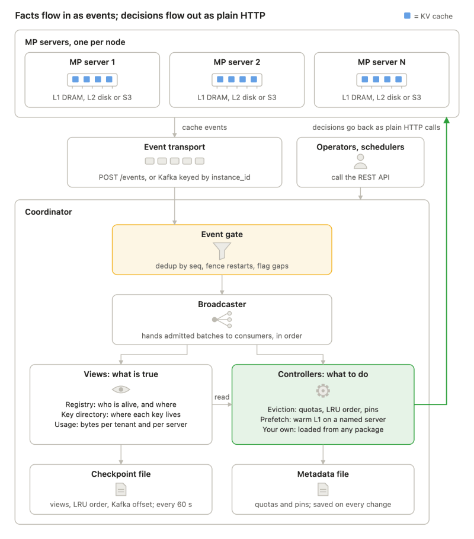

Rui Zhang · 2026-11-11  
原文：[The LMCache Coordinator: A Control Plane for Fleet-Wide KV Cache](https://blog.lmcache.ai/en/2026/11/11/the-lmcache-coordinator-a-control-plane-for-fleet-wide-kv-cache/)

同一提示词的十六个 RL 样本分散到四台机器，如果每台只知道自己的缓存，就可能做四次 prefill。LMCache Coordinator 针对的是这类跨节点盲区：缓存字节继续由各节点搬运，独立控制平面维护“谁保存了什么”和“应该保留或预取什么”。文章最值得读的部分，是目录不准确、节点重启和策略替换时系统如何退化。

## 从本机缓存到事件驱动的全局视图

MP 模式把缓存从推理引擎进程中分离，每个节点的 L1 是 CPU DRAM，L2 可以是磁盘或 S3。它能让缓存跨引擎重启存活，却没有自动形成跨节点目录。Coordinator 是可选的 FastAPI 进程；本地缓存命中无需经过它，控制平面停机时，各节点仍继续推理，全局功能等待恢复。

每个 MP server 在存储、读取或删除 chunk 时生成事件，约每秒批量发送，默认走 HTTP，也可走 Kafka。事件经过 gate 检查后广播给共享视图和控制器。registry 描述存活节点，key directory 描述位置、存储层和大小，usage 记录租户及服务器占用；LRU 顺序这类策略状态归控制器自己所有。

<a class="note-image-link" href="/assets/images/tech/lmcache-coordinator-fleet-kv/figure.png" target="_blank" rel="noopener" aria-label="LMCache 事件入口、共享视图和策略控制器 · 查看原图 ↗">查看原图 ↗</a>

*从上向下读缓存事件，再沿右侧返回的 HTTP 动作看控制器如何影响节点；底部将派生状态与运维意图分别持久化。*

控制器读这些视图，再向 MP server 现有接口发送删除或预取请求。全局目录可能有滞后，因此使用 KV 前仍需向持有节点核实。目录回答的是“可能在哪里找到”，不能替代数据持有者的有效性检查，也不意味着所有远端搬运路径已经自动部署。

## 策略插件为什么不能互相依赖

v0.5.6 起提供的功能包括成员管理、key 查找、租户 L2 配额、pin、指定节点预取和定向删除。预取将 token 序列对应的状态从 L2 装入指定节点 L1。默认配额驱逐假设所有节点共享 L2，例如同一个对象存储桶；若 L2 是本地磁盘，删除必须路由到实际持有副本的节点，需要更换控制器。

控制器可从外部 Python 包加载，并通过自己的方法声明事件消费、持久化、HTTP 接口和后台循环。替换驱逐器时要显式禁用内置实现，否则两个策略会争抢相同状态与接口。持久化段以 pins、quotas 等语义命名，使替换实现可以接续用户意图；插件包导入失败或禁用名称拼错会直接阻止启动。

设计还限制控制器只能依赖共享视图，不能调用另一个控制器的策略。这样第三方插件只需依赖稳定的事实接口，不必知道别人的内部决策。事件记录与回放则提供离线比较策略的入口，但回放效果不能直接等同于线上吞吐提升。

## 重启后，哪些缓存事实应当失效

服务器的新 incarnation 到达时，gate 撤销旧实例报告的 L1 条目，因为 DRAM 已丢失；L2 条目保留，直到删除事件说明其消失。心跳静默 30 秒后节点会被移除，检查循环每 10 秒运行。这里的关键是按存储层处理重启，而非把一个节点的所有缓存一并当作有效或无效。

每台服务器维护自己的 seq，旧序号批次被丢弃；事件应用也设计为幂等。发现序号跳跃则标记该节点视图可能过时，而不是假装缺口已恢复。没有全局时钟或跨节点总序，正确性依赖每个节点作为自身事实的单一写入方。

控制平面又把状态分成两类：目录、usage、LRU 与消费游标可从事件重建，每 60 秒及正常退出时写 checkpoint；配额和 pin 属于运维意图，每次变更立即写 metadata。Kafka offset 与视图一起保存，重启后从相匹配的位置继续。缺失或损坏 checkpoint 会冷启动；某个视图应用失败可能让视图彼此不一致，必须通过监控显露出来。

## 可用性承诺和测量边界

当前高可用是单实例快速恢复，不是热备。无事件丢失的恢复依赖足够长的 Kafka retention、持久化路径和进程存活探针。文章特别要求 Kubernetes 使用一个副本与 Recreate：RollingUpdate 短暂启动两个同组消费者，会让每个实例只收到部分事件，完整目录反而被拆开。

因此监控重点是事件缺口、视图应用失败、目录陈旧程度和后台循环进度。健康检查不因一般退化而失败，否则反复重启会丢掉已积累的视图。指标也避免把 cache key 做标签，或在抓取时锁住整个索引扫描。

这篇没有提供协调器带来多少端到端吞吐收益的对照实验。它的实质贡献是可执行的控制平面结构和故障语义；跨节点 KV 移动、分层协调器、热备及更智能策略仍包含路线图内容。读者应重点看事件 gate、checkpoint 与 controller 的边界，而不要把“全机群像一个缓存”的愿景理解成当前版本已经自动实现全部放置优化。
