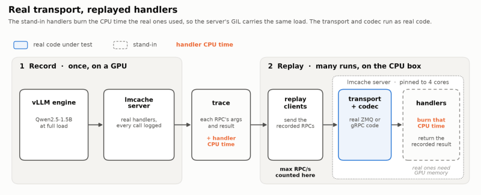

单个 vLLM 引擎的生成延迟几乎看不出传输层差异，但把多个引擎接到同一缓存服务后，CPU 会先于 GPU 成为瓶颈。Minjun Choi 的测量从一次引擎调用拆到一次控制 RPC，解释了为什么改协议实现能提高共享容量，又为什么同一改动对单引擎帮助很小。

Minjun Choi · 原文标注 2026-11-23 · [How gRPC in LMCache Closed the Gap and Surpassed ZMQ](https://blog.lmcache.ai/en/2026/11/23/grpc-in-lmcache-surpassed-zmq/)

## 先把数据传输与控制消息分开

在多进程模式下，KV 数据通过 CUDA IPC 传输。查找、存储和结束会话等小消息才走 ZMQ 或 gRPC。一个满载 1.5B 引擎每秒约发 270 次 RPC，而节点上的多个引擎往往共享一个 Python 服务进程。两种协议下服务 CPU 都在约 1.1 个核心附近趋于饱和。若在引擎侧只看生成耗时，GPU 工作会掩盖服务端在全局解释器锁下花掉的时间。

<a class="note-image-link" href="/assets/images/tech/lmcache-grpc-surpassed-zmq/lmcache-grpc-surpassed-zmq.png" target="_blank" rel="noopener" aria-label="查看原图">查看原图 ↗</a>

*左侧记录真实引擎调用，右侧用真实传输层与替代处理函数回放。*

为保留真实请求的形状，作者录下 RPC 参数、结果和处理函数占用的 CPU 时间，在真正的服务与编解码器上回放。处理函数消耗录得的 CPU 时间并返回既有结果，这样无需复制 GPU 数据也能对照控制路径。客户端从八个加到十二个，最大吞吐没有随之增加，是服务端已成瓶颈的一项检查。非饱和延迟另用原始到达节奏测量。

## 小批导出先改善长尾，事件循环再提高吞吐

性能剖析发现，指标导出每隔 0.5 秒成批占有解释器锁。改为每 0.05 秒导出更小的批次，监控仍然开启。模拟每秒 530 次 RPC 时，P99 从 229 毫秒降到 140 毫秒；每秒 265 次时，两种设置都是 32 毫秒。接着把同步服务器的接收路径换成 aio 事件循环，维持原处理线程池，同一提交下饱和吞吐从每秒 960 次升到 1,116 次。

也有改动没有兑现收益。按方法缓存响应编码器后，回放吞吐只从每秒 1,129 次变为 1,133 次。真实流量的响应很小。反而是请求键里逐个转换的 token ID 在长提示下重复花费 Python 时间，交给 protobuf 批量转换才改善了主路径。这个反例说明，微基准上显眼的成本还要乘以它在实际请求中的出现频率。

## Rust 改变的是共享服务的上限

native 模式把 HTTP/2 和 gRPC 协议处理交给锁外的 Rust，只把成批调用交回 Python 解码和执行。最终同一轮饱和回放中，每秒处理量分别为 native 1,617、ZMQ 1,322、aio 1,030、同步 gRPC 859 次。这一轮与早期逐项优化使用的提交和容器不同，不能把几张表里的绝对值连成一条加速曲线。

按每个引擎每秒 31 个请求逐步增加共享者时，aio 在十个引擎前饱和，ZMQ 大约到十五个，native 约到十五至二十个。单引擎下，各 gRPC 模式仍比 ZMQ 低几个百分点，客户端开销没有随服务端迁移而消失。项目还把真实引擎接入端到端测试，检查服务在调用中途退出时客户端能否及时报错、重启后能否继续。对于一个所有引擎都依赖的进程，故障后的恢复行为同样影响它的可用容量。
