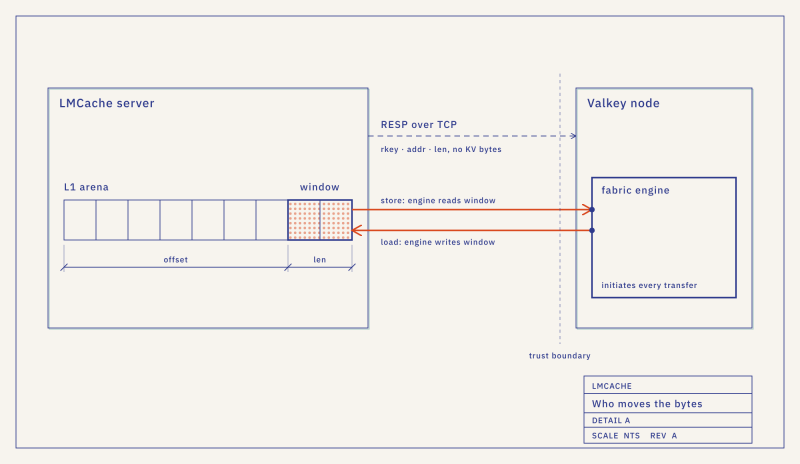

当另一个推理进程已经算过相同的前缀时，重用它首先是一次数据传输。大模型的一次请求可能涉及数百个多 MiB 的 KV 块。LMCache 原有的 Valkey 适配器已经能跨机器找到这些块，但即使客户端尽量少复制，每个块仍要经过命令缓冲区和 TCP 套接字。这次改动针对的就是这段路径。

Tony Valderrama、Karsten Wade、Ben Kugler · LMCache · 2026-11-19 · [Valkey in LMCache: Building a Fast, Shared Memory Fabric](https://blog.lmcache.ai/en/2026/11/19/valkey-in-lmcache-fast-shared-memory-fabric/)

## 存入缓存时由服务端读，取出时由服务端写

LMCache 进程在启动时向网络设备注册一片已分配的主机内存，也就是它的 L1 缓存区。每次存取仍由客户端通过 TCP 发送 RESP 命令，但命令只需标识对象及本次操作可以使用的内存窗口。存入时，Valkey 节点从窗口读取；取出时，Valkey 把内容写到窗口。两种操作的数据搬运都由 Valkey 发起。共享缓存的内存地址不必交给每一台推理主机。

<a class="note-image-link" href="/assets/images/tech/lmcache-valkey-rdma-2026-11-19/figure.png" target="_blank" rel="noopener" aria-label="客户端报告 L1 窗口，Valkey 通过独立数据通道发起读或写">查看原图 ↗</a>

*上方命令只标识窗口；下方两条线分别表示缓存节点读出和写入该窗口。*

远端可以直接写入本地内存，命中判定也就有了额外条件。对象比目标窗口大时，服务端在写入前拒绝请求；比窗口小时，固定大小的 KV 块没有完整往返，客户端按未命中处理。正常读取还会校验 CRC32C。若连接断开、没有收到完成回复，客户端不能假定远端已经停止使用窗口。它撤销注册，工作线程重新注册后重试一次。明确收到服务端错误回复则可以保留注册。这两类失败决定了同一片内存何时可以安全复用。

## 线程数也消耗内存注册额度

每个工作线程有自己的客户端，每个客户端注册整个 L1 区域，一次处理一个传输。线程共享原有内存，所以增加线程不必复制数据，却会重复占用设备的注册额度。c8gn.16xlarge 的额度是 384 GiB，八个线程各注册 32 GiB 可以容纳；在额度为 96 GiB 的 g6.8xlarge 上，八个线程各注册 16 GiB 已超限。决定并发数时，线程数乘以 L1 容量和链路带宽同样重要。

数据的生命周期由 Valkey 的 Large Object 模块管理。纯 DRAM 模式从预分配内存读写；分层模式先把对象写入 NVMe，以 DRAM 作读缓存，反复访问才提升。大对象与原 TCP 路径写入的普通值使用不同的 Valkey 类型，切换时需要不同的键前缀或节点。盘上有副本本身也不构成进程重启后的持久性保证。

## 带宽饱和以后，更大的块意味着更久的等待

作者用同一放置组内的两台 c8gn.16xlarge，各配一块 200 Gbit/s EFA，一端直接驱动 L2 适配器，另一端运行 Valkey。RDMA 组使用 DRAM 模式，TCP 对照使用普通 Valkey。每次提交 32 个键，在途请求数等于线程数；每组预热一轮，测三轮，读写分别测量。单 TCP 线程约在 8–10 Gbit/s 封顶。四个线程、每块 4 MiB 时，RDMA 写入达到 198.1 Gbit/s，读取达到 193.5 Gbit/s，对照分别为 24.7 和 36.9 Gbit/s。

保持四个线程，把读取块增到 16 MiB，带宽仅增到 197.8 Gbit/s，每次提交的中位延迟却从 22.2 升至 86.8 毫秒。在已经接近线速时，一次提交要搬四倍的数据，吞吐曲线几乎水平并不意味着等待时间也不变。这里计时的两端分别是 Valkey 和主机内存。模型执行、主机到 GPU 的复制、分层模式下的磁盘读取都在测量之外。因此这些数据可以估算搬运的上限，要回答一次请求能早多久吐出首 token，还需知道实际命中的块数和引擎重叠传输的程度。
