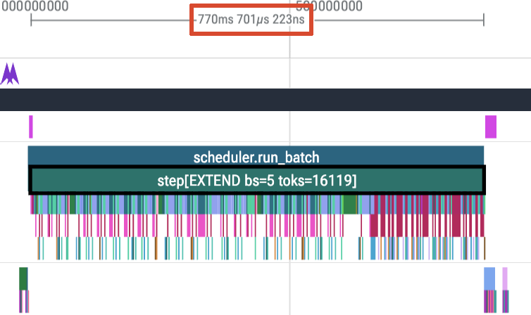

预填充和解码使用同样的四卡张量并行，对一个阶段合适，对另一个阶段却可能造成浪费。Ant International AI Infra Team 在同一台八卡 H20-3e 主机上分别给两阶段分配四卡，逐项打开优化。最值得注意的结果是平均响应时间从 13.63 秒缩短到 4.70 秒时，首 token 之后的平均每 token 时间反而从 3.20 毫秒增至 5.62 毫秒。要理解用户为何仍更早收到完整回复，得先看请求把时间花在哪里。

## 长共享前缀决定了瓶颈

256 个请求各带 61,440 个共享 token、4,096 个独有 token，生成 500 个 token，并发为 24。预热十次后清空缓存开始计时，测量期间缓存命中率为 93.21%。两组都运行相同检查点和 DSpark，KV 状态通过机内 NVLink 在两个工作进程之间传递。基线光等到首 token 就要 12.04 秒，几乎占满用户的整个等待时间。因此，减少预填充排队比单纯缩短一个解码步更有杠杆。

<a class="note-image-link" href="/assets/images/tech/lmsys-deepseek-v41-flash-h20-pd-colocate/figure.png" target="_blank" rel="noopener" aria-label="专家并行预填充的时间线显示了多项内核交错执行的区间。">查看原图 ↗</a>

*专家并行预填充的时间线显示了多项内核交错执行的区间。*

## 同一模型的两个阶段怎样分工

预填充可以把一个长请求的 token 行交错分给四卡，让四张卡都参与同一请求。解码时每个请求只有少量新行，与其让各卡处理同一请求的一部分，不如让各卡分别负责不同请求的注意力和词表输出。仅改变这两处分工，端到端均值已降至 7.55 秒，首 token 用时降至 5.16 秒。另一项大头是 Indexer：在选择稀疏注意力所需的键之前，要先给可见键打分。作者将打包的键集中读取并转为 FP8，用 DeepGEMM 在 Hopper 上计算分数，均值进一步降至 5.29 秒。

改用 FP8 还带来一个正确性问题。Indexer 给键排序，哪怕数值误差很小，只要位于选择边界附近，进入注意力的块就可能变化。团队在一条 64K 提示的八个 Indexer 层抽查 64 个查询行；采样的 16,774,528 个键值均未触发截断，但 BF16 与 DeepGEMM 的 top-k 集合重合率为 99.08%。没有数值溢出和候选集合完全相同，是两种不同强度的判断。

## 优化预填充会改变解码看到的负载

之后的步骤包括对可捕获部分回放 CUDA Graph、改变专家并行方式、扩大打分分块以及复用验证阶段的键。预填充队列的中位数从基线的 15 个请求逐步降到零。更多请求因此更早进入解码，固定并发下完成一个请求又会释放客户端名额。从最后的逐 token 时间不能反推解码内核单独变慢了同样多。完整配置的输出吞吐从每秒 847 增至 2,465 个 token，而 P99 整体延迟从约 21.31 秒降至 10.07 秒。逐步加速也没有处处相乘：融合预填充选择和写回后，首 token 有改善，该步骤的端到端均值却基本持平。

时间线还解释了为什么更慢的专家矩阵乘法有时反而有利。专家并行下，少数热门专家所在的卡忙到最后，其他卡已经在等集合通信。把一个专家切到四卡上，其矩阵乘法可能慢一些，却能缩短整批完成时间。两份各五个请求、约 1.6 万 token 的预填充采样分别用时约 771 和 657 毫秒。对照没有使用 DeepEP 或 MegaMoE 的 all-to-all，因此结果界定了这套后端上的取舍。可中断 CUDA Graph 同样有前期成本：该配置每个预填充 rank 约需 14.5 GB 捕获显存，捕获约 388 秒，常驻服务和频繁冷启动会给这笔成本不同的权重。

## 四卡共置换来了什么

把两阶段放回一个四卡工作进程，优化后平均 7.96 秒、总吞吐每秒 1,483 个输出 token。八卡分离配置整机更快，但共置每卡约 371 token/s，高于分离的 308。选择取决于要买的是单次响应时间还是单位卡产出。准确性检查中，GSM8K 的 1,314 道计分题从答对 1,268 道变为 1,267 道，64K 检索两组均为 10/10。这能界定此负载上的精度检查范围；长共享前缀、并发度和同机互联同样应随性能数字一起保留。

Siyuan Chen, Bingjia Wang, Bofeng Jiang, Yongxu Ai, Kaixin Shen · 2026-11-19 · [Optimizing DeepSeek-V4.1-Flash PD & Colocate Serving on H20-3e](https://www.lmsys.org/blog/2026-11-19-deepseek-v41-h20/)
