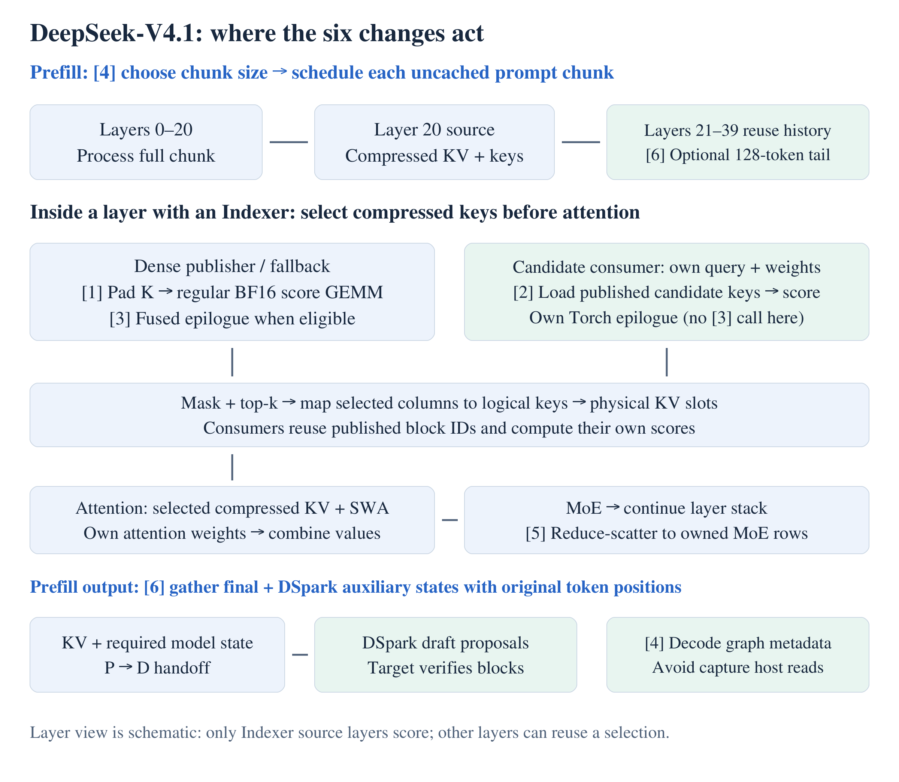

Ant International 在八张 H200 上运行 DeepSeek-V4.1-Flash，四卡预填充、四卡解码。长提示的耗时集中在几个可定位的操作上：稀疏注意力的 Indexer 处理了最后不会使用的位置，MoE 返回路径传了过多数据，部分晚层还按完整提示长度计算。团队沿着这些开销改，结果是首 token 和整请求明显变快，后续每 token 的时间却上升。

## 先减少打分范围，再减少中间读写

索引器某些 BF16 矩阵形状对硬件不友好，将得分宽度对齐后，即使计入填充，微基准的打分延迟也降约 40%。对只需候选位置的消费端，先筛候选、再做点积，比先给完整上下文打分再丢弃更省工作。接着把激活、头权重、跨头归约和转换合进同一尾处理，减少中间张量的显存往返。MoE 输出则在适用的上下文并行路径用 reduce-scatter 返回，避免每卡复制整份结果。几项分别作用于形状、计算量和通信量，不能把不同 PR 的百分数相加。

<a class="note-image-link" href="/assets/images/tech/lmsys-deepseek-v41-h200-pd/overview.png" target="_blank" rel="noopener" aria-label="查看原图 ↗ — 索引器优化减少评分的形状和范围，MoE 通信与晚层尾段计算则改变之后的数据路径。">查看原图 ↗</a>

*索引器优化减少评分的形状和范围，MoE 通信与晚层尾段计算则改变之后的数据路径。*

## 让紧凑输出的布局从头到尾一致

团队同时把预填充分块由 8,192 调到 16,384 token；记录中的首 token 时间最多下降 31.3%，但该对照未单独识别所有配置变化的作用。另一条路径只在晚层计算最后 128 个 token。对四路上下文并行，原本每卡预期从一个 16,384 分块收集 4,096 行，紧凑尾段每卡却只有 32 行。修正收集元数据后，执行器才知道如何把紧凑输出交给后续 DSpark 路径。缩短张量不能只改生产者，消费端的布局约定也是这项优化的一部分。

## 把端到端收益与生成阶段退化放在一起看

八个案例固定约 64K 输入、512 输出，覆盖不同前缀复用率与并发 4–32。综合配置相对原基线，端到端时间减少约 15%–64%，首 token 时间减少 41%–79%，首 token 之后每 token 时间增加 3%–52%。单次 GSM8K 测试 1,319 题，准确率由 96.74% 降到 95.38%。长输入、短回复时，前段省下的时间可以盖过后段的损失；输出更长或质量要求更严的服务，不能沿用同一个端到端倍率。

[Optimizing DeepSeek-V4.1 on H200 with SGLang PD Disaggregation](https://www.lmsys.org/blog/2026-11-05-deepseek-v41-h200-pd-optimization) · Bingjia Wang, Siyuan Chen, Bofeng Jiang, Jincong Chen, Yongxu Ai, Kaixin Shen · 2026-11-10
