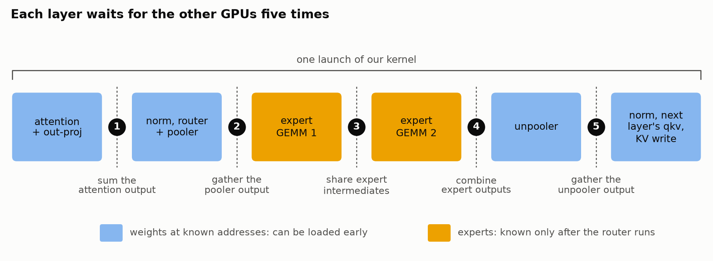

[Muse Spark Open Ultrafast: Pushing beyond 1,000 Tokens per second](https://www.lmsys.org/blog/2026-11-05-muse-spark-open-ultrafast)  
Pranjal Shankhdhar · 2026-11-11

SGLang 为 Muse Spark Open 从零编写 CUDA C++/PTX megakernel，在八张 GB300 上将解码从 517 提高到 1,109 token/s。这个结果的重点不只是少启动 kernel，而是让不同 warp 在同一层内提前做互不依赖的工作，减少计算、权重读取和通信彼此等待的空隙。当前实现只支持 batch size one 加投机解码，需要先明确这个运行范围。

## 一个 launch 穿过层边界，但保留依赖

每次 launch 从本层 attention 一直运行到下一层 QKV 投影和 KV 写入。历史 KV 在此前步骤已经生成，新 kernel 可以先读取它，不必等待上一层输出完全就绪。每个 SM 上常驻一个十二 warp 的线程块，加载、tensor core 运算、归约和发送接收分别由不同 warp 执行。

<a class="note-image-link" href="/assets/images/tech/lmsys-muse-spark-open-megakernel/layer.png" target="_blank" rel="noopener" aria-label="一次 launch 覆盖 attention 到下一层 QKV；蓝色阶段的权重地址预先已知，橙色专家阶段需等待路由结果。">查看原图 ↗</a>

*一次 launch 覆盖 attention 到下一层 QKV；蓝色阶段的权重地址预先已知，橙色专家阶段需等待路由结果。*

八卡切分也不是照搬普通 TP：两个专家 GEMM 都沿 N 维切分，中间与末尾各做一次 all-gather。它增加一次通信步骤，却以不同中间表示减少通信量，也避免 EP 路由不均造成某卡专家工作过重。图中的五处跨卡等待没有凭空消失，优化要让等待期间仍有独立工作可做。

## 预取的不只是权重，还有 kernel 自己的代码

固定地址的权重可以提前进入 shared memory 环形缓冲，装不下的部分先留在 L2，再搬到 shared memory。专家身份在 router 完成前未知，作者用上一步最常用的十四个专家做推测预取，约占每卡 50 MB；猜错会消耗带宽，所以它只在有空隙时有价值。

更意外的瓶颈来自指令缓存。作者用两个各约 100 KB 的直线代码块测得，单独重复执行各约 12.4 微秒，拼在一起则各约 19.5 微秒；缩小其中一个代码块后，另一个恢复原速。实际 kernel 的机器码约 215–314 KB，大于作者测得约 128 KB 的 SM 指令缓存，专家预取还会把代码挤出 L2。

实现于是限制不必要的循环展开，每次 launch 读代码行把它们预热到 L2，并对关键短路径做不写输出的 dry pass，把即将执行的指令拉近。这个观察解释了为什么不能简单把整个模型继续融合成更大 kernel：融合收益需要与代码体积、寄存器分配和可调度空间一起考虑。

## 用数据表示就绪，不代表永远不需要同步

SM 内采用 mbarrier 协调异步搬运，跨 SM 或 GPU 仍需轮询。传统“写数据、fence、置标志”在持续搬运权重时会等待已有内存活动。作者改为将接收缓冲填成生产者不会写出的特殊值，读方直到各位置不再为空才消费数据。不同类型选择不同哨兵，例如 bf16 使用指定 NaN 位模式。

这依赖值域和缓冲重置协议，不能泛化为任意张量都可取消 fence。缓冲复用仍需同步，只是移到每层一次且离开关键路径；专家交换使用双缓冲轮换。投机草稿模型也做类似融合，175 次 launch 变成八次，草稿步骤从 1.16 ms 降到 0.44 ms，并与验证模型放进同一 CUDA Graph。

## 速度属于具体负载，观测也有成本

整步 launch 数从 1,450 降为 97。投机步骤验证 16 个 token，平均接受长度 6.6；文中阶段性能比较取单个 GSM8K 请求二十步的中位数。这不是多租户高并发吞吐，也不能用更高 token/s 推断所有上下文或任务都同样受益。

大 kernel 在外部 profiler 中只剩一条长条，所以实现让各 warp 记录阶段时间戳。插桩约增加 2.8% 开销，可编译关闭；这些内部时间线显示部分通信后的依赖链仍留下空闲时间。值得迁移的是依据依赖提前发起数据与指令读取，并用内部观测验证重叠是否真的发生；具体预取距离、cache hint 和 warp 分工仍是针对该模型与硬件测出来的设计。
