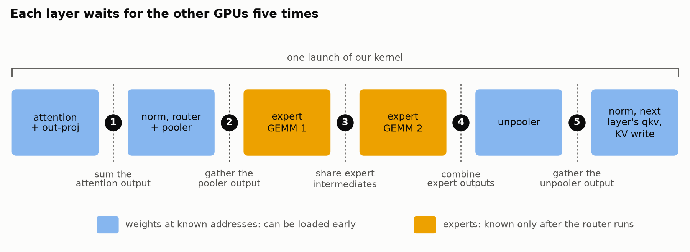
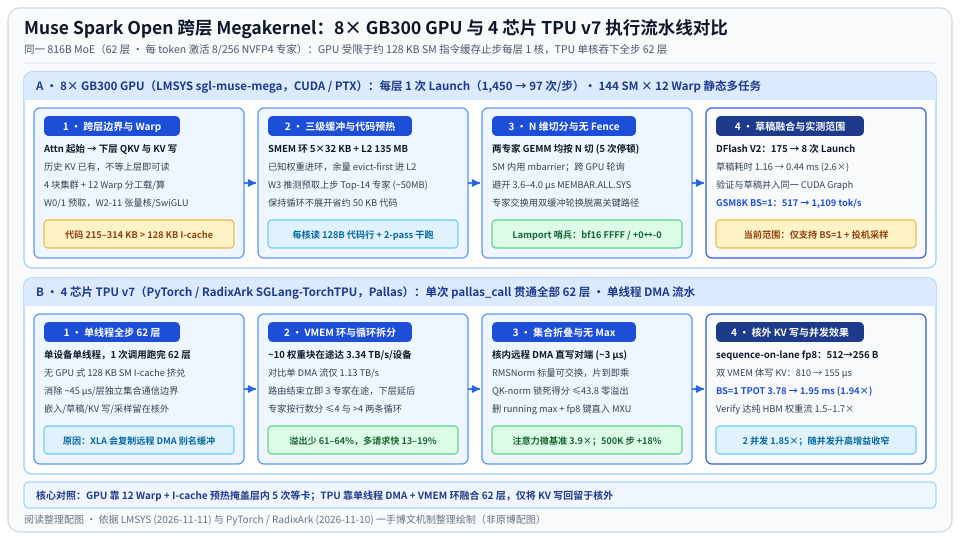
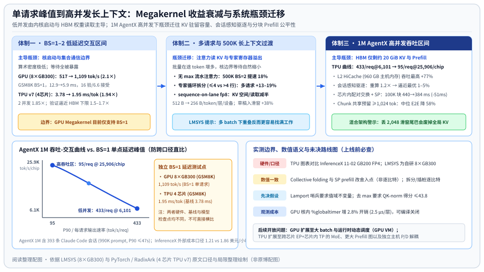

主文入口：Pranjal Shankhdhar · 2026-11-11 · [Muse Spark Open Ultrafast: Pushing beyond 1,000 Tokens per second](https://www.lmsys.org/blog/2026-11-05-muse-spark-open-ultrafast)（LMSYS / SGLang 团队，8× NVIDIA GB300，开源代码 [facebookresearch/sgl-muse-mega](https://github.com/facebookresearch/sgl-muse-mega)）  
对照一手文章：Haolin Fu, Xiaoyu Zhang, Junyan Xu, Wangyuan Zhang, Haoguang Cai, RadixArk Team · 2026-11-10 · [Optimizing Muse Spark Open on TPU v7 with SGLang-TorchTPU](https://pytorch.org/blog/optimizing-muse-spark-open-on-tpu-v7-with-sglang-torchtpu/)（4 芯片 / 8 设备 TPU v7 Ironwood，开源分支 [sgl-project/sglang-torchtpu `haolin/ms-v11`](https://github.com/sgl-project/sglang-torchtpu/tree/haolin/ms-v11)）

当大语言模型进入低批大小（batch size = 1 或 2）解码阶段，每个新 token 在每张芯片上执行的算术运算极少，真正决定步长的往往不是矩阵单元的峰值算力，而是**权重与 KV 缓存从 HBM 流向计算单元的连续性，以及核函数与集合通信边界暴露出的等待时间**。2026 年 11 月 10 日至 11 日，PyTorch/RadixArk 团队与 LMSYS/SGLang 团队几乎同步公开了针对同一开源模型 **Muse Spark Open** 的 Megakernel 工程实践：一边是在 **4 芯片（8 设备）TPU v7** 上用 Pallas 把全部 62 个解码层包进单次 `pallas_call`，将单请求每输出 token 时间从 `3.78 ms` 压到 `1.95 ms`（`1.94×`）并在 1M 上下文 AgentX 负载上压出 `6,101` 至 `25,906 tok/s/chip` 的 Pareto 曲线；另一边是在 **8× NVIDIA GB300 GPU** 上从零手写约 `8,000` 行 CUDA C++/PTX 代码，将单请求 GSM8K 解码从 `517 tok/s` 推至 `1,109 tok/s`（`2.1×`），把整步 kernel 启动次数从 `1,450` 降为 `97`。

把这两篇同源模型的一手工程长文放在一起对照，价值远不止记住几个峰值数字：它罕见地揭示了**两种截然不同的硬件执行模型如何迫使 Megakernel 走到不同的融合边界**——GPU 因 SM 指令缓存（约 `128 KB`）与多 Warp 共存限制而止步于“每层一次 Launch”，转向硬件级多引擎重叠、L2/SMEM 预热与无 Fence 哨兵轮询；TPU v7 凭借单线程处理器与可显式编排的 VMEM/DMA 引擎吞下了“全步 62 层”，却在跨过单用户区间后立刻把瓶颈交给了 **20 GiB 级剩余 HBM 容量、会话感知逐出、以及百万上下文下的 Prefill 公平调度**。

> **信源与口径边界**：本文严格依据冻存的两篇一手工程文章展开对照，不把两套测试混作同基线横向跑分。LMSYS 测试运行在 `8× GB300` 上，取 GSM8K 单请求（`BS=1`）配合 DFlash V2 投机解码（验证 16 个 token，平均接受长度 `6.6`）的 20 步中位数，且目前实现明确仅支持 `BS=1 + 投机采样`；PyTorch/RadixArk 测试运行在单台 `4 芯片 / 8 设备 TPU v7` 上，单/双并发对照取自较早 Muse Spark 检查点的 GSM8K 实测（`DFlash2`），高并发 1M 上下文曲线则来自重放 393 条 Claude Code 会话的 SemiAnalysis AgentX 基准（总 token 口径含输入与输出，引用 `2026-11-02` InferenceX 公开 GB200 FP4 数据作外部对照）。文内所有算子收益均保留各自的微基准与端到端前提，并将原博作者的类比与经验估算明确标注。

## 跨层融合与硬件执行模型：为什么 GPU 止步于单层，而 TPU v7 吞下全步 62 层

两支团队面对的是同一个参数与注意力混合度极高的对象——Meta 发布的 **Muse Spark Open**（总参数 `816B`，每 token 激活约 `42B`）。全模型包含 `62` 个 MoE 解码层，每层将每个 token 路由至 `256` 个专家中的 `8` 个；专家权重采用 4-bit **NVFP4** 微缩放格式（每 16 个值共享 1 个缩放因子，部分层保持 `bf16`）；注意力采用混合结构，其中 `46` 层是窗口为 `2,048` token 的滑动窗口注意力，其余 `16` 层是支持最高 `1M` 上下文的全局注意力（`128` 个查询头、`16` 个 KV 头、头宽 `64`）。此外，模型在进入专家前先用 **pooler** 投影压缩 token 向量，在专家计算之后再用 **unpooler** 还原维度。

在常规服务引擎中，这样一座 62 层混合 MoE 网络会被切碎成上千次核函数与集合通信调用。LMSYS 指出，基线 SGLang 为 Muse Spark Open 的单个解码步启动约 `1,450` 个独立 kernel，核间排水与重新填满会让大量 SM 与显存通道空转；而在 PyTorch/RadixArk 的 TPU v7 实测中，即便原有 “native” 路径已经把算子融合为多个 Pallas 模块，它在验证步（verify step）上的耗时仍是纯粹从 HBM 读取所需权重理论时间下限的 `2.9×`——原因在于在 `BS=1` 下矩阵乘与注意力几乎不占计算时间，真正吃掉耗时的是每次跨程序边界无法重叠、每层约 `45 µs` 的集合通信开销。

为了跨过这层开销，两家选择了相似的并行起点——**8 路张量并行（TP8）**（GPU 对应 `8× GB300`；TPU 对应 `4 芯片 × 2 chiplet/芯片 = 8 设备`），但在 MoE 切分与核边界设计上展现出鲜明的硬件适应性。

**路径一（GPU，8× GB300，LMSYS）**：N 维双向 TP8 与每层跨界 Launch。常规 TP 对专家 `GEMM 1` 按 `N` 维切分、对 `GEMM 2` 按中间维（`K` 维）切分，末尾只需一次 `bf16 all-reduce`；而传统专家并行（EP）在推理时极易遭遇路由不均引起的长尾失衡。LMSYS 改用把两个专家 GEMM **同时沿 N 维切分**，在 `GEMM 1` 后加一次 `FP4 all-gather`、在 `GEMM 2` 后加一次 `bf16 all-gather`。这虽然在每层制造了 **5 处跨 GPU 等待点**（下图 `1` 至 `5`），却获得了更小的总通信量、更好的大 batch 扩展性，并且能在数值上与训练时的 EP 实现**逐比特一致（bitwise same）**。

<figure class="note-figure">
  <a class="note-image-link" href="/assets/images/tech/lmsys-muse-spark-open-megakernel/layer.png" target="_blank" rel="noopener" aria-label="放大查看 LMSYS 原文图件：Muse Spark Open 单个解码层在 8 张 GPU 上的 6 个阶段与 5 处同步等待点">
    
    点击放大 ↗
  </a>
  <figcaption>LMSYS 原文保留图件（Figure 2）：单次 Megakernel 启动覆盖本层 attention 至下一层 QKV 投影与 KV 写入；即使完美负载均衡，5 处等待点上最慢一张卡仍可能滞后达 4 微秒。</figcaption>
</figure>

尤为巧妙的是 LMSYS **刻意把 Launch 边界切在下一层 QKV 投影与 KV 写入之后**：注意力读取的主体是前序步骤早已写入的历史 KV，与上一层尚未算完的残差输出无关，因此下一层 Megakernel 一旦落地即可立刻读取历史 KV，把等待上层结果的空窗填满。不过受制于后文详述的 SM 指令缓存墙，LMSYS 在每个 SM（全卡 `144` 个 SM，按 `4` 块集群启动并使用分布式共享内存做低延迟归约）上驻留 `12` 个静态分工的 Warp，依然维持**每层一次 Launch**，将整步启动次数从 `1,450` 降为 `97`（含与验证同处一个 CUDA Graph 内的 `8` 次草稿 Launch）。

**路径二（TPU v7，4 芯片 / 8 设备，PyTorch/RadixArk）**：单线程 62 层全步巨核。TPU v7 每个 chiplet 设备本质上是**单线程处理器**——同一时刻只运行一个程序，没有 GPU 上多 Warp 抢占同一套 SM 指令缓存的挤兑问题，而是由一个标量单元（Scalar unit）驱动控制流、两套矩阵单元（MXU，单芯片峰值 `2,307 TFLOPs bf16` / `4,614 TFLOPs fp8`）、向量单元（VPU，`8 × 128` 32 位寄存器与交叉通道单元 XLU）、大容量片上 SRAM（**VMEM**）以及多个后台 **DMA 引擎**（配合 `192 GiB/芯片`、`7.37 TB/s` HBM 与 `1,200 GB/s` ICI 互联）协同工作。正因不受 128 KB SM 指令缓存的限制，RadixArk 直接把**全部 62 层解码与最终 RMSNorm 放进单次 `pallas_call`**，只在核外保留 embedding、DFlash2 草稿模型、LM head、采样以及一个独立的流水化 KV-write 核函数——之所以单拆 KV-write，是因 **XLA 编译器会对任何内部发起远程 DMA 的核函数复制别名（aliased）操作数**，把大块 KV 缓存留作别名输入会触发不可接受的拷贝开销。

<figure class="note-figure">
  <a class="note-image-link" href="/assets/images/tech/lmsys-muse-spark-open-megakernel/muse-spark-megakernel-pipeline-zh.svg" target="_blank" rel="noopener" aria-label="放大查看 GPU 8x GB300 与 TPU v7 跨层 Megakernel 流水线对比图">
    
    点击放大 ↗
  </a>
  <figcaption>阅读整理配图（非原博配图）：对照同一 816B MoE 模型在 8× GB300 GPU（CUDA/PTX 单层巨核）与 4 芯片 TPU v7（Pallas 62 层全步巨核）上的执行边界与流水机制。</figcaption>
</figure>

## 隐藏等待的微架构机制：SMEM/VMEM 预取、指令缓存诅咒与同步协议

一旦进入“单核内跨操作流水”，真正的难点不再是算得有多快，而是如何**在依赖结果尚未抵达前就把一切已知工作推到台前**，同时避免预取把更稀缺的片上缓存或编译器寄存器挤垮。Pranjal Shankhdhar 在 LMSYS 博文中坦率用了操作系统类比——这仍像 IBM OS/360 MFT 的“固定任务数多道程序设计”，每个 Warp 在编译期领好每阶段的固定分工：Warp 0/1 负责预取 KV、权重与激活，Warp 2 驱动 Tensor Core（在专家阶段负责 scale factors），Warp 3 负责指令预热与发送，Warps 4–11 负责注意力归并、尾处理发送、SwiGLU 与接收规约；而在 TPU v7 侧，单线程 Pallas 程序则由开发者直接编排 VMEM 环形槽位与 DMA 队列深度。

| 微架构维度 | 8× GB300 GPU（LMSYS CUDA/PTX 单层巨核） | 4 芯片 / 8 设备 TPU v7（PyTorch/RadixArk 62 层 Pallas） | 关键工程约束与差异实质 |
| :--- | :--- | :--- | :--- |
| **融合边界与调度模型** | 每层 1 次 Launch（`1,450 → 97`）；`144` SM × `12` 静态分工 Warp，4 块集群 | 全部 `62` 层 + 终层 Norm 合进单次 `pallas_call`；单线程标量 + 后台 DMA | GPU 受制于 SM 指令缓存止步单层；TPU 仅因 XLA 复制远程 DMA 别名缓冲而将 KV 写回拆到核外 |
| **确定性权重预取** | `5 × 32 KB` SMEM 环（全卡约 `23 MB`）+ `135 MB` L2；权重流加 `evict-first` 提示 | VMEM 权重环保持约 `10` 块在途，单设备持续带宽达 `3.34 TB/s`（单 DMA 仅 `1.13 TB/s`） | TPU VMEM 容量更大且全由软件编排；GPU 需用 `evict-first` 防止流式权重把 L2 常驻代码/热点挤出 |
| **路由未知的专家处理** | 注意力期间 Warp 3 预取上步 Top-14 专家进 L2（约 `50 MB/卡`），路由落盘后再优先派发 L2 命中 tile | 路由结束立刻发起 `3` 个专家在途请求；下层注意力重填延后到专家循环再启动，避免争抢带宽 | GPU 猜测预取可省约 `0.2 ms`（总验证 `5.3 ms`），但若不保护代码反而净亏；TPU 按需求排队避免互相挤占 |
| **代码体积与寄存器压力** | 机器码 `215–314 KB` > 实测 `~128 KB` SM I-cache；靠少展开（`-50 KB`）、`load_evict_last` 预热与 `2-pass` 干跑 | 共享专家循环中 `8 行`分支 `f32` 累加器溢出拖累 `1–2 行`路径（`~0.37 µs/专家`）；拆分为 `≤4` 与 `>4` 行双循环 | GPU 碰上 **I-cache 驱逐墙**（非寄存器溢出）；TPU 碰上 **编译器跨分支寄存器分配污染**（拆循环后少 `61–64%` 溢出） |
| **跨设备通信与同步** | SM 内 `mbarrier` 硬件挂起；跨 GPU 轮询 + **Lamport 哨兵**（`bf16 0xFFFF` / `+0↔-0`），避开 `3.6–4.0 µs` 栅栏 | 核内远程 DMA 直写对端 HBM（小轮次约 `~3 µs`，取代 `~45 µs/层`独立通信）；**Collective Folding** | GPU 上重度 TMA 在途会让 `MEMBAR.ALL.SYS` 堵 `3.6–4.0 µs`；TPU 利用 RMSNorm 标量可交换性让片到即乘（非逐比特） |
| **长上下文注意力与 KV 布局** | 全局层 Tensor Core 路径，滑窗层 Warp 4–11 自载 KV；层末提前将下层旧 KV 预取进 L2（`65 µs`） | QK-norm 锁死得分 `≤43.8` 后**去掉 running max**（`3.9×` 微基准）；`sequence-on-lane fp8` 将 KV 字节减半（`512→256 B`） | TPU 直接靠模型常量在编译期证明无溢出而免去在线 softmax 串行重缩放链；fp8 必须改通道映射才免除对齐填充 |

### GPU 侧的三重深水区：L2 挤兑、指令缓存墙与 `MEMBAR.ALL.SYS`

LMSYS 文章最宝贵的贡献，是完整记录了把大核做大后连续撞上的三堵硬件暗墙，以及每一堵墙后面的微基准归因：

- **指令缓存诅咒解释了“为什么不把全模型融成一个核”**：作者最初把两段各自约 `100 KB` 的直线代码块首尾拼接测试，发现单独循环各自耗时 `12.4 µs`，拼在一起后每段飙升到 `19.5 µs`（每对多出 `14 µs`）。怀疑对象起初是 `ptxas` 寄存器溢出，但检查确认零溢出；当把其中一段缩减到 `20 KB` 时，另一段 `100 KB` 立刻恢复 `12.4 µs` 原速。结论明确指向 GB300 上每个 SM 约 `128 KB` 的指令缓存容量。而真实单层 Megakernel 编译出 `215–314 KB` 机器码，每次启动硬件只把前 `32–64 KB` 拉近 SM，其余代码行首次执行时都要经与数据共享的 L2 拉取。更棘手的是，每步占约 `50 MB/卡` 的推测专家预取会把指令挤出 L2——滑动窗口核在两次运行间丢掉约十分之一的代码，而每隔 4 层才跑一次的全局注意力核会丢掉超过一半代码；在**没有保护指令的前提下，开启专家预取反而是净负收益**。对此，LMSYS 组合了三招：非寄存器状态循环保持不展开（省约 `50 KB` 且结果逐比特一致）；每次启动由少数 SM 的 1 个 Warp 用 `load_evict_last` 按 `128 字节`行步长把整段机器码当作数据预热进 L2（由于 GB300 双芯粒各持一份 L2 副本，每个阅读 Warp 都需读完完整代码）；对 GEMM 1 epilogue、专家输出合并与层末 RMSNorm 等关键短路径执行 `#pragma unroll 1` 的两遍循环，第一遍 **dry pass** 在数据还在路上时先空跑指令与访存、跳过等待和写出，把热点指令提前拽进 SM 指令缓存，单次可省 `0.5–1 µs`。
- **消除在途 TMA 阻塞的 Lamport 哨兵协议**：在 SM 内部及 `4` 块集群的分布式共享内存里，`mbarrier` 可让等待 Warp 硬件挂起而非空转；但跨 SM 或跨 NVLink 硬件没有地址等待中断，只能轮询。LMSYS 微基准测得 GPU 域 acquire 轮询单次 `141–145 ns`，同节点跨卡单向标志约 `1.9 µs`，而在 SM 持续搬运权重时轮询请求会在批量 TMA 拷贝后排队 `1.0–2.6 µs`。更致命的是传统“写数据 + 内存栅栏 + 置标志”：在 GB300 上系统域释放指令（`fence.release.sys` / `fence.acq_rel.sys` / `st.release.sys`）均编译为重量级 `MEMBAR.ALL.SYS`，即便窄一点的 GPU 域 fence 在空闲 SM 上只要 `0.4 µs`，一旦 SM 有批量 TMA 权重流在途便会暴涨到 `3.6–4.0 µs`——在每层的第 3、4 处专家交换点各卡一次。LMSYS 因此借鉴 TensorRT-LLM 与 FlashInfer 的 Lamport 思路，在层内全部跨 GPU 交接中**让数据本身充当就绪标志**：接收槽预填为生产者永不写出的哨兵（如 `bf16` gather 用全 `1` 比特位 `0xFFFF` 的非规范 NaN；`all-reduce` 用 `+0` 作空槽，真实 `+0` 改写为比特不同但值相同的 `-0`），生产方直接向对端 HBM 写数据而不发 fence，读端轮询直到所有槽位脱离哨兵值。缓冲复用仍需 fence，但通过专家双缓冲交替或读后重置被移到每层一次且脱离关键路径。

### TPU v7 侧的四项代数与编译器拆解：Folding、Max-Free、拆循环与双 Bank

由于 TPU 没有多 Warp 指令缓存 thrashing 问题，PyTorch/RadixArk 把精力集中在了如何把单线程 DMA 流水线榨干到物理访存极限，同时处理好 XLA 与向量单元的特性：

- **跨越 RMSNorm 的 Collective Folding**：Muse Spark 在下一层注意力前计算残差流 `α·x + β·s·f` 的 RMSNorm（`x` 为本地已有残差，`f` 为来自 8 设备的专家汇总，`s` 与最终 `r` 均为逐行标量）。利用逐行标量与矩阵乘可交换的代数性质，核函数在收到本地切片与远端每一片 `f_d` 后按固定对等端顺序立即与重排后的权重块 `W_d` 相乘累加，直到最后一片到达才算出标量 `s` 和 `r` 统一缩放。每层两个 `all-gather`（MoE 输出进下层 `qkv`、注意力输出进 `pooler/router`）均如此折叠；由于 `bf16` 舍入点前移，结果**不再逐比特一致**，但通过了精度校验。
- **靠模型结构常量省掉在线 Softmax Running Max**：在长上下文注意力中，FlashAttention 式在线 softmax 的 running max 让每个 KV chunk 陷入“等 DMA → QK → 更新 max → exp → 求和 → P·V → 重缩放”的串行链（微基准中每块约 `0.17 µs` 链条开销，无论 `fp8` 还是 `bf16`）。RadixArk 检查 Muse Spark 架构后发现，其 Q/K 采用无学习权重的 RMSNorm 且 Q 乘固定增益，使**所有注意力得分的绝对值严格不超过 `43.8`**，距离 `f32` 指数溢出极远。核函数在构建时校验该常量上界并直接去掉 running max 与重缩放步骤（连 FlashDecoding++ 的溢出回退分支都不需要），使各 KV 块彻底解除依赖、拆分多条独立 softmax 流并用软件流水重叠 QK 与 P·V；配合全局层 `1,024–2,048` token 大块（滑窗层 `512`）、`fp8` key 直入 MXU（混合 `bf16 × fp8` 点积精确且免去 VPU 升宽开销）、以及将 `1/8` 缩放因子提前合并进 Query，注意力微基准提速从 `2.4×` 拉到 `3.9×`，`500K` 上下文双请求实际解码提速 `18%`。
- **把重度分支移出轻量专家循环**：在专家循环中，`1–2` 行常见轻量路径与 `8` 行大累加器路径原本共用一个循环体，编译器为了同一套寄存器适配最重分支，迫使每一次轻量专家都额外产生约 `0.37 µs` 的寄存器溢出存取（相对约 `1.2 µs` 的权重读取开销）。按服务行数排序并拆分成 `≤4` 行与 `>4` 行两个独立循环后，轻量循环溢出指令骤降 `61–64%`、结果**逐比特一致**，多请求随机路由测试提速 `13–19%`。
- **适配 `8 × 128` 向量寄存器的 `sequence-on-lane` KV 布局**：TPU VPU 拥有 `8` 个 sublane × `128` 个 lane 的 32 位向量寄存器。每台设备分得 `2` 个 `64` 维 KV 头（恰占 `128` 个 lane）。传统 token-major 布局在 `bf16` 下把 K 与 V 并排塞满 `128` 通道，但换成 `fp8` 后每个 32 位字沿 sublane 打包 4 个字节，导致 K/V 对被填充成 4 槽——**单纯转 `fp8` 竟然一字节没省**（仍是 `512 B/token/层/设备`）。改用 Google 工程师在 `sglang-torchtpu#344` 引入的 `sequence-on-lane` 布局（页内 `256` 个 token 沿 `128` lane 排布、头维度沿 sublane 排布），`fp8` 无填充落到 **`256 B`**（内存与读取双减半），再配双 VMEM Bank 乒乓写 KV（`16` 行 `810 → 155 µs`，`64` 行 `2,286 → 336 µs`，逐比特一致）与把只看 `2,048` 窗长的草稿模型 KV 移入滑窗池（多装 `38%` token），为高并发腾出了决定性的 HBM 空间。

## 性能归因、内部可观测性与单请求到高并发的体制边界

把两篇文章放在一起看，最容易得出误判的一点，是把低并发峰值延迟直接当成集群上线吞吐的代表。事实上，两篇原博自己就画出了非常清晰的性能边界。

在 **BS=1 极致延迟区间**，两项工作都证明了 Megakernel 消除启动/集合境界后的硬核回报：

- **GPU（LMSYS，8× GB300，GSM8K 单请求 + DFlash V2）**：20 步中位总步长从 `12.9 ms` 降至 `5.9 ms`（解码速率 `517 → 1,109 tok/s`，`2.1×`），其中草稿模型每步预测 `15` 个 token、耗时从 `1.16 ms` 降至 `440 µs`（`2.6×`，175 次启动压为 8 次），验证步从 `10.9 ms` 降至 `5.3 ms`，草稿与验证同框进单个 CUDA Graph。关于 DFlash V2 验证 `16` 个 token、平均接受长度 `6.6`，LMSYS 特意对比了小米 `MiMo-V2.5-Pro`（验证 `8` 个 token、平均接受 `6.3`，同样跨过 `1,000 tok/s`），解释虽然验证 16 个 token 会激活更多专家，但在该模型上更实际地支撑了 `6.6` 的接受长度。
- **自我插桩可观测性（GPU `%globaltimer`）**：因为 Nsight Systems 与 PyTorch Profiler 只能把整个 Megakernel 看成每层一条长黑条，LMSYS 在关键算子前后让每个 Warp 的 lane 0 无原子、无同步地读取 `%globaltimer` 纳秒时钟写入独立数组，每层仅增 `2.5 µs`（整步 `2.8%` 开销，编译开关可关闭且输出逐比特一致）。在 `4,096` 上下文（`45` 个滑窗层、`2` 张卡、`19` 次重放、按 GSM8K 测得的每层 `49` 专家合成路由）下，时间线直接暴露了重叠是否真正生效：最早 10% 的块在 `47 µs` 已启动 GEMM 2，而最慢 10% 仍在跑 GEMM 1 至 `50 µs`；但 GEMM 2 在 `55–64 µs`（P10–P90）间陆续结束后，combine 与 unpooler 必须等到最慢一张卡抵达（`65 µs`），导致每个块从 GEMM 2 到层尾平均仍有 `12.5 µs` 闲置（占全层近半空转）。这也解释了为何下一层靠 PDL 提前 `4 µs`（`79 µs`）发起仍得等当前层全部在 `84 µs` 退出 SM 后才能落地，LMSYS 于是选择在 `65 µs` 顺手把下一层旧 KV 提前预取进 L2。
- **TPU v7（PyTorch/RadixArk，4 芯片 / 8 设备，GSM8K + DFlash2）**：开启 DFlash2 时单请求每输出 token 时间由原生路径 `3.78 ms` 降为 `1.95 ms`（`1.94×`）；而在 Megakernel 内部，DFlash2 本身将单请求耗时从无投机采样的 `3.93 ms` 减半至 `1.95 ms`（`2.0×`，得益于 TPU MXU 耗时按 row tile 而非乘加数计费，验证一块 token 与验证单个 token 在同一 row tile 内几乎同价）；双并发加速收窄为 `1.85×`，且作者明确指出**随着并发升高，Megakernel 自身的相对增益会继续收窄**。

一旦系统迈入 **高并发、百万上下文与多轮工具调用（AgentX 1M）**，瓶颈迁移得更加剧烈。在单设备扣除权重后仅剩约 `20 GiB` HBM 可用于 KV 的前提下，RadixArk 在 `4` 芯片 TPU v7 上跑完 SemiAnalysis **AgentX 1M-context** 轨迹（基于 393 条脱敏 Claude Code 会话，单 prompt 最长约 `990K` token，P90 均在 `47 s` 内完成），得出一条从 `433 output tok/s/req @ 6,101 tok/s/chip` 延伸到 `95 tok/s/req @ 25,906 tok/s/chip`（含输入输出总 token）的完整权衡曲线。在这条曲线的高吞吐侧，真正扛起收益的已经不是单步解码 Megakernel，而是三组围绕 **KV 层次存储与分块 Prefill** 的机制：

1. **L2 HiCache 与混合注意力“会话感知逐出”**：启用 `960 GB` 主机内存作为 HBM 后面的 L2 HiCache 后，Agent 负载吞吐最高跃升 **`77%`**。针对主 Agent 在等待子 Agent 运行时可能闲置一刻钟、导致普通 LRU 误踢冷前缀的问题，RadixArk 特别指出混合模型的惩罚倍增效应——**只要失去那 `2,048` token 的滑窗 KV，前面整段巨大的全局注意力 KV 也会全部作废**。通过把客户端自带会话 ID 引入主机内存层的会话感知基数树逐出（HBM 保持普通 LRU 给在跑请求），最高吞吐点下的重算量从最优缓存的 `1.2×` 降到了 **`1–5%`**。
2. **芯片内双芯粒“配对交换”与序列并行 Prefill**：Prefill 期间算力打满后，各设备按 `(token, expert)` 逐行用标量单元写回 `8` 份部分和（每行约 `50 ns` 标量序列化开销）拖垮了整体速度。利用 TPU v7 同芯片两个设备间比 1D ICI 快 **`6×`** 的 die-to-die 链路先在芯片内互换合并、再按连续行块一次 DMA 发给远端属主，跨芯片字节减半、属主合并数从 8 降为 5，MoE 核从 `3,247 µs/层` 降到 `2,368 µs/层`；叠加双权重缓冲与单遍合并，冷启动 `100K` 上下文下单个 `4,096` token Prefill 块耗时从 `440 ms` 降至 `384 ms`。叠加序列并行（将 `4,096` token 拆成每卡 `512` token，用 `all-to-all` 取代 `all-gather` 降为 `1/8` 通信量），`131K` 上下文单步前向再降 `51 ms`（约 `11%`，非逐比特一致）。
3. **Chunk 共享消除 15–95 秒队头阻塞**：为防止几十万 token 的长 prompt 独占 `4,096` token 块把短轮次堵死 `15–95 s`，调度器改用每批至少为长 prompt 保留 `1,024` token、余量让给等待轮次的策略，使 AgentX 中位端到端延迟降低 **`58%`**、P90 降低 **`33%`**，同时吞吐保持在 `5%` 以内波动。

<figure class="note-figure">
  <a class="note-image-link" href="/assets/images/tech/lmsys-muse-spark-open-megakernel/megakernel-batch-regime-boundaries-zh.svg" target="_blank" rel="noopener" aria-label="放大查看 Muse Spark Open Megakernel 从 BS=1 到 1M AgentX 高并发的体制迁移与口径边界图">
    
    点击放大 ↗
  </a>
  <figcaption>阅读整理配图（非原博配图）：刻画并发度上升时性能瓶颈如何从核启动/权重读取迁往 KV 容量与 Prefill 公平性，并隔离不同测试集、硬件与数值口径。</figcaption>
</figure>

| 关键实测指标 | 所属硬件与实测设置 | 基线条件与样本口径 | 数值语义与外推边界（严防误读） |
| :--- | :--- | :--- | :--- |
| **517 → 1,109 tok/s**（`12.9 → 5.9 ms/step`） | **8× NVIDIA GB300**，TP8，DFlash V2（16 验 / 6.6 接受） | GSM8K **单请求（BS=1）** 20 步中位数；基线已开投机采样（1,450 launch） | **仅支持 `BS=1 + 投机采样`**，不代表多租户批量吞吐或所有上下文长度均同倍率提速 |
| **3.78 → 1.95 ms/tok**（`1.94×`；BS=2 `1.85×`） | **4 芯片（8 设备）TPU v7**，TP8，Pallas 62 层核 + DFlash2 | GSM8K（**较早 Muse Spark 检查点**）单/双并发，对照“native”已融合 Pallas 路径 | 仅面向极低并发；验证步距 HBM 纯读权重下限 `1.5–1.7×`（原生为 `2.9×`），高并发下增益收窄 |
| **433/req @ 6,101/chip → 95/req @ 25,906/chip** | **4 芯片 TPU v7**，FP8 算 + NVFP4 专家 + HiCache/Chunk 共享 | **AgentX 1M**（393 条 Claude Code 轨迹，~990K prompt，P90 ≤47s）；含输入+输出总 token | 外部对照引用 `2026-11-02` InferenceX GB200 FP4（拥有成本 `1.21` vs `1.86` 美元/小时）；两套平台非同一评测框架内复现 |
| **+18% 解码（500K BS=2）/ 3.9× 注意力微基准** | **TPU v7** 无 running max 流水注意力 + `fp8` 键直入 MXU | 生产形状微基准对照 FlashAttention 式在线 softmax；服务端取 500K 2 并发 | 严格前提是 Muse Spark 的**无权重 QK-norm + 固定增益保证得分 ≤43.8**；无法直接搬给无有界得分的普通模型 |
| **+13–19% 解码（-61–64% 溢出）/ +77% HiCache** | **TPU v7** 按 `≤4` 与 `>4` 行拆专家循环 / `960 GB` 主机内存 L2 | 随机路由多请求核测 / AgentX 长会话工具停顿回放 | 拆分循环**逐比特一致**；`1.2× → 1–5%` 重算依赖客户端会话 ID 且对混合模型必须保住末尾 `2,048` 滑窗 |
| **`2.8%` 插桩开销 / `12.4 → 19.5 µs` I-cache 降速** | **GB300** `%globaltimer` 核内打点（2.5 µs/层）/ 双 `100 KB` 直线块测试 | 4,096 上下文 45 滑窗层、2 卡、19 重放、49 专家合成路由 | 插桩可编译关闭且逐比特一致；`128 KB` SM 指令缓存实测解释了为何 GPU 版止步每层一核而不强融 62 层 |

## 工程落地判据：何时需要 Megakernel，何时瓶颈已移出内核

梳理完两篇一手文献，应当明确区分**原文作者的论断与类比**和**面向部署团队的工程推论**。LMSYS 作者把当前手工静态分工的 GPU Megakernel 类比为早期主机操作系统（IBM OS/360 MFT），并提出向运行时动态调度器与“GPU 虚拟机”演进的愿景（同时坦承在 BS=1 极限低延迟下，哪个权重进 SMEM、进 L2、预取多远及 cache hint 仍依赖逐算子实测调参——而且他特别点出编码 Agent 非常适合帮工程师搜索这类参数空间）；PyTorch/RadixArk 团队则给出了一条非常务实的路线图——即便已经做出 62 层 TPU Megakernel，高并发下真正卡住他们的仍是 Prefill 吞吐与多机拆分，因此未来工作重点指向**跨芯片 EP + 芯片内 TP 的拓扑感知 MoE**、更大 Prefill 图以及面向 AgentX 的 **Prefill/Decode 主机级解耦（P/D Disaggregation）**。

对自建大模型推理服务的工程团队而言，两条一手路线最终收敛出四条清晰的架构取舍准则：

- **先定并发与交互体制，再决定是否投入手写 Megakernel**：如果你的核心指标是编码助手实时补全、语音交互或极少数 VIP 请求的极低 TPOT（`BS=1–2`），核启动边界（`1,450` 次 launch 或 `45 µs/层` 集合开销）与流式 HBM 权重读取就是一等矛盾，跨层 Megakernel 能兑现接近 `2×` 的单请求延迟红利；但如果业务跑在多并发代理集群上（关注 `tok/s/chip` 与每百万 token 成本），在多 batch 环境下各层的计算与通信原本就更容易相互掩盖，继续压榨极小 batch 的极限巨核边际收益会快速递减。
- **按“指令缓存容量 × 编译器行为 × 别名语义”划定融合粒度**：在 NVIDIA Blackwell 这类高并行多 Warp 架构上，切勿盲目追求“把整个模型塞进一个核”——当机器码体积突破 SM 指令缓存（`~128 KB`）且与数据共享 L2 时，没有 `load_evict_last` 行预热、抑制循环展开与干跑保护的巨核反而会被自家的权重/专家预取拖慢；在 TPU 这类单线程 DMA 架构上，虽然可以融合全步 62 层，但必须警惕编译器副作用（如 XLA 对远程 DMA 别名操作数触发整块拷贝而迫使 KV 写入独立成核）和跨分支寄存器分配污染（重度分支会把轻量常用路径拖入寄存器溢出）。
- **无栅栏同步与无 Max 注意力都是“受模型与协议不变量保护的专用捷径”**：Lamport 哨兵省掉 `3.6–4.0 µs` `MEMBAR` 的前提，是生产者严格不输出哨兵比特模式、且双缓冲或读后重置协议能在关键路径外可靠清零；TPU 去掉在线 softmax running max 省掉 `0.17 µs/块` 链条开销的前提，是无权重 QK-norm 与固定缩放让得分在编译期就被证明小于 `43.8`。一旦模型架构更换（如取消 QK-norm）或需要任意浮点张量复用，这些优化必须有自动回退或编译期断言护栏，切忌当成通用算子默认开启。
- **百万上下文 Agent 服务的主战场在 KV 布局、混合层保护与 Prefill 公平性**：当单卡只剩约 `20 GiB` HBM 装 KV、每次逐出都会引爆十万级 token 重算时，对齐向量寄存器的 `fp8` 压缩布局（`sequence-on-lane` 直接省半）、把只有短窗长的草稿模型 KV 移出全局池、在主机内存层对空闲主会话实施“保住 2,048 滑窗尾巴”的会话感知逐出，以及用 `Chunk 共享` 切碎半秒级的长 Prefill 块，往往比继续微调解码期单步延迟更能直接撬动端到端 SLA 与集群经济性。

---

### 参考来源与一手核对链接

- 主文入口（GPU 8× GB300）：Pranjal Shankhdhar, *[Muse Spark Open Ultrafast: Pushing beyond 1,000 Tokens per second](https://www.lmsys.org/blog/2026-11-05-muse-spark-open-ultrafast)*, LMSYS Org, 2026-11-11；开源实现：[facebookresearch/sgl-muse-mega](https://github.com/facebookresearch/sgl-muse-mega)。
- 对照一手博文（TPU v7）：Haolin Fu, Xiaoyu Zhang, Junyan Xu, Wangyuan Zhang, Haoguang Cai, RadixArk Team, *[Optimizing Muse Spark Open on TPU v7 with SGLang-TorchTPU](https://pytorch.org/blog/optimizing-muse-spark-open-on-tpu-v7-with-sglang-torchtpu/)*, PyTorch Blog, 2026-11-10；开源分支：[sgl-project/sglang-torchtpu (`haolin/ms-v11`)](https://github.com/sgl-project/sglang-torchtpu/tree/haolin/ms-v11)。
- 模型、硬件与相关引用：LMSYS, *[Muse Spark Open](https://www.lmsys.org/blog/2026-10-15-meta-muse-spark-open)*；Xiaomi, *[MiMo-V2.5-Pro 1,000 tok/s](https://mimo.mi.com/docs/en-US/news/latest/1000tps)* 与 [Hugging Face 模型卡](https://huggingface.co/XiaomiMiMo/MiMo-V2.5-Pro)；Google Cloud *[TPU7x 文档](https://docs.cloud.google.com/tpu/docs/tpu7x)* 与 JAX *[Pallas TPU 指南](https://docs.jax.dev/en/latest/pallas/tpu/details.html)*；SemiAnalysis *[AgentX Benchmark Guide](https://inferencex.semianalysis.com/blog/agentic-benchmark-agent-benchmark-guide)*；Chen 等人 *[DFlash: Block Diffusion for Flash Speculative Decoding](https://arxiv.org/abs/2602.06036)*；Hong 等人 *[FlashDecoding++](https://arxiv.org/abs/2311.01282)*；SGLang Team *[SGLang HiCache](https://lmsys.org/blog/2025-09-10-sglang-hicache/)*；Hazy Research *[Look Ma, No Bubbles!](https://hazyresearch.stanford.edu/blog/2025-05-27-no-bubbles)*；Cheng 等人 *[MPK (OSDI 2026)](https://www.usenix.org/conference/osdi26/presentation/cheng)*；Novack 等人 *[Inferact TPU Megakernels](https://github.com/Inferact/tpu-megakernels/tree/4048f0820aa4ff8787f707ca9d99b2bada9751aa)*。

> **AI 辅助整理 · 归档注记**：本篇中文深度解析与对应的英文配套版（[English note](/tech/en/lmsys-muse-spark-open-megakernel/)）均由助手对照上述两篇冻存一手技术原文逐项核对重写，保留原 `id`、`date`、`permalink`、`source_url`、`published_at` 与可核验 `source_published_at` 元数据，保留 LMSYS 原文图件 `layer.png` 并新增助手绘制的两幅 `v3-blue` 架构与体制边界图（`muse-spark-megakernel-pipeline-zh.svg`、`megakernel-batch-regime-boundaries-zh.svg`）。仅链接直接核验过的公开地址，且严格隔离 `BS=1` 单请求峰值与 `1M AgentX` 高并发曲线的测试口径。
