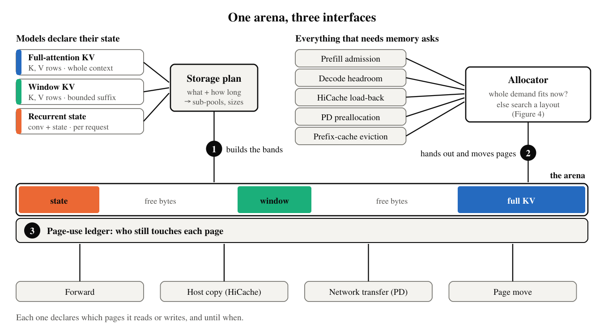

Cheng Wan, Caihua Li, Yonghao Zhuang, Seokwoo Song, Shuwen Wang, Lianmin Zheng · 2026-11-11  
原文：[Unified Memory in SGLang: One Arena for Every Token Lifetime](https://www.lmsys.org/blog/2026-11-11-unified-memory)

混合模型的显存压力并不只随上下文长度增长。全注意力 KV 保存历史，滑窗 KV 只保留有界后缀，递归状态则随并发请求数增加。SGLang 的实验性统一内存把三者放进同一个 arena，让空闲容量能随负载变化重新分配。值得关注的是，设计同时改了状态布局、准入判断和异步回收；仅仅合并几个缓冲区，无法安全实现这种共享。

## 静态分区为何浪费容量

原有方案在启动时为不同状态池设定比例。长上下文可能耗尽全注意力池，同时留下大量空闲递归状态槽；短请求高并发则可能反过来。比例调得再好，也只是对某种流量的预估。

统一 arena 让全 KV 从高地址向下增长、有界状态从低地址向上增长，中间空间由需求方取得。每个子池仍有自己的页或槽大小，不必把较小 KV 页都补齐成大状态槽。惰性压紧将存活数据向两端移动；有第三类状态时，中间的浮动区带也可搬迁。这里的共享针对不同状态类型之间的容量，页内取整以及 arena 外的工作区预算仍然存在。

布局也从每层独立缓冲区改成每 token 一个 entry：该 token 跨层的 KV 行放在一起，兼容的草稿模型 KV 可作为附加通道并入，即使其形状、dtype 不同。分配、释放和搬页因此能一起作用于相关状态，避免只移动一部分后破坏对应关系。

## 准入要判断整个请求能否放下

<a class="note-image-link" href="/assets/images/tech/lmsys-sglang-unified-memory/figure.png" target="_blank" rel="noopener" aria-label="共享 arena 的状态声明、联合分配器与页面访问账本 · 查看原图 ↗">查看原图 ↗</a>

*上方声明决定各类状态的形状与寿命；右侧统一回答容量问题；底部账本约束搬移和覆盖时机。*

一个 32K 上下文、4K 滑窗的请求，在每页 64 token 时，稳态需要 512 个全 KV 页和 64 个窗口页。递归模型还要占用请求状态槽。实际准入进一步计入页取整、预计 decode 余量及窗口退休前的暂留数据，不能只读“全注意力剩余 token 数”。

分配器先重用孔洞、原地扩展；不够时压紧两端；再不够才搬动浮动区带。顺序体现了一个工程取舍：先找低搬迁成本方案，再考虑更全面的重排。判断某种布局最终可行，与此刻能否无等待实现，也被分开处理。前者可考虑尚未结束的页面访问，后者需避开固定页和活跃网络传输。

同一需求模型用于 prefill 准入、分块处理、decode 预分配和缓存驱逐。驱逐不再只看一个池释放了多少页，而是每删除一个候选后，重新判断联合需求是否已满足。这把缓存策略与内存可行性接在了一起。

## 逻辑释放之后，谁还在访问旧字节

重叠调度时，CPU 已在准备下一步，GPU 可能仍读写上一步的 KV。请求表因此保存虚拟 ID，搬页后更新虚拟到物理映射，新一轮 forward 访问新地址，旧 reader 可以继续读原地址。旧位置只有在这些 reader 结束后才能被覆盖。

writer 的条件更严格：必须先完成旧写入再复制，否则新副本会过时，旧 writer 还可能破坏下一位持有者的数据。普通释放同样先进入 pending，不能因为容量统计已增加就立刻覆盖。page-use ledger 记录 forward、HiCache 拷贝、网络传输与页面搬移各自读写哪些页、何时结束，让不同写入方等待所需事件。原文还描述了带固定随机种子的压力测试和真实 CUDA 工作，但这不是对所有并发组合的形式化证明。

## 收益来自负载变化，也有明确兼容边界

作者在单服务器单 H200、SGLang 提交 daa171846f 上，对 Qwen3.5-4B 和 GPT-OSS-20B 各取两次运行平均。GPT-OSS 的 512 输入、1,536 输出、并发 1,024 配置中，统一内存约容纳 1,000 个运行请求，对照默认分池为 618；吞吐提高 14%，首 token 时间从 43 秒降至 6 秒。Qwen 的 16K 输入、4,096 输出、并发 64 配置中，运行请求由 22 增至 32，速度提高 26%。

收益并不普遍：Qwen 的 1,024 输入、256 输出、并发 64 配置下，输出吞吐是 5,830 对 5,880 tokens/s；200 道 GSM8K 均为 0.875。长输出压力下，撤回次数也只是从每千次完成约 294 降到 233，没有消除资源压力。

当前只面向受支持的混合模型；纯全注意力模型、DeepSeek-V4 等不在支持范围。LMCache、FP4 KV 和若干并行组合会在启动时拒绝；优先级抢占被禁用，高优先级请求仍可能等待。窗口准入还假设递归检查点持续推进，缺少可替换状态槽时实际保留窗口可能超过预算。对服务系统而言，这篇最有价值的变化是把“容量是否够”和“旧字节何时可写”放进同一管理体系，性能数字要连同这些生命周期约束一起理解。
