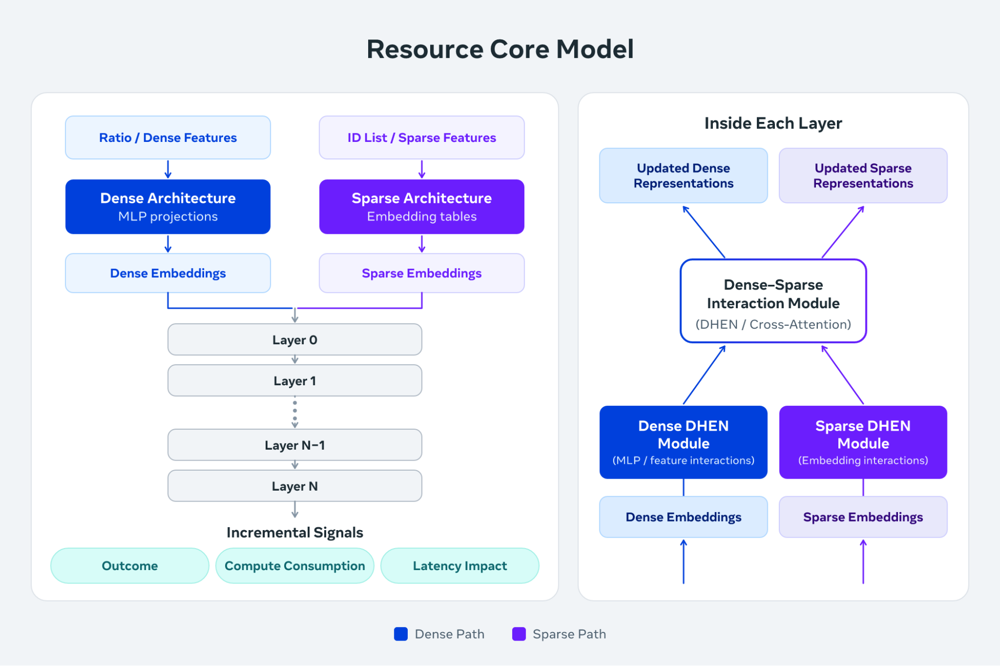

[Intelligent Delivery: Making Every Unit of Compute Serve Better Ads](https://engineering.fb.com/2026/11/11/ml-applications/intelligent-delivery-serve-better-ads/)  
Zhaojun Zhang, Qinwei Zhu, Gang Li, Jianwei Xiao, Yanan Wang, Hongmei Li, Deepak Vijaywargi, Ke Pan, Li Yu · 2026-11-11

同样一毫秒算力，用在不同广告请求上未必带来相同效果。Meta 的 Intelligent Delivery 把 serving 优化从“让每次推理更快”扩展为“让有限容量产生更高整体收益”。它不直接解决 LLM 解码，但对异构推理、动态预算和自动化调优有可迁移价值。

## 先预测请求对资源的响应

手写规则可以把请求按场景分桶，却难以表达大量特征交互。Resource Core Model 在候选召回前运行一次，使用 6B 稀疏参数和 20M 稠密参数，为整个排序漏斗提供共享请求表示。基于它微调的专门模型再预测结果、计算消耗及延迟影响，为不同资源旋钮提供增量信号。

<a class="note-image-link" href="/assets/images/tech/meta-intelligent-delivery-ads-compute/resource-model.png" target="_blank" rel="noopener" aria-label="稠密与稀疏特征共享交互表示，再预测结果、计算消耗和延迟影响，供资源分配机制使用。">查看原图 ↗</a>

*稠密与稀疏特征共享交互表示，再预测结果、计算消耗和延迟影响，供资源分配机制使用。*

因此，预测热门请求并不足够：控制器需要知道多给一点资源是否真的改善该请求，以及要付出多少计算和延迟。文章报告，相对前一生产模型，识别高影响请求的离线基准改善约 20%；这不是广告最终排序效果提高 20%，也不是全服务成本降低 20%。

## 多层控制不能各自独立最优

请求先经过地域选择。系统以分钟尺度在区域间转移流量，朝各地边际容量效率相近的方向调节。随后根据实测 workload–SKU 效率分配异构硬件：召回可能受内存约束，排序受计算约束，推理又受加速器吞吐约束，不存在对所有工作都最快的芯片。

进入主机后，系统在尾延迟 SLO 内根据预测结果和资源成本分配计算，负载高时先削减高成本、低收益工作。执行范围从内核调度到应用线程池，还包括排序候选数等上层旋钮。跨地域搬流量会改变主机负载，后者又影响请求预算，因此作者使用端到端闭环硬件测试观察联动，不能把各层单独的局部收益直接相加。

## Agent 缩小实验搜索，人工保留发布判断

模型、硬件和机制变化会让原来的配置失效。文章描述的 Agent 读取源码、设计文档和历史实验，定位值得测试的少数改动，设计并运行实验；工程师审核最后变更后才发布。它是持续优化流程中的实验助手，而非在每个广告请求路径上直接自由修改调度。

Meta 报告，2017 年至 2026 年上半年该系统在模型和系统进展之外累计带来约 10% 排序效果增量。2026 年上半年 Agent 参与约 20% 的 Intelligent Delivery 优化，在最自动化机制上参与约 80% 的工程工作。这些数字口径不同，不能据此推导 80% 全系统自动化，或把历史累计效果归给近期 Agent。

## 可迁移的是分工，尚不是可复现的最优性保证

原文没有给出可重跑的配置搜索数据、完整目标函数或因果消融；“朝全局最优调节”是系统目标，不能当已证明的最优解。GPU 容量、批处理与内存的离散性也使 CPU 时代的控制方式不能直接照搬。对 Ops4LLM 更值得保留的设计分工，是共享预测模型估计增量价值，多层控制器约束实际动作，再用端到端实验检查跨层影响。
