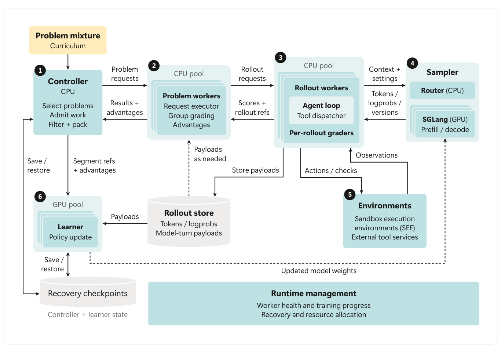

一次长程编码任务还在等待工具返回时，学习器可能已经更新了多次策略。Microsoft AI 的 Rocket 要处理的是这个时间差，以及另一种更隐蔽的偏差：即使给采样器和学习器完全相同的权重和输入，它们也可能算出不同的 token 概率。在数千步的训练中，两种偏差的治理手段不同。

The Microsoft AI Team · 原文标注 2026-11-23 · [RL infrastructure at Microsoft AI](https://microsoft.ai/news/rl-infrastructure-at-microsoft-ai/)

## 一枚 token 会在哪里变旧

Rocket 把每道题交给一个工作进程，由它派发多条轨迹。同一题的轨迹完成后，GRPO 才能根据组内奖励计算优势值。控制器接收分数和轨迹引用，组成学习批次。采样器间歇更新权重，轨迹中每枚 token 因此各有一个生成时的策略版本。论文用这个版本与训练实际消费它时的版本之差衡量陈旧度。首枚 token 生成前的等待会占用沙箱和时间，却不会让一个尚不存在的样本变旧。

<a class="note-image-link" href="/assets/images/tech/microsoft-ai-rocket-rl-infra/microsoft-ai-rocket-rl-infra.png" target="_blank" rel="noopener" aria-label="查看原图">查看原图 ↗</a>

*控制器以引用传递轨迹，学习器更新权重，健康监测与恢复独立运行。*

一组示例中，最先完成的轨迹等了最慢成员 7.6 小时。Rocket 优先服务已经开始的轨迹，按推理容量调节在途数量，并丢弃失败轨迹以免重试拖住全组。这样会改变组内奖励的样本构成。权重分发也分两跳，先由部分采样引擎拉取参数块，再分发给对应副本，报告给出的当前配置耗时 15 秒。单纯增加推理服务器并不总能改善陈旧度：若批量固定，学习器更新得更快，同样长的一次工具调用可能跨过更多策略版本。

## 容量收益与数值一致性要分别检验

MAI Base 2 的专家权重占参数的 95% 以上。采样侧将专家权重以 MXFP8 存储，乘法前还原成 BF16；学习器也执行相应的量化与反量化，使损失计算面对相同的舍入。局部注意力缓存以及最后三层全局注意力缓存保留 BF16，其余全局层使用 MXFP8。团队报告，全局上下文可容纳的 token 比全 BF16 配置多约 67%。这里的分母是全局注意力缓存容量，不能直接用来推算整机吞吐。

相同的数值格式也未必得到逐位相同的结果，算子归约顺序和并行切分都能改变中间舍入。团队用同权重、同输入对照定位实现差异。在一个总参数 180B、激活参数 7B 的较小模型上，逐位对齐后的训练曲线在可比步数获得了更高评测分数。两次运行约隔一个月，因此该曲线更适合说明工程现象，难以单独估计每项数值改动的因果收益。

## 恢复学习器时保留什么

健康检查既看进程存活也看训练是否前进。学习器停滞后，Rocket 暂停接新题、终止学习器各个 rank，从最近的检查点重建，再接回原控制器。课程状态、有效的待处理工作与健康推理副本得以保留。团队报告单独恢复学习器约需五分钟，期间让采样继续，接受由此产生的版本差。最近一次运行的节省估算中，单此一项超过 GPU 小时的 7%。推理副本则可独立替换，只有剩余健康容量不足等情况才升级到作业级恢复。
