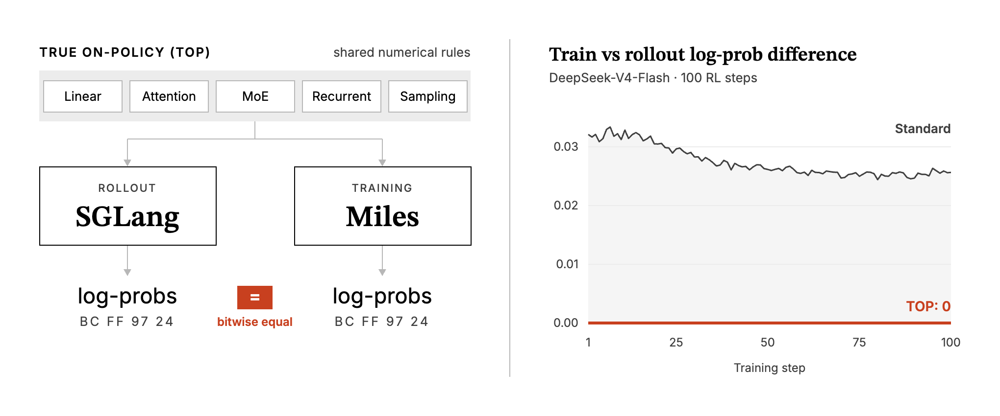

强化学习的一条样本经历两套系统：推理引擎在生成时记录选中 token 的概率，训练器稍后用这条轨迹更新模型。即使权重完全相同，推理端逐步解码和训练端一次处理整段序列，也可能选用不同的内核。对普通前馈层，这也许只造成末位舍入差异；对 MoE，接近的路由分数若交换顺序，后续就可能走进不同专家。重要性权重因而同时反映策略更新与执行差异，两者很难从训练曲线中区分。

## 把一次前向计算的结果定义到字节

Yiming Li 与 Miles 团队给出一个可直接检查的端点：对相同权重、相同轨迹上的每个采样 token，训练器输出的 FP32 对数概率必须与 SGLang 保存的字节一致。项目报告在 DeepSeek-V4、GLM-5 和 Qwen3 的若干具体型号上通过全深度前向检查。对于支持投机解码的配置，验证也包括打开投机的路径。

为达到这一点，两端将模型模块映射到具有相同算术规则的算子。固定矩阵分块和归约顺序，使同一个 token 不因同批请求变化而得到另一组加数顺序；预填充切块、前缀命中恢复、逐步解码和训练重计算也要遵循这条规则。专家并行允许 token 跨设备移动，但返回结果要按约定的专家槽位顺序合并。这样可以改变任务分配，同时让每一行看到的运算次序保持一致。当前两端的张量并行度都是 1；训练侧用流水线、上下文和专家并行，采样侧用注意力数据并行配合专家并行。

<a class="note-image-link" href="/assets/images/tech/miles-sglang-true-on-policy-rl/overview.png" target="_blank" rel="noopener" aria-label="相同算术规则使同权重下训练和采样的对数概率逐位一致">查看原图 ↗</a>

*相同算术规则使同权重下训练和采样的对数概率逐位一致*

## 同一份 FP8 权重也可能暂时学不动

训练器保留高精度主权重，再按采样端规则舍入成 FP8 做前向。若从 FP8 检查点初始化，主权重恰好处在舍入区间中心，小更新可能连续数步都没有改变前向实际用到的 FP8 值。团队在初始化时给主权重一次确定性的区间内偏移，让较小的更新也有机会较早跨过量化边界。这个问题解释了为何仅比较初始模型输出不够，还要观察相同量化规则在持续更新中如何表现。

## 异步时，剩下的偏差从哪里来？

如果样本由旧版本采出，用新权重重算自然会出现概率差。作者在 Qwen3.6-35B-A3B 的多轮 text-to-SQL 实验中分别比较同权重内核差异与版本差异。标准路径中，归属于内核的每 token 差异约为 0.006–0.0095；TOP 在新鲜 token 上为零。保留过期样本时，整条曲线仍有非零值，反映权重更新。实验最多五次 SQL 工具交互，两个训练臂的平均滞后范围也不同，读结果应保留这个条件。

权重变化仍可能改变专家选择，所以团队在异步配置中重放采样路由。取消重要性权重上限后，TOP 加路由重放的曲线较平稳，标准内核加路由重放、以及未重放路由的 TOP 都出现过中途准确率下跌。这个消融给出了一个可诊断的区分：同权重逐位相等消除一类系统误差，陈旧样本仍需要独立处理。

## 精确性的成本落在哪个阶段？

64 块 H200 上，DeepSeek-V4-Flash 和 GLM-5.2 的整步 token 吞吐分别为标准配置的 0.90 和 0.93 倍，仅看采样则为 0.79 和 0.88 倍。GLM-5.2 为保持顺序，在解码时沿用稀疏预填充注意力内核，每次迭代多花 2.2–2.8 毫秒。Qwen3.6 的专家矩阵乘增加 1.3–1.7 毫秒。固定顺序还约束并行方式：批量可以靠数据并行扩展，低并发时标准实现可选的张量并行降延迟路径尚不适用于 TOP。选择数值一致性时，整步吞吐、轨迹采样速度和单请求延迟各自回答不同的成本问题。

Yiming Li (RadixArk Miles Team) · 2026-11-23 · [True On-Policy RL: Bit-Exact Rollout and Training with SGLang and Miles](https://miles.radixark.com/blogs/true-on-policy-rl-bit-exact-rollout-and-training-with-sglang-and-miles)
