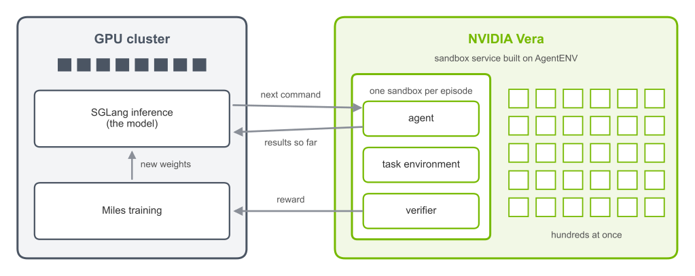

Agentic RL 的 GPU 会等待 CPU：模型发出命令之后，沙箱要编译、执行测试、整理结果，模型才能继续下一轮。多个 rollout 并行时，这些环境工作可能同时挤到同一台机器上。RadixArk Miles Team 的这篇实践把所有沙箱迁到 NVIDIA Vera，重点不只是比较 CPU 跑分，而是追踪环境速度如何影响 episode 时长、样本时效与 GPU 状态驻留。

原文：[RadixArk Miles runs agentic RL training on NVIDIA Vera CPUs: faster sandboxes, faster training](https://www.lmsys.org/blog/2026-11-13-miles-vera-sandboxes) · RadixArk Miles Team · 2026-11-13

## 每个 episode 有独立环境，推理与训练仍在 GPU

沙箱服务基于 AgentENV，每个 episode 获得新建的 Firecracker 微虚拟机，作者报告从快照启动不到 0.1 秒。Agent 把任务交给 SGLang 服务的模型，接收下一条命令，在沙箱执行，再把结果送回模型；任务结束后，verifier 在同一环境执行测试并产生奖励，Miles 将奖励用于训练。并发的数百个沙箱由此形成持续的 CPU 需求。

迁移涉及环境而非训练逻辑。团队为 530 个 Terminal-Bench 和 SWE-bench 任务重建 arm64 环境，并用参考解检查；服务端还处理 Vera 的 64K 内存页并构建 arm64 Firecracker。能运行相同任务的环境是比较前提，不能把换处理器当作直接替换 x86 镜像。端到端演示使用 GLM-4.7-Flash，涵盖同步与完全异步训练，共 68 步、超过 2,400 个 episodes。

<a class="note-image-link" href="/assets/images/tech/miles-vera/pipeline.png" target="_blank" rel="noopener" aria-label="GPU 负责推理和训练，Vera 上的沙箱执行命令并返回奖励 · 查看原图 ↗">查看原图 ↗</a>

*读图：GPU 负责推理和训练，Vera 上的沙箱执行命令并返回奖励。*

## 实测缩短的是 episode，不是已证明的训练步时

受控比较将沙箱放在 Vera 或 AMD EPYC Turin，模型、任务、GPU 和设置保持相同；每个 socket 另运行 176 个背景任务，再执行 5 步、160 个 episodes 的训练。前台只有 4 个 SWE-bench Verified 任务，推理由同一台 8×H200 机器承担。作者比较平均 episode 时间，因为步时取决于最慢样本，5 步不足以分辨几个百分点的差异。

Turin 的 episode 平均比 Vera 长 12%，等价于从 Turin 换到 Vera 缩短约 11%。这两个百分比的分母不同。每 episode 多出的 53 秒中，Agent 命令占 26 秒，verifier 占 11 秒，其余沙箱工作占 12 秒，等待模型占 4 秒。Turin/Vera 耗时比的 90% 置信区间为 1.04–1.22；结论适用于这组较窄但受控的任务。

## 满载优势有机制，也有比较条件

作者回放同样的命令轨迹，并检查命令结果与最终奖励匹配，以减少不同模型决策造成的噪声。延迟门槛要求 95% 命令耗时不超过参考机器独占执行时的 1.5 倍。在此门槛下，单 socket Vera 可承载 Xeon 6 的 1.3–1.5 倍、Turin 的 1.4–2.1 倍负载。核心现象是全核忙碌后单核命令速度的下降程度不同，不能只用空载命令速度预测饱和表现。

比较同时包含硬件与配置差异：Vera 为 88 核/176 线程，Turin 为 96 核且未启用 SMT，Xeon 6 为 96 核/192 线程；Vera 启动参数由 NVIDIA 调优，x86 主要使用 AWS 默认设置，Xeon 的 C6 则为避免文件访问退化而关闭。背景 176 个任务也意味着不同的每线程压力。作者另以 96 个背景任务检查 Turin，命令差距仍在但缩小。因此结果是这些系统配置的测量，不能解释成纯 ISA 或任意 CPU 的普遍差距。

## CPU 收益怎样传到 GPU 与样本时效

等待工具时，episode 的 KV cache 仍驻留 GPU。作者以每轮上下文长度乘等待命令时间统计，Turin 的闲置 KV 占在用缓存的 17.9%，Vera 为 12.1%。异步训练中，慢 episode 还会使用更旧的策略权重；GRPO 一组样本又要等最慢成员完成，环境尾延迟因此影响整组释放。

文章把推理时间缩短 8 倍后 Turin episode 长 33% 的结果，是保持沙箱耗时不变的推算；“相同陈旧度下训练最多快 12%”也是基于 episode 时长比例的估算，并假设 GPU 能跟上。它们不等于已测得的 time-to-quality 提升。最可迁移的经验是按模型等待、命令、verifier 和组内尾部拆开测量，再判断 CPU 是否限制训练进度。
