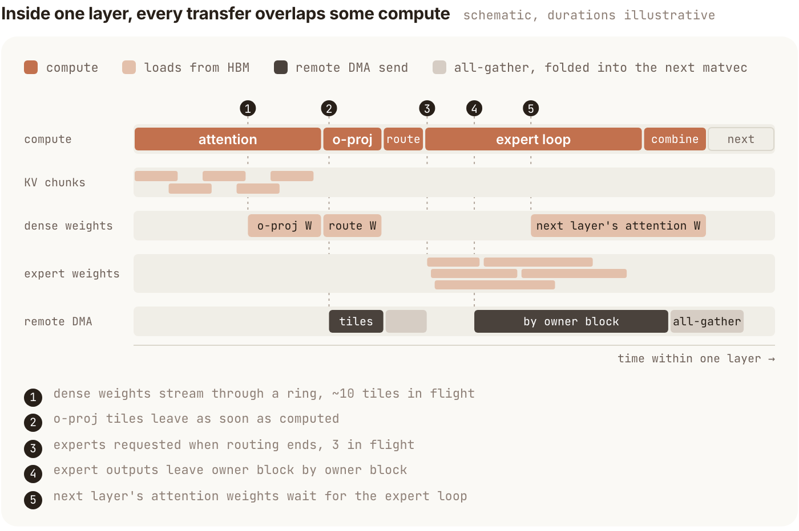

PyTorch 官方博客这篇工程报告，把 816B MoE 的服务优化串成一条完整路径：低并发时减少 decode/verify 的流水中断，高并发时保留长会话缓存，再让 prefill 不把短请求挡在队尾。它比单个算子性能更新更值得关注，因为同一套系统里，最优瓶颈会随并发和上下文改变。

原文：[Optimizing Muse Spark Open on TPU v7 with SGLang-TorchTPU](https://pytorch.org/blog/optimizing-muse-spark-open-on-tpu-v7-with-sglang-torchtpu/)  
Haolin Fu、Xiaoyu Zhang、Junyan Xu、Wangyuan Zhang、Haoguang Cai、RadixArk Team · 2026-11-10

## 把一次 Verify 的 62 层连成持续的数据流

部署使用一台四芯片 TPU v7 主机；每芯片有两个框架可见设备，因此采用八路 TP。Muse Spark Open 共 62 层，每层 MoE，每 token 激活 256 专家中的 8 个。46 层为 2,048-token 滑窗，16 层处理全上下文。

小 batch 时，每份权重对应的计算很少，速度受 HBM 流式读取限制。原生路径虽然已有融合 kernel，每层之间仍有 kernel 与 collective 边界，权重流不断停顿。新路径每设备用一个 Pallas 程序覆盖 62 层和最终 norm，让稠密权重、路由后才确定的专家权重与跨设备部分和提前在途。

<a class="note-image-link" href="/assets/images/tech/muse-spark-tpu/official-5.png" target="_blank" rel="noopener" aria-label="一个模型层内的权重、KV 与跨设备传输流水 · 查看原图 ↗">查看原图 ↗</a>

*读图：上方是计算流，下方各 DMA 流提前或并行搬运所需数据；时间长度为示意，不能从图上读取实测倍率。*

稠密权重用跨层环形预取；专家选择结束立刻发起权重请求；下一层注意力预取等专家循环启动后再补，避免与当前必需专家争带宽。o-proj 的 tile 完成就直接 DMA 到拥有它的设备，传输与后续 tile 运算重叠。embedding、draft 模型、KV 写回、LM head 与采样仍在 megakernel 周围执行，不能说整个服务只剩一次 kernel。

GSM8K 的真实接受率测试中，单请求每输出 token 从原生路径 3.78 ms 降到 1.95 ms，约 1.94 倍；两个并发约 1.85 倍。两条路径都使用 DFlash2，不能再把这项倍率与投机解码收益无条件相乘。verify step 距纯读权重下界 1.5–1.7 倍，是局部执行效率指标，亦不等同于完整请求时延。

## 改变依赖，而不只是增加重叠

两个技巧直接缩短串行链。collective folding 在其他设备的切片陆续到达时就做投影，而不是等 all-gather 完整结束；利用每行 norm 标量可以移到矩阵乘之后的性质，隐藏通信等待。它改变了部分 bf16 舍入位置，所以不是逐位等价。

注意力则利用模型 QK normalization 和固定增益推导分数绝对值上界 43.8，远离 FP32 exp 溢出区间。既然上界可在构建时检查，就可删除 online softmax 中维持 running max 与重标定的串行依赖，让 KV chunk 独立流水。作者报告局部注意力微基准最高 3.9 倍，两请求、500K 上下文的服务 decode 速度提高 18%。**这个删除依赖的依据是模型的确切界，不能推广到任意注意力。**

另一个细节是寄存器压力：少行专家与重行专家共用循环体，重分支的活跃累加器让轻分支也 spill。按行数拆为两个循环后，常见路径少带寄存器负担；这项重构保持输出逐位一致。文中不同优化的数值等价性并不相同，应分别理解。

## FP8 不省空间时，要检查物理布局

每设备每层只有两个 64 维 KV 头，token-major 排布在 TPU 向量槽位上产生 padding，使 bf16 和 FP8 同为每 token 512 字节。sequence-on-lane 布局把序列沿 lane 排，真正把 FP8 降到 256 字节。同时，draft 只关注最近窗口，却曾按全上下文分配 KV；移入滑窗池让相同 HBM 可缓存 token 增加 38%。精度位宽只有与物理布局匹配，才能兑现容量收益。

HBM 外启用 host DRAM HiCache，保留工具等待期间被挤出的前缀。会话感知保护放在 host 层，HBM 仍采用 LRU：主 Agent 长时间等待子 Agent 时，不应把它当死数据；否则哪怕只丢滑窗尾部，也会使全注意力前缀无法复用。这与本期 KV 存储测量提出的生命周期信号相呼应，但不是同一机制的性能复现。

## 高吞吐还需要公平的 Prefill

长冷提示按 4,096 token chunk 处理，原先会连续占用 prefill，让新来的短增量等待。新方案给长提示每批至少 1,024 token，其余位置接等待请求。AgentX 测试中端到端中位时延下降 58%、p90 下降 33%，吞吐变化在 5% 内；这是调度对照，不是 megakernel 单独带来的结果。

AgentX 使用 393 条自愿共享 Claude Code 会话的请求长度、前缀共享、工具暂停和子 Agent 结构，以合成 token 替代原始内容。本文测试 1M-context 版本。433 output token/s/请求与 95 output token/s/请求是曲线上的不同交互点；对应每芯片 6,101 到 25,906 token/s 的吞吐**计入输入与输出**，不能都称为输出生成速度。

报告给出了大量可定位的实现与消融，但 AgentX 合成内容不验证 Agent 完成任务的语义正确性，部分 kernel 对照还使用较早模型检查点。collective folding 和 sequence parallelism 改变归约/舍入，原文称做了准确率检查，却没有给出足以覆盖所有任务的完整结果表。对读者最可迁移的是瓶颈拆分方法：先看低并发数据流，再看会话容量与高并发排队，不把所有改善合成一个普适倍率。
