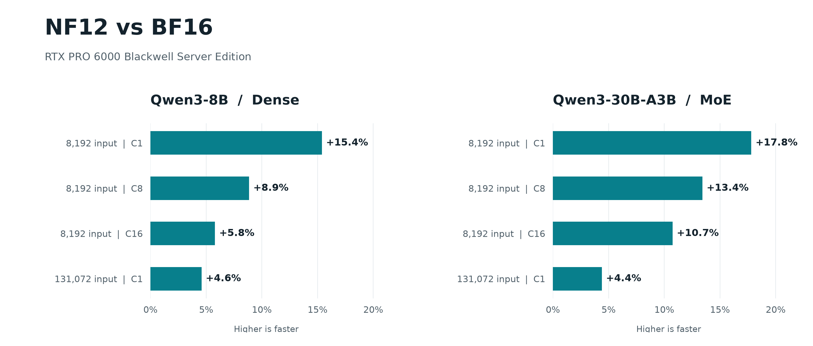

把 BF16 权重缩小约四分之一，同时保留每个原始数值，是 nf12 的主要吸引力。它还能把解码融合到 GPU 矩阵运算中，让省下的传输有机会转化为速度。不过项目给出的跨 GPU 数据也很明确：RTX PRO 6000 上有收益，B200 和 H200 的部分高并发配置却回退。这个实现最值得理解的是存储格式、计算路径与服务负载之间的联系。

原始来源：[nf12 项目](https://github.com/dphnAI/nf12)，dphnAI，仓库创建于 2026-11-06。项目基于 Together AI 的 NyoomFloat12（Liberman, Fang, Zhang, Dao, Fu），但采用自己的位布局和分块内存布局，二者格式并不兼容。

## 12-bit 主存储如何完整还原 BF16

BF16 含符号、8 位指数和 7 位尾数。nf12 为每个矩阵选择指数基数 B，覆盖连续 16 个指数值。窗口内的值保留原始低字节，把符号与指数偏移的剩余部分装入元数据。八个数为一组，主存储固定 12 字节；常规 BF16 同一组需要 16 字节。

**固定长度描述的是主存储，不能理解为所有矩阵最终都恰好只占 12 bit/权重。** 任一值落在窗口外，或编码触及预留哨兵，整组进入 escape 表，额外保存八个原始 BF16 值。主存储改为保存索引。选择 B 的目标是减少逃逸组，特殊值也走同一规则。由此，恢复是原始位模式重建，而非将数值四舍五入到较粗精度；异常指数较多的矩阵则可能付出更多额外空间。

这一区分决定了应用边界：nf12 压缩的是权重表示，没有压缩 KV cache，也没有减少模型的 token 数。README 中 Qwen3-30B-A3B 已加载权重由 56.88 GiB 降至 42.80 GiB，是该模型的测量值；实际服务还需要工作区、激活和 KV 空间。

## 为什么要把布局做成计算单元能直接消费的形状

项目的[格式与 API 规范](https://github.com/dphnAI/nf12/blob/master/docs/SPEC.md)把权重分成 16×16 的 atom，再组成 16×64 的 super-atom。解码后的组直接对应矩阵乘指令的寄存器片段，内存平面支持 warp 合并读取。小批量路径能边取压缩权重、边解码、边计算，避免先把整份 BF16 权重写回显存再读一次。

但融合并非永远最优。token 较多时，同一权重块可能为每个 token tile 重复解码。规范因此提供按架构和形状选择的 decode-then-GEMM 路径：先把行切片恢复到工作区，再调用 BF16 GEMM。它增加临时存储和搬运，却可能省掉重复解码。路径由形状和架构确定，不依赖权重内容，也无需主机同步。

MoE 还要处理路由。每个专家有自己的指数基数和逃逸表；token 分派按专家稳定排序，执行 gate/up 投影、激活和 down 投影，再按路由权重合并。专家权重能按字节切片，运行过程仍需付出整理分派与归并成本。压缩数据类型并没有让这些系统步骤消失。

## 无损的契约到哪里结束

规范要求 encode/decode 对所有 BF16 位模式精确往返，包括负零、次正规数、Inf 和 NaN payload。线性运算用 FP32 累加，再写回 BF16。相同 kernel 配置下，与同布局的未压缩 bf16t 对照应一致；与 cuBLAS 或另一服务执行路径比较，则可能因累加顺序和 kernel 选择而不同。

这种差异在[拟议 vLLM 集成 PR #66221](https://github.com/vllm-project/vllm/pull/66221)中有具体例子：作者在 WikiText-2 raw 上测得 Qwen3-8B 的平均 KL 为 0.000822 nats/token、top-1 一致率 98.24%；Qwen3-30B-A3B 分别为 0.002667 和 99.22%。这些数据说明权重无损并不自动带来逐 token 相同输出；它们也不能替代完整任务质量评估。该 PR 当前仍开放、未合并。

## 服务数据为何出现两种方向

README 的服务测试采用 HTTP 生成，128 输入、256 输出 token，并发 1/8/32，68 次服务运行交替执行 BF16 与 NF12。RTX PRO 6000 Blackwell 上，三模型、三档并发的吞吐比为 1.06–1.27×。相同表格里，B200 的 Qwen3-8B 在并发 32 时只有 0.81×，Granite 1B MoE 为 0.78×；H200 上 Qwen3-30B-A3B 为 0.93×。H200 的 Granite 计时不稳定，作者没有报告汇总加速比。

这说明带宽节省与解码开销、计算利用率之间存在真实取舍。README 的 MoE 测试使用基准专用适配器，BF16 则使用原生后端，包括 B200 上的 FlashInfer TRT-LLM。因而这些结果是完整执行路径的比较，不能单凭某张卡的回退断定压缩格式本身有缺陷，也不能把有利硬件的结果外推到所有 GPU。

<a class="note-image-link" href="/assets/images/tech/nf12/benchmark.png" target="_blank" rel="noopener" aria-label="RTX PRO 6000 上 nf12 相对 BF16 的吞吐提升 · 查看原图 ↗">查看原图 ↗</a>

*PR 的 RTX PRO 6000 测试：两个模型在短一些的输入、低并发下收益更大；输入增至 131,072 token 时，单请求提升降到约 4–5%。这是另一组实验，不是 README 的 128/256 token 配置。*

PR 中 Qwen3-30B-A3B、8,192 输入 token、并发 1 的吞吐为 127.05→149.69 tok/s；并发 16 时为 614.10→680.09。相应权重内存报告是 56.87→43.00 GiB，不能与 README 的 42.80 GiB 混成同一次测量。项目还列出单 token MoE kernel 的加速，但其对照是旧的 NF12 组合路径，**不是 BF16**；kernel 加速与服务加速必须分开读。

## 哪类部署最值得继续看

nf12 面向 NVIDIA SM80 及更新架构，要求权重 N 为 16 的倍数、K 为 64 的倍数。最直接的机会是权重容量或搬运带宽受限、同时需要保留 BF16 权重的部署。项目的“NF12 only”条目表示给定内存上限下只运行了 NF12；作者并未在那里尝试 BF16，因此它是容量线索，不是可计算的速度倍率。

对推理运维而言，需把三个判断分别做好：权重往返是否精确、目标执行路径的输出偏差是否可接受、真实并发和上下文下是否更快。nf12 的价值在于给出了具体的无损表示与运行路径，也公开了不利配置。它没有消除压缩与计算之间的取舍，而是把取舍落实到了可检查的工程条件。
