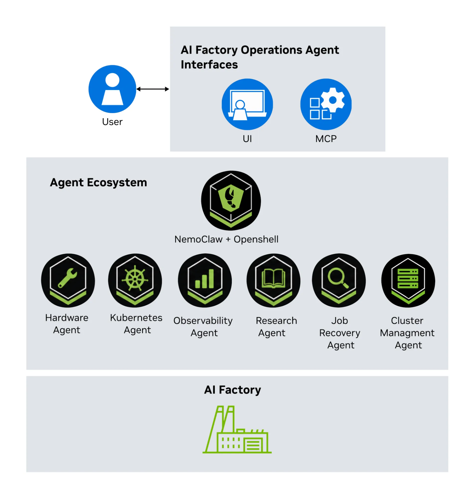

原文: [How NVIDIA Uses AI Agents to Streamline AI Factory Operations](https://developer.nvidia.com/blog/how-nvidia-uses-ai-agents-to-streamline-ai-factory-operations/)  
Kavya G Y, Rohan Adwankar · 2026-11-04

## 从多个仪表盘走向一次跨层调查

训练吞吐下降可能同时牵涉调度、网络、GPU、存储与应用。NVIDIA 的 AI Factory Operations Agent 将这些观察交给不同领域代理，再通过同一个对话入口组织调查。文章报告该框架用于内部 DGX H100、B200 和 GB300 生产集群；它介绍的是运维调查与建议的工程实践，没有给出可用于量化收益的 MTTR 或 RCA 准确率结果。

中心运行时基于 NemoClaw，接收 SRE 请求并路由给专业代理。OpenClaw 插件与 MCP 服务器暴露范围清晰的运维工具；Nemotron 模型可在本地提供推理，框架支持完整本地部署。这个划分的意义是：新增一种观测后端或专业角色，不必让每个代理都获得所有系统接口。

<a class="note-image-link" href="/assets/images/tech/nvidia-ai-agents-ai-factory-operations/architecture.webp" target="_blank" rel="noopener" aria-label="NVIDIA 运维框架的用户入口、专业代理和 AI 集群 · 查看原图 ↗">查看原图 ↗</a>

*从上方 UI／MCP 入口进入代理体系；底层集群提供被调查对象，专业角色负责不同证据域。*

## 调查角色与操作权限分别设计

Job Recovery Agent 关注作业失败和 goodput 下降，串联调度器、应用、硬件与网络证据，在确认根因后推荐恢复步骤。Hardware Agent 检查 PCIe、ECC、GPU、NVMe 和温度；Observability Agent 查询 Prometheus 与 Grafana Loki，并生成仪表盘。Research Agent 检索手册、参考架构和站点 runbook；Kubernetes Agent 提供只读资源与调度视图；Cluster Management Agent 通过诊断接口访问集群管理系统。

这些角色都围绕建议和调查展开。角色名称中出现“恢复”并不表示它已被授予生产写权限。原文强调先以准确的只读调查建立 SRE 信任，并让工程师在行动前查看工具调用、证据和结论。跨层关联也不应被理解为自动证明因果；文章仍把 RCA 准确率与 SRE 一致性列为持续测量方向。

## 最具体的机制在工具边界

框架作为 Kubernetes 控制面应用部署，Helm 安装 UI、网关、MCP 工具服务器、推理端点和 OpenShell 运行时。Shell 命令使用每个会话自己的 Kubernetes 沙箱，而不是在主网关 pod 中执行。沙箱接收工作区、选定技能与命令策略，避免把整个网关运行环境直接交给模型。

Kubernetes 检查由服务器侧 run_kubectl 工具执行：使用固定 kubectl 二进制和登记过的只读凭据。OpenShell 本身不接收 kubectl 或 Kubernetes 凭据，实际可见资源由 service account 与 RBAC 定义。原文展示的权限检查允许读取 pods、configmaps，不允许读取 secrets，也不能创建或更新 pods。这些是具体访问路径的权限证据，比在提示里写“请只读”更有约束力。

多租户场景继续把代理、工具、沙箱和 Kubernetes 权限限定到租户可见的命名空间、作业和节点；中央运维保留更广视图。OpenShell 用隔离沙箱和内核级限制执行边界。由此可见，多代理数量不是核心设计指标，角色边界与每个角色背后的工具权限才决定信息与动作能流向哪里。

## 控制面也需要资源隔离

文章建议大规模部署使用独立的 GPU 控制面，为推理分配专用容量，使生产集群主要输出遥测，不挤占训练 GPU。NVIDIA 内部采用专用推理 GPU，并在现有控制面的 CPU Kubernetes 管理空间运行服务。小规模部署可以选择其他本地或云推理端点，但数据驻留条件随之改变。

这份报告最值得参考的是五条实践经验背后的实现：减少角色所有权重叠、先只读、跨层取证、精确定义 MCP 工具、公开调查依据。它尚未给出有基线的事故恢复对照，演示视频也明确是注入事故；开源编排框架仍属实验性软件，NVIDIA 自有领域代理的获取方式另有安排。因而它更适合作为运维代理访问边界和部署结构的参考，而非已被证明能普遍降低故障时间的产品结论。
