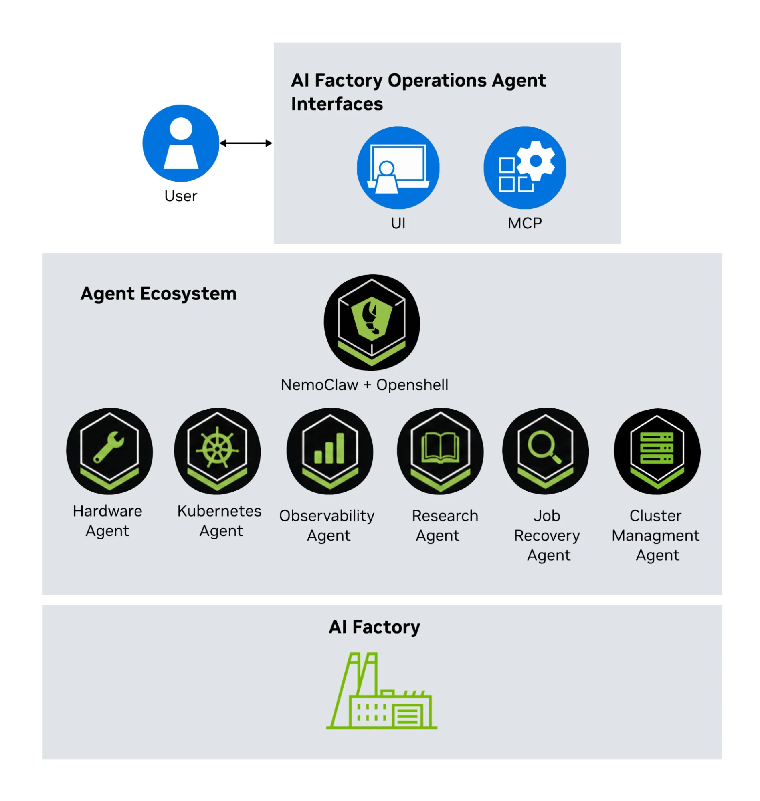
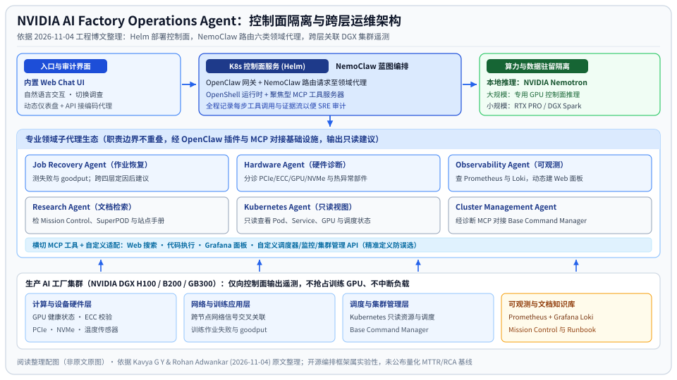
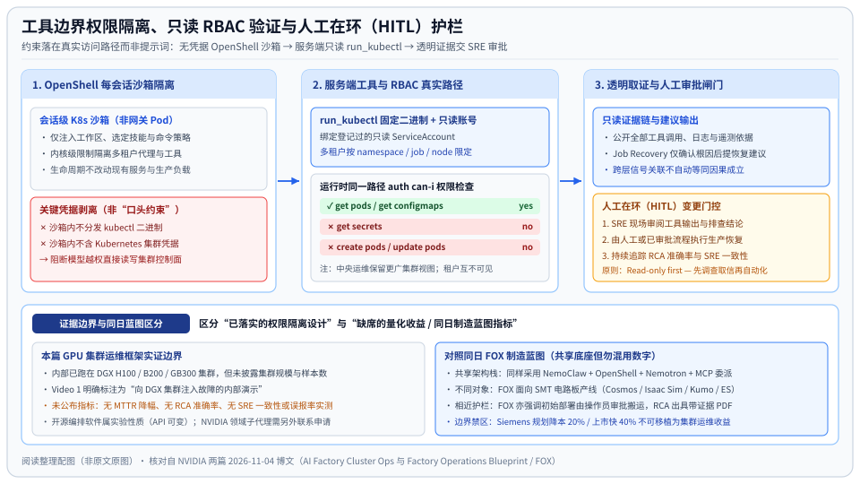

Kavya G Y（NVIDIA 企业产品经理）、Rohan Adwankar（NVIDIA AI 基础设施可观测性与智能体工程师）· 原文发布于 2026-11-04 · [NVIDIA 技术博客原文](https://developer.nvidia.com/blog/how-nvidia-uses-ai-agents-to-streamline-ai-factory-operations/) · [开发者示例卡片](https://build.nvidia.com/nvidia/operate-ai-factories-with-agents/examplecard) · [GitHub 开源编排代码](https://github.com/NVIDIA/AI-Factory-Operations-Agent)

大规模 GPU 集群发生训练作业失败或有效吞吐（goodput）下降时，根因往往跨越计算设备、互联网络、底层硬件、存储与集群调度多个平面，值班 SRE 不得不在十几个监控与日志仪表盘之间来回切换。NVIDIA 于 2026 年 11 月 4 日发布的这篇工程实践文章，介绍了团队在内部 **NVIDIA DGX SuperPOD**（涵盖 **DGX H100、DGX B200 与 DGX GB300** 生产集群）上落地的 **AI Factory Operations Agent**：通过 **NemoClaw** 蓝图、**OpenClaw** 网关与 **MCP**（Model Context Protocol）协议组织六个职责分离的专业代理，并以 **NVIDIA OpenShell** 与服务端只读 `run_kubectl` 把安全边界落实到真实访问路径上。

> **证据口径与来源边界**：本文严格依据冻存的 NVIDIA Technical Blog 2026 年 11 月 4 日原文及同日配套发布的制造蓝图博文（[FOX Blueprint 原文](https://developer.nvidia.com/blog/how-nvidia-factory-operations-blueprint-coordinates-ai-agents-to-investigate-production-issues/)）逐项核对重写。需要事先明确三项事实边界**：其一**，这篇集群运维博文报告的是工程架构与内部落地经验，**未公布任何受控对照实验、MTTR 缩短百分比、RCA 准确率或 SRE 一致性量化数值**（原文明确将 RCA 准确率与 SRE 一致性列为持续跟踪的改进指标）；**其二**，文中演示视频（Video 1）明确标注为**向内部 DGX 集群注入故障后的演示（injected into an NVIDIA DGX cluster for internal demonstration）**；**其三**，GitHub 开源编排框架仍属**实验性软件**（experimental open source software），且 NVIDIA 自研的集群运维领域代理需通过客户经理另行申请，而同日 FOX 制造蓝图里引用的 Siemens 产线规划数据（最高节省 20% 成本、缩短 40% 上市时间）**绝对不能**直接外推为本篇 GPU 集群 AIOps 框架的实测效果。

## 架构解耦与跨层遥测关联：NemoClaw 编排、六大专业代理与控制面隔离

传统单代理排障原型一旦同时面对 Kubernetes 状态查询、硬件告警解析、历史指标检索与文档比对，提示词与工具列表很快膨胀失控，误选工具或跨层遗漏也随之发生。NVIDIA 在 AI Factory Operations Agent 中采取的解法，是把**人机入口、中心编排路由、领域工具服务端以及底层推理算力**拆成边界清晰的模块化控制面。

<figure class="note-figure">
  <a class="note-image-link" href="/assets/images/tech/nvidia-ai-agents-ai-factory-operations/architecture.webp" target="_blank" rel="noopener" aria-label="放大查看 NVIDIA 原文 Figure 1：AI Factory Operations Agent 架构图">
    
    <span class="note-image-action">查看原图 ↗</span>
  </a>
  <figcaption>原文配图保留（来源：NVIDIA Technical Blog 原文 Figure 1）：展示用户经 UI 与 MCP 接口接入 NemoClaw 与 OpenShell 编排生态，协调六个专业领域代理面向 AI Factory 开展调查（注：原图节点名称保留英文原样，其中原始配图元数据提及由 NVIDIA Nemotron 3 模型驱动推理）。</figcaption>
</figure>

按照原文部署描述，整套系统作为 **Kubernetes 控制面应用**通过 **Helm** 统一拉起，核心服务包含 **Web UI、OpenClaw 网关（gateway）、MCP 工具服务器、推理端点与 NVIDIA OpenShell 运行时**。在请求路径与推理驻留上，它呈现三项关键工程特征：

1. **双入口接入与过程可审计**：SRE 既可以通过内置 **Web Chat UI** 用自然语言向任意代理发起调查、在多条排障会话间切换并查看动态生成的图表，也可以经 API 直接集成现有的编码代理（coding-agent）界面；系统会记录每次工具调用与动作轨迹，满足后续审计复盘要求。
2. **NemoClaw 中心路由 + OpenClaw / MCP 插件解耦**：**NemoClaw** 蓝图位于运行时中心，负责接收请求并路由至对应领域代理；各代理通过 **OpenClaw 插件**和 **MCP 服务器**连接基础设施，每个 MCP 服务器只暴露经过批准、职责聚焦的一小组运维工具。得益于这种解耦，新增一种监控后台或领域角色时，不必改动既有代理，也不必把全集群接口塞给所有代理。
3. **控制面算力与数据主权隔离**：为满足内部数据主权与可落盘要求，框架支持**完全本地化（on-premises）部署**，模型推理由本地部署的 **NVIDIA Nemotron** 开放模型承担（原文配图 `alt` 元数据提及 `NVIDIA Nemotron 3` 模型，正文统一表述为本地服务的 NVIDIA Nemotron 开放模型）。针对大规模 AI 工厂，NVIDIA 明确建议采用**与生产训练集群隔离的专用 GPU 加速控制面**——NVIDIA 内部部署即为模型推理分配专用 GPU 容量，并把运行时服务放到现有控制面的 **CPU Kubernetes 管理空间**中，使生产集群仅负责输出遥测而不被调查推理抢占训练 GPU。对于集群规模较小或算力受限的场景，原文也允许按数据主权与容量条件选用本地 **RTX PRO Workstation**、**DGX Spark** 或外部/云推理端点（但一旦接入外部端点，数据驻留边界便会相应外移）。

<figure class="note-figure">
  <a class="note-image-link" href="/assets/images/tech/nvidia-ai-agents-ai-factory-operations/ai-factory-multiagent-ops-zh.svg" target="_blank" rel="noopener" aria-label="放大查看 NVIDIA 集群运维控制面隔离与跨层遥测架构整理图">
    
    <span class="note-image-action">点击放大 ↗</span>
  </a>
  <figcaption>阅读整理配图（非原文原图）：依据 2026-11-04 博文梳理的控制面服务拓扑、本地推理算力隔离以及六个专业代理面向 DGX 生产集群的跨层遥测分工。</figcaption>
</figure>

在具体排障分工上，NVIDIA 将内部数据中心运维拆解为**六个专业领域代理**与若干**横切（cross-cutting）MCP 工具**。以训练作业吞吐骤降为例**：Job Recovery Agent** 串联调度器、应用、硬件与网络信号定位根因并提出恢复建议；**Hardware Agent** 沿设备层下钻 **PCIe 错误、ECC 内存错误、GPU 故障、NVMe 失效与温度异常**直至具体硬件组件；**Observability Agent** 查询历史 **Prometheus** 遥测和集成的 **Grafana Loki** 日志并直接在 Web UI 中动态生成看板；**Research Agent** 检索预加载的 **NVIDIA Mission Control** 手册、DGX SuperPOD 参考架构及用户上传的站点 Runbook；**Kubernetes Agent** 提供 Pod、Service、Deployment、GPU 资源、节点与调度状态的只读视图；**Cluster Management Agent** 则通过诊断型 MCP 工具调用 **NVIDIA Base Command Manager** API，提供集群层面的诊断与顾问式管理建议。此外，Web 搜索、代码执行和 Grafana 仪表盘作为横切 MCP 工具为各角色共用，企业也可接入自有的调度器、观测平台或集群管理器 MCP。

需要如实补充的一处架构留白在于（以下为基于冻存原文文本的核查结论）：原文反复强调该体系能够跨**计算、网络、硬件与调度**四层关联信号，以发现孤立工具遗漏的根因，但博文正文并未公开具体的互联层遥测采集接口名称（例如未展开说明网络信号具体来自哪类交换机计数器、NVLink 还是特定网络遥测插件），也未公开 MCP 工具的 JSON Schema 或各子代理之间的状态交接协议。对外部工程团队而言，这些协议细节仍需通过实验性开源仓库或企业架构评审进一步确认。

## 工具边界与人类在环护栏：OpenShell 每会话沙箱、无凭据隔离与只读 RBAC

在生产级 AIOps 系统中，“让大模型只做只读调查”如果只写在系统提示词（system prompt）里，几乎无法抵御提示词注入、工具参数拼接错误或插件越权调用。这篇博文最具工程参考价值的部分，正是它把权限控制拆解并钉死在**沙箱生命周期、凭据隔离与服务端 RBAC 执行路径**三道边界上。

| 架构组件 / 门控原语 | 覆盖证据域与接入接口 | 权限边界与防范的核心风险 | 原文披露状态与核查说明 |
| :--- | :--- | :--- | :--- |
| **Job Recovery Agent** | 串联调度器、应用、硬件与网络层的失败及 goodput 下降证据 | 虽名为“恢复代理”，但只作跨层定因后的**建议输出**，不默认执行生产变更 | 定性描述内部使用；未附独立自动恢复比例或耗时指标 |
| **Hardware Agent** | PCIe 错误、ECC 错误、GPU 问题、NVMe 故障与热异常设备诊断 | 聚焦器件级根因排查，避免与调度或日志查询角色发生职责重叠 | 归属“NVIDIA 自研领域代理”，需客户经理申请获取 |
| **Observability Agent** | 历史 Prometheus 指标、集成 Grafana Loki 日志与动态 UI 看板 | 负责时序与日志取证及可视化，不直接操控业务工作负载 | 文中明确支持在内置 Web UI 动态生成与展示仪表盘 |
| **Research Agent** | 预装 NVIDIA Mission Control 手册、SuperPOD 指南与自定义 Runbook | 将排查建议锚定到站点操作规程与参考架构，减少模型凭记忆编造步骤 | 支持上传站点私有文档；具体切分/检索后端未披露 |
| **Kubernetes Agent + `run_kubectl`** | Pod、Service、Deployment、GPU 资源、节点与调度状态 | 服务端固定 `kubectl` 二进制 + 注册的只读 ServiceAccount / RBAC 凭据 | **原文给出真实路径 `auth can-i` 检查**：可 `get` Pods/ConfigMaps，拒 `secrets` 及 `create`/`update` |
| **Cluster Management Agent** | 通过诊断型 MCP 工具调用 NVIDIA Base Command Manager API | 严格限定为“顾问式管理与排障”（advisory），保留人类决策门控 | 接口仅作诊断接入；是否包含写操作开关未展开说明 |
| **NVIDIA OpenShell 运行时** | 每会话独立 K8s 沙箱（工作区、选定技能、命令策略与内核级限制） | **不持有 `kubectl` 二进制与 K8s 凭据**；多租户下隔离各租户数据、工具与节点 | 原文重点安全机制；同样被同日 FOX 蓝图复用为文件/命令/网络策略网关 |

这套工具边界如何逐层拦截越权风险？从博文披露的实现链路可以拆出三个硬约束：

1. **每会话 Kubernetes 沙箱（而非主网关 Pod 内执行）**：当需要执行 Shell 命令时，**NVIDIA OpenShell** 不会直接在主网关 Pod 内运行指令，而是为每个会话创建一个独立的 **Kubernetes 沙箱**，并仅向其中传入 AI Factory Operations Agent 工作区、当次选定的技能（skills）以及明确的**命令策略（command policy）**。原文强调，该沙箱的创建与销毁生命周期**不会修改现有控制面服务或生产训练负载**。
2. **彻底的凭据剥离与服务端 `run_kubectl` 网关**：所有 Kubernetes 集群状态检查都必须经由服务端工具 **`run_kubectl`** 执行——该工具在服务端调用版本固定的 `kubectl` 二进制文件，并使用预先登记的**只读凭据（registered read-only credentials）**发起查询。**OpenShell 沙箱自身既拿不到 `kubectl` 二进制文件，也拿不到任何 Kubernetes 集群凭据**。从系统安全工程角度分析（此句为助手基于原文架构的机理归纳）：把集群凭据从智能体可执行 Shell 的环境中物理拿掉，意味着即便模型在工具输出或日志正文里遭遇恶意文本引导，也无法在沙箱内翻找 `kubeconfig` 或直接调用 `apiserver` 越权操作，而必须受制于服务端 `run_kubectl` 的单一只读入口与 ServiceAccount RBAC 策略。
3. **同一运行时访问路径下的 RBAC 实测检验与多租户隔离**：为了证明权限不是“口头承诺”，原文贴出了沿运行时实际访问路径执行 `kubectl auth can-i` 的检查结果——允许读取 `pods` 与 `configmaps`，但明确拒绝读取 `secrets` 以及任何 `create pods`、`update pods` 写操作：

```bash
(agent) $ kubectl auth can-i get pods
yes
(agent) $ kubectl auth can-i get configmaps
yes
(agent) $ kubectl auth can-i get secrets
no
(agent) $ kubectl auth can-i create pods
no
(agent) $ kubectl auth can-i update pods
no
```

在**多租户 AI 工厂（multi-tenant AI factories）**场景下，这套机制进一步向下切分：代理实例、MCP 工具、OpenShell 沙箱以及 Kubernetes 权限都会按租户范围收敛——租户侧 SRE 只能看到分配给自己的 **namespaces、jobs 与 nodes**（如有需要，还可为单个租户配置独立的领域子代理与专用推理硬件），而中央运维团队仍保留更宽的集群全局可见性；OpenShell 则通过**带内核级限制（kernel-level restrictions）的隔离沙箱**强制执行租户间的数据与工具边界。

<figure class="note-figure">
  <a class="note-image-link" href="/assets/images/tech/nvidia-ai-agents-ai-factory-operations/factory-hitl-remediation-gates-zh.svg" target="_blank" rel="noopener" aria-label="放大查看工具边界权限隔离、只读 RBAC 验证与人类在环护栏图">
    
    <span class="note-image-action">点击放大 ↗</span>
  </a>
  <figcaption>阅读整理配图（非原文原图）：拆解 OpenShell 无凭据沙箱、服务端 run_kubectl RBAC 权限路径、人工在环（HITL）变更门控，以及本篇与同日 FOX 制造蓝图之间的证据边界。</figcaption>
</figure>

更进一步看，权限只读只是硬件/平台侧的硬护栏，**工作流侧的人类在环（Human-in-the-Loop, HITL）护栏**同样被放在核心位置：原文五条经验中的“**Read-only first**”与“**Transparent reasoning**”互为表里——在走向任何自动化动作前，代理必须首先通过只读调查证明诊断准确度，并把每一步**工具调用（tool calls）、原始证据（evidence）和推导结论（conclusions）**完整暴露给 SRE；即使名为 **Job Recovery Agent**，它在确认根因后也只是**推荐恢复步骤（recommends recovery steps）**，真正拍板并在生产集群动手的依然是人工运维团队。

## 证据边界与定性实践的诚实盘点：缺席的量化基准与同日 FOX 蓝图对照

把工程架构讲清楚的同时，技术深读必须守住一条底线：**不能因为文中提及内部生产集群型号（DGX H100、B200、GB300），就把定性实践脑补成已经量化证明“降低多少故障恢复时间”的实证结论**。对照冻存的原文文本与 HTML 结构，这篇 11 月 4 日博文在证据成熟度上有四处非常清楚的边界：

- **只声明内部生产部署范围，未给出规模与定量收益**：文章指出该框架已在 NVIDIA 内部 DGX H100、B200 与 GB300 集群运行并减少了 SRE 手工切换工作量，但既未公布接入集群的 GPU 总卡数、月度调查查询量，也未公布上线前后的 **MTTR、MTTD 或人工工单耗时对比**。
- **RCA 准确率与 SRE 一致性属“持续评估方向”，非“已公开基准”**：文中写明 NVIDIA 正通过衡量 **RCA accuracy** 与追踪 **SRE agreement** 来持续打磨系统，但全文**没有给出任何百分比数字、评测场景集大小或错判案例分布**。
- **演示视频属于可控故障注入案例**：正文嵌入的 **Video 1** 明确写着 *“incident trouble-shooting example, injected into an NVIDIA DGX cluster for internal demonstration”*——这证明系统具备跑通人工注入故障排查链路的能力，但**不等价于**在复杂长尾真实生产故障上的统计胜率。
- **开源部分与专有代理的发布分层**：GitHub 仓库 `NVIDIA/AI-Factory-Operations-Agent` 提供的是**实验性开源编排框架**（明确提示 API、配置与部署要求可能随版本变化），而文中所列六个**NVIDIA 开发的集群运维领域代理**则需要现有客户联系客户经理单独申请。

有意思的是，同一天（2026 年 11 月 4 日）NVIDIA 还发布了另一篇名称高度相近的工程博客——由 Samuel Ochoa 与 Carlos Garcia-Sierra 撰写的 **[NVIDIA Factory Operations Blueprint (FOX)](https://developer.nvidia.com/blog/how-nvidia-factory-operations-blueprint-coordinates-ai-agents-to-investigate-production-issues/)**。将两份同日冻存的原始文献放在一起对照，不仅能看清 NVIDIA 在 **NemoClaw + OpenShell + Nemotron + MCP** 上的跨场景统一设计模式，更能精准识别**绝对不可混用的业务数字与边界**：

| 审查条目 / 来源主张 | 一手原文真实口径与适用上下文 | 缺失的对照条件或未公开信息 | 工程理解与禁止外推边界 |
| :--- | :--- | :--- | :--- |
| **DGX H100 / B200 / GB300 生产应用** | 本文（2026-11-04）：AI Factory Operations Agent 已在 NVIDIA 内部上述三类集群运行，辅助调查与建议 | 未披露集群节点规模、并发查询数、历史覆盖周期及故障类别分布 | 证明其在 NVIDIA 自有基础设施具备工程可行性，但不能代替通用集群压测或成本回报结论 |
| **RCA 准确率 / SRE 一致性 / 减负效果** | 本文（2026-11-04）：定性描述“减少 SRE 手动排查工作量”，并将 RCA 准确率与 SRE 一致性列为持续测量方向 | **零受控基线对照**、**零 MTTR 降幅百分比**、**零精确率/召回率与误报率统计** | 不能宣称“已在公开评测中将故障定位速度提升 X%”；跨层信号关联仍需人工复核因果 |
| **Video 1 集群故障排障演示** | 本文（2026-11-04）：明确标注为向内部 DGX 集群**注入故障（injected）**后的演示视频 | 未说明注入故障的具体数量、难度分级以及端到端推理耗时 | 可用于理解多代理界面与证据呈现形态，不宜作为真实复杂长尾故障的胜率证明 |
| **开源编排软件 vs. 领域代理交付** | 本文（2026-11-04）：`GitHub` 与 `build.nvidia.com` 提供实验性开源编排示例；NVIDIA 领域代理另行申请 | 实验阶段 API 与配置可能变动；未披露闭源领域代理的集成与维护边界 | 外部团队可借鉴其 NemoClaw + OpenShell + `run_kubectl` 骨架，但领域 MCP 工具多半需自研适配 |
| **同日 FOX 制造蓝图与 Siemens 数字** | 伴生文章（2026-11-04）：FOX 借 **NemoClaw + OpenShell + Nemotron** 服务 **SMT 电路板产线**；另引 Siemens 报道（非计划停机年损 2.53 亿美元）及 Erlangen 工厂规划（最高省 20% 成本、上市快 40%） | Siemens 规划数据来自制造排产与虚拟 AOI 准备，且 SMT 示例自身亦未公布缺陷检测与 RCA 准确率量化对照 | 两篇文章共享“编排底座 + 只读/审批门控”思想，但 **Siemens 20% / 40% 数值严禁混用为 GPU 集群运维成效** |

把这两篇同日文章并排审视，还能提炼出一个耐人寻味的共通工程原则：无论是在 GPU 数据中心（用 `run_kubectl` 只读 RBAC 守住集群控制面、只由 Job Recovery 输出恢复建议），还是在物理电子制造工厂（FOX 要求初期搬运由操作员批准、Visual Inspection Agent 必须向上返回不确定性而非硬凑二分类、RCA Agent 出具带来源记录与时序窗口的 PDF 报告），NVIDIA 现阶段的落地范式都刻意避开了“大模型直接接管高危执行动作”，而是把重心放在**用跨系统标识符、时间戳和聚焦工具把分散证据收拢到人类可审计的单一界面里**。

## 生产落地启示与上线前核查清单：从五条实践经验到可验证工程指标

文章后半段总结了内部运维沉淀下的五条经验：**清晰的代理边界（Clear agent boundaries）**、**先只读调查（Read-only first）**、**跨层关联（Cross-layer correlation）**、**精确的 MCP 工具定义（Precise MCP tools）**以及**透明推理（Transparent reasoning）**。对于正打算自研或引入 AIOps 多代理系统的基础设施团队而言，真正值得迁移的并非“凑齐六个代理图标”，而是将这五条定性原则转化为上线前可审计、可度量的工程护栏（以下四项核查清单由助手结合原文架构机制整理推导）：

1. **在凭据与系统调用层面落实只读边界，而不是在提示词里口头呼吁**：对照原文 `OpenShell（无凭据、无 kubectl） + 服务端 run_kubectl（固定二进制、只读 ServiceAccount）` 的拆分结构，在 CI/CD 与预发环境自动跑一遍覆盖敏感资源（`secrets`、节点修改、Pod 创建/删除/Exec）的 `kubectl auth can-i` 冒烟测试，并按多租户命名空间与节点标签做硬隔离。
2. **用“工具路由误选率”而非“代理数量”约束架构拆分**：原文直指“职责重叠产生的是噪声而不是信号”，且“清晰的工具定义能显著降低误选”。每新增一个 MCP 工具或专业代理前，应审查它与现有工具在参数语义与证据域上是否重叠，避免同时存在两个都能查指标或改状态的模糊接口。
3. **在故障风暴期之前规划独立控制面容量**：当生产集群发生大面积网络抖动或训练掉卡时，正是运维代理并发查询和推理最密集的时刻。照搬“生产集群仅输出遥测、推理走独立控制面 GPU（或独立工作站）+ CPU 管理命名空间”的物理隔离原则，可以避免诊断负载反向拖垮原本脆弱的生产集群或把密钥/训练上下文暴露到不可控云端端点。
4. **自行补齐原文缺失的量化基线后再讨论半自动缓解**：既然原文公开承认 RCA 准确率与 SRE 一致性仍在内部测量中，任何团队在内部灰度上线时都应预先打点四类客观指标——**工具选择准确率（tool-routing accuracy）**、**跨层假关联率（spurious correlation rate，即时间重合但无因果的误归因）**、**SRE 对排查建议的采纳/一致率（SRE agreement）**，以及在相同故障类型基线下的**首次定位证据耗时（TTFE）与 MTTR 变化**。只有当只读调查在这些真实工单上站稳脚跟，才谈得上为低风险、可瞬时回退的操作开放预批准人工确认按钮。

---

### 参考来源与一手核对链接

- 主要工程博文（本篇主出处）：Kavya G Y, Rohan Adwankar, *[How NVIDIA Uses AI Agents to Streamline AI Factory Operations](https://developer.nvidia.com/blog/how-nvidia-uses-ai-agents-to-streamline-ai-factory-operations/)*, NVIDIA Technical Blog, 2026-11-04。
- 官方代码与示例入口：*[AI Factory Operations Agent Developer Example](https://build.nvidia.com/nvidia/operate-ai-factories-with-agents/examplecard)*（NVIDIA Build）与 *[NVIDIA/AI-Factory-Operations-Agent](https://github.com/NVIDIA/AI-Factory-Operations-Agent)*（GitHub 实验性开源编排框架）。
- 关联架构组件文档：*[NVIDIA NemoClaw Blueprint](https://build.nvidia.com/nvidia/nemoclaw-for-openclaw/nemoclawcard)*、*[NVIDIA OpenShell](https://www.nvidia.com/en-in/ai/openshell/)*（及 [OpenShell 文档概览](https://docs.nvidia.com/openshell/latest/about/overview)）、*[NVIDIA Nemotron Open Models](https://www.nvidia.com/en-us/ai-data-science/foundation-models/nemotron/)*、*[NVIDIA DGX SuperPOD](https://www.nvidia.com/en-us/data-center/dgx-superpod/)*、*[NVIDIA Mission Control](https://www.nvidia.com/en-us/data-center/mission-control/)*、*[NVIDIA Base Command Manager](https://www.nvidia.com/en-us/data-center/base-command-manager/)*，以及小规模推理节点选项 *[RTX PRO Workstation](https://www.nvidia.com/en-us/products/workstations/)* 与 *[DGX Spark](https://www.nvidia.com/en-us/products/workstations/dgx-spark/)*。
- 同日伴生制造蓝图对照文献：Samuel Ochoa, Carlos Garcia-Sierra, *[How NVIDIA Factory Operations Blueprint Coordinates AI Agents to Investigate Production Issues](https://developer.nvidia.com/blog/how-nvidia-factory-operations-blueprint-coordinates-ai-agents-to-investigate-production-issues/)*, NVIDIA Technical Blog, 2026-11-04（与 [NVIDIA Agent Toolkit 文档](https://docs.nvidia.com/nemo/agent-toolkit/latest/index.html)）。

> **AI 辅助整理 · 归档注记**：本篇中文深度技术阅读与配套英文版（[English note](/tech/en/nvidia-ai-agents-ai-factory-operations/)）均由助手对照冻存的 2026 年 11 月 4 日两篇 NVIDIA 官方技术博文原文与 HTML 逐项核对撰写（`authoring_source: assistant`、`translation_source: assistant`），保留原 `id`、`date: '2026-11-05'`、`permalink`、`published_at` 与 `observability`、`systems-reliability`、`multi-agent` 三项标准标签。文中完整保留原始架构图 `architecture.webp`，并新增两幅由助手绘制的 `v3-blue` 架构与护栏对比图（`ai-factory-multiagent-ops-zh.svg`、`factory-hitl-remediation-gates-zh.svg`），所有可点击链接均取自冻存一手页面，未凭空补写原文缺失的 MTTR、RCA 准确率或网络层接口细节。
