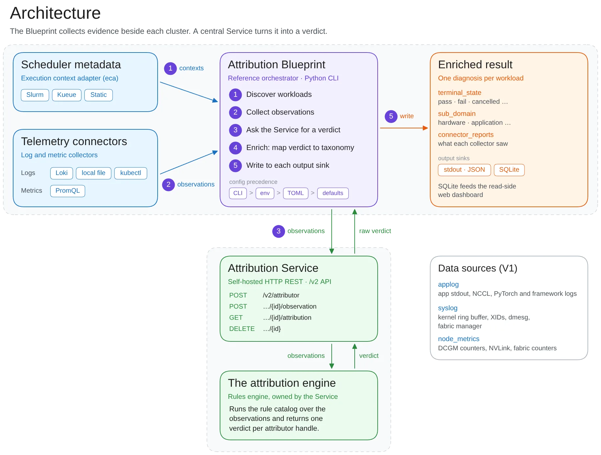

分布式训练里，一块 GPU 或一条互联链路出问题，往往会让多个 rank 同时报告 NCCL 错误。最后抛异常的位置不一定是故障起点。如果诊断系统把每条错误独立处理，就容易把一个根因拆成多个事故，或者把下游通信症状误判为责任节点。

NVIDIA Attribution 把分析单位设为一次 workload attempt：先确定它运行的时间与节点，再把应用日志、系统日志、指标和调度状态关联起来。它的核心是确定性规则与结构化证据，适合关注大规模 AI 基础设施故障归因的团队。本文作者为 Gargi Prasad、Jason Sewall、Aaron Blakeman、Ajay Hotchandani 和 Ashwin Poojary；[Diagnose Distributed AI Workload Failures with NVIDIA Attribution](https://developer.nvidia.com/blog/diagnose-distributed-ai-workload-failures-with-nvidia-attribution/)发布于 2026-11-02。

## 先限定事故范围，再解释日志

流程从 ExecutionContext 开始。调度器标识，或显式的执行时间窗口与节点分配，确定这次分析应该看哪些机器、哪段时间。Blueprint 的采集连接器据此生成 Observation，覆盖应用日志、GPU 驱动、Fabric Manager、调度记录以及节点和网络指标。这样的工作负载范围约束，是跨来源关联的基础：同一集群中同时发生的其他任务事件，不应自动成为本次失败的解释。

Service 接收规范化观察，调用归因引擎提取 GPU XID、NCCL 失败、调度转换与指标条件，再用规则解释事件间的时间关系和相互作用。结果同时包含终止状态 terminal_state、归因域 sub_domain、受影响节点、症状和采集覆盖／错误记录。把“任务是否失败”与“归因到了哪里”分成字段，便于下游系统消费，也让采集缺口有地方显式表达。

<a class="note-image-link" href="/assets/images/tech/nvidia-attribution/architecture.png" target="_blank" rel="noopener" aria-label="NVIDIA Attribution 的工作负载上下文、采集连接器、规则服务与输出架构 · 查看原图 ↗">查看原图 ↗</a>

*从左侧调度元数据与遥测进入 Blueprint，向下调用 Service 和规则引擎，再把归因与采集报告送往右侧输出。集群接入与诊断逻辑可以分别演进。*

## 一条 NVLink 证据如何解释多个 NCCL 错误

官方的合成示例包含三个节点上的 NCCL 错误，以及 node-02 系统日志中的 XID 149。提取阶段把原始日志变成带来源的类型化事件；此时仍保留多个候选症状，而不是看到任意 XID 编号就立即宣布最终根因。

EARLY 阶段的 HandleXidBurstEvents 读取 XID burst 的错误字，解析出 NVLink 信号完整性问题，同时保持三个 NCCL 事件不变。随后事件被组织为节点级症状，经过节点级清理，再聚合到任务级。FINAL 阶段的 Xid149AndNvlinkFiltering 保留信号完整性症状、降低其他节点症状的优先级，Gb200PriorityRootCause 进一步缩减活动症状集，最后映射为硬件故障归因。

这里最值得关注的是证据保留：被降级的 NCCL 症状仍作为 interesting evidence 留下原始来源，读者可以检查它为何被判断为下游影响。若多个原因都符合证据，sub_domain 可以标为 ambiguous。规则把已编码的故障知识应用到事件集合；可重复的规则执行并不意味着诊断在任何遥测缺失条件下都正确。

## Service 与 Blueprint 分工

Service 是归因引擎的自托管 HTTP 包装，接收标准化观察并返回 verdict。Blueprint 是 Python 参考编排器，负责发现工作负载、解析上下文、调用采集器、请求归因、补充结果并写入输出。它可以靠近各集群的数据源部署，多个 Blueprint 也可以共享一个 Service。

现有连接器覆盖 Slurm、Kueue 与静态执行上下文；日志和指标可来自 Loki、本地文件、Kubernetes pod 日志及 PromQL。输出支持 stdout 和 SQLite，后者供只读仪表盘使用。这个边界让团队可以更换调度器和遥测后端，同时复用归因逻辑；它并不消除为本地日志格式和故障模式补充规则的工作。

规则扩展同样有可审查路径。原文以无效 Pyxis 参数为例，展示带内联测试样例的提取规则。Service 启动时加载随版本发布的规则目录并检查样例；规则变更随服务交付，而非经 HTTP API 动态上传。对运维团队而言，规则版本、采集完整性和源证据可以一起成为诊断记录的一部分。

## 证据支持到哪里

NVIDIA 报告该系统已在其 AI 基础设施中使用多年，每周分析数百万工作负载，覆盖数十万 GPU；这说明部署范围，不是公开的准确率基准。文中还提及在大型 RDMA 集群中关联端口错误、连接重置和调度事件，以缩小到具体主机与交换机端口的维修范围，但没有给出统一的误归因率或检测延迟。

因此，这篇文章最扎实的可迁移内容是工作负载范围约束、分阶段规则、下游症状保留和标准化输出。它适合为自动恢复提供可追查的诊断输入；是否重启、隔离或维修仍需要结合恢复策略。进一步阅读可从[项目与规则目录](https://github.com/dsx-ai-factory/attribution)入手，对照本地已有的遥测覆盖判断哪些故障模式能被解释。
