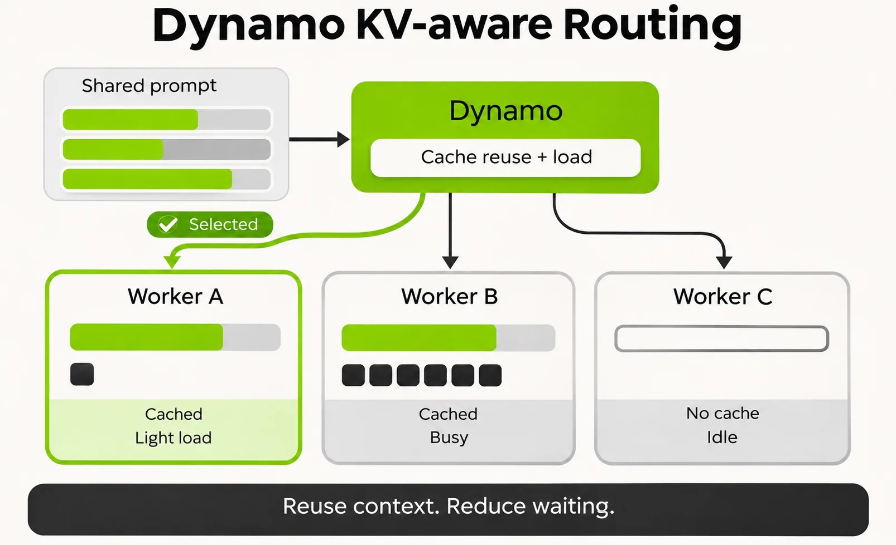

强化学习的一步训练需要一组可接受的样本。只提高一个 worker 的输出速度，可能让其他 worker 闲置，也可能加快了使用过期权重的轨迹。NVIDIA 把 rollout 推理拆成三方职责：训练框架决定奖励、环境和样本验收，推理引擎生成 token、加载权重，Dynamo 决定请求去哪里以及失去容量后怎样恢复。

Amr Elmeleegy, Harry Kim, Kyle Kranen · 2026-11-19 · [Reducing Rollout Bottlenecks in Reinforcement Learning with NVIDIA Dynamo](https://developer.nvidia.com/blog/reducing-rollout-bottlenecks-in-reinforcement-learning-with-nvidia-dynamo/)

## 前缀命中与队列长度一起看

同一题会采多个解，共享提示重复出现。路由到已缓存该前缀的 worker 可以省下预填充，但把整组请求都送过去可能制造长队。Dynamo 同时考虑缓存复用和负载。一次局部命中是否有价值，取决于省下的预填充能否抵消排队，以及这条轨迹是否会拖住整步训练。对同步等待样本的训练器来说，最后几个迟到样本尤其重要。

<a class="note-image-link" href="/assets/images/tech/nvidia-dynamo-rl-rollout-2026-11-19/figure.png" target="_blank" rel="noopener" aria-label="共享提示进入路由器后，缓存命中和已有队列共同影响 worker 选择。">查看原图 ↗</a>

*共享提示进入路由器后，缓存命中和已有队列共同影响 worker 选择。*

## 权重增量必须能对上基线版本

ModelExpress 可经 NIXL 从兼容 worker 的显存复制已有权重，省去反复读取远端存储。更新时也可发送压缩后的变化，由持有匹配基础版本的 worker 重建新权重。新加入的替代节点先加载检查点，再应用后续增量追上进度。何时允许切版本、旧缓存如何处理、样本是否满足策略版本要求，仍由 RL 框架协调。这些约束决定了更快搬运的权重何时真正变成可用容量。

## 替换节点与恢复轨迹分别验收

节点丢失后，Dynamo 把新请求转到合格节点，替代节点准备好才重新进入路由。在支持的配置中可以排空节点或迁移符合条件的在途请求。剩余的中断样本由训练框架处理，健康 worker 可继续服务。原文列出的现场数字有不同分母：CoreWeave 报告权重更新最高加快 15 倍，H Company 报告平均训练步时间最多缩短 20%、GPU 小时最多下降 5%。前者计时在分发路径上，后者包含训练的其他环节，不能连乘成一个集群的端到端收益。
