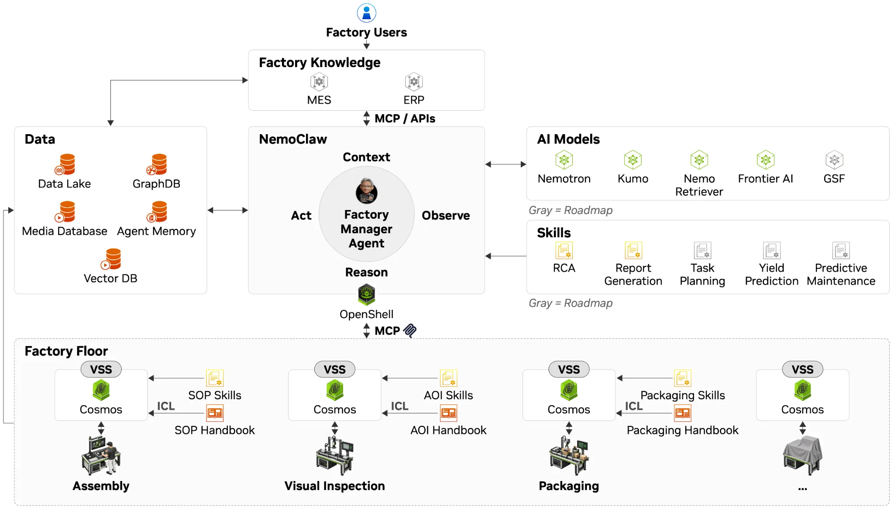

原文: [How NVIDIA Factory Operations Blueprint Coordinates AI Agents to Investigate Production Issues](https://developer.nvidia.com/blog/how-nvidia-factory-operations-blueprint-coordinates-ai-agents-to-investigate-production-issues/) 
Samuel Ochoa, Carlos Garcia-Sierra · 2026-11-04

## 生产缺陷往往跨越多个工位

电路板在检测工位出现焊接问题，原因可能来自更早的印刷、贴片或回流过程。NVIDIA Factory Operations Blueprint（FOX）展示如何让一个长期运行的 Factory Manager Agent 调用专业代理，串联二次检查、返工搬运和根因调查。它处理的是制造现场，与 GPU 集群运维代理不同。

文章的 SMT 电路板装配线是参考示例。经理代理不替换 MES、ERP 或设备数据库，而是通过适配器、MCP 与 API 访问这些系统。LLM 解释任务并组织证据，NemoClaw 管理工具、技能、记忆和委派，OpenShell 执行文件、命令和网络访问边界。开发者仍需提供任务完成标准、工厂特定的检查规则和操作审批条件。

<a class="note-image-link" href="/assets/images/tech/nvidia-factory-operations-blueprint-agents/architecture.webp" target="_blank" rel="noopener" aria-label="FOX 经理代理连接工厂知识、专业模型与现场设备的架构 · 查看原图 ↗">查看原图 ↗</a>

*中心代理将知识、模型和设备接口连接起来；图中灰色项目明确属于路线图，并非全部已交付能力。*

## 板卡标识让分散记录成为同一条调查

AOI 报警进入系统后，经理代理先获取板卡标识、疑似缺陷组件和图片，再请求二次判断。标识关联各工位的加工历史；适配器还要保留时间戳、单位和来源引用。这里的工程难点不只是模型看懂一张图，而是确保不同系统讨论的是同一块板、同一时间段和相同量纲。

Visual Inspection Agent 接收板卡图像、参考样例与获准使用的判定标准，调用 Cosmos 做视觉分析。可接受的变化、确定缺陷与无法确定的情况走不同分支：分别依据工厂策略继续、进入处理流程，或交给人工复核。模型的不确定性因此是流程输入，不应被压成统一的通过／不通过。

确认缺陷后，Fleet Management Agent 负责将指定板卡送往返工。原文用 Isaac Sim 与 ROS 2 在数字孪生中演示运输；真实机械手和 AMR 的连接、安全处理策略仍要按工厂实现。专业代理检查权限和能力并验证动作完成，初始部署建议在搬运前获得操作员批准。返工后的维修与复测也由操作流程承担。

## 根因报告需要回到加工窗口

RCA Agent 用板卡标识与工艺历史提取检测结果、贴片记录、电测结果和机器测量。即使 AOI 没有可见缺陷，功能测试失败也能触发调查。怀疑焊接异常时，板卡进入和离开回流炉的时间限定了应检查的温度等读数，Kumo Anomaly 再分析这段时序的异常模式。

异常并不自动等于原因。代理继续与其他批次、检测结果和机器手册对照，形成带来源记录、可疑测量、可能原因和建议动作的报告，交由线体负责人审阅。Elasticsearch 用于检索证据、版本化手册和历史调查；历史结论引导搜索，当前记录与规程支持本次结论。这种结构对 AIOps 有迁移价值：把对象、时间窗口和证据版本显式关联，避免只依靠语义相似的历史事故得出答案。

## 哪些效果不能混在一起

文章还引用 Siemens Electronics Factory in Erlangen 的生产规划与虚拟准备实践，分别提到最高 20% 的成本节省、最高 40% 的上市时间缩短。它们不是上述 SMT 缺陷调查参考示例的测量结果，也不能用来代表 FOX 的 RCA 准确率或所有工厂的停机收益。

本地部署可将模型与数据服务放在 DGX Station 上，但真正保持数据在厂内，要求所有模型和服务端点都留在工厂网络；只把经理代理放在本地还不够。开发者还承担设备连接、标识映射、输出验证和边界检查，当前蓝图提供早期访问入口。

这份材料的价值是把多代理协作落实到可检查的交接：视觉判断提供证据与不确定性，搬运返回完成状态，RCA 返回可追查的报告。它没有证明闭环自治已经解决制造故障，也没有给出该参考例的受控收益测量。阅读时应优先看这些交接契约及开发者责任，而不是将架构图中的模块数量当成成熟度。
