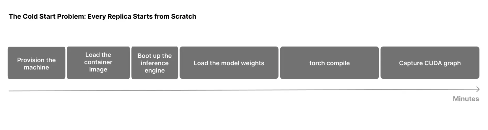

扩容时分到 GPU，并不意味着模型副本立即可用。加载权重、编译、autotune 与 CUDA graph capture 都可能占用数分钟。NVIDIA Snapshot 将已经初始化的进程与 GPU 状态保存为检查点，让下一份兼容副本从这个位置恢复。它为弹性伸缩和副本故障恢复提供的是可复用启动资产，效果取决于保存的状态、存储速度和兼容条件。

原文：[Start and Restore GPU Workloads in Seconds with NVIDIA Snapshot](https://developer.nvidia.com/blog/start-and-restore-gpu-workloads-in-seconds-with-nvidia-snapshot/)  
Ron Kahn、Dan Feigin、Oz Bar-Shalom、Ekin Karabulut、Schwinn Saereesitthipitak · 2026-11-10

## 检查点跨过了哪些初始化工作

冷启动的成本不只是把权重从盘搬进 HBM。引擎要启动工作进程、导入库、建立多卡通信，然后做张量重排、显存分析、KV 与缓冲分配，最后编译和捕获执行图。保存完全初始化后的 CPU/GPU 内存，能同时跳过多类重复工作。

<a class="note-image-link" href="/assets/images/tech/nvidia-snapshot/official-1.webp" target="_blank" rel="noopener" aria-label="模型副本从节点分配到 CUDA 图捕获的冷启动阶段 · 查看原图 ↗">查看原图 ↗</a>

*读图：左侧节点和镜像准备仍需另行考虑；Snapshot 主要复用后面的进程、权重、编译与图捕获状态。*

原文流程用 Kubernetes 自定义资源表达：已有 Pod 可由 `PodSnapshot` 指定并捕获；`SnapshotJob` 则从模板启动，等就绪后保存。新 Pod 通过 `nvidia.com/restore-from` 注解选择已有快照。工作负载需要一个小型握手，在捕获前暂停、恢复后继续，并非任意运行中的容器都能不经适配直接迁移。

多 GPU 进程可在单节点内作为跨 rank 的统一工件保存，覆盖 TP、数据/专家并行与 decode context parallelism。目标必须满足运行时兼容要求，文章明确要求同 GPU 型号和驱动。这里的“可移植”是兼容节点间恢复，不是跨设备、跨驱动任意恢复。

## 从存储回到可服务状态

恢复分成四段。节点 agent 先定位工件并准备 Pod/GPU；CRIU 从存储还原 CPU 进程；CUDA 恢复把 GPU 状态放回显存；最后进行新节点所需的 remap 与唤醒。快照文件因此大于模型权重，8 卡配置可接近或超过 1 TB，不能只用参数字节数估算存储与带宽。

本文基准特别说明：**每次捕获前会释放 KV cache，KV 不在工件里。** 因此，这些数字证明的是已初始化引擎副本恢复，并不证明保留某个用户正在生成的上下文、采样位置或外部工具状态。故障前没有保存的在途进度，也不能从这类预热工件中重建。

## 数字说明了什么

测试使用 B200、驱动 615.71.09、VAST NFS，比较 vLLM 0.31.0、SGLang 0.5.21 与 TensorRT LLM 1.3.0，同配置下对照进程冷启和快照恢复。结果为 3.6–42.7 秒，较冷启动快约 8–36 倍。最大 8 卡 MoE 的 CUDA 状态搬运约 18–29 秒，CRIU 阶段约 4.2–10.8 秒，说明大检查点的主要瓶颈仍是移动状态。

检查点创建需要 15 秒至 5.5 分钟。在作者测试的每种配置中，“创建一次加恢复一次”仍短于一次冷启；这依赖原有初始化代价，不是对任何轻量模型的保证。预先生成工件后，多副本可以反复使用，才体现复用的规模价值。

## 恢复时延之外还有完整就绪链路

冷启动与恢复测量都排除了容器镜像拉取和容器运行时设置；基础设施分配也在比较范围之外。把这些数字当作“从扩容决策到生产流量可用”的完整时间，会漏掉节点供给、调度、网络以及镜像成本。改变模型、引擎或驱动后，也需要重新管理快照兼容性与生命周期。

它与 Firepool 解决相邻但不同的问题：Firepool 复用可接任务的热执行环境，Snapshot 复用模型引擎已经完成的初始化；两者并未在本文证明可以无缝组合。对可靠性工程，最值得关注的是把恢复对象、被排除的阶段与工件读取带宽说清楚，再判断它能缩短哪一段恢复时间。
