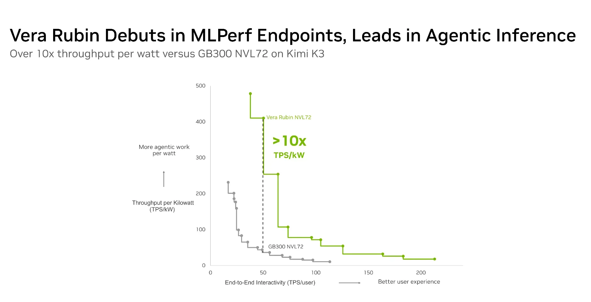

同一代服务器可以在增加并发后产出更多 token，却让每个正在等回复的人等得更久。NVIDIA 的 MLPerf Endpoints v1.0 文章给出了回答这两个问题的原始运行点。理解 Vera Rubin 与 GB300 的差距，要先确定比较时固定的是响应速度、并发数，还是功率。

## 多轮端点同时承受重复前缀和不断增长的历史

编码任务会不断向上下文追加工具结果，企业工作流还会在不同任务间复用指令、工具定义和业务规则。一个推理端点既要尽快处理新输入，也要在持续解码时给每个用户足够的输出速度。基准通过 API 运行这两类工作流，在性能测量期间将工具调用和工作流意图与参考值比较；另外使用 SWE-bench Verified 检查端到端解题能力。这两种检查分别约束快速运行时的行为和任务层面的质量。系统总吞吐与单用户端到端平均交互速度也分别记录，因此可以观察扩容后服务体验如何变化。

## 按同一响应门槛比较，允许两个系统选择不同并发点

以 Kimi K3 为例，先要求两套系统都达到每用户每秒 50 个 token，再从各自满足要求的实测点里选每千瓦吞吐最高者。Vera Rubin 所选运行使用 32 个加速器、1,024 并发，总吞吐 41,414.2 tokens/s，配置功率 100.89 kW。GB300 所选运行使用 48 个加速器、48 并发，分别为 2,210.4 tokens/s 和 60 kW。二者约为 410 和 37 tokens/s/kW，这才是文中「超过十倍」的含义。两套配置实际达到的交互速度分别是 50.4 和 56.2 tokens/s/user。

把问题换成「同样是 1,024 并发，用户感觉快多少」，比较点也要换。此时 GB300 的交互速度为 16.8，而 Vera Rubin 为 50.4，约为三倍。原文以阶梯图展示已测点，没有对中间的并发配置插值。图上的每千瓦以配置功率作分母，不能直接读作对每次任务耗电量的电表测量。

<a class="note-image-link" href="/assets/images/tech/nvidia-vera-rubin-nvl72-mlperf-endpoints-v1-0/nvidia-vera-rubin-nvl72-mlperf-endpoints-v1-0.png" target="_blank" rel="noopener" aria-label="阶梯上的每一档来自实际提交的运行点，可以沿横轴选择交互速度门槛，再读出每千瓦吞吐。 查看原图 ↗">查看原图 ↗</a>

*阶梯上的每一档来自实际提交的运行点，可以沿横轴选择交互速度门槛，再读出每千瓦吞吐。*

## 服务层和内核一起改变了比较结果

对于重复的对话开头，前缀缓存和状态复用可以省掉已经完成的计算，Dynamo 路由还要在复用机会和工作节点负载之间作选择。预填充与解码分开配置后，前者的同步等待不会以同样方式限制后者。底层的 HBM4 和第六代 NVLink 分别服务于内存访问与跨卡传输。不同模型又用上不同路径：DeepSeek 的 MegaMoE 内核利用数据局部性，Qwen 用多 token 预测提出候选，再用 Tensor Core 集中验证。这样的组合也说明，端点间的差距无法直接归给某款芯片或某一项软件优化。

NVIDIA 报告，三个模型在各自交互门槛下的每千瓦吞吐比约为 5–10 倍，在各自匹配并发的运行点上交互速度比约为 3–5 倍。DeepSeek 和 Qwen 使用的门槛分别是 280 和 410 tokens/s/user，并非 Kimi 的 50。文章发布时 GB300 结果已通过 MLCommons 核验，Vera Rubin 提交仍是临时成绩；结论对应这些特定模型、服务配置和已测工作点。

Zhihan Jiang, Lisa Luh · 2026-11-16 · [NVIDIA Vera Rubin NVL72 Leads Agentic Inference Performance on MLPerf Endpoints v1.0](https://developer.nvidia.com/blog/nvidia-vera-rubin-nvl72-leads-agentic-inference-performance-on-mlperf-endpoints-v1-0/)
