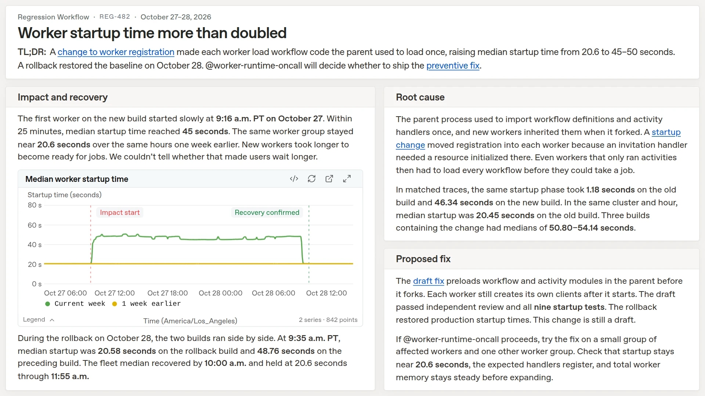

一次 ChatGPT 图片下载故障中，调查智能体找到了失败的文件定位服务，把它列为根因。另一个会话检查时间线后发现，该服务早已恢复，图片请求却仍在报错。原解释能说明故障是怎样开始的，却无法解释它为何持续。OpenAI 的 Performance Factory 把这种反证作为独立步骤，并让同一个任务一直保留到部署后确认恢复。由此，“有解释了”和“用户受到的影响结束了”有各自的证据。

## 让任务在告警、评审和部署之间存续

团队最初把定位方法整理成 perf-forensics 技能，让 Codex 找回归起点、受影响请求及相关上线变更。即便这一步自动化，工程师还得在告警、Slack、代码评审和指标面板间传递信息。新系统把状态和调查结果写进独立任务。工作流配置规定允许的状态转移、每步提示和需要工程师判断的位置；调度循环只为已经就绪的步骤启动会话。等待评审意见或部署完成时，任务订阅事件，等到匹配事件才继续。后一位调查者可以接手同一份证据，不依赖前一位智能体仍在运行。

<a class="note-image-link" href="/assets/images/tech/openai-performance-factory/figure.png" target="_blank" rel="noopener" aria-label="工作进程启动变慢的任务报告把指标走势、影响和候选修复保存在一起。">查看原图 ↗</a>

*工作进程启动变慢的任务报告把指标走势、影响和候选修复保存在一起。*

## 先分清请求变慢，还是慢请求变多

指标越过告警阈值的时间可能晚于性能开始恶化的时间。调查者先找变化起点，再按请求群组比较。如果各组的相似请求都没有变慢，整体中位数的上升可能来自流量构成变化。若某组确有退化，再对照它实际接收部署或配置的时间，用日志、追踪和剖析数据判断代码是否足以解释现象。独立复核会问未暴露于变更的相似请求是否健康，回滚后指标是否恢复。图片下载案例就是后一类检验迫使调查重开。

## 修复建议如何经过生产验证

根因通过复核后，智能体提交候选修改，工程师结合性能时间序列、火焰图和追踪决定是否合并。加缓存可能减轻计算，却同时引入陈旧数据；这种取舍需要熟悉服务的人决定。部署完成后，另一次会话对照先前基线复查。如果毫无改善，原任务回到调查；如果原回归已解决但还有残余减速，则新开任务追踪剩余原因。仅凭一个 PR 已合并无法区分这两种结果。

## 用过去的事故检验新的调查技能

换模型或改提示后，团队让新会话从当时的原始告警重新调查，再对照实际解决过程。历史数据并不是天然干净的题库：旧指标和追踪会过期，恢复后写下的复盘却可能直接泄露答案。回测限制可访问的数据，不提供既往调查笔记、复盘或其他轮次的结果，结束后还检查轨迹是否意外接触了答案。交接摘要则用已保存任务的快照评估，重点看不熟悉服务的工程师能否理解影响、看见关键图表、判断下一步是否有依据。这两类测试依赖的数据寿命不同，拆开后才知道退化发生在调查还是表达。

## 怎样读调查数量与准确率

作者报告三个多月内工作流跟踪了超过 1,700 次调查，为超过 600 个案例定位了根因。另一次人工抽查针对 100 条根因建议，70% 被评为准确，其余需要补充或未确立因果关系。调查数、已定位案例和抽查正确率的分母不同，三者不能换算成自动修复率。系统还会检查近期调查中反复出现的工具错误和权限缺口，用已保存任务测试交接摘要是否保留关键证据。这里可以迁移到其他 SRE 流程的，是分别检验“找对时间”“找对原因”和“修复后恢复”。

Okay Zed, Cyrus Forbes · 2026-11-19 · [How OpenAI’s Performance Factory keeps ChatGPT fast](https://openai.com/index/how-openai-performance-factory-keeps-chatgpt-fast/)
