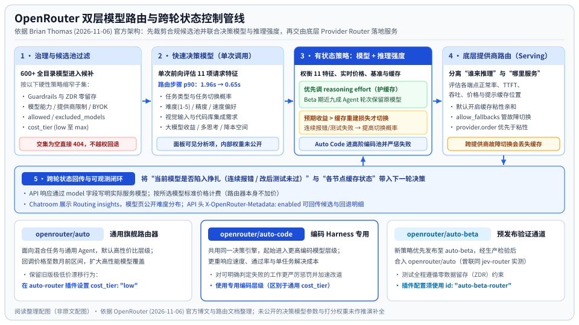
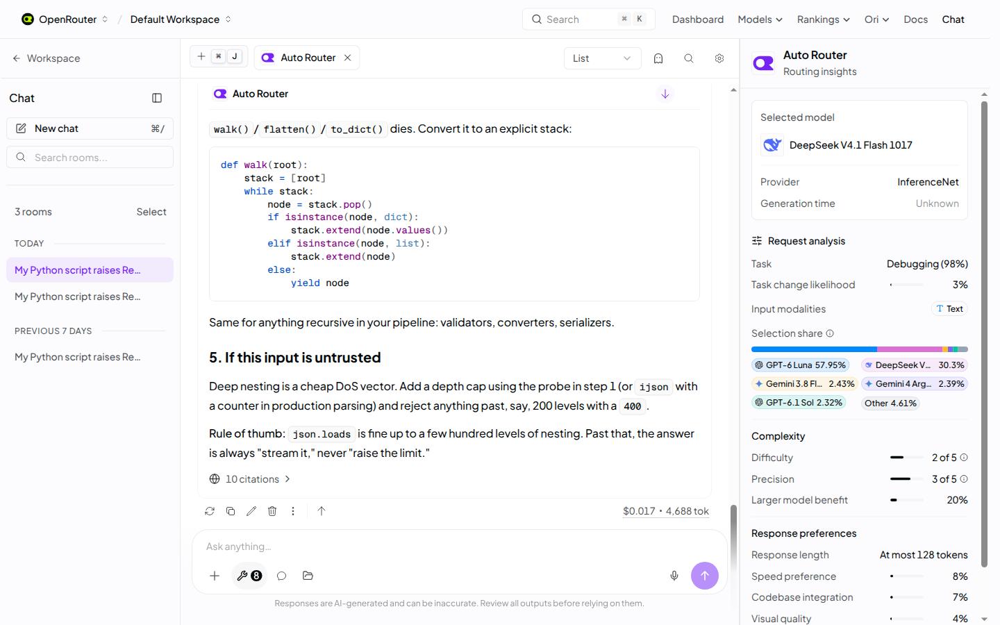
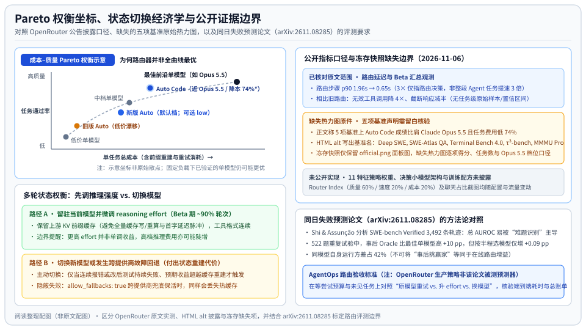

Brian Thomas（OpenRouter）· 原文发布于 2026-11-06 · [原始官方公告《Introducing the New Auto and Auto Code Routers》](https://openrouter.ai/blog/announcements/auto-and-auto-code-routers/) · 关联官方文档：[Auto Router 指南](https://openrouter.ai/docs/guides/routing/routers/auto-router) · [Provider Selection 文档](https://openrouter.ai/docs/guides/routing/provider-selection) · [Router Metadata 文档](https://openrouter.ai/docs/guides/features/router-metadata#enabling-router-metadata)

逐轮挑一个标价更便宜或跑分更高的模型，在单轮问答里往往能压低单次账单，但在多轮工具调用与编码 Agent 中，模型切换本身就有高昂的状态成本：新模型必须重新预计算长输入前缀，丢失既有提示缓存（prompt cache），同时还可能引入工具调用格式与推理风格漂移。OpenRouter 在运行 Auto Router 接近 **3 年**、月均处理超过 **10 万用户** 与 **2.5T tokens**、目录覆盖 **600+ 模型**的背景下，从底层重写了通用路由 **`openrouter/auto`**，并推出面向编码 Harness 的 **`openrouter/auto-code`** 与预发布通道 **`openrouter/auto-beta`**。比“支持更多模型”更关键的机制变化在于：它把路由拆成“模型/推理强度选择”与“底层提供商路由”两层，并将**缓存保留、推理强度微调与跨轮失败延续**变成了同一套有状态控制闭环。

> **口径与来源边界**：本文主信源为冻存的 OpenRouter 官方发布页 HTML 与正文（`2026-11-06`，作者 Brian Thomas）及冻存的官方截图 `official.png`（即原站 `chat-routing-insights.png`）。下文同步核对了文章直接引用的 OpenRouter 官方路由/元数据/基准文档，以及同日收录的失败预测论文 [`arXiv:2611.08285`](/digest/zh/daily/2026-11-08/#paper-arxiv-2611.08285) 与关联技术笔记（[Datadog 提示缓存排障](/tech/zh/datadog-prompt-cache-investigation/)、[Claude Opus 5.5 剖析](/tech/zh/anthropic-claude-opus-5-5/)）。必须明确指出一项**冻存快照边界**：原博文内嵌的五项基准热力图（`benchmark-comparison-light/dark.png`）与模型页实时占比图（`router-page-live-routing.png`）未作为静态图片保存在本次冻存快照中，仅其 HTML `alt` 文本与正文总结保留在原始 HTML 里——因此下文仅引述可核对的文本与 `alt` 口径，绝不补写缺失的逐项得分与样本分布；后文关于切换损耗与回退冲突的工程推演亦明确标为助手分析，而非 OpenRouter 官方披露的内部权重或算法。

## 双层架构与五步请求管线：把“谁来推理”与“在哪里服务”彻底拆开

旧版 `openrouter/auto` 为压低路由延迟并维持判别一致性，只依赖任务类型等少数粗糙信号；同时，由于极低成本模型性价比提升，旧版在迭代中出现了明显的“向低价漂移（drifted lower on cost per task）”现象，导致许多高能力模型很少被选中。新版架构在恢复数月前价格定位、重新扩大高能力模型覆盖的同时，将每条请求放进一套清晰的**五步双层管线**：

1. **治理与合规候选池收敛**：所有 OpenRouter 上超过 `600` 个模型在上线当日即进入候选集合（由基准成绩与市场活跃信号决定能否进入当前成本最优子集），但任何请求在真正评分前，会先被硬性治理边界裁剪——包括组织与工作区的 `guardrails`、**零数据留存（Zero Data Retention, ZDR）**要求、模态/工具能力、提供商限制、**BYOK（自带密钥）**绑定，以及 `auto-router` 插件内的 `allowed_models`（支持通配符如 `anthropic/*`）、`excluded_models` 与 `cost_tier`（`low`、`medium`、`high`、`xhigh`、`max`，优先级高于已保留向后兼容的旧浮点参数 `cost_quality_tradeoff`）。需要留意官方路由文档的一条硬性边界：**若上述限制交叉后的合法候选池为空，请求会直接返回 `404` 报错**，路由器不会越权回退到受禁模型。
2. **单次前向调用的快速决策模型（11 项请求特征）**：一个低延迟决策模型在**单次调用**内对请求的 11 项属性打分，涵盖任务类型、任务是否刚刚发生切换、任务难度、速度敏感度、是否需要视觉输入或代码库知识，以及“换更大模型、增加思考、还是改用更便宜模型”各自的潜在收益。原文报告其在线测试中的**路由步骤 p90 耗时从 `1.96s` 降至 `0.65s`（快 `3×`）**，但决策模型本身的参数规模、提示词及 11 项特征的内部权重均未公开。
3. **有状态策略联合输出 `(model, reasoning_effort)`**：决策策略把上述 11 项特征与**实时价格、提示缓存状态、基准成绩及上一轮延续信号**结合，同时决定**选用哪款模型**以及**开启哪一档 `reasoning effort`**。`openrouter/auto` 默认追求跨工作负载的平衡覆盖（若希望恢复旧版极低价漂移风格，可在 `auto-router` 插件显式指定 `cost_tier: "low"`）；而 **`openrouter/auto-code`** 虽然共用同一决策引擎，却直接从**更高一级的编码模型层级**起步，更看重响应速度、实测通过率与每解决任务成本，并对可明确判定失败的编码轮次施加更严厉惩罚（依据官方文档，`Auto Code` 运行在自身专用编码层级，默认不沿用标准 `auto-router` 插件里的通用 `cost_tier` 规则）。
4. **交由标准 Provider Router 落地执行**：OpenRouter 刻意将 **Model Routing（选模型）** 与 **Provider Routing（选服务提供商）** 分层解耦。一旦模型与推理强度确定，请求进入与直连单模型完全相同的[提供商路由层](https://openrouter.ai/docs/guides/routing/provider-selection)，按用户偏好（`order`、`only`、`allow_fallbacks`）、实时可用率与延迟、吞吐、实付价格以及**提示缓存所在节点**选择托管端点。正如 OpenRouter 在 2026 年 10 月 28 日[《How we rebuilt provider routing for better, faster inference》](https://openrouter.ai/blog/announcements/how-we-rebuilt-provider-routing/)中指出的，提供商层自身刚从“单一最低价导向”重构为综合平衡实付价、TTFT、吞吐与错误率（其在线对比报告容量错误减少 `46%`、TTFT 快 `16.9%`、吞吐升 `16.3%`、均价微增 `6.0%`）。
5. **跨轮状态延续与全链路可观测**：每轮执行结束后，系统把“当前模型是否陷入挣扎（例如相同错误反复出现、修改代码后测试持续失败）”和“已经建立的缓存状态”写回下一轮决策上下文；同时在 API 响应 `model` 字段返回实际服务模型（路由本身**不加收额外费用**，仍按实际命中模型的标准单价计费），在 Chatroom 侧提供实时 **Routing insights** 面板，并在 API 请求头传入 `X-OpenRouter-Metadata: enabled`（兼容旧头 `X-OpenRouter-Experimental-Metadata`）时于响应附带 `openrouter_metadata` 供排障审计。

<figure class="note-figure">
  <a class="note-image-link" href="/assets/images/tech/openrouter-auto-router-next-gen/openrouter-autorouter-pipeline-zh.svg" target="_blank" rel="noopener" aria-label="点击放大查看 OpenRouter 双层模型路由与跨轮状态控制管线图">
    
    点击放大 ↗
  </a>
  <figcaption>阅读整理配图（非原文配图）：依据 OpenRouter（2026-11-06）官方五步流程与路由/元数据文档整理的模型选择、提供商分配及跨轮状态闭环。</figcaption>
</figure>

保留自冻存原始博客的 `official.png` 直观展示了 Chatroom 侧 **Routing insights** 面板在单次请求上的决策粒度。图中一段排查 Python 递归栈溢出并补入不可信嵌套深度防护的请求（底部计费 `$0.017 · 4,688 tok`）最终落到 `InferenceNet` 托管的 `DeepSeek V4.1 Flash 1017`；右侧面板拆出了主任务归类（`Debugging 98%`、`Task change likelihood 3%`、`Input modalities: Text`）、复杂度评分（`Difficulty 2 of 5`、`Precision 3 of 5`、`Larger model benefit 20%`）以及响应偏好（`Response length: At most 128 tokens`、`Speed preference 8%`、`Codebase integration 7%`、`Visual quality 4%`），并列出了同期各模型选中占比（`GPT-6 Luna 57.95%`、`DeepSeek V... 30.3%` 等）。但正如原文同时强调的，这类界面**用于事后解释与排障，而不证明某次分配全局最优**；该面板的占比随模型目录更新、定价调整和实时请求分布而变化，不能当作固定性能承诺。

<figure class="note-figure">
  <a class="note-image-link" href="/assets/images/tech/openrouter-auto-router-next-gen/official.png" target="_blank" rel="noopener" aria-label="点击放大查看 OpenRouter 原文 Routing insights 面板截图">
    
    点击放大 ↗
  </a>
  <figcaption>原文保留截图（chat-routing-insights.png）：展示单轮请求在 Routing insights 面板暴露的多维特征分析、选中模型与提供商；图中候选模型占比随目录、定价与流量动态变化，不代表跨工作负载性能保证。</figcaption>
</figure>

## 多目标权衡与失效边界：缓存粘性、推理强度调节及回退死角

把路由放进真实 Agent Harness 后，最棘手的工程权衡不再是“这道题哪个模型最聪明”，而是**在前缀缓存、推理强度与故障回退之间做有状态平衡**。结合官方博文描述与 OpenRouter 路由文档，可以拆出四类直接影响生产成本与可靠性的边界条件：

1. **先调 `reasoning effort` 再换模型，但高推理档位也非免费或单调**。多轮编码会话每轮都在追加工具调用与上下文前缀（与同日 [Datadog 提示缓存调查](/tech/zh/datadog-prompt-cache-investigation/)揭示的“前缀必须稳定、工具排序不可漂移”一脉相承）。一旦切换模型，新模型必须全量重算整段输入前缀——以同日发布的 [Claude Opus 5.5 定价](/tech/zh/anthropic-claude-opus-5-5/)作参照，缓存读取每百万 token 为 `$0.20`，而普通输入为 `$4`、缓存写入为 `$5`，单价差距达到 `20×–25×`（注：此处以 Anthropic 公开计价说明跨模型冷启动经济差距的量级，并非 OpenRouter 公告内给出的模型定价）。正因如此，OpenRouter 新策略在能力足够时**优先提升同一模型上的 `reasoning effort`**，只有当预期收益超过输入缓存重建损耗、或相同报错与改后测试失败反复拉高切换权重时才更换模型——原文报告在 beta 期间**接近九成（`~9/10`）Agent 轮次都保持在原模型**，说明它的设计目标恰恰是**克制切换**。不过（此为助手结合同日观测的工程推演）：提高 `reasoning effort` 同样会增加输出推理 token 费用与首字等待时间，且在复杂工具基准上未必单调提分（如 Opus 5.5 在 `Terminal-Bench 4.0` 上 `max` 档成本高出 `xhigh` 档 `53%` 而得分反降），因此策略仍需持续对照解决率与单任务总价标定。
2. **“模型不换”不等于“缓存一定不掉”：提供商层故障回退（`allow_fallbacks`）的隐性冲突**。在双层路由下，即便模型路由坚持把第 `k` 轮继续留在模型 `M` 上，底层的 Provider Router 仍要在多个托管 `M` 的基础设施供应商之间调度。按 OpenRouter 官方 [Provider Selection 文档](https://openrouter.ai/docs/guides/routing/provider-selection)，系统默认启用**提示缓存粘性路由（provider sticky routing）**以尽量把同会话后续请求送回已经建立前缀缓存的同一供应商；但如果该粘性供应商出现限流（`429`）或宕机，且默认 `provider.allow_fallbacks: true` 处于开启状态，底层路由会自动故障转移至备选供应商——这虽然保住了可用性，却会在**不切换模型名称的情况下静默丢失热缓存**；相反，若团队为锁死缓存或数据合规强行配置 `provider.order` / `only` 并设为 `allow_fallbacks: false`，则显式顺序优先级高于缓存粘性，且任何上游瞬时故障都会直接变成向调用方抛出的错误。
3. **跨通道插件配置错配与治理交集空洞**。根据官方博文与 `auto-router` 文档，升级到新版 `openrouter/auto` 本身无需修改接口字符串，旧的 `cost_tier`、`allowed_models`、`excluded_models` 插件字段继续有效，但若用户误把仅适用于 `openrouter/auto` 的插件标识 `id: "auto-router"` 传给测试通道 `openrouter/auto-beta`（后者必须使用 `id: "auto-beta-router"`），相关限制会被静默忽略；若沿用未传 `cost_tier` 的旧代码直接升级到新版 `openrouter/auto`，其价格定位会自动向数月前回调而高于旧版低价漂移期，需要显式传入 `cost_tier: "low"` 才能维持原先的低价倾向；而过多叠加 ZDR、BYOK 与窄 `allowed_models` 规则则会直接触发 `404`。
4. **网关可观测失败 vs. Harness 语义盲区**。一个 HTTP API 网关天然能观测到工具调用 JSON 结构错误、响应长度截断（`finish_reason`）以及对话历史里反复出现相同报错文本（这也是 beta 期能够直接观测到“无效工具调用降 `4×`、截断减半”的原因）；但只要调用方 Harness 没有把本地单元测试退出码、编译报错或业务验收结果回传进后续消息流，路由器就**无法仅凭表面流畅回复识别“静默跑偏”**。

| 路由机制层 / 通道 | 核心输入信号与配置面 | 设计权衡（成本 / 延迟 / 质量） | 典型故障与回退死角（工程核查重点） |
| :--- | :--- | :--- | :--- |
| **治理与候选池预过滤** | 组织 `guardrails`、ZDR、模态/工具能力、BYOK、`allowed_models` / `excluded_models`、`cost_tier` | 用硬性合规与预算天花板缩窄 `600+` 目录；不越权绕过安全或数据留存规则 | 多重限制交集为空时直接返回 `404`；将 `id: "auto-router"` 误用于 `auto-beta`（须用 `auto-beta-router`）导致配置失效 |
| **单次快速决策模型** | 单次评估 11 项请求属性（任务、切换概率、难度、速度、视觉、代码库需求、扩模型/多思考/降本空间） | 用 `0.65s`（p90）前哨开销换取细粒度感知，替代旧版仅看任务类型的粗略分类 | 决策模型结构、提示词与 11 项内部权重均未开源，且单次 `0.65s` 尾延迟在极短单轮请求里占比偏高 |
| **有状态 `(model, effort)` 策略** | 11 项特征 + 实时价格 + 缓存状态 + 基准分 + 跨轮挣扎信号（重复错误、改后测试失败） | 约 `9/10` 轮次留原模型并调 `reasoning effort`，仅在增益超越缓存重建损耗才切换 | 若 Harness 未把本地测试失败回传进消息历史，路由难以感知静默错误；盲升 `effort` 亦可能遭遇非单调成本飙升 |
| **三大通道定位差异** | `openrouter/auto` vs. `openrouter/auto-code` vs. `openrouter/auto-beta` | `auto` 回调覆盖高性价比多样模型；`auto-code` 重编码通过率、速度与失败严惩；`beta` 先行验证 | 升级 `auto` 后未设 `cost_tier: "low"` 会发现单价高于旧版低价漂移；`auto-code` 使用独立编码层级而非通用 `cost_tier` |
| **底层 Provider Routing** | `provider` 参数（`order`、`only`、`allow_fallbacks`）、健康度、TTFT、吞吐、实付价、缓存位置 | 将“选哪个模型”与“谁来托管”隔离；默认用缓存粘性保热前缀并兼顾可靠性与吞吐 | 粘性节点限流/宕机且 `allow_fallbacks: true` 时跨提供商兜底会**隐蔽失效热缓存**；`allow_fallbacks: false` 则直接暴露上游错误 |
| **可观测与审计元面** | Chatroom `Routing insights`、模型页实时分布、响应 `model` 字段、`X-OpenRouter-Metadata: enabled` | 不加收额外路由费；支持在响应内直接对账候选筛选、推理强度、缓存与回退明细 | `Routing insights` 比例随目录/价格/流量波动；界面可见的“选中理由”不等价于经过反事实验证的最优保证 |

## 实测口径审计：延迟/降错数据、五项基准边界与失败预测反证

阅读产品型技术公告，最容易出错的是把“局部步骤提速”“厂商汇总 Beta 观测”与“整段任务端到端收益”混为一谈。把 OpenRouter 本文公开的数字逐项拆回各自的测量边界，并对照同日论文 [`arXiv:2611.08285`](https://arxiv.org/abs/2611.08285)，可以得到如下清晰审计结论：

1. **路由步骤 p90 `1.96s → 0.65s`（快 `3×`）仅衡量路由前置开销**。这个数字来自 OpenRouter 在线测试中“决策与选路步骤本身”的 p90 延迟，**绝不代表整段多轮 Agent 任务快了三倍**——决定端到端墙钟时间的依然是下游模型的 TTFT、解码速度、工具沙箱执行以及多轮重试次数。
2. **Beta 汇总指标（约 `90%` 保持同模型、`4×` 更少无效工具调用、截断减半）缺少消融与分布区间**。这组结果记录自 `typesafe/jev-router` 与 `openrouter/auto-beta` 的真实生产流量（全程遵循 ZDR），对比对象是旧版 Auto Router。但公告未公布样本量、任务类型占比、置信区间，也未拆解“无效工具调用减少 `4×`”中有多少来自 11 特征策略本身，又有多少纯粹源于新版停止把复杂工具请求过度漂移到极低价弱模型。
3. **五项基准对比与“比肩 Claude Opus 5.5 且任务成本低 `74%`”存在显著缺失项**。虽然正文声称在“以下五项基准”上、`Auto Code` 达到与 `Claude Opus 5.5` 相近分数而每任务成本低 `74%`，且相比旧版最高领先 `4×`——并且我们从原始 HTML 图片的 `alt` 文本核实了这五项基准分别是 **Deep SWE**、**SWE-Atlas QA**、**Terminal Bench 4.0**、**τ³-bench Banking** 与 **MMMU Pro Vision**（热力图对比新版 Auto 默认档、Auto Code 与旧版 Auto 默认档）——但是**热力图 PNG 本身并未进入本次冻存快照**，公告正文与已知页面也未披露：
   - 五项基准各自对应的具体得分与每任务美元费用（例如是否在 `Terminal Bench 4.0` 等硬命令行任务上仍略逊于单模型而靠其余几项拉平）；
   - 作为对照基线的 `Claude Opus 5.5` 究竟运行在 `medium`、`xhigh` 还是 `max` 推理档位（从前文 [Opus 5.5 剖析](/tech/zh/anthropic-claude-opus-5-5/)可知，该模型不同 `effort` 档位的单任务费用跨度可高达数倍至数十倍）；
   - 评测 Harness 下跨轮提示缓存的真实命中假设与每道题的尝试次数预算。
   - 此外，OpenRouter 独立的 [Model Router Benchmarks 页面](https://openrouter.ai/benchmarks/routers)（2026-10-02 发布说明）采用归一化 `0–10` **Router Index**，默认权重为**质量 `60%` + 任务耗时/速度 `20%` + 成本 `20%`**——这意味着路由器总排名本身对人为权重高度敏感。
4. **同日失败预测论文 [`arXiv:2611.08285`](https://arxiv.org/abs/2611.08285) 提供的反事实验收警示**。Xingyue Shi 与 Wesley K. G. Assunção 在《*Hard Issue, Weak Model, or Bad Run? Rethinking Failure Prediction for Coding Agents*》（`2026-11-05`）中分析了 SWE-bench Verified 上 7 个模型的 `3,492` 条轨迹：他们发现跨题汇总 AUROC 极易被“认出这题本身很难”主导（第 20 步仍活跃的 `2,840` 条轨迹上，难度参照达 `0.924`，轨迹预测器仅 `0.624–0.630`，其中 `99.66%` 配对跨题）；一旦同时控制题目难度与模型能力，所有 18 种配置下轨迹分带来的额外 AUROC 增量全部落在 `±0.02` 等效区间内。更贴近路由器评测的是他们的双 Llama 模型、**522 题重复运行试验**：事后挑任一成功模型的 **oracle 比最佳单模型高 `10` 个百分点**，但若只根据前一半运行结果在后一半按题切换模型，实际净增益仅有 **`0.09` 个百分点（95% 置信区间跨零）**，而同一模型自己的随机运行波动占结果方差的 **`42%`**。需要严格区分边界**：OpenRouter 的生产策略并不是这篇论文所测试的 TF-IDF/LoRA 轨迹预测器，因此不能把论文的负面结果直接当作对 OpenRouter 路由器的否定**；但它强有力地指出——评估任何宣称“能动态换模型避坑”的系统，绝不能展示事后 oracle 或某张截图的分布比例，而必须在**相同总尝试预算**与**未见测试任务**上直接对照三种动作：“原模型原地重试”、“保留缓存提高 `reasoning effort`”与“冷启动切换模型”。

<figure class="note-figure">
  <a class="note-image-link" href="/assets/images/tech/openrouter-auto-router-next-gen/routing-pareto-eval-boundaries-zh.svg" target="_blank" rel="noopener" aria-label="点击放大查看 Pareto 权衡坐标、状态切换经济学与公开证据边界图解">
    
    点击放大 ↗
  </a>
  <figcaption>阅读整理配图（非原文配图）：将 OpenRouter 原文的 Pareto 取舍、先调 effort 再换模型经济学、冻存快照中的五项基准缺失边界，以及同日失败预测论文的方法论要求并置对照。</figcaption>
</figure>

| 公开数字 / 性能宣称 | 原文披露范围与对应对比基线 | 冻存快照中缺失或未披露的细节 | 工程解读与复测红线 |
| :--- | :--- | :--- | :--- |
| **路由 p90 从 `1.96s` 降至 `0.65s`（`3×`）** | 在线测试中“路由决策步骤本身”的尾延迟，对比旧版 Auto Router | 未公布决策模型规格、缓存命中率对路由步骤的影响及 P50/P99 分布 | **不可写成“Agent 任务快 3 倍”**；单轮极简请求需核对 `0.65s` 额外尾延迟占比 |
| **Beta 期约 `9/10` Agent 轮次保留原模型** | `typesafe/jev-router` 与 `openrouter/auto-beta` 生产 Beta 汇总（遵守 ZDR） | 未公布会话长度分布、`auto` 与 `auto-code` 各自留存率及触发切换后的最终胜率 | 证明策略在设计上克制切换、保护缓存；仍需在自家会话长度下核查长链切换率 |
| **无效工具调用降 `4×`、截断减半** | 生产 Beta 期对比旧版 Auto Router 的提供方汇总观测 | 缺少任务级样本量、置信区间，以及“修正低价漂移”与“11 特征选择”的归因拆分 | 反映网关可见的格式/截断改善；不能替代端到端语义正确率与工具执行成功率验收 |
| **`Auto Code` 近 `Claude Opus 5.5` 且单任务成本低 `74%`** | 正文称跨 5 项基准的综合对比；HTML `alt` 列出 `Deep SWE` 等 5 个基准名称 | **热力图 PNG 未冻存**：缺逐项分数/成本、Opus 5.5 所用 `effort` 档位与重复次数 | 属于高层次汇总声明；采用前须按自家代码库与目标 Opus 档位跑同 Harness 对照 |
| **相比旧版最高领先 `4×`** | 取决于具体基准的上限倍率，对比旧版默认档 Auto Router | 未知究竟哪一项基准触发 `4×`，以及旧版低价漂移在该基准上的具体退化程度 | 不能外推为所有任务平均提效 4 倍；部分增益可能来自旧版过低价基线失效 |
| **Provider Routing 实测 `-46%` 容量错 / `+16.9%` TTFT** | OpenRouter `2026-10-28` 独立公告，对比其旧版“最低价优先”提供商算法（均价 `+6.0%`） | 来自提供商路由单独在线实验，实验时段与 `Auto Code` 五基准不同 | 说明底层端点健康度优化与上层模型路由叠加收益，不可把两层改动混作单项功劳 |

## 工程落地与选型清单：什么时候用路由器，什么时候钉死单模型

OpenRouter 这篇公告最难得的克制，在于明确承认：**基准测试一再表明，市场上没有任何路由器能在成本—质量曲线的每一点上都胜过最佳前沿单模型**。模型路由本质上是用**极少量的峰值天花板**，去换取**多变负载下的稳定性价比与免人工跟榜维护**。把官方定位和前文的故障边界落到具体选型，可以直接遵循以下决策与上线核查清单：

**三类负载的明确选型边界**：

- **多任务混杂、流量波峰波谷大、或团队不愿人工追踪 `600+` 模型迭代的通用 Agent 与平台入口**：优先试接 **`openrouter/auto`**；若成本上限敏感、希望复现旧版极致压缩费用，应在 `auto-router` 插件中显式指定 `cost_tier: "low"` 或配合 `allowed_models` 圈定可控模型池。
- **编码 Harness、CLI 调试与测试驱动迭代环**：选择 **`openrouter/auto-code`**，利用其更高编码模型层级、更快响应权重与对测试/工具报错的严厉改道惩罚；但别假设它天然遵守你在 `auto-router` 插件里设置的通用 `cost_tier`。
- **任务形态高度固定、且团队已通过离线基准锁定最佳 `(model, reasoning_effort)` 与提示缓存形态的生产流水线**：**直接钉死已验证的单模型**（正如 Brian Thomas 原文建议：*"If you know the model that works best for your specific work, keep using it"*），将动态路由留给长尾或实验性流量。

**上线前的四项 AgentOps 实操验收动作**：

1. **开启逐轮 `openrouter_metadata` 与账单拆解**：在灰度期请求头注入 `X-OpenRouter-Metadata: enabled` 并落盘响应 `model` 字段、实际服务提供商、缓存读写 token 与单轮美元费用，把“选错模型”“高 `effort` 溢价”和“底层 `allow_fallbacks` 跨提供商兜底丢缓存”三笔账分开统计。
2. **压测治理交集与回退策略**：上线前跑通最严组合（ZDR + BYOK + 视觉/工具能力要求 + `allowed_models` / `excluded_models`），确认高并发与限流场景下不会因为候选交集为空触发 `404`；并明确团队要的是“宁可 `allow_fallbacks: true` 降缓存也要保活”，还是“宁可失败也要守住 `provider.only` 与 `allow_fallbacks: false` 缓存/合规边界”。
3. **先把前缀确定性治理好，再谈缓存感知路由**：遵循同日 [Datadog 提示缓存指南](/tech/zh/datadog-prompt-cache-investigation/)，将系统提示、工具定义按确定性顺序放在上下文前端并剥离每轮随机时间戳——如果每轮第一批 token 都在破坏前缀哈希，再聪明的缓存感知路由器也无缓存可护。
4. **用等尝试预算的端到端任务评测替代“看路由面板打分”**：按 [`arXiv:2611.08285`](/digest/zh/daily/2026-11-08/#paper-arxiv-2611.08285) 与 OpenRouter `Model Router Benchmarks` 的视角，在自家未见业务轨迹集上固定总预算与最大尝试次数，横向对比 `openrouter/auto-code`、单一强模型（如 `Opus 5.5` 标定后的 `medium`/`xhigh`）以及“原模型重试”，把**每解决任务净成本**、**端到端完成耗时**与**首次/二次缓存重算罚金**放进同一张验收表后再全量切换。

---

### 参考来源与一手核对链接

- 核心主源：Brian Thomas, *[Introducing the New Auto and Auto Code Routers](https://openrouter.ai/blog/announcements/auto-and-auto-code-routers/)*, OpenRouter Blog, 2026-11-06（含冻存 HTML 内 `benchmark-comparison` 与 `router-page-live-routing` 图像 `alt` 描述及保留截图 `official.png`）。
- 官方配套路由与可观测文档：OpenRouter Docs, *[Auto Router](https://openrouter.ai/docs/guides/routing/routers/auto-router)*、*[Router Metadata](https://openrouter.ai/docs/guides/features/router-metadata#enabling-router-metadata)*、*[Provider Selection](https://openrouter.ai/docs/guides/routing/provider-selection)*；模型实时页 *[openrouter/auto](https://openrouter.ai/openrouter/auto)* 与 *[openrouter/auto-code](https://openrouter.ai/openrouter/auto-code)*。
- 官方底层路由与基准体系公告：OpenRouter Blog, *[How we rebuilt provider routing for better, faster inference](https://openrouter.ai/blog/announcements/how-we-rebuilt-provider-routing/)*（2026-10-28）与 *[Model Router Benchmarks](https://openrouter.ai/blog/announcements/model-router-benchmarks/)*（2026-10-02，含 [Model Routing Benchmarks 看板](https://openrouter.ai/benchmarks/routers)）。
- 同日研究与关联工程笔记对照：Xingyue Shi & Wesley K. G. Assunção, *[Hard Issue, Weak Model, or Bad Run? Rethinking Failure Prediction for Coding Agents](https://arxiv.org/abs/2611.08285)*（arXiv, 2026-11-05；见本站[2026-11-08 论文日报](/digest/zh/daily/2026-11-08/#paper-arxiv-2611.08285)）；本站同日技术笔记 [*提示缓存失效：从账单追到请求前缀和接口路径*](/tech/zh/datadog-prompt-cache-investigation/) 与 [*Opus 5.5：成本曲线与实际服务模型都需要重新核对*](/tech/zh/anthropic-claude-opus-5-5/)。

> **AI 辅助整理 · 归档注记**：本篇中文深度解析与配套英文版（[English note](/tech/en/openrouter-auto-router-next-gen/)）由助手对照冻存原始 HTML、官方路由/元数据/提供商文档及同日学术文献重写，保留原 `id`、`date: '2026-11-08'`、`permalink`、`published_at` 与 `source_url`，将 `tags` 规范为 `_data/note_tags.yml` 中的 `inference-serving`、`agent-reliability`、`coding-agents` 与 `observability`；保留原博客截图 `official.png`（`chat-routing-insights.png`），并新增两幅 `v3-blue` 图解（`openrouter-autorouter-pipeline-zh.svg`、`routing-pareto-eval-boundaries-zh.svg`）。对于冻存快照中缺失的五项基准热力图原始数据与未公开决策模型权重，正文均显式保留边界而未作任何补写或数值推算。
