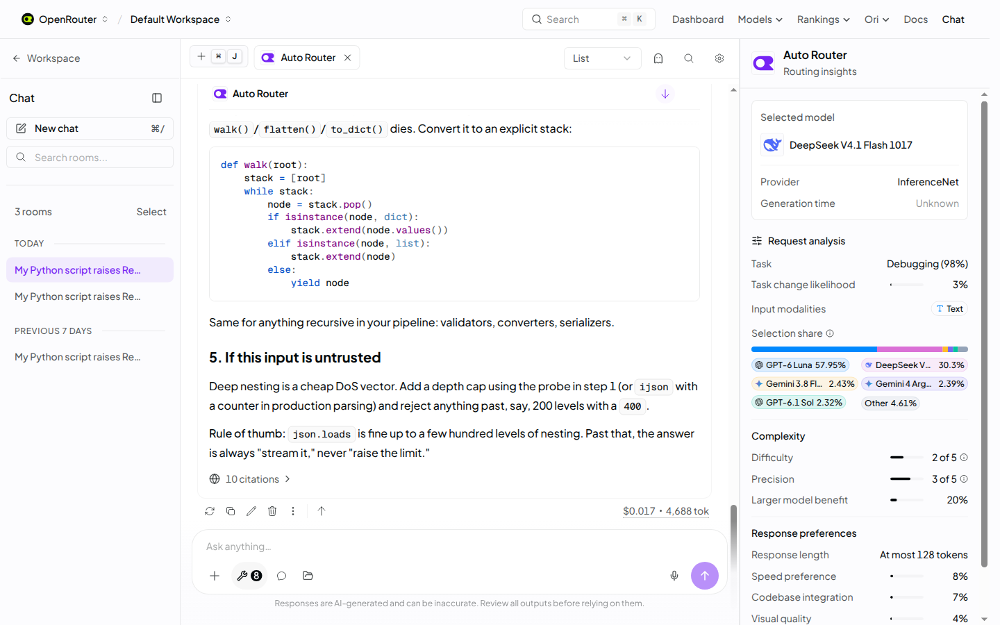

[Introducing the New Auto and Auto Code Routers](https://openrouter.ai/blog/announcements/auto-and-auto-code-routers/)  
Brian Thomas / OpenRouter · 2026-11-06

逐轮挑一个更便宜或更强的模型，看起来能改善 Agent 成本曲线，但模型切换会失去既有输入缓存，也可能改变工具调用行为。OpenRouter 新版 Auto 和 Auto Code 把这些状态因素放进路由决策；比“支持更多模型”更值得关注的是，路由在模型选择之外还选择 reasoning effort，并把前一轮结果带入下一轮。

<a class="note-image-link" href="/assets/images/tech/openrouter-auto-router-next-gen/official.png" target="_blank" rel="noopener" aria-label="OpenRouter 路由面板中的模型选择与请求分析 · 查看原图 ↗">查看原图 ↗</a>

*右侧面板展示选中模型和任务分析，用于解释一次选择；图中比例不是跨工作负载的性能保证。*

## 请求如何经过两层路由

系统先根据 guardrails、零数据保留要求、模型能力、提供商限制和允许列表缩小候选池。随后，一个快速决策模型在一次调用中判断十一项请求特征，包括任务类型、任务是否变化、难度、速度需求，以及是否需要视觉或代码库知识。

策略将这些特征与价格、缓存状态和基准表现结合，选择模型及推理强度。之后才进入 provider routing，在能服务同一模型的提供商之间根据健康度、延迟、价格和缓存位置作选择。前者决定“谁来推理”，后者决定“在哪里服务”；混为一谈，会难以定位质量回退与服务抖动分别来自哪层。

Auto Code 使用同一引擎，但偏向较高能力的编码模型层级，更重视速度、通过率和每个解决任务的成本。它也对可明确识别的失败给予更强惩罚。文章没有披露完整权重或训练配方，因此不能从十一项特征推导可复刻的路由算法。

## 为什么先调推理强度，再考虑换模型

换模型意味着新模型重新处理输入前缀，失去已有缓存收益。策略因此在足够时优先改变 reasoning effort，只有预期收益超过缓存损失才切换。作者称 beta 期间接近九成 Agent 轮次保持原模型，显示这个路由器并不以频繁切换为目标。

另一方面，重复错误或修改后测试持续失败会提高换模型的概率。前一轮的困难信号与缓存状态被保留，下一轮不再是独立的一次分类。这使路由更接近有状态控制：需要同时权衡本轮能力需求、已经投入的状态以及继续失败的风险。

不过，观察到失败不等于知道原因。本期失败预测论文提醒我们，难题、能力不足和偶然坏运行需要不同干预。OpenRouter 的生产策略不是那篇论文测试的预测器，不能直接套用其负面结论；两者共同提出的评估要求是检查实际干预后是否改善，而非只展示选对模型的事后 oracle。

## 官方结果说明什么

作者报告在线测试中路由步骤 p90 从 1.96 秒降到 0.65 秒。这衡量路由自身延迟，不能当成整段 Agent 任务快了三倍。beta 相比旧路由的无效工具调用少四倍、响应被截断的频率减半，也是提供方汇总观测，文章未给出足以独立复算的任务级样本与置信区间。

页面提供路由原因面板和 API 元数据，让用户看到任务分析及选中模型。它有助于排查“为什么切换”，但解释面板不自动证明该决策最优。模型选择分布也会随模型目录、价格和请求构成变化，不应把某个截图的占比视为长期保证。

## 适用的是混合工作负载

公告自己承认路由器不会在成本—质量曲线每一点都胜过最佳单模型。它更适合任务类型变化、需要成本控制、又不想持续手工维护模型选择的场景；已经验证某模型适合固定工作负载时，路由未必增加收益。

这次更新给 AgentOps 的具体启发是把缓存状态和切换成本纳入路由评测。只比较单次请求标价，会遗漏前缀重建、失败后的额外轮次，以及提供商层面的服务差异。
