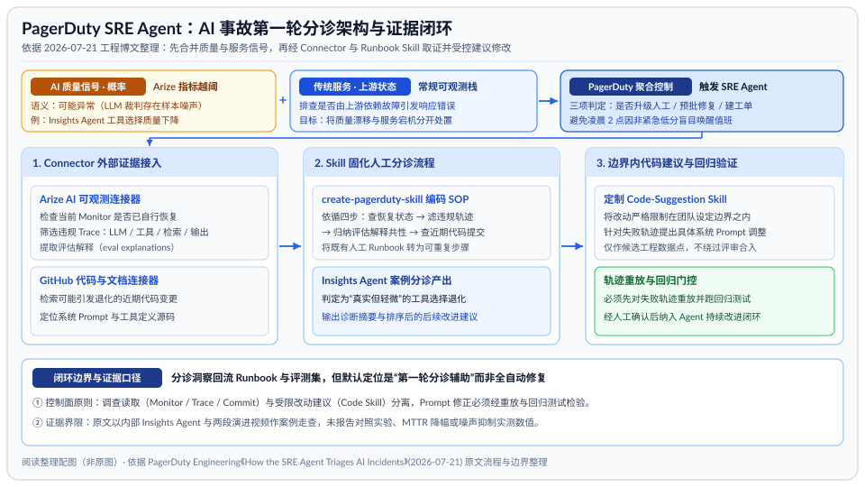
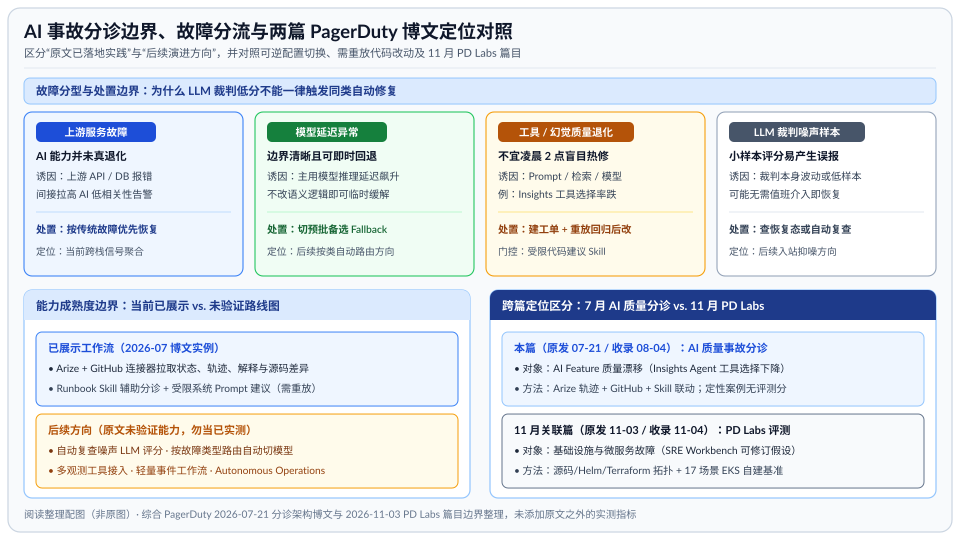

PagerDuty Engineering（Irena Grabovitch-Zuyev、Antonio Correia、Everaldo Aguiar、Murilo Venturin、Derek Barnes）· 原文发布于 2026-07-21（约 8 分钟阅读）· [原始工程博文](https://www.pagerduty.com/eng/pagerduty-for-ai-how-the-sre-agent-triages-ai-incidents/) · [2025-08-13 前篇：PagerDuty + Arize 生产可观测性接入](https://www.pagerduty.com/eng/pagerduty-arize-building-end-to-end-observability-for-ai-agents-in-production/)

传统服务器宕机或接口 5xx 飙升会把监控面板直接染红，而静默跑偏的 AI Agent 往往不会触发任何基础设施红灯。PagerDuty 在 2025 年 8 月与 Arize 的前篇中重点解决了“如何检测传统监控抓不到的 AI 失效”，而这篇 2026 年 7 月的工程长文把镜头推到下一步：**当 AI 事故真正告警之后，值班响应与 SRE Agent 的第一轮分诊（First-Pass Triage）究竟该如何运转，又该如何避免把每一条低分告警都当成全自动修复或凌晨两点紧急故障**。

> **口径界限与关联篇目区分**：本文依据 PagerDuty Engineering 于 2026 年 7 月 21 日发布的原文（本站于 2026-08-04 收录）重写，原文展示的是基于内部 **Insights Agent** 的工程实践案例与两段产品演进视频，**未报告对照实验、MTTR 缩短百分比、准确率基准或误报抑制实测数据**；文中“自动复查噪声评分”“按故障类型分类路由”及“Autonomous Operations”均属明确标注的后续演进方向，而非已验证能力。同时，请勿将本篇与本站 11 月 4 日收录的 PD Labs 长文混淆（见[11 月 4 日 PD Labs 评测笔记](/tech/zh/2026-11-04-pagerduty-pd-labs-sre-agent/)）：**本篇（7 月原文 / 8 月收录）聚焦 SRE Agent 如何分诊 AI 功能自身的质量退化事故**（连接 Arize 轨迹、Runbook Skill 与受限 Prompt 建议）；**11 月篇则聚焦 PD Labs 对 SRE Agent 调查通用基础设施与微服务故障的架构重构与实证评测**（SRE Workbench 可修订假设、源码/Helm/Terraform 拓扑图与 17 场景 EKS/Chaos Mesh 基准）。

## 告警语义重构：从“已宕机”到“可能退化”与归因分流

原文首先点出了 AI 运维与传统 SRE 的根本语义错位：基于 **LLM-as-a-judge（大语言模型裁判）** 评估的监控器发出告警时，信号含义不再是确定性的“某个组件坏了（something is broken）”，而是概率性的“**按裁判模型打分，这里可能出了问题（something might be broken）**”。

这种语义转变直接改写了凌晨 2 点值班工程师的动作边界。对于传统发布故障，值班人员通常能在 15 分钟内通过回滚版本或重启实例止血；但 AI **相关性（relevance）指标下跌**往往对应四类截然不同的工程动作——调整 Prompt、微调检索链路（RAG）、切换底层模型，或者反过来重新校准评估裁判本身——其中大多数工作既无法在深夜 15 分钟内草率完成，也未必值得立刻唤醒人类工程师。

更棘手的是**归因歧义（attribution ambiguity）**：一条“低相关性”告警，既可能源自 Agent 内部提示词或工具选择逻辑退化，也可能仅仅因为某个**上游传统服务发生故障**，连带导致 AI 助手的响应大面积报错或答非所问——此时 Agent 自身性能其实并未下降，值班人员也不该盲目去改 Prompt。正因如此，PagerDuty 的核心设计逻辑并不是把 AI 监控孤立出来，而是**以 PagerDuty 作为汇聚全观测栈信号的统一控制面**，把 AI 输出质量漂移与传统应用/依赖故障放在同一事故上下文中交叉核验，从而分开处置。

围绕“减少值班负担、加速早期判断”的目标，原文将平台原语与 SRE Agent 的协同拆解为三项分诊职责：

1. **升级判定（Escalation Classification）**：在收集上下文并预判问题真实性后，决定该事故是否真正需要升级唤醒人工值班人员。
2. **受控预批修复（Pre-Approved Remediation）**：仅对预先批准、边界清晰的场景触发既定缓解动作，而非放任 Agent 在生产环境自由发挥。
3. **异步研发跟进（Follow-Up Ticketing）**：对确认存在但无需深夜热修的质量退化，直接为负责该 AI 功能的研发团队创建跟进工单并附带排序后的建议路径，把改动留到工作时间处理。

## 分诊闭环机制：连接器、Runbook Skill 与 Insights Agent 实战拆解

为了把“可能出了问题”变成“到底出了什么问题、下一步该做什么”，第一步工程接入是把 SRE Agent 连入 AI 可观测平台。与只报单次延迟或 HTTP 状态码的传统 APM 不同，Arize 等 AI 可观测平台将每一次用户交互记录为完整的 **Trace（执行轨迹）**——串联起单次请求内的全部 **LLM 调用、工具调用（tool calls）、检索步骤（retrievals）与最终输出**。

<figure class="note-figure">
  <a class="note-image-link" href="/assets/images/tech/pagerduty-ai-incident-triage/triage-loop-architecture-zh.svg" target="_blank" rel="noopener">
    
    查看原图 ↗
  </a>
  <figcaption>阅读整理配图（非原图）：依据 PagerDuty Engineering（2026-07-21）原文流程与架构说明整理的 SRE Agent AI 事故第一轮分诊闭环及验证边界。</figcaption>
</figure>

原文以 PagerDuty 内部运维对话助手 **Insights Agent** 为具体示例展开全流程走查。Insights Agent 负责回答诸如“上周我们发生了多少起 SEV-1 事故？”一类的运营问题，并在后台调用分析工具；该助手在 Arize 中配置了多项质量监测器，一旦越过阈值便触发 PagerDuty 事故。

当 Insights Agent 的**工具选择（tool-selection）性能跌破设定阈值**并触发事故后，值班人员在 PagerDuty 事故页面调用 SRE Agent。值得注意的是，SRE Agent 并非靠提示词即兴发挥，而是依托两套显式工程原语运转：通过 [SRE Agent Connectors](https://support.pagerduty.com/main/docs/connectors-tools-and-skills) 接入 Arize、GitHub 与文档库等外部数据源；通过由 [`create-pagerduty-skill`](https://github.com/PagerDuty/claude-code-plugins/blob/main/commands/create-pagerduty-skill.md) 将团队既有人工 Runbook 编码成的 **PagerDuty Skill**，严格按既定调查顺序推进四个动作：

1. **核查实时恢复状态**：先查询当前 Arize Monitor 状态，判断告警是一过性抖动（已经自动恢复）还是仍在持续。
2. **筛查违规轨迹**：在对应 Arize 项目中过滤出触发异常的失败 Trace，读取单步工具与调用链现场。
3. **归纳评估解释模式**：阅读 LLM-as-a-judge 的评估解释文本（eval explanations），摘要提炼共同失效模式而非只看单一总分。
4. **检索关联代码提交**：通过 GitHub 代码连接器检查近期可能引入退化的代码或配置变更。

在原文展示的第一段演示录像（[`sre-agent-triage-rundown.mp4`](https://cdn.pagerduty.com/wp-content/uploads/2026/07/sre-agent-triage-rundown.mp4)）中，SRE Agent 汇总轨迹与代码线索后给出的判定是：**这确实是一起真实存在、但程度轻微的工具选择性能退化**，因此建议**直接关闭当前告警事故**，同时附上针对性的后续改进事项以优化工具调用行为。

随后在第二段演示录像（[`sre-agent-code-suggestions.mp4`](https://cdn.pagerduty.com/wp-content/uploads/2026/07/sre-agent-code-suggestions.mp4)）中，值班人员利用 GitHub 代码连接器继续下钻，要求 Agent 指明具体应修改的位置。此时系统切换到一个**定制的代码建议 Skill（code-suggestion skill）**，把 Agent 的修改提议严格约束在团队预先划定的范围边界之内——Agent 针对失败轨迹提出了若干**系统 Prompt 调整建议**。原文特别强调，这些建议**不是可直接上线的自动化补丁**，而是一个额外工程数据点，必须遵循团队的 Agent 自改进策略（参考 PagerDuty LLMday 演讲《[Teaching AI Systems to Fix Their Own Failures](https://www.youtube.com/watch?v=12e0pSOBBQk&t=1s)》），**先针对失败轨迹进行重放（replay）并通过回归测试（regression testing）**后才能推进修改。

| 架构组件 / 门控机制 | 在 Insights Agent 分诊链路中的职责 | 约束边界与防范的典型风险 |
| :--- | :--- | :--- |
| **PagerDuty 跨栈信号汇聚** | 把 Arize 质量告警与传统应用/基础设施告警统一收敛到同一事故时间线 | 避免把上游依赖宕机误判为 Agent 内部 Prompt 退化，防止深夜错误调度 |
| **Arize 可观测连接器** | 读取当前 Monitor 恢复状态、违规请求的完整 Trace 与 LLM 裁判评估解释 | 仅提供观测实态与解释证据，不让 Agent 仅凭单条告警标题臆测根因 |
| **GitHub 代码与文档连接器** | 检索近期代码提交变更并定位对应系统 Prompt、工具定义与运维文档源码 | 为分诊与修改建议提供版本化代码上下文，但只读或受后续 Skill 门控 |
| **Runbook 编码 Skill** | 通过 `create-pagerduty-skill` 把人类标准排障 SOP 固化为 4 步可复现流程 | 防止 Agent 在事故现场跳过恢复检查或遗漏关键证据直接下结论 |
| **受限代码建议 Skill** | 基于失败轨迹与源码，在团队界定作用域内提出具体系统 Prompt 调整方案 | 限制建议修改面，避免分诊助手越权提出大范围应用逻辑重构 |
| **重放与回归测试门控** | 将候选 Prompt 调整在失败轨迹集与既有回归集上重放验证 | 防止“修好当前几条工具选择样本却在另一批常规问题上引入新退化” |

## 边界与演进路线：从“人工把关分诊”到 Autonomous Operations 的四道关卡

原文在总结“现状已经做到哪里”之后，非常克制地用一整节《What this unlocks next》勾勒了后续演进路线。在解读这篇工程文章时，**把“当前已交付的人工协同第一轮分诊”与“尚未经过公开实测验证的后续目标”清晰拆开至关重要**，否则容易高估当前自动闭环的成熟度。

<figure class="note-figure">
  <a class="note-image-link" href="/assets/images/tech/pagerduty-ai-incident-triage/evidence-guardrail-boundaries-zh.svg" target="_blank" rel="noopener">
    
    查看原图 ↗
  </a>
  <figcaption>阅读整理配图（非原图）：梳理 PagerDuty 原文中的故障分型逻辑、已展示工作流与未来路线图边界，以及与 11 月 PD Labs 博文的篇目分工。</figcaption>
</figure>

依据原文陈述，PagerDuty 面向下一阶段提出的演进方向包含四层递进机制：

1. **入站信号降噪（自动复查评分）**：由于 LLM-as-a-judge 评估在小样本窗口上容易出现波动噪声，团队计划让 PagerDuty 在告警入站时**自动触发二次复查（re-check of the score）**，使真实持续退化依然能够响铃呼救，而瞬时统计波动在进入值班队列前被抑制。
2. **故障类型细粒度分类与路由**：不再把所有 AI 告警混作一团，而是先按失效类型分类——原文明确点出**幻觉（hallucinations）、工具调用错误（tool-call errors）与模型延迟（model latency）**三类典型故障——并为不同类别路由到完全不同的修复路径。
3. **按可逆性匹配自动化速度**：原文给出的最典型自动化例子发生在**模型延迟**场景——系统可**临时切换至预先批准的备选模型（pre-approved fallback model）**先行恢复响应时效，而其余需要改 Prompt 或调整逻辑的异步变更仍留待工作时间完成。
4. **观测生态扩展与轻量工作流**：在工程生态层面，PagerDuty 正把连接器支持从 Arize 拓展至其他 AI 可观测平台，同时构建一套**不强依赖 SRE Agent 对话界面**的轻量级模式，通过标准 Incident Workflows 直接把失败模式上下文注入事故流，最终指向跨工具通用的 **Autonomous Operations（自治运维）**。

从系统工程权衡角度看（以下为助手结合原文逻辑的工程推导，非原文实测声明），“延迟切备选模型适合即时自动执行，而工具/幻觉修复必须推迟到重放测试之后”背后有一条清晰的**可逆性与语义半径原则**：切换到经过基线验证的备用模型属于有界配置切换，副作用可预期且能秒级回滚；相比之下，系统 Prompt 或检索策略哪怕改动几句话，都可能改变全局工具路由与拒答边界，必须依靠失败轨迹重放和回归集做全局护栏。此外，入站自动复查 LLM 评分虽然能压低凌晨误报，但也会引入额外的复核延迟与裁判模型推理开销——在遭遇真实突发退化时，团队需要在“多等一轮复核确认”与“尽快升级止损”之间设定明确阈值。

同时，把本篇与 PagerDuty 11 月初发布的 PD Labs 长文并排对照，能更准确把握两套工程叙事各自回答的问题：

| 对比维度 | 本篇（原发 2026-07-21 / 收录 08-04）：AI 事故第一轮分诊 | 关联篇（原发 2026-11-03 / 收录 11-04）：PD Labs 生产级 SRE Agent |
| :--- | :--- | :--- |
| **核心调查对象** | **AI 功能自身质量退化**（由 LLM 裁判告警触发，例为 Insights Agent 工具选择下跌） | **通用基础设施与微服务故障**（初始告警组件未必是根因，依赖跨服务排障） |
| **主要上下文与拓扑** | Arize 监测状态、单请求 Trace（LLM/工具/检索/输出）、评估解释与 GitHub 变更 | 源码、Helm、Terraform 跨仓库静态解析构图，辅以 SRE Workbench 共享时间线 |
| **工作流与推理结构** | Connector 接入数据源 + `create-pagerduty-skill` 编码 4 步人工 Runbook + 受限代码建议 Skill | Deep Investigation 维持多候选可修订假设、明确记录直接/间接证据与被排除反证 |
| **变更与验证门控** | Prompt 建议限制在团队边界内，须经失败轨迹重放与回归测试后再合入 | 17 场景私有 EKS + Chaos Mesh 现场故障注入与历史回放，三家模型裁判评分 |
| **证据成熟度边界** | **定性工程架构与内部案例走查**；无对照实验、无 MTTR 改善幅度或抑噪率数据 | **厂商自建基准评估**；报告架构重构后诊断分提高约 20 点，仍提示回放泄露与人类交互缺失局限 |

## 工程落地启示与证据边界：值班团队能复用什么、还缺什么

即使团队并不直接采用 PagerDuty 与 Arize 组合，这篇文章仍给出了四条可立即迁移到现有 AgentOps 值班体系的工程准则：

1. **先把 AI 评估告警和常规基础设施告警放进同一个事件面**：上线 LLM-as-a-judge 监控的第一件事不是接自动修 Prompt，而是确保值班人员能在 30 秒内看到“上游 API、数据库或模型网关是否同时报错”，避免对着上游故障调提示词。
2. **用“只读取证流程 + 作用域受限建议”拆分调查权限**：通过类似 Runbook Skill 的显式步骤固化“先查监控是否已自愈、再聚拢违规轨迹解释、最后查最近提交”，能够显著减少分析 Agent 漏检自愈或跳步猜根因的风险；同时把代码建议限定在明确文件或配置边界内，避免分诊权限演变成无约束改码权限。
3. **按影响半径与可逆性决定谁能在半夜动手**：只有像“切换至预批备用模型”这样可瞬时回退的运行时开关，才适合纳入预批准自动缓解；涉及系统 Prompt、检索分块或裁判阈值重调的语义修改，应默认转为白天的工单、失败轨迹重放与回归测试流水线。
4. **清醒看待当前证据空白，补齐本地度量再谈“少叫醒人”**：原文没有给出“自动重查到底压低了多少误报、是否会漏掉真正的缓慢退化（false suppression）、以及分诊摘要真实节省了多少分钟 MTTA/MTTR”的定量结果。值班团队在参考该模式落地时，必须自行建立两项观测口径：**其一是裁判评分在不同流量样本窗下的稳定性基线，其二是“建议关闭事故”后的二次复发率**，才能真正验证第一轮分诊是在降噪减负，而不是把真故障静默吞掉。

---

> **AI 辅助整理 · 归档注记**：本篇中文重写与配套英文版（[English note](/tech/en/pagerduty-ai-incident-triage/)）由助手精读冻存原始网页与正文逐项核对扩写，保留原 `id`、`date: '2026-08-04'`、`permalink`、`published_at` 与 `agent-reliability`、`observability`、`systems-reliability` 三项标准标签。两幅 `v3-blue` 图解 `triage-loop-architecture-zh.svg` 与 `evidence-guardrail-boundaries-zh.svg` 系助手依据原文流程及与 11 月 PD Labs 篇目之边界绘制（非原文原图），未捏造任何文中未出现的延迟、准确率或 MTTR 数值。
