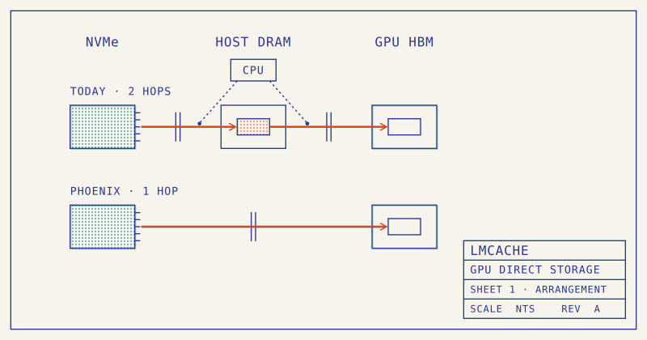
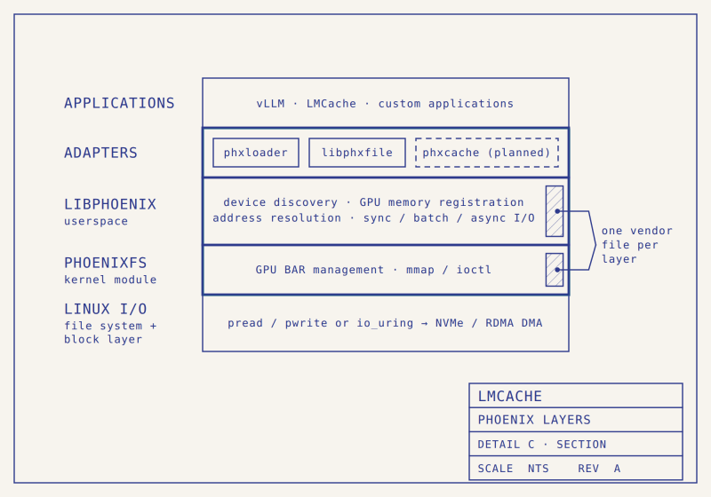

长会话 Agent 反复提交相同前缀，缓存越来越像一个存储系统：容量要足够大，下一轮又必须及时把几十 GB 状态送回 GPU。LMCache 与腾讯 xPU-IO 的这篇联合文章，重点不是又增加一种 SSD 后端，而是改变 SSD 到 GPU 的路径。它展示了为什么磁盘已经很快，GPU 仍可能大半时间等缓存，以及直接 I/O 如何与缓存管理和调度协同。

原文：[LMCache & xPU-IO: LMCache Meets GPU Direct Storage](https://blog.lmcache.ai/en/2026/11/09/lmcache-xpu-io-lmcache-meets-gpu-direct-storage/)  
Shi Qiu · 2026-11-09

## 两次搬运怎样吃掉缓存收益

传统文件后端先把 NVMe 数据读到 host bounce buffer，再通过设备复制送到 GPU。CPU 参与提交、同步和完成处理，主机内存也进入数据路径。文章给出的四块 PCIe 4.0 NVMe RAID 0 例子中，磁盘侧达到 25 GB/s，LMCache retrieve 路径到 GPU 只有 10.2 GB/s，约为前者的 40%。因此，磁盘吞吐不能直接当作缓存恢复吞吐。

一项独立的 fs_native 轨迹回放分析使用 20,230 条请求，平均提示约 68K token。展示的 54 条请求样本里，平均 TTFT 为 1,101 ms，SSD 到 GPU 阶段约 600 ms，实际 prefill 为 313 ms。它说明加载可能超过新增计算，但这不是后文并发对比采用的同一份完整测试配置，不能把两个图的分母混在一起。

<a class="note-image-link" href="/assets/images/tech/phoenix-gds/official-1.png" target="_blank" rel="noopener" aria-label="传统两跳路径与 Phoenix 单跳路径 · 查看原图 ↗">查看原图 ↗</a>

*读图：上方先进入主机 DRAM 再到 HBM，下方直接从 NVMe 到 HBM；箭头表示数据路径，不表示控制面完全没有 CPU。*

## 直接到显存，仍然需要清楚的顺序

Phoenix 利用 Linux 的 ZONE_DEVICE 为 GPU 内存建立 `struct page` 表示，让映射地址能够成为标准 I/O 的目标，沿文件系统、块层与 NVMe 驱动执行 DMA，省去主机中转缓冲。应用因此仍可使用 POSIX 读取和 io_uring，而不是另造一整套文件 API。底层厂商差异集中在 GPU 内存 P2P 映射、设备发现与复制接口，LMCache 上方逻辑通过薄适配层保持稳定。

LMCache 的 GDS L1 用 NVMe 上的 slab 文件替代 pinned DRAM。进程级 `GDSContext` 接收 KV 描述符，安排 GPU 与 slab 间的 DMA；加速器上保留小 staging buffer，填满后再由 D2D kernel 放入前缀缓存。**直接存储消除的是 host bounce，不代表完全没有缓冲和设备内复制。**

顺序同样是正确性问题。Phoenix 用运行时的 `LaunchHostFunc` 把主机发起的 DMA 包装进调用者的 stream：前面的 gather 完成后才发起写，读完成后才允许后面的 kernel 使用数据。CPU 仍负责部分控制工作，“绕过 CPU”应理解为数据不再绕经主机内存，不能理解为所有提交工作都由 GPU 自主完成。

<a class="note-image-link" href="/assets/images/tech/phoenix-gds/official-4.png" target="_blank" rel="noopener" aria-label="Phoenix 的适配层、厂商层与 Linux I/O 栈 · 查看原图 ↗">查看原图 ↗</a>

*读图：从应用适配器向下读到 libphoenix、phoenixfs 和原生 Linux I/O；厂商代码集中在中间两层。*

## 并发结果来自容量与路径的共同作用

端到端对比采用一台 8×H20、每卡 96 GB HBM、四盘 RAID 0 的节点，TP=8、256K 上下文上限，回放 11,596 条生产 trace 请求，平均长度约 70K token，总 KV 约 3.5 TB。三个方案分别为 1 TB DRAM-only、400 GB DRAM 加 25 TB SSD 的两层路径，以及 25 TB SSD 的 Phoenix 路径。DRAM 满后按 LRU 驱逐，缺失需要重新计算。

以**平均 TTFT 不超过 5 秒**为条件，Phoenix 可支撑 37 个并发请求，DRAM+SSD 为 13，DRAM-only 为 7。最高测试并发下，TTFT 分别比后两者低 2.2 倍和 5.6 倍。低并发时三者都约 1.1 秒；收益是在缓存容量压力和恢复带宽成为瓶颈后出现的。

所以，不能将“比 DRAM-only 快 5.6 倍”读成 SSD 单次读取比内存更快。DRAM-only 的容量不足导致重算，分层后端还承担 host bounce；Phoenix 同时保留更大工作集并缩短恢复路径。较快加载也更容易被前一批计算覆盖，从而让既有重叠调度真正发挥作用。文章没有提供同容量 DRAM 的完整对照，亦未在本文给出独立跨厂商端到端结果。

## 接入边界决定能否迁移

Phoenix 需要内核模块和兼容的 P2P 内存映射环境。文章列出的已验证设备包括 NVIDIA、MetaX 和 AMD MI308X，但同样的接口不保证每种硬件都获得相同收益。Linux 路径支持常用本地与并行文件系统，FUSE 是当前明确例外；BAR 全映射和按需 staging 模式还涉及与现有 RDMA 栈的共存。

对 Ops4LLM 最有用的变化，是**KV 容量层与恢复带宽可以一起设计**。选择后端时应比较目标工作集下的重算、读取、安装和排队成本，并区分平均 TTFT 与尾延迟；原文的 5 秒门槛是均值，不能当成 p95 SLO。它也与本期 KV 存储测量相接：会话何时结束决定哪些状态值得保留，直接 I/O 决定留下的状态能否及时取回。
