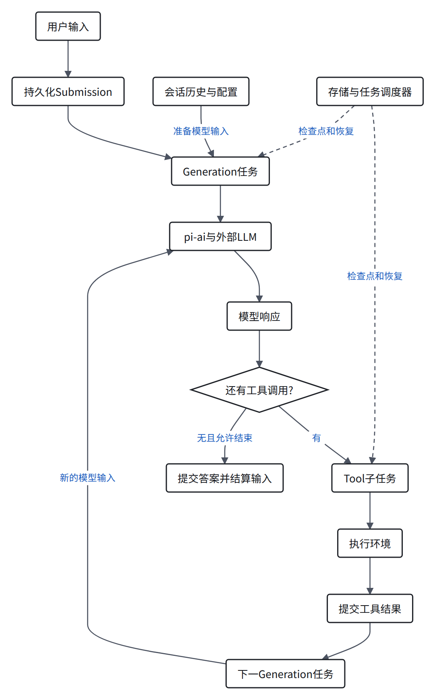
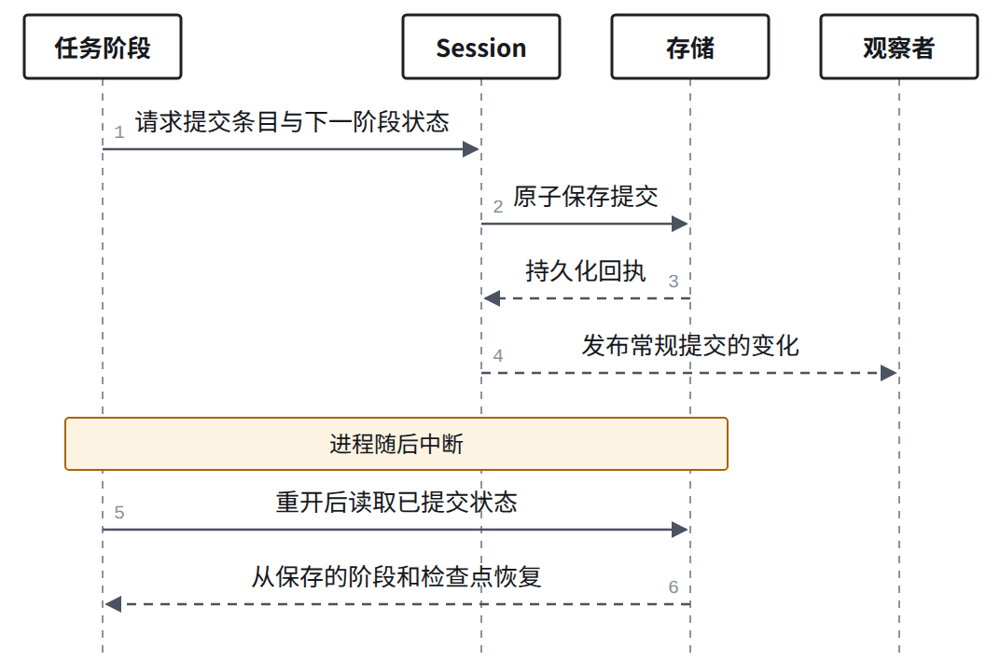
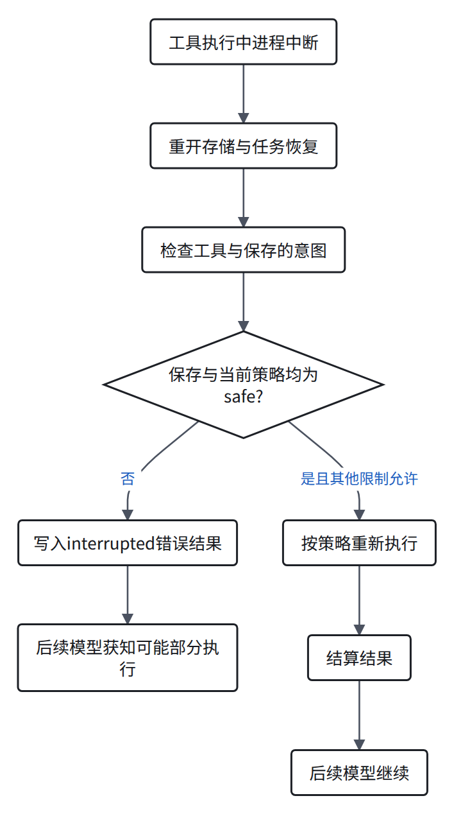

> AI 辅助整理。依据固定版本文档与局部源码分析，未运行恢复实验。

**Pi Durable 把模型生成和工具调用组织成可持久化任务。** 进程重启后，系统根据已提交状态决定继续什么，而不只是重新读取聊天记录。

它更贴近Agent 运行稳定性问题。本文单独分析实验性 `@earendil-works/pi-durable`，不把其恢复契约直接套到普通 Pi CLI。

<h2 id="section-a">架构：Loop 从内存流程变成任务状态机</h2>

<figure>
<a class="note-image-link" href="/assets/images/tech/pi-durable-runtime/zh-01.png" target="_blank" rel="noopener" aria-label="Pi Durable 将用户输入、模型生成与工具调用组织成持久任务，提交结果后继续推理。">放大图解 ↗</a>
<figcaption>Pi Durable 将用户输入、模型生成与工具调用组织成持久任务，提交结果后继续推理。 根据固定版本文档与代码绘制的说明图。</figcaption>
</figure>
图省略结束钩子、额外输入和错误分支。

| 对象 | 通俗含义 |
|---|---|
| Submission | 已接收的一份输入，可以等待它完成或失败 |
| Entry | 不可变的消息或结果记录 |
| Document | 通过提交更新的结构化状态 |
| Task | 带检查点和状态转换的工作单元 |
| Generation | 调用模型，并协调其工具子任务 |
| Tool task | 一次工具调用及其结果处理 |

主循环仍然是LLM—工具—结果，但推进依据包含持久任务状态。实现基于 pi-ai 和 Chord。

依据：[固定版本规范](https://github.com/earendil-works/pi/blob/3c9a86bb08398a425f95a81ba4339aa76151f5a1/packages/durable/docs/spec.md)。

<h2 id="section-b">输入怎样进入模型？存储历史与模型视野要分开</h2>

用户输入先被接收为 Submission，再形成会话条目。生成任务使用当前会话的模型、指令、工具和有效上下文。

同一个 `requestId` 重提可找到原 Submission，避免重复接收同一输入。这不是所有外部工具操作的“恰好执行一次”保证。

| 数据 | 保存与使用方式 |
|---|---|
| 对话条目 | 提交后保留；用于构建模型可见上下文 |
| 模型与扩展选择 | 会话保存名称与配置，运行时解析实现 |
| 压缩摘要 | 增加摘要记录，旧条目仍在存储中 |
| reset | 改变模型从哪里开始看，旧记录仍保留 |
| 工具结果 | 与对应任务结算后供后续生成使用 |

**保存过的信息不一定都送给模型。** reset、压缩和请求构造仍影响模型视野。

依据：[概念、输入与压缩说明](https://github.com/earendil-works/pi/blob/3c9a86bb08398a425f95a81ba4339aa76151f5a1/packages/durable/README.md)。

<h2 id="section-c">恢复到哪里？阶段检查点，不是任意代码行</h2>

一个任务由阶段和检查点组织。进程在阶段中断后，恢复时会从该阶段入口重新进入。

<figure>
<a class="note-image-link" href="/assets/images/tech/pi-durable-runtime/zh-02.png" target="_blank" rel="noopener" aria-label="常规提交先保存再发布；进程重启后根据阶段检查点恢复，而不是回到任意代码行。">放大图解 ↗</a>
<figcaption>常规提交先保存再发布；进程重启后根据阶段检查点恢复，而不是回到任意代码行。 根据固定版本文档与代码绘制的说明图。</figcaption>
</figure>
这是常规提交路径。规范允许指定的 deferred 文档更新先在内存可见，再延后保存；崩溃会丢失未保存部分。

**提交事务不包含任意外部副作用。** 发邮件、远端写入或启动进程，不会自动与本地任务状态一起原子提交。

分析判断：恢复边界更明确了。工具作者仍要处理检查点之间的重复执行窗口。

依据：[提交不变量与deferred例外](https://github.com/earendil-works/pi/blob/3c9a86bb08398a425f95a81ba4339aa76151f5a1/packages/durable/docs/spec.md)。

<h2 id="section-d">最关键设计：中断工具是否允许重放？</h2>

工具执行意图先提交，再运行工具。恢复时根据已保存状态处理，不把所有中断都自动重试。

<figure>
<a class="note-image-link" href="/assets/images/tech/pi-durable-runtime/zh-03.png" target="_blank" rel="noopener" aria-label="中断工具只有在保存策略与当前声明均允许安全重放时，才进入相应重放路径。">放大图解 ↗</a>
<figcaption>中断工具只有在保存策略与当前声明均允许安全重放时，才进入相应重放路径。 根据固定版本文档与代码绘制的说明图。</figcaption>
</figure>
代码同时检查已保存的重放策略和当前工具声明。恢复时不能仅凭新版本把策略改成 safe 就重跑旧操作。

| 性质 | 能否由此自动获得？ |
|---|---|
| 区分可重放与不可重放工具 | 有明确机制 |
| 避免默认盲目重跑不安全工具 | 有对应恢复路径 |
| 工具作者正确声明safe | 需要独立验证 |
| 邮件、付款等外部副作用恰好一次 | 不自动保证 |

**`replay: "safe"` 是契约，不是自动幂等化。** 外部服务需要幂等键或其他可核查机制。

公开测试覆盖保存与当前策略的组合、部分输出、中断和重放。本次只检查测试代码，未运行测试。

依据：[工具任务实现](https://github.com/earendil-works/pi/blob/3c9a86bb08398a425f95a81ba4339aa76151f5a1/packages/durable/src/harness/tool.ts)、[恢复测试](https://github.com/earendil-works/pi/blob/3c9a86bb08398a425f95a81ba4339aa76151f5a1/packages/durable/test/harness-tools-recovery.test.ts)。

<h2 id="section-e">模型请求和取消：也需要区分不同状态</h2>

模型请求期间的崩溃会计入失败尝试。部分回答保留为中止记录，后续按重试预算处理。

若响应已在提供方后台生成、只是正在获取结果，恢复应继续轮询该响应，而不是重复创建请求。

| 机制 | 稳定性作用 | 仍需注意 |
|---|---|---|
| 重试预算与退避 | 避免立即重复失败 | 成本及部分响应是否重复采用 |
| restartLimit | 限制反复中断同一任务 | 配置可关闭限制，不是绝对终止保证 |
| 保存的等待状态 | 等时间或子任务时不占用活动阶段 | 宿主仍需正确唤醒调度器 |
| 任务所有权 | 主任务与其子任务关联 | background边界改变取消传播 |
| 取消等待 | 结束调用方的等待 | 不等于取消底层工作 |

忽略取消信号的任务仍可能拖延关闭。稳定退出需要执行代码合作。

依据：[生成任务](https://github.com/earendil-works/pi/blob/3c9a86bb08398a425f95a81ba4339aa76151f5a1/packages/durable/src/harness/generation.ts)、[恢复、等待与取消说明](https://github.com/earendil-works/pi/blob/3c9a86bb08398a425f95a81ba4339aa76151f5a1/packages/durable/README.md)。

<h2 id="section-f">扩展与 RSI：新代码必须能理解旧状态</h2>

扩展可以提供工具、提示词片段、钩子、包装器和任务定义。会话保存扩展名称；注册表中的实际代码由宿主提供。

模型请求准备后，其模型、提示词与工具集合固定。工具和钩子在任务阶段解析当前配置，因此更新可能影响已经提出的调用。

| RSI修改 | 需要新增的验收 |
|---|---|
| 改工具实现 | 旧执行意图能否被新代码正确解释？ |
| 改replay策略 | 是否把不安全副作用错误声明为safe？ |
| 改任务阶段 | 旧检查点是否需要迁移？ |
| 移除扩展 | 未完成任务是否因缺少定义被阻塞？ |
| 改结束钩子 | 是否不断触发下一轮，逃逸局部预算？ |

`maxTurns` 约束一个run的工具轮次，但continue及onYield续推可能开始新的计数。宿主需要限制总工作量。

**分析判断**：RSI验收应检查任务得分，也应检查“新代码接管旧状态”是否兼容。

依据：[任务与扩展契约](https://github.com/earendil-works/pi/blob/3c9a86bb08398a425f95a81ba4339aa76151f5a1/packages/durable/docs/spec.md)、[配置与限制](https://github.com/earendil-works/pi/blob/3c9a86bb08398a425f95a81ba4339aa76151f5a1/packages/durable/README.md)。

<h2 id="section-g">Durable 的保证取决于哪些条件？</h2>

| 条件 | 实际边界 |
|---|---|
| MemoryStorage | 仅内存，不能承诺跨进程恢复 |
| SQLite默认WAL/NORMAL | 文档区分进程崩溃与掉电/主机故障 |
| JSONL | fsync配置影响刷盘；可写打开还包含修复动作 |
| 写入所有权 | 文档要求一个进程写；没有通用跨进程写锁 |
| deferred更新 | 可见状态可能领先存储，未存部分可丢失 |
| 存储失败 | Harness失败关闭，不能假装继续提交成功 |

这不是一个“打开选项就永不丢失”的保证。选用存储、宿主生命周期和工具契约必须一起验证。

普通 Pi coding-agent 的依赖清单不能证明它已采用这套恢复运行机制。本页按独立包分析。

依据：[存储与错误规则](https://github.com/earendil-works/pi/blob/3c9a86bb08398a425f95a81ba4339aa76151f5a1/packages/durable/README.md)、[提交规范](https://github.com/earendil-works/pi/blob/3c9a86bb08398a425f95a81ba4339aa76151f5a1/packages/durable/docs/spec.md)、[CLI依赖](https://github.com/earendil-works/pi/blob/3c9a86bb08398a425f95a81ba4339aa76151f5a1/packages/coding-agent/package.json)。

<h2 id="section-h">与 Sentry、HarnessFix 的位置关系</h2>

| 对象 | 主要解决什么 | 分析用途 |
|---|---|---|
| Sentry | 运行中诊断行为失败，按需给恢复指导 | 行为恢复与经验学习基线 |
| HarnessFix | 从轨迹定位Harness问题并生成补丁 | 自动实现修复的直接相关工作 |
| Pi Durable | 用提交、任务状态和重放规则组织可恢复执行 | 研究稳定性契约与故障注入的具体系统 |

它们不在同一层，不能直接按任务分数排高低。

### 值得开展的实验（尚未执行）
1. 在工具意图提交前后分别终止进程。
2. 在外部副作用完成、结果未提交时崩溃。
3. 交叉测试旧/新工具的safe声明。
4. 恢复时替换扩展版本、目录或任务定义。
5. 分别注入存储错误、模型流中断和取消。
6. 检查常规与deferred状态的可见性差异。

记录重复副作用、错误重放、永久阻塞、约束遗失与恢复成本。能恢复任务，不等于能证明所有外部操作只执行一次。

证据范围：固定提交 `3c9a86bb08398a425f95a81ba4339aa76151f5a1`，阅读README、规范及相关工具/生成源码和恢复测试。API标记为实验性；未安装或运行恢复实验。

[Sentry精读](/digest/zh/paper-sentry-close-reading/) · [HarnessFix精读](/digest/zh/paper-harnessfix-close-reading/)
