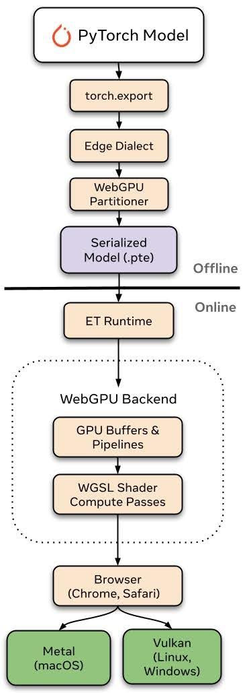

[ExecuTorch WebGPU: PyTorch Models on the GPU, in the Browser](https://pytorch.org/blog/executorch-webgpu-pytorch-models-on-the-gpu-in-the-browser/)  
Julian Ng-Thow-Hing, Siddartha Pothapragada, Stephen Jia, Digant Desai, Bilgin Cagatay · 2026-11-10

把 PyTorch 模型放到浏览器，往往还要换成另一套框架格式。ExecuTorch 的 WebGPU 后端提供了同一工具链内的路径：导出 `.pte`，由浏览器中的 ExecuTorch 运行时执行 GPU 计算。它的新增价值是部署链路和算子覆盖，而不是重新发明 WebGPU。

## 导出与运行时各做什么

模型经 torch.export 和 WebGPUPartitioner 形成导出产物。浏览器侧 C++ 动态运行时通过 Emscripten 编译为 WebAssembly，emdawnwebgpu 将 WebGPU API 调用接到浏览器 JavaScript 接口。GPU 后端管理缓冲和 command buffer，并调度 WGSL compute shader。

<a class="note-image-link" href="/assets/images/tech/pytorch-executorch-webgpu/backend.jpg" target="_blank" rel="noopener" aria-label="离线阶段导出 .pte，在线阶段由 ExecuTorch 运行时管理 GPU 缓冲并执行 WGSL shader。">查看原图 ↗</a>

*离线阶段导出 .pte，在线阶段由 ExecuTorch 运行时管理 GPU 缓冲并执行 WGSL shader。*

动态形状通过按最大尺寸分配缓冲、每次 dispatch 重新计算 workgroup 和选择专门 kernel 来处理。这保留运行时灵活性，但最大尺寸分配也意味着内存需求仍需与目标设备匹配。相同 `.pte` 可沿 WebGPU 的平台转换路径运行，不等于每个浏览器、驱动或 GPU 已取得相同性能与完整算子支持。

## 加速比较覆盖两款小模型和一台机器

作者在 Apple M1 Pro 的 Chrome 中，对比 WebGPU 与 ExecuTorch 自己的多线程 Wasm/XNNPACK CPU 路径，使用量化 Llama 3.2 1B 和 Qwen3-0.6B。上下文为 128 到 8K token，双方 token ID 相同，每点三次预热后取五次运行中位数，以墙钟计时。

测得 prefill 加速 4–7 倍，decode 加速 2–10 倍。但两条路径的数值配置不完全相同：WebGPU 为 4-bit 分组权重、组大小 64、FP32 激活；CPU 为 4-bit 权重和动态 8-bit 激活。因此它是各自实现路径的实用对照，不能把差异全部解释为硬件 GPU 对 CPU 的纯效应，更不能外推成所有手机的倍率。

## 本地执行扩大用途，也留下覆盖边界

官方列出的验证范围包括小型 LLM、SmolVLM、图像分割与深度估计、Whisper 等，还展示设备内适配工作。模型输入在该本地推理路径中不需要传到服务端；浏览器作为分发入口降低了用户安装门槛，也减少服务器推理需求。

不过，官方同时将后端标为早期开发，后续仍需扩大算子、数据类型和模型支持。对于云边协同，这项工作的意义是将导出、分发与设备执行收敛到同一产物，而非为任意 Web 应用提供隐私保证：外围应用如何处理数据仍由应用实现决定。性能结论应留在文中那组量化模型、浏览器与设备条件内。
