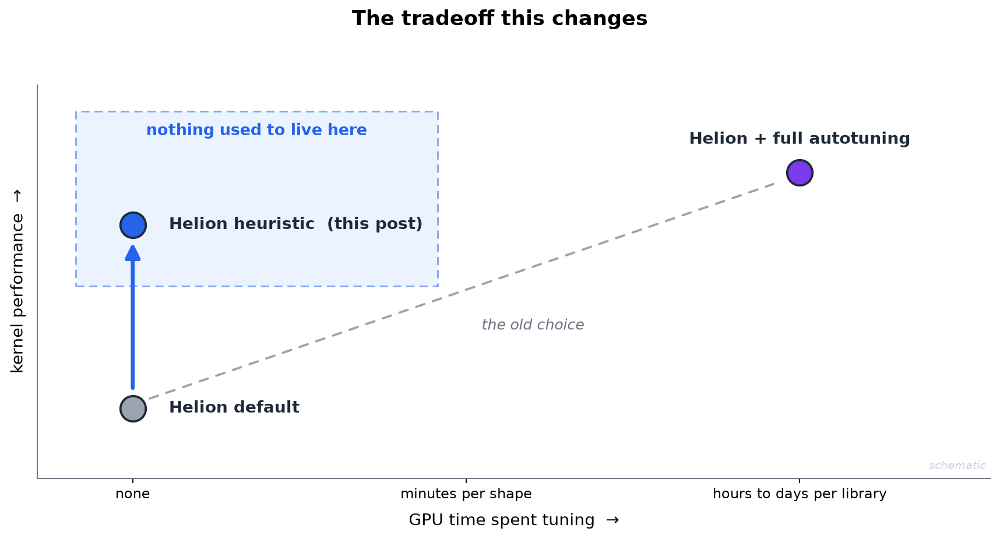

Caleb Min Sup Kim, Ethan Che, Jongsok Choi, Jason Ansel · 2026-11-12  
原文：[Fast by Default: Compile-Time Heuristics for Helion Kernels](https://pytorch.org/blog/fast-by-default-compile-time-heuristics-for-helion-kernels/)

自定义 kernel 的开发成本不只在写代码，也在为每种形状重新搜索配置。Helion 文中举出的 paged-attention 案例，72 种形状在 quick 模式需要约 10 小时，完整调优约 25 小时。新的编译期启发式不逐个编译、测速候选，而是分析 kernel 的结构和资源需求，直接给出一个有竞争力的起点。

这对形状不断变化的推理服务尤其有意义：固定形状可以提前支付调优成本，快速迭代或长尾形状却往往只能接受默认配置。文章提供的是这两者之间的新选择，而不是宣称静态规则总能胜过搜索。

## 从运算类型到活跃资源预算

Helion 先扫描设备 IR。只要有矩阵乘法就走 matmul 规则；没有 matmul 但有归约则走 reduction；其余走 pointwise。分类依据实际运算，不要求 kernel 恰好是标准 GEMM。如果关键 extent 在编译期未知，当前规则不触发，退回旧默认配置。

共同基础是活跃性分析：找出值最后一次使用的位置，估计某组 tile 大小下，一个 CTA 在执行过程中同时需要多少寄存器、共享内存，以及 Blackwell 上的 tensor memory。最先耗尽的资源决定驻留能力。例如每个 CTA 需要 SM 的六成 tensor memory，即使其他资源很空，也不能同时放下两个。

这种预测必须猜测 Triton 会把中间值放在哪里，是否将它融合掉。因此它是资源模型，不是汇编结果的精确替代。但它让 block size、warps 和 stages 不再是互相独立的经验常数。

## 配置旋钮怎样一起决定

matmul 的 grid 太小、填不满 SM 时，规则会缩小 tile 来增加 CTA。增加流水 stage 有助隐藏加载延迟，却可能占满共享内存、降低驻留；更多 warp 能分摊寄存器压力，也会改变 Triton 选择的 MMA 指令。规则结合动态 matmul 工作量和资源估计做取舍，最后再进行保守可行性检查。

一个 kernel 有多个 matmul 时，不同 dot 可能共享同一个 block-size 参数，也只能共用一套 warp 数。Helion 优先考虑带循环累加器的 dot，其次看动态工作量与输出面积，让最影响整体 footprint 的运算主导冲突参数。

归约则要平衡足够多的 warp、更多 CTA 驻留和连续访存。若能确认同一行会被读两遍，例如 RMSNorm 先求尺度再应用，保留整行进行 persistent reduction 有机会省掉第二次内存访问，值得接受一定寄存器压力。block 与 warp 相互影响，规则迭代到两者稳定。

<a class="note-image-link" href="/assets/images/tech/pytorch-helion-compile-time-heuristics/figure.png" target="_blank" rel="noopener" aria-label="Helion 默认配置、编译期启发式与完整调优的概念比较 · 查看原图 ↗">查看原图 ↗</a>

*横轴是调优 GPU 时间，纵轴是 kernel 性能；这是取舍示意图，不是带数值刻度的实测曲线。*

## 结果支持什么，不支持什么

H100 上九类线性注意力、96 个 kernel–shape 单元中，作者报告前向性能为手写 FLA Triton 的 1.18×，前向加反向为 1.12×；前向完整调优是 1.26×。形状覆盖 batch 1–8、head 8–96、序列 1,024–16,384、head dimension 64–256。这说明部分搜索收益可以通过编译期结构信息获得，不能外推为所有 attention kernel 都快 18%。

另一组是 vLLM 的六类生产归约 kernel、153 个单元：启发式达到手写 CUDA/C++ 的 1.27×，完整调优为 1.31×。这里比较的是算子，不是在线服务的端到端吞吐。相对 torch.compile 的普通 matmul 套件还存在融合程度不同的比较条件；jagged HSTU 的旧默认恰好更好，启发式发生回退。

启发式也可生成约 5–20 个候选作为 autotuner 初始种群。38 个 kernel、每个一种形状的实验中，达到距已发现最优值 25% 内所需候选数中位数由 103.5 降到 2.5，但完成整轮搜索只从 521.5 降到 420.5，最终最佳配置几乎相同。收益集中在尽早取得好答案，不能把早期的四十多倍候选减少理解成完整调优时间缩短同样倍数。

## 适合快速起步，仍需识别回退路径

文章称分析开销仅几十毫秒量级，相比 Triton 编译噪声很小；并非取消实际 kernel 编译。当前在 Triton 后端的 H100、B200 默认启用，评估与常数调节也集中在 NVIDIA。动态 extent、未覆盖的配置旋钮和资源预测误差仍限制适用面。

最值得跟踪的是能否编译一次后读回真实资源用量修正预测，以及遇到运行时形状时怎样给出较可靠的默认值。对 Ops4LLM 来说，这项工作把启动等待与运行速度放进同一优化目标：先得到足够好的配置，再按形状稳定性和使用频率决定是否支付完整搜索成本。
