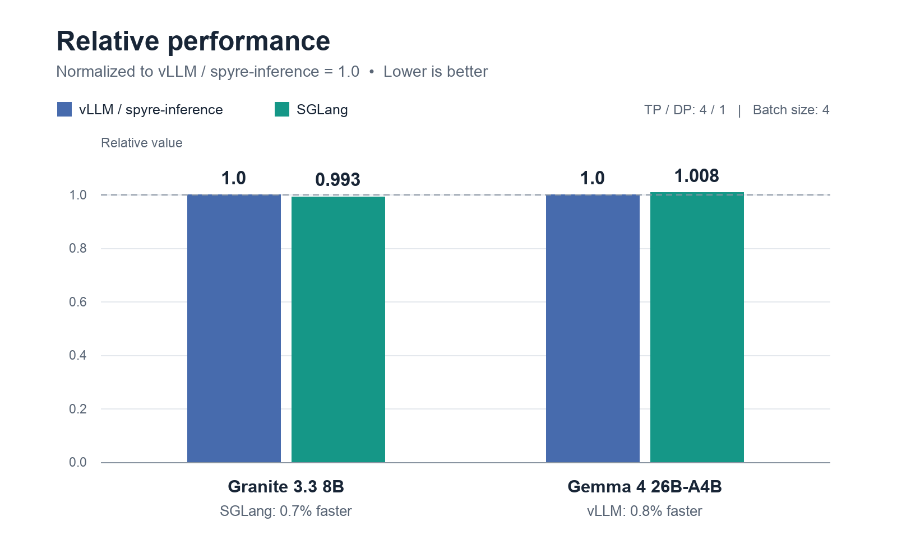

Gal Bloch, Itay Etelis, Raghu Ganti, Mudhakar Srivatsa, Alex Nails · 2026-11-12  
原文：[Integrating SGLang into Spyre in Under a Week with AI](https://pytorch.org/blog/integrating-sglang-into-spyre-in-under-a-week-with-ai/)

两人、一周以内、约 1,500 行插件，是这篇报告醒目的开发结果。更值得关注的解释是：团队已经有可工作的 Spyre 编译器和 PyTorch 算子，AI coding agents 主要把它们接到 SGLang 的明确扩展点。这个案例展示模块边界怎样缩小迁移任务，并没有证明 agent 能在一周内从零建立完整加速器软件栈。

## 既有硬件实现成为适配依据

torch-spyre 已将 Spyre 注册为 PyTorch device，并接入 torch.compile。团队又以现有 vLLM Spyre 集成为参考，其中已经包含 attention 分桶、张量形状处理和 PyTorch KV 分配逻辑。AI 工具因此能看到实际可用的硬件操作，而 SGLang 的平台注册、attention backend、KV pool 和 operator dispatch 指定了要满足的接口。

初始接入另需四个小补丁：两个移除执行路径对 CUDA 的特定依赖，两个注册 Spyre 设备与不依赖 Triton 的 attention backend。它们分别处理通用兼容性和设备识别，没有把已有调度器重写成另一套实现。

## 哪些逻辑可以直接保留

attention 基类提供外围逻辑，Spyre 只需覆盖内部 scaled dot-product attention；这部分复用解释了与约 3,500 行 vLLM 插件相比，代码量差异的约三分之二。KV pool 的 buffer 创建可用一个方法覆盖，但原先依赖 Triton 的分配路径仍需换成 PyTorch 实现。RMSNorm、SiLU、GeLU、rotary embeddings 与 linear 等操作则连接已有 Spyre 算子。

RadixCache 的前缀共享由调度器在硬件执行前解决，所以不需要新的 Spyre 特定代码。这个结果不能自动扩展为所有 attention 性能特性均已可用：文章把未来 Triton 支持和其上的 RadixAttention 优化仍列作后续工作。

## 性能比较的两个基线

<a class="note-image-link" href="/assets/images/tech/pytorch-sglang-ibm-spyre-ai/figure.png" target="_blank" rel="noopener" aria-label="Spyre 上 SGLang 与 vLLM 的归一化性能 · 查看原图 ↗">查看原图 ↗</a>

*TP/DP 为 4/1、batch 4；以 vLLM 为 1，越低越好，两模型差异均不到 1%。*

作者报告相对 torch-spyre 参考 PyTorch 推理实现约 3.6× 吞吐；与 vLLM 比较时，则在 Granite 3.3 8B 和 Gemma 4 26B A4B 上大致相当。图中 TP/DP 为 4/1、batch 4，归一化值是 0.993 和 1.008，基线 vLLM 为 1，越低越好。**3.6× 不是对 vLLM 的提升。**

因此证据支持“复用成熟服务框架可以超过参考推理路径，并接近另一个成熟后端”，不能从开发用时或代码行数推导出 AI 编码的独立生产率提升。文章没有无 AI 的对照开发过程，也没有覆盖所有模型与负载。

## 可迁移的是任务边界

该方法依赖工作中的 compiler/runtime、已有算子参考和稳定扩展接口。当前形状管理仍需 buckets，动态形状与 Triton 支持是后续方向。对于新硬件接入，案例最有参考价值的不是承诺“一周完成”，而是先把工作收敛为有限接口适配，让 coding agent 有具体实现可比照、让人能沿接口检查数值与执行语义。
