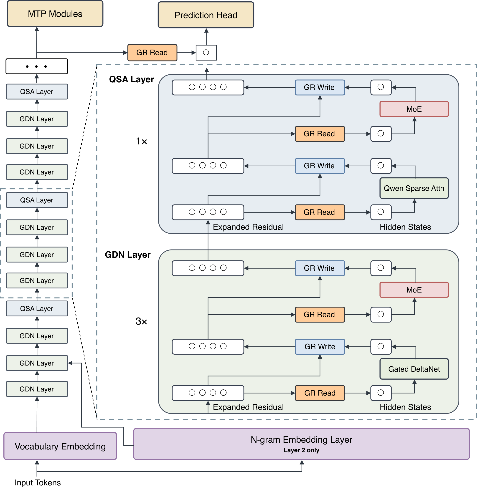

长任务的代价来自两处：每一步推理要处理多少历史，以及智能体要走多少步才能交付结果。Qwen4-Max 的发布报告分别给出了架构和任务账单，让这两种代价可以分开讨论。模型支持百万 token 上下文和原生视觉，公开的任务成本测量则来自团队自己的评测。

## 历史的两种表示

模型每三个 Gated DeltaNet 层搭配一个 Qwen Sparse Attention 层。前者把历史压进固定大小的状态，后者保留按需回看上下文的路径，先用轻量索引器选择相关的小块，再对选中部分计算注意力。长序列既有持续累积的状态，又保留了从远处取回具体片段的机会。公开材料描述了这条计算路径，但没有给出在不同并发和长度下实际可节省多少服务内存的曲线。

另外两处改动也影响参数数字的解读。四条并行残差分支通过动态读写门在层间传递信息；第二层还用 N-gram 查表提供局部 token 模式的表示。团队给出的主干参数为 2.4 万亿，每个 token 激活 710 亿，另有 3,280 亿 N-gram embedding 参数。这三个数描述总容量、稀疏激活与额外查表容量，不能相加当作单个 token 的活跃计算量。

<a class="note-image-link" href="/assets/images/tech/qwen4-max/architecture.png" target="_blank" rel="noopener" aria-label="左侧给出主干层次，图中分别展开稀疏注意力、残差门和局部模式查表。 查看原图 ↗">查看原图 ↗</a>

*左侧给出主干层次，图中分别展开稀疏注意力、残差门和局部模式查表。*

## 节省多少 token，要看工作负载和推理档位

在 Work360 上，与 Qwen3.8-Max 相比，Qwen4-Max 在 Xhigh 和 High 档的 token 用量分别减少约 24% 和 35%；换到 Terminal-Bench 4.0，同两档分别减少约 48% 和 49%。所以「接近减半」对应的是终端任务的测量。对于要交付完整工作成果的智能体，任务分布和推理设置都是估算成本时不可省略的条件。

Work360 由团队按 26 个一级领域、182 个二级领域和 721 个细分方向组织工作场景。在这一评测里，新模型得分从上一代的 47.74 升至 52.69。这个组合结果说明，在作者选择的任务上，更少 token 可以伴随更高成绩。报告没有逐任务分解减少的是冗长回复、无效尝试还是工具调用后的推理，因而无法单凭这些均值解释节省来自哪个行为变化。

## 每任务账单还包含价格变化

Work360 的平均每任务成本由 4.43 美元降到 1.67 美元，约降 62%。这个指标计入新 API 价格，尤其是缓存输入的降价。发布时，输入、输出和隐式缓存输入每百万 token 的报价分别为 1.50、4.50 和 0.075 美元。对于反复发送共享前缀的长工作流，同一批 token 是否命中缓存会改变账单，即使模型输出长度相同。

因此迁移到实际部署时，需要把任务成功情况、各类 token 数量和计价项放回同一份记录。有了这些数据，才能区分一次任务是因为少走了几步、重复输入更便宜，还是二者兼有。该发布报告提供了模型架构与两组任务级比较，尚未将每个组件对成本变化的贡献单独测量。

Qwen Team · 2026-11-16 · [Qwen4-Max: Your New Teammate Has Arrived](https://qwen.ai/blog?id=qwen4-max)
