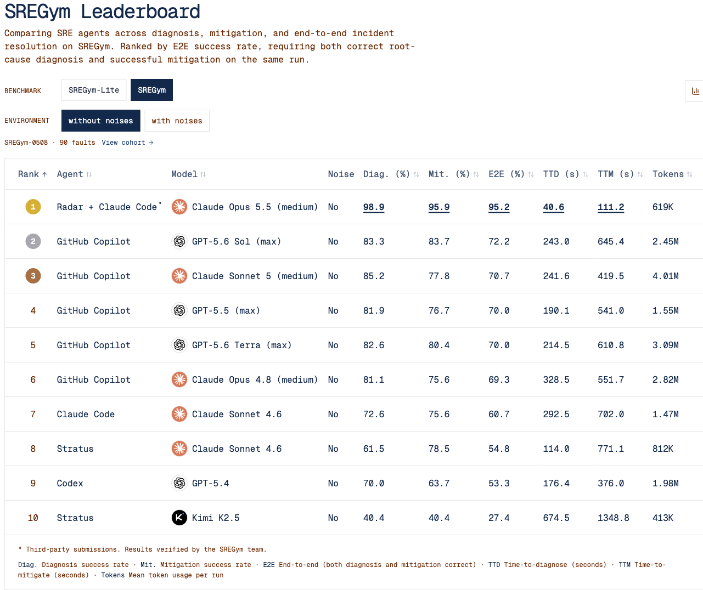

自动运维的困难不总是缺少一个能运行 shell 的模型。一个故障会在很多工作负载上留下症状，真正改变行为的配置却可能位于另一个 namespace。Radar 的 SREGym 实验把重点放到工具提供的上下文：去掉 Agent 的 kubectl 和 kubeconfig，只让它通过 Radar MCP 读取与修改集群，再看端到端故障处理是否仍能完成。

原文：[Radar Is #1 on SREGym: 95% of Live Kubernetes Faults Fixed](https://radarhq.io/blog/sregym-leaderboard) · Nadav Erell · 2026-11-05

## 隔离集群入口，测完整的处理链

提交组合为 Claude Code、Claude Opus 5.5 medium 和 Radar v1.19.0。每次运行启动全新 Radar，使用 SREGym 原有评分器；完整 SREGym-0508 共 90 个活 Kubernetes 故障，每个三次尝试，形成 270 次运行。作者报告没有丢弃运行，也没有另行重试。

Agent 容器里没有原生 kubectl 和 kubeconfig，集群的读与修复都必须是具名 MCP 调用。上游客户端包含过滤代理，使 Radar 可见范围与 kubectl Agent 对齐。这限制了绕过工具直接读集群的路径，但系统表现仍来自模型、harness、提示、工具及其上下文的组合，不能仅凭榜单隔离 Radar 的净贡献。

## DNS 案例：从跨服务症状找到另一个 namespace 的原因

SREGym 的一个场景改坏 CoreDNS 配置，使内部服务名都无法解析。在线商店多个服务同时失败，应用 namespace 的错误看起来很多，却都只是上游 DNS 失效的结果。

Agent 首次调用 issues 查询商店问题时，Radar 返回应用症状，还将 kube-system/coredns ConfigMap 标为可疑，提示检查导致 NXDOMAIN 的配置。Agent 因此先查最近变化、读取 CoreDNS，再提交根因；随后用 patch_resource 去掉坏配置，重启 CoreDNS，并在商店 Pod 内执行解析检查。示例轨迹在 21 秒提交诊断、38 秒提交修复，同一故障三次均通过。

这里的机制不是让模型多读一些原始日志，而是把资源关联、变化信息与可疑配置一起提供，缩小从症状到原因的搜索。修复后又回到工作负载内检验可达性，避免仅以“配置写入成功”宣告解决。一个例子能说明运行过程，却不足以证明所有问题都通过同一路径加速。

## 270 次运行具体说明了什么

作者给出的完整套件结果为诊断 98.9%、修复 95.9%、两者同时成功 95.2%；平均诊断时间 40.6 秒、修复时间 111.2 秒，token 约 619K/运行，报告的 Agent 成本为 0.41 美元/运行。95.2% 的分母是运行，并非恰好 90 个唯一问题中成功了某个整数比例。

<a class="note-image-link" href="/assets/images/tech/radar-sregym-leaderboard/radar.png" target="_blank" rel="noopener" aria-label="官方文章保存的 SREGym 榜单画面，展示各提交的模型、诊断、修复与端到端结果；不同提交的模型条件并不一致。 · 查看原图 ↗">查看原图 ↗</a>

*官方文章保存的 SREGym 榜单画面，展示各提交的模型、诊断、修复与端到端结果；不同提交的模型条件并不一致。*

工具使用也提供了行为证据：issues 出现在全部 270 次运行，get_changes 为 231 次、patch_resource 为 219 次、get_resource 为 218 次；248 次使用 wait_for，82 次使用 exec_pod。它们支持“先获取结构化上下文、再定点修改和验证”的总体路径。20 种工具实际被使用，不能只用一个摘要检索端点解释全部结果。

## 领先分数为何仍不能直接归因于工具

榜单另一条目端到端为 72.2%，但使用不同模型和 harness；作者明确承认，完整榜单没有另一项 Opus 5.5 对照。Lite 的同模型同 effort 比较更接近，但任务只有 17 个，仍不是严格只替换工具的配对消融。旧的诊断-only 实验也不能替代本次修复链的控制组。

因此，95.2% 是一项工具受限组合的高完成率证据，而非证明“Radar 独立带来 23 点提升”。公开静态榜单页面也显示该组合和数值，但没有足以独立重算每次轨迹的明细；本次解读将工具调用统计和案例时间明确归属于作者报告。

## 剩余失败和生产权限边界

13/270 次未能端到端完成，多数已诊断正确却没有修好，集中在 Kafka 等应用内部证据、节点或 kubelet 故障；这些情况耗时可达 3–10 分钟。结构化 Kubernetes 资源信息并没有消除应用与节点层的盲区，带噪声榜单也尚未测试。

Radar 保留 Kubernetes RBAC，结构化读取不返回 Secret 值，删除需要 preview 和 confirmation token，MCP 客户端还可要求写操作前确认。exec_pod 默认关闭，是本次可按需开放的能力。具名调用使审计和权限配置更清楚，但仍需按环境限制目标、写权限和执行通道。

与本期 SWEOps-Bench 放在一起看，两者补齐不同环节：Radar 展示运行态工具与上下文怎样支持故障诊断修复，SWEOps-Bench 则要求修改 operator 源码、重建部署并通过独立功能检查。它们的任务与恢复标准不同，数值之间不构成能力排名。
