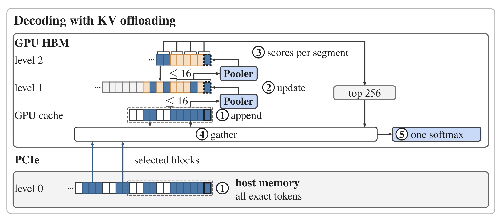

[RecSA: Million-Token Extrapolation at Logarithmic Cost](https://haoailab.com/blogs/recsa/)  
Ruitian Wang, Xinyu Yang, Minshen Zhang, Hao Zhang · 2026-11-17

RecSA 同时处理长上下文的两个成本：注意力要读多少历史，以及模型在训练长度之外怎样理解位置。它把 KV cache 组织成树，让每个 query 逐层只展开少数节点；未展开部分仍以摘要进入注意力。与只减少最终读取量的方法相比，值得关注的是选择过程本身也不再扫描全部历史。

## 从整段扫描变成逐层展开

每 16 个相邻 token 合成一个上层节点，再每 16 个节点向上合并，直到顶层不超过约 4K 个候选。节点的 value 是子节点均值，key 来自小型可学习 pooler。query 在一层选择 256 个节点，其中包含自己所在节点，其余按分数挑选；下一层只考察这些节点的子节点，所以每层候选仍不超过 4,096。

这种结构把随长度增长的部分变成树高。固定分支和选择预算下，每个 query 的选择成本与读取条目数按对数增长，不能把这个结论扩写成整个 prefill 或整个模型只需对数时间。未选节点也不直接丢弃，而作为子树摘要，与展开到叶子的精确 token 共同进入一个 softmax；每个历史 token 由其中一个条目覆盖。覆盖不代表逐 token 精确信息都被保留，摘要仍然是一种近似。

<a class="note-image-link" href="/assets/images/tech/recsa/method.png" target="_blank" rel="noopener" aria-label="精确叶子可留在主机；GPU 逐层选择后只取回需要的块，并把摘要与精确 token 放进同一 softmax。 · 查看原图 ↗">查看原图 ↗</a>

*精确叶子可留在主机；GPU 逐层选择后只取回需要的块，并把摘要与精确 token 放进同一 softmax。*

## 位置距离为什么没有一起增长

标准 RoPE 使用原序列位置，百万长度会带来训练时从未见过的相对距离。RecSA 在每层按候选列表顺序重新编号，query 使用最后一个编号，去掉候选之间被跳过的间隔。因为一层最多 4,096 个候选，距离也保持在此范围内。

这不是任意模型的免训练补丁。第一阶段冻结 Qwen3-4B，用教师的注意力质量蒸馏 pooler；第二阶段冻结 pooler，在 RecSA 下训练骨干。两阶段共处理 0.62B token，序列都为 32K。蒸馏时每层只选 64 个节点，让短序列也出现更多树层，学习“已经池化的 key 怎样再次池化”；推理时新出现的层复用同一组参数。

pooler 还要避免一个特殊捷径：统一 key 偏移在候选局部 RoPE 后可能变成位置偏置，使蒸馏损失下降却没有学会更好的子树检索。作者惩罚这一共享偏移，保留节点之间的有效差异。这说明位置机制与训练目标需要一起设计。

## 缓存超出显存后，真正搬什么

当 1M、2M 的精确 KV 装不进 H200 时，RecSA 把叶子保存在锁页主机内存，上层摘要留在 GPU，后者占缓存不到 7%。选择在 GPU 完成，再只收集选中的精确块；空余显存可缓存输入后缀。每步追加一个 token 时，也只更新各层最后的节点，避免重建整棵树。

kernel 设计要处理每个 query 的候选位置不同这一麻烦。prefill 将 key 的子节点内位置旋转与 query 承担的父节点槽位旋转分开，使相邻 query 仍能共享已加载的 KV 块。decode 把候选评分分段并行，避免 batch size 1 时只有少量 KV head 占用 GPU。它的系统收益来自算法结构和执行方式配合，不能只看稀疏比例。

## 证据显示了什么，尚未显示什么

同一稀疏读取预算下，RULER 的 1M 分数为 60.5，最强对比 Dense+DCA 为 40.0；2M 时 RecSA 为 49.3，因此外推有效并不意味着长度增加后质量不下降。在单 H200、batch size 1、同框架 dense FlashAttention 比较中，524K 的 prefill 为 80 秒对 257 秒，约快 3.2 倍；decode 约 6 ms 对 23 ms，约快 3.8 倍。32K prefill 反而略慢，为 1.6 秒对 1.5 秒。

1M、2M 时 dense 缓存也发生主机卸载，较大倍率包含不同访问方式的影响，不能只归因于 Tensor Core 计算。现有主要证据来自 Qwen3-4B、检索与书籍任务及单请求延迟；高并发、多用户缓存管理和更大模型仍是不同检验。对多轮 agent，RecSA 提供了让历史更便宜可读的路径，但没有替代“哪些信息必须精确保留”的质量判断。
