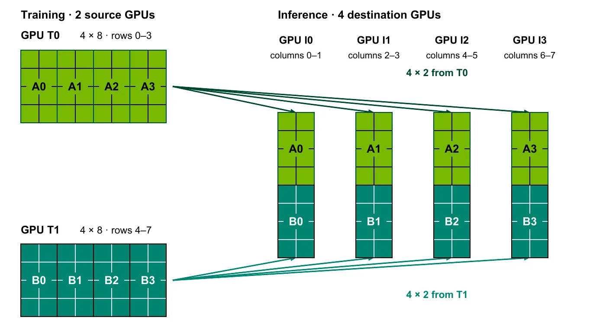

**NVIDIA · Youngeun Kwon、Kaushik Kandadi Suresh、Sreeram Potluri、Terry Kong、Sangkug Lym · 2026-11-06**  
原文：[Accelerating Reinforcement Learning Weight Refit with the Reshard Collective](https://developer.nvidia.com/blog/accelerating-reinforcement-learning-weight-refit-with-the-reshard-collective/)

RL 后训练常把轨迹生成与参数更新放在不同 GPU 上。训练器更新完参数，推理侧必须拿到新权重，下一轮生成才使用更新后的策略。这个 refit 不只是复制一个文件：两侧的 GPU 数和张量、流水线、专家、数据并行布局可能都不同。Reshard 的变化，是把权重刷新定义成分布式张量从一种布局直接转到另一种布局。

## 完整张量这个中间结果为何昂贵

常见做法先在训练端 all-gather 还原参数，再广播给推理端，各目的 GPU 只保留自己需要的分片。好处是不用为每对并行布局单独设计通信；代价是每个接收者都收到完整参数，即便最终只保留一小块。模型越大，重复搬运越难隐藏。

文章以 BF16、每参数两字节估计，Kimi K3 的 2.8T 参数约为 5.6 TB，先聚合再广播的两阶段逻辑载荷约 11.2 TB。这是说明旧流程冗余的载荷估算，并非某次真实网络计数，也不是说每个模型、每一步都必然跨网络搬动同样多字节。工程上真正需要问的是：目的分片缺哪些区域，它们现在在哪个源 GPU 上？

## 用分片交集生成传输计划

DTensor 用全局 shape、设备 mesh 与各维的分片或复制方式描述分布式张量。Reshard 接受源和目的两份描述，求源分片与目的分片的交集，直接传需要的区域。

<a class="note-image-link" href="/assets/images/tech/reshard-rl-refit/shard-transfer.webp" target="_blank" rel="noopener" aria-label="训练行分片直接组成推理列分片 · 查看原图 ↗">查看原图 ↗</a>

*读图：两个源各发所需的 4×2 交集，四个目的端各自拼出 8×2；不先广播完整矩阵。*

例如一个 8×8 权重矩阵在两张训练 GPU 上按行分，每张持有 4×8；推理侧四张 GPU 按列分，每张需要 8×2。每个目的端从两个源各取 4×2，拼成自己的列分片即可。没有哪个目的端需要先接收完整 8×8。这个例子也解释了抽象的价值：框架提供布局，通信库负责“谁向谁发送哪一区域”，算法优化与上层并行配置得以分开。

这里的“最小数据量”仍需结合复制和物理拓扑解释。若多个目的副本都要同一片数据，把交集转换为逐一直接发送，仍可能在慢速跨节点网络上复制多次。

## 把重复复制留在 NVLink 域内

NCCL M2N Reshard 进一步按 NVLink 域分组。一个域内的多个目的副本分担接收不同数据子集，让每份源数据只跨网络进入一次，再通过 NVLink 交换缺失部分，使每个副本装配出完整目的分片。网络传输与本地交换采用流水线。

这不是取消复制，而是把不可避免的复制移到较快的域内链路，并减少稀缺跨域带宽的重复消耗。源端 TP4、目的端 TP2×DP2 的例子中，朴素发送会把每份源贡献跨网络送给两个 DP 副本；新路径让目的 GPU 分担外部接收，再相互补齐。因此单纯比较 API 调用次数看不到收益，必须看同一分片在不同网络层次上经过几次。

## NeMo RL 的混合路径与实测

实际参数布局的边角情况很多。NeMo RL 没有声称所有层都统一切换：占大部分参数、文中约 95% 的前馈投影权重走 Reshard，较小的 QKV 或 Mamba 等权重保留 gather-and-broadcast，以维持功能覆盖。这是按载荷占比获得大部分收益的混合设计。

官方 NeMo RL 测量中，DGX H100 上 Qwen 3 235B 的 refit 从 6.4 秒降至 1.9 秒，DeepSeek v3 671B 从 14.9 秒降至 2.6 秒；DGX GB200 上后者为 6.1 秒降至 2.3 秒。整表报告 2.7–5.7 倍 refit 加速。Qwen3.8 2.4T BF16 的 4.3 秒是另一项 refit-only 微基准，不能与训练整步吞吐等同。

对部署判断，这些数据证明的是指定模型与布局的权重刷新阶段缩短，收益还取决于 refit 在完整训练步中占多少，以及生成与训练之间的重叠。它也不消除异步 RL 的旧权重问题：搬得快和使用了哪个版本，是不同的运行约束。

## 布局变化时仍要重建通信语义

故障恢复或节点增减会改变 GPU 成员与分片布局。文章说明，当前 NeMo RL 通过销毁并重建通信组适应变化；利用 NCCL shrink/grow 调整已有通信组仍是后续计划。不能因为通信库提供了相关 API，就把该能力算作当前集成已完成。

这项实践最值得关注的是把布局转换做成明确通信原语，再按真实网络层级压缩冗余。它适合两侧布局不同、权重刷新开销明显的解耦 RL；当前证据还不足以给任意布局、精度或弹性恢复路径承诺同样倍率。
