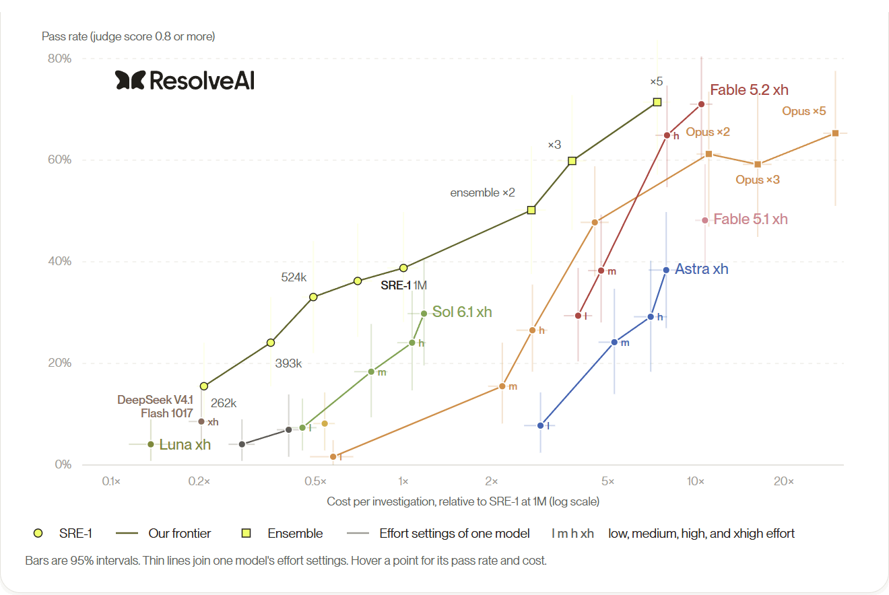

生产告警通常只告诉值班人员哪个指标越过了阈值。一次部署碰巧发生在告警前，几条日志又恰好包含服务名，这些都能生成听起来合理的解释。ResolveAI Labs 给 27B 模型设定的任务更具体：从告警出发查询当时可获得的记录，交出一条能与事后查明的原因逐环对应的因果链。系统的价值取决于查对一次需要付出多少查询和模型成本，也取决于看似可靠的线索有没有提前泄露答案。

## 把调查环境还原到告警发生时

调查需要从指标、追踪、代码、部署记录等不同来源找证据。单纯给每个工具加一个结束时间不够：作者发现过一个调查者沿着后来的提交哈希读到修复内容，从而提前拿到了根因。团队逐个为可用工具限制时间视野，无法处理的工具退出训练。工具查询对接真实或捕获的数据；用模型替未记录查询补写响应的尝试因保真度不足而放弃。训练调查中有 18.1% 遇到至少一次工具失败，这些超时、限流等真实失败被保留下来，让策略学会在证据暂不可得时更换查询路径。

<a class="note-image-link" href="/assets/images/tech/resolve-sre-1/overview.png" target="_blank" rel="noopener" aria-label="查看原图 ↗ — 横轴是相对调查成本，纵轴是生产案例通过率；增加合成条数会同时改变两者。">查看原图 ↗</a>

*横轴是相对调查成本，纵轴是生产案例通过率；增加合成条数会同时改变两者。*

## 一次查证与多次调查的合成

一类训练任务允许模型现场调用工具；另一类给它只读的历史调查记录，包含调用参数、完整返回值和咨询过的运行手册，让它从已有证据重新得出结论。后者也让多次调查有了不同于多数投票的合成方式。一条轨迹可能找到异常的部署，另一条验证了受影响的请求范围；合成模型有机会把互补证据拼成更完整的链。奖励以参考因果链为依据，由经过值班工程师校准的模型评判器评分，达到 0.8 算通过。它衡量的是对已知事故的解释质量，自动修复成功率需要单独的验收。

## 长轨迹训练中的一个数据一致性问题

采样器产生的是 token 序列，服务接口通常返回文本。对文本再次分词有时会得到另一串 ID，在策略更新时就变成用另一串动作解释原先的收益。作者估计，若按这种方式回传，约 94% 的 rollout 会有 token ID 变化。保留采样时的序列解决了这一错位。训练从 Qwen3.8-27B 出发，覆盖 1,549 个不同事故；最终一轮运行 7.4 天，峰值使用 512 张 GPU。这样的工程成本解释了为什么报告把部署调查成本与训练投入分列。

这套异步平台把训练器和采样器放在低层计算接口之后，查询工具、评判与编排运行在环境附近。组织者可在一条轨迹等待后端时继续推进别的轨迹。峰值同时在途 8,736 条，最终跑完 812,695 条，训练实际使用 409,600 条；5,150 万是整轮工具调用量。并发数、完成量和进入参数更新的样本量各自描述不同的系统负载。

## 49 个真实案例上的成本曲线

实测包含 49 个困难生产案例。单次调查通过率从基座的 6.9% 提至 38.8%；三条调查合成达到 60%，五条约为 71%。五条配置与所测 Fable 5.2 xhigh 表现相当，按作者计费口径成本低 37%，其中计入了合成步骤。关键在于能否以额外调查买到不同证据：若几条轨迹都找不到同一类遥测，增加条数也未必弥补缺口。读曲线还应保留测试集大小、作者内部工具权限与评判方式，尤其是组织间工具覆盖和事后根因记录质量的差异。

[SRE-1: Frontier Incident Investigation from a 27B Model](https://resolve.ai/labs/sre-1) · ResolveAI Labs · 2026-11-18
