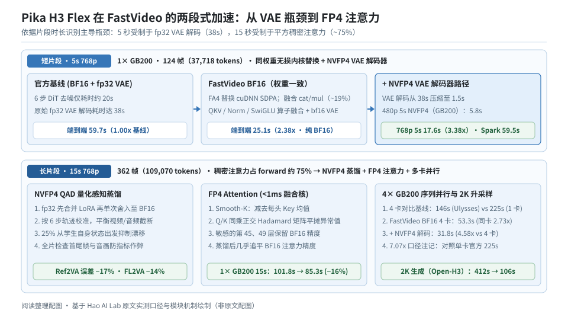
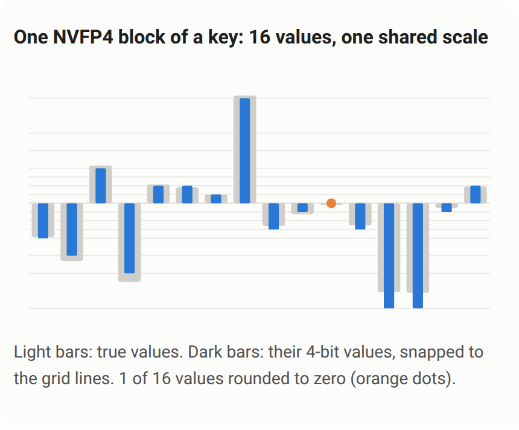

Hao AI Lab @ UCSD（FastVideo 团队 · Aryan Kumar / Will Lin / Hao Zhang）· 2026-11-04 · [原文](https://haoailab.com/blogs/pika-h3-flex/)

Pika H3 Flex 基于 MiniMax H3 后训练，配备两套 LoRA 适配器：`fl2va`（文本生视听、`T2VA`，及首尾帧条件 `I2VA / L2VA / FL2VA`）与 `ref2va`（最多融合 9 张图像、3 段视频与 3 段音频参考 `Ref2VA`），采用 6 步采样、无分类器引导（no CFG）和全序列稠密注意力。FastVideo 团队针对这套开源模型发布了 BF16 内核加速实现以及两套通过量化感知蒸馏（QAD）训练的 4-bit 版本（BF16 注意力 `FastVideo/Pika-H3-Flex-NVFP4-QAD` 与 FP4 注意力 `FastVideo/Pika-H3-Flex-NVFP4-FP4Attn-QAD`），同时开放推理代码、训练全流程配方与 2K 二阶段生成流水线。

> **基准口径与边界说明**：原文所有端到端耗时均按“从提示词到带音频 MP4”的常驻模型热中位数（warm median，不含权重加载时间）统计，且依赖 NVIDIA Blackwell 架构 GPU（最低支持 DGX Spark 与 RTX 5090）。文首标题的 **`7x`（实测 `7.07x`）** 比较的是“4× GB200 + 算子融合 + NVFP4 VAE 解码器（`31.8 s`）”相对“单卡 GB200 官方 BF16 代码（`225 s`）”的结果，**并非**同卡数、同纯 BF16 精度的单一优化收益。

## 长短片瓶颈迁移：VAE 解码反超 DiT 去噪与 BF16 内核加速

在做任何低比特量化之前，FastVideo 先用单卡 GB200 拆开了官方基线（`diffusers + cuDNN SDPA + fp32 VAE`）的时间账。以 **5 秒 768p（1344×768，124 帧 / 37,718 tokens）** 为例，6 次 DiT forward 合计只需约 **20 秒**，而官方默认 `fp32` VAE 解码单独就要吃掉 **38 秒**——超过半数等待都在最后解码环节。

因此 FastVideo 分两步清理同权重下的工程开销：首先用 **FlashAttention-4（FA4）** 替换 cuDNN SDPA，并把官方前向里占约 **19%** 耗时的零碎 `cat`/`mul` 拼接（glue）算子以及 QKV 预处理、归一化、调制和 SwiGLU 全部融合进定制核（在 BF16 下数学等价）；其次把 VAE 解码切至 BF16（`25.1 s`，单卡提速 `2.38x`），再叠加定制的 **NVFP4 VAE 解码器**，直接把 38 秒解码压缩到 **`1.5 s`**（端到端 `17.6 s`，提速 `3.38x`）。

然而一旦把片长拉到 **15 秒 768p（362 帧 / 109,070 tokens）**，全局格局立即反转：稠密注意力的计算随序列长度平方增长，单卡上注意力耗时反超占到每次 DiT forward 的约 **75%**。此时即便在四卡 GB200 启用序列并行（Ulysses CP），单卡和四卡官方基线分别仍需 `225 s` 与 `146 s`，必须由下文针对注意力的 FP4 优化接棒。

<figure>
  <a class="note-image-link" href="/assets/images/tech/review-haoailab-pika-h3-flex/pika-h3-pipeline-zh.svg" target="_blank" rel="noopener">
    
    放大图解 ↗
  </a>
  <figcaption>阅读整理配图（非原文原图）：按片段时长划分的性能瓶颈迁移与 FastVideo 对应优化栈，严格区分同卡 BF16（2.38x / 2.73x）与跨卡+NVFP4 解码器（7.07x）的不同比较基准。</figcaption>
</figure>

| 任务与时长（768p `1344×768`，1×/4× GB200） | 配置路径与核心改动 | 端到端耗时 | 同卡加速比 | 相对 1 卡官方 (`225 s`) |
| :--- | :--- | :--- | :--- | :--- |
| `5 s · 124 帧` · 1× GB200 | 官方 `pika-h3-pro`（`cuDNN SDPA + fp32 VAE`） | `59.7 s` | `1.00x` | — |
| `5 s · 124 帧` · 1× GB200 | FastVideo BF16（`FA4 + 融合算子 + bf16 VAE`） | `25.1 s` | `2.38x` | — |
| `5 s · 124 帧` · 1× GB200 | `+ NVFP4 VAE 解码器`（解码 `38 s → 1.5 s`） | `17.6 s` | `3.38x` | — |
| `15 s · 362 帧` · 1× GB200 | 官方 `pika-h3-pro`（`fp32 VAE`） | `224 s` | `1.00x` | — |
| `15 s · 362 帧` · 1× GB200 | FastVideo BF16 / `+ NVFP4 解码器` | `104 s` / `94.7 s` | `2.15x` / `2.37x` | — |
| `15 s · 362 帧` · 4× GB200 | 官方 4 卡 `diffusers Ulysses CP` | `146 s` | `1.00x` | `1.54x` |
| `15 s · 362 帧` · 4× GB200 | FastVideo BF16 4 卡序列并行（DiT + VAE） | `53.3 s` | `2.73x` | `4.22x` |
| `15 s · 362 帧` · 4× GB200 | `+ 定制融合核 + NVFP4 VAE 解码器` | `31.8 s` | **`4.58x`** | **`7.07x`** |

此外在较低分辨率的 **480p · 5 秒** 档位，NVFP4 模型（BF16 注意力）在单卡 GB200 上可在 **`5.8 s`**（`5.79 s` vs FP4 注意力 `5.74 s`）内生成完整带声音视频；而在单台桌面级 **DGX Spark** 上，同配置生成 5 秒 480p `FL2VA` 片段耗时 **`59.5 s`**。

## NVFP4 量化感知蒸馏：LoRA 合并、双模态校准与防漂移护栏

两套适配器均将 50 个 DiT block 中所有注意力与前馈线性层压缩到 **NVFP4**（4-bit 权重 + 4-bit 激活，每 **16 个值共享 1 个 8-bit 缩放因子**）。为避免音画对齐与细粒度结构在 4-bit 下坍塌，团队设计了三项关键步骤：

1. **先 `fp32` 合并 LoRA，再单次舍入至 BF16**：Flex 分发的 LoRA 适配器原为 `fp32` 精度。团队严格执行 `(W.float() + (alpha / rank) * B.float() @ A.float()).to(torch.bfloat16)` 先合并再做唯一一次舍入，防止合并误差叠加量化噪声。
2. **面向“视频 + 音频”平衡的静态激活校准**：按 Flex 自身 6 步去噪轨迹标定静态激活截断阈值。若直接按最大值缩放，极少数离群峰值会浪费全部 4-bit 动态范围；若单纯追求总体 token 重建误差最小，数量占绝对多数的视频 token 会完全淹没音频通道误差。因此每一层分别搜索能**平衡视频与音频误差**的最佳裁剪阈值。
3. **部署数值下的 6 步全轨迹 QAD 与防自激漂移**：从第 1 步蒸馏起即开启与上线完全一致的 4-bit 运算（保证导出的权重与训练期**按字节完全一致**），同时对齐冻结 BF16 教师的最终输出与每一层 block 输出；并且 **25%** 的训练 rollout 会直接从学生模型自身前序生成的中间状态出发继续跑完轨迹，专门教会学生纠正自回归积累的漂移误差。

值得注意的是，团队并未迷信单一蒸馏损失：原文明确记录过一次训练中蒸馏 loss 持续下降，但整片端到端质检发现**最后一帧悄悄跑偏**——团队设置的**基于种子噪声阈值的全片守卫**（同步校验首尾帧保真度、运动幅度与音频质量）及时叫停了这次退化，随后调低学习率修复了问题。

<figure>
  <a class="note-image-link" href="/assets/images/tech/review-haoailab-pika-h3-flex/official-figure.png" target="_blank" rel="noopener">
    
    放大图解 ↗
  </a>
  <figcaption>原文配图（Hao AI Lab）：NVFP4 细粒度分块量化机制示例。16 个连续数值共享同一缩放尺（E4M3），若同块存在剧烈离群通道，小数值会被强制舍入为零。</figcaption>
</figure>

## 长序列 FP4 Attention：Smooth-K、Hadamard 旋转与敏感层保留

对 15 秒 109K tokens 长序列，团队进一步将 FlashAttention-4 中的 Q 和 K 量化至 NVFP4（`P` 与 `V` 维持 BF16）。直接量化会令 QAD 距离指标大幅恶化 **13%–17%**，团队用两项量化前等价变换与一层混合精度保留把大部分精度拉了回来：

- **Smooth-K（减除每头 Key 均值）**：由于 softmax 对所有 Key 同加减一个常向量保持结果严格不变（`q·(k_j - k̄) = q·k_j - q·k̄`），提前减去每个注意力头的平均 Key 能消除各通道固定偏置。
- **Q/K 共享正交 Hadamard 旋转**：对 Q 与 K 同乘同一正交 Hadamard 矩阵满足 `(qH)·(kH) = q·k`，在量子化前不改变一点 `softmax(QKᵀ)` 语义，同时把少数尖峰离群通道均匀打散至各个 16 值分块中。两项变换与量化已合入单个融合内核，单次注意力调用额外耗时低于 **`1 ms`**，与训练期模拟误差相差不超过 **`1%`**。
- **第 45、49 层保留 BF16 注意力**：实测各层误差后发现第 45 与第 49 个 block 集中了绝大部分残余量化损失，将其注意力退回 BF16 后即可把单层 FP4 误差再压下一截。

| 量化策略 / 对比项 | `Ref2VA` 指标 / 数值 | `FL2VA` 指标 / 数值 | 端到端与工程说明 |
| :--- | :--- | :--- | :--- |
| NVFP4 QAD 前 vs QAD 后（距 BF16 距离，越低越好） | `0.326 → 0.270`（**`-17%`**） | `0.272 → 0.234`（**`-14%`**） | 6 步全轨迹蒸馏 + 25% 自身状态纠偏 |
| 真实 Flex 激活每层 FP4 注意力误差：朴素 FP4 | `0.113` | `0.115` | 直接将 Q/K 压缩到 4-bit |
| `+ Smooth-K + Hadamard 正交旋转` | `0.095` | `0.095` | 数学等价去偏+打散，`< 1 ms` 融合核开销 |
| `+ 第 45、49 层保留 BF16 注意力` | `0.080` | `0.083` | 显著收敛残余层间误差 |
| 完整 QAD 后最终距 BF16 距离（FP4 vs BF16 注意力） | `0.276` vs `0.270` | `0.237` vs `0.234` | 几乎抹平注意力 4-bit 量化损失 |
| 1× GB200 端到端耗时（`768p 15 s` · FP4 vs BF16 注意力） | `85.3 s` vs `101.8 s`（**`-16%`**） | `480p 5 s`：`5.74 s` vs `5.79 s` | 短片段受限于其余算子，长序列收获 `-16%` |

在文首 5 组同提示、同随机种子（`768p · 5 s`，1× GB200）的并行样片中，端到端耗时表现为：官方 BF16 `59.7 s–75.4 s` → FastVideo BF16 `26.6 s–61.7 s` → NVFP4 QAD（BF16 注意力）`16.8 s–61.7 s` → NVFP4 QAD（FP4 注意力）`15.1 s–51.4 s`（其中前 4 组文生/首帧任务降到 `15.1 s–16.5 s`，而带最多参考素材的 `References to video` 因条件编码开销仍需 `51.4 s`）。

## 2K 二阶段升采样与多模态推理选型启示

针对更高清晰度需求，FastVideo 将 NVIDIA 开源的 **`Open-H3-Regenerate-2K`**（把 768p H3 视频重生成到 `2560×1440` 2K）接在 NVFP4 QAD Flex 草稿模型与 NVFP4 解码器之后：在单卡 GB200 上，2K 阶段的 VAE 解码从 `23.3 s` 降至 `5.0 s`，而草稿生成环节从 50 步原始 H3 基线的 `316 s` 压缩到 `16.8 s`，使 **文生 2K 总耗时从 `412 s`（接近 7 分钟）降到 `106 s`（不到 2 分钟）**。

从多模态加速架构落地角度看，这篇工程实践有三条超出特定模型的通用价值：第一，先看耗时饼图再谈量化——短片先治 `fp32 VAE`（占超一半时长）和碎算子拼接（19%），长片才轮到平方注意力做文章；第二，多模态校准必须显式按模态分权重（防止海量视频 token 吃掉音频动态范围）；第三，端到端守卫必须基于真实首尾帧、运动和声音产物指标，而不是仅靠蒸馏 MSE 降了就宣布收工。

---

> **AI 辅助整理 · 归档注记**：本篇中文重编与对应的英文配套版（[English note](/tech/en/review-haoailab-pika-h3-flex/)）均由助手通读 Hao AI Lab 原文逐项核对重写，原文唯一技术图 `official-figure.png` 原样保留，架构图 `pika-h3-pipeline-zh.svg` 系助手按原文口径绘制（非原文配图）；同步修正原档误挂的 4 个 Agent/可观测标签，仅保留 `inference-serving`。
