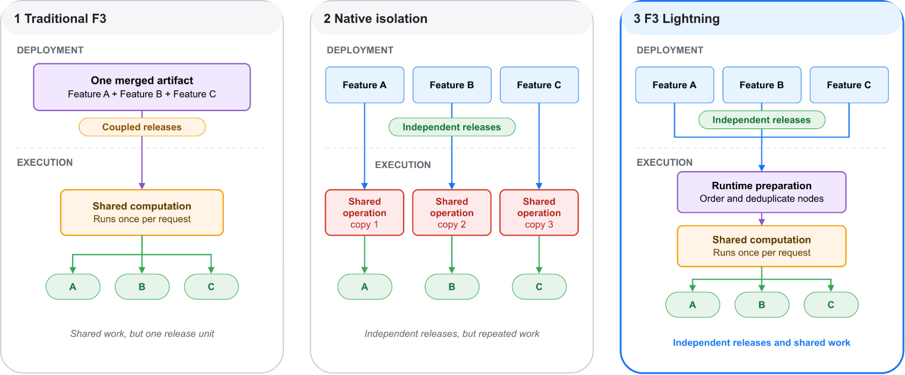

## 为什么共享图拖慢发布

F3 为广告排序提取特征，一次请求可能需要两万多个特征。七天点击数和展示数可以共享事件读取、时间过滤，点击率又复用两者。旧编译器把所有特征合成一个 DAG，公共节点每次请求只执行一次；代价是整个图也成为发布单位。一个定义错误会挡住其他有效特征，已上线特征需要的昂贵模型测试也让新特征一起等待。

Meta 的 F3 Lightning 将每个特征编译成自足配置，包含它需要的全部节点，独立验证、发布和回滚。队列按影响与风险选择更新：尚无模型消费的新特征走标准检查，已有消费者的修改接受额外测试。这解决的是发布依赖，早期原型却因分别执行各图而明显增加 CPU 用量。

## 如何重新共享计算与内存

<a class="note-image-link" href="/assets/images/tech/review-meta-f3-lightning/official-figure.png" target="_blank" rel="noopener" aria-label="查看原图">查看原图 ↗</a>

*每个特征可以独立发布，运行时仍对计算节点排序和去重，复用公共计算。*

关键是让独立编译的配置认出同一项工作。编译器用操作、参数和输入的标识生成稳定计算 ID，输入 ID 递归包含上游语义；可交换输入先规范排序，聚合还包含窗口和分组键。因此节点在局部图中的编号改变，不会导致相同计算失去共享。

服务启动时，把活跃配置按依赖排序并去重，再展平成单个执行序列。请求只顺序执行这份计划。失败节点会让依赖它的下游标记为未就绪，独立分支继续运行，因而独立发布不等于消除了运行时依赖。

仅去重仍未恢复 CPU 效率：中间结果分散在各配置容器，访问造成缓存缺失。系统改用每请求一个共享缓冲区和独立 readiness 向量。空列表是合法结果，不能拿它表示“尚未计算”；列表、映射共享结果引用，小标量仍复制。启动时再将稳定 ID 映射为连续整数槽位，让请求路径直接索引数组，省掉哈希查找。

## 收益对应什么，哪些经验可迁移

Meta 报告可比提取特征进入生产约快 3.6 倍，基础设施计算成本没有增加。这个指标是发布周期，不是单次预测速度，也没有把开发和迁移成本纳入“免费”的含义。文章提供机制与工程经验，未给出可用于其他平台的统一性能承诺。

我的理解是，这个案例适合存在大量公共子计算、但组件更新频率不同的特征平台。可借鉴的不是把每个图拆成服务，而是分开发布边界和执行边界，再将不随请求变化的去重、排序、地址解析提前到启动阶段。共享执行仍需显式传播失效状态，才能避免一个分支的问题污染无关输出。

来源：[原始工程文章](https://engineering.fb.com/2026/11/03/ml-applications/f3-lightning-how-meta-accelerates-ads-ml-features-to-production/)
