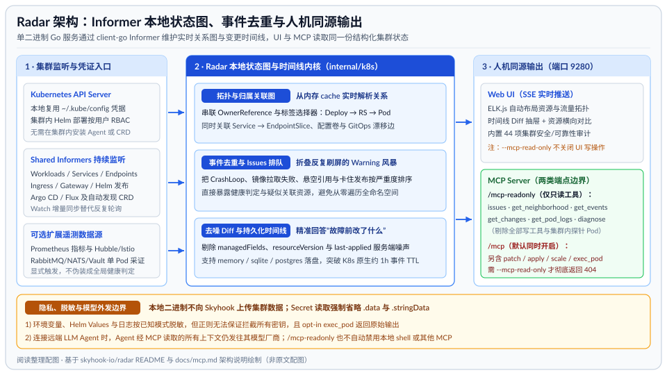
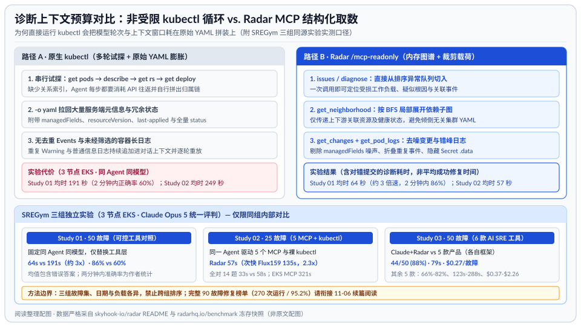

Skyhook · Apache-2.0 开源单二进制 Go 服务 · [GitHub 仓库与 README](https://github.com/skyhook-io/radar) · [SREGym 诊断基准页（radarhq.io/benchmark）](https://radarhq.io/benchmark)

让编码或 SRE 智能体直接拿着原始 `kubectl` 排查 Kubernetes 故障，最先耗尽的往往不是推理能力，而是上下文窗口和 API 往返轮次。Skyhook 开源的 **Radar** 将集群可视化面板与内置 Model Context Protocol（MCP）服务器打包进同一个 Go 二进制（本地或经 Helm 集群内部署，默认监听 `9280` 端口）：前端与智能体不再各自重复拉取原始清单，而是共同消费一套由 Kubernetes Informer 持续维护的状态图、去重事件流与去噪变更时间线。

> **证据口径与姊妹篇分工说明**：本文核心机理与基准数字均源自冻存的 `skyhook-io/radar` 仓库 README（快照记录 `4.0k` stars / `268` forks）、官方 MCP 文档（`docs/mcp.md`）及 `radarhq.io/benchmark` 页面上的三组 SREGym 评测（作者团队自建 3 节点 Amazon EKS 集群、同由 Claude Opus 5 按 SREGym 评分准则评判，**各组之间故障集、日期与集群负载不同，仅限组内对比**）。其中基准数字与工具清单属原文实测或仓库记录；围绕上下文开销机理、局部图遍历取舍与权限隔离的工程推演，均标明为基于上述材料的架构分析。关于 Radar 随后在 11 月初去掉 `kubectl` 与 `kubeconfig`、挑战 90 故障 / 270 次端到端修复运行（`95.2%` 联合成功率）的榜单实验与归因边界，请参阅续篇《[Radar 的 SREGym 实验：结构化上下文如何连接诊断与修复](/tech/zh/radar-sregym-leaderboard/)》，本文则聚焦其**底层 Informer 缓存、拓扑关联、事件去重与受限 MCP 接口设计**。

## Informer 状态缓存、拓扑关联与人机同源视图

无状态 `kubectl` 调查之所以昂贵，根源在于 Kubernetes 的声明式对象天然分散：一次看似普通的 rollout 卡滞，真实线索可能横跨 `Deployment`、`ReplicaSet`、`Pod`、`Service`、`EndpointSlice`、`ConfigMap`、`Ingress`/`HTTPRoute` 乃至 Argo CD 或 Flux 控制器。智能体若通过 shell 逐条执行 `get` 与 `describe`，每次都要重新触发 API Server 查询，并在模型上下文里手工拼出 `OwnerReference` 与标签选择器映射。

Radar 的做法是在单二进制后端（`internal/k8s/`）中用 `client-go` **Shared Informer** 订阅集群事件，在本地内存维持一份持续同步的资源与关系缓存（`internal/k8s/cache.go`）。这一设计有两重直接后果：其一，本地运行只需复用操作者的 `~/.kube/config`，集群内通过 Helm 部署时则配合 OIDC / Auth Proxy 与 Kubernetes 用户模拟（impersonation）沿用各自 RBAC，**不在目标集群额外安装后台 Agent 或自定义 CRD**；其二，包括工作负载、网络、存储、Helm release、GitOps（Argo CD `Application`/`ApplicationSet`/`AppProject` 与 Flux `GitRepository`/`OCIRepository`/`HelmRepository`/`Kustomization`/`HelmRelease`）以及自动发现的各类 CRD（含 Karpenter、Gateway API、Knative、CloudNativePG、GPU/推理服务 CRD 等），都在同一层图模型里完成归属与依赖建边。

<figure class="note-figure">
  <a class="note-image-link" href="/assets/images/tech/review-skyhook-radar-k8s-ai-sre-mcp/radar-informer-topology-zh.svg" target="_blank" rel="noopener">
    
    放大图解 ↗
  </a>
  <figcaption>阅读整理配图（非原文配图）：Radar 基于 client-go Shared Informer 的本地状态图、去噪时间线与 UI/MCP 双端输出及安全边界。</figcaption>
</figure>

更值得注意的工程选择是**人机同源（one model of the cluster）**：Web UI（通过 SSE 实时推送状态变化，使用 `@xyflow/react` 与 ELK.js 自动布局资源与流量拓扑，并在本地附带 `44` 项安全/可靠性/效率集群审计）和 MCP 工具读取同一份内存状态图与健康判断。当工程师在 Issues 队列看到异常、点开拓扑抽屉并触发 `Investigate` 时，接入的智能体看到的不再是零散文本，而是和人类排障视角一致的上下文起点。

## 事件去重、去噪 Diff 与持久化时间线

只解决“静态关系图”还不够，线上排障更常卡在两个时间维度上的噪声问题：

- **重复事件风暴与短 TTL 失忆**：Pod 陷入 `CrashLoopBackOff` 或 `ImagePullBackOff` 时，Kubernetes 会周期性吐出大量重复 `Warning` 事件；另一方面，集群原生 `Event` 对象通常带有较短的默认保留窗口（约 1 小时 TTL）。若直接把原始事件列表喂给模型，提示词很快会被重复告警占满；若事故发生在几小时前或发生在服务重启前后，原生事件又可能早已过期。
- **服务端托管元数据淹没变更信号**：直接对两份 `kubectl get -o yaml` 结果做文本对比，往往被 `metadata.managedFields`、`metadata.resourceVersion` 和 `last-applied-configuration` 等服务端填充字段淹没，真正导致故障的副本数变化、容器镜像 tag 改动或 GitOps 漂移反而难以一眼分辨。

在 Radar 的预处理管线中，事件流与变更记录被拆成两个相互配合的视图。第一层是**事件去重（`dedup`）与严重度排队**：对高频重复告警进行折叠聚合，将崩溃循环、镜像拉取失败、悬空引用（dangling references）以及 Argo CD/Flux 同步漂移整理为按严重度排列的 `Issues` 与 `get_events` 摘要；第二层是**去噪 diff 与可配置持久化时间线**：在 Compare 与 Timeline（`get_changes`）中主动剥离 `managedFields`、`resourceVersion` 与 `last-applied` 噪声（仅在必要时把字段管理时间戳作辅助变化线索，而不把整段元信息塞进模型窗口），并通过 `--timeline-storage` 支持从默认的 `memory` 切换到 `sqlite`（配合 `--timeline-db` 与 `--timeline-max-size`）或 `postgres` 持久化保存事件与变更轨迹，从而跨过进程重启与 Kubernetes 原生 1 小时事件窗口。

从可观测性边界来看，这一设计也有明确的物理上限：Informer 缓存擅长捕获**集群控制面与资源层面的拓扑、配置变更和调度异常**，却无法凭空变出原本缺失的应用内部指标或宿主内核状态（这也是为何在 [11 月 6 日的 SREGym 修复榜](/tech/zh/radar-sregym-leaderboard/) 中，剩余失败仍集中在 Kafka 应用内部状态或节点/kubelet 故障）。Radar 通过可选接入 Prometheus（`--prometheus-url`）、Hubble/Istio/Caretta/Beyla 网络流量图，以及面向 RabbitMQ、NATS 和 Vault 的**单 Pod 显式局部采证**来弥补部分盲区，并在文档中明确提示这些局部采集只描述单个 Pod 端点且需人工/审批触发，不会自动伪装为全局健康结论。

## 只读 MCP 工具面与非受限 kubectl 的上下文经济账

在架构上，Radar 并不是把 `kubectl` 包装成单个 `run_shell` 工具，而是把上述本地缓存与图查询拆成约 30 个窄作用域的具名 MCP 原语。其中只读诊断路径的核心差异可以用下表概括：

| 诊断环节 | 传统非受限 `kubectl` 路径 | Radar 只读 MCP 工具面（`/mcp-readonly`） | 对上下文窗口与调用轮次的影响 |
| :--- | :--- | :--- | :--- |
| **入口异常发现** | 逐命名空间执行 `get pods` / `get deploy` 盲扫并筛选非 Running 状态 | 直接调用 `issues` 或 `get_dashboard` 获取排序后的当前故障队列 | 省去全集群列举往返，直接从受损对象与疑似根因切入 |
| **依赖与拓扑遍历** | 多次 `describe` / `get rs` / `get svc` / `get endpoints` 手工核对选择器 | 调用 `get_topology` 或按广度优先局部展开的 `get_neighborhood` | 返回单资源上下游邻域图，避免把全量清单塞入历史消息 |
| **事件与高频告警** | `get events` 拉回未折叠的重复 `Warning` 记录，且受限于短期 TTL | 调用 `get_events` 获取去重汇总事件，衔接持久化时间线 | 抑制循环重启造成的提示词重复占用，保留长窗口时序证据 |
| **配置变更与漂移** | `get -o yaml` 对比全文，混入 `managedFields` 与 `resourceVersion` | 调用 `get_changes` 获取剔除服务端噪声后的字段级 diff 摘要 | 让模型注意力集中于镜像、副本数、环境变量等有效变更 |
| **日志与密钥隔离** | `logs` 原样输出长尾文本；读取 `Secret` 易不慎暴露 base64 内容 | `get_pod_logs` 支持错误优先与过滤；`get_resource` 隐藏 Secret 值 | 在返回模型前完成结构化裁剪与基础脱敏，降低泄露风险 |
| **综合证据包拉取** | 至少 4–6 轮命令行交互拼装同一工作负载上下文 | 单次 `diagnose` 聚合匹配资源、邻域、近期事件、日志与跳数检查 | 将原本跨多轮重放的上下文压缩进单次结构化响应（不含探针 Pod） |

为了量化“结构化上下文到底省下了什么”，Radar 在 `radarhq.io/benchmark` 公开了基于微软与 UIUC **SREGym** 基准套件的三组实验。三组实验均在 **3 节点 Amazon EKS 集群** 上注入真实故障，并统一由 **Claude Opus 5** 按 SREGym 原生评分细则裁判，每组可下载逐故障 JSON 数据集（Study 03 另含成本数据）：

<figure class="note-figure">
  <a class="note-image-link" href="/assets/images/tech/review-skyhook-radar-k8s-ai-sre-mcp/radar-mcp-context-budget-zh.svg" target="_blank" rel="noopener">
    
    放大图解 ↗
  </a>
  <figcaption>阅读整理配图（非原文配图）：原生 kubectl 多轮膨胀路径与 Radar 图谱裁剪接口的对比，以及三组 SREGym 实测口径边界。</figcaption>
</figure>

| 实验编号与设定 | 测试规模与控制变量 | 实测结果摘要（仅限组内对比） | 方法学与口径界定 |
| :--- | :--- | :--- | :--- |
| **Study 01 · 工具可控对照** | `50` 个 SREGym 故障；**固定同一 Agent 与同一模型**，仅切换 Radar MCP 与原始 `kubectl` | 平均提交诊断时间 **64 秒 vs 191 秒**（约 3 倍速）；2 分钟内正确诊断率 **86% vs 60%** | 耗时统计**包含答对与答错的提交**，并非平均成功修复时间（MTTR） |
| **Study 02 · 6 组 MCP 横评** | `25` 个故障；同一 Agent 分别驱动 5 款 K8s MCP 与原始 `kubectl` | Radar **57 秒**（次快 Flux159 为 **135 秒**，约 2.3 倍速）；`containers/kubernetes-mcp-server` 149s、k8sgpt 174s、kubectl 249s、EKS MCP 321s | 在 6 组全部答对的 **14 个共同故障**上为 **33 秒 vs 58 秒**（对比次快者） |
| **Study 03 · 6 款 AI SRE 产品** | `50` 个故障；Claude Code + Radar MCP 对比 5 款成品（除 AWS DevOps Agent 用自研模型与框架外，其余均经 Bedrock 调用 Claude Sonnet 5） | Claude Code + Radar MCP 达 **44/50（88%）、79 秒、每故障 0.27 美元**；`kubectl-ai` 41/50（82%、288s、1.67 美元）；HolmesGPT/OpenSRE/kagent 均为 38/50（76%、151–181s、0.37–2.26 美元）；AWS DevOps Agent 33/50（66%、123s、1.27 美元） | 属于**不同 Agent 框架与提示词连同工具的整套产品对比**，不能单独把胜出全归功于 MCP 层 |

对照 Study 01 与 Study 03 可以清晰看出设计因果：在 Study 01 严格锁定模型与 Agent 框架的前提下，把原始 `kubectl` 换成预裁剪的图谱/时间线接口，就已经把平均诊断时间从 `191` 秒压低到 `64` 秒；而各组之间由于故障子集、测试日期和集群后台负载各不相同，**原文明确反对跨实验直接横向排序**。同时，更快提交诊断结论只是缩短定位时间的第一段路——要把“诊断更快”推演成“端到端修复成功”，仍需把受控写工具与验证循环纳入评测（这正是 11 月 6 日 [SREGym 90 故障修复实验](/tech/zh/radar-sregym-leaderboard/) 补充回答的问题）。

## 只读边界、密钥脱敏与智能体隔离陷阱

把 MCP 服务默认暴露在本地 `9280` 端口上，工程团队最容易踩中的误区是把**“接口名里带 readonly”**误以为**“整个智能体进程已经被完全沙箱化”**。逐项核对 Radar 的配置标志与文档声明，至少有四道真实边界需要在部署前显式收口：

1. **双端点共存与进程级只读锁**：Radar 默认同时开放 `/mcp-readonly` 与完整读写端点 `/mcp`（后者包含按 MCP destructive 规范标注的重启、扩缩容、apply、回滚、GitOps sync、节点 drain 以及带短生命周期集群探针 Pod 的 `diagnose`）。只有启动时加上 `--mcp-read-only`（或环境变量 `RADAR_MCP_READ_ONLY=1`、配置 `"mcpReadOnly": true`），服务端才会彻底关闭 `/mcp`（使其返回 `404` 并禁用 AI 调查后的一键应用修复）；而 `--no-mcp` 会同时停用 MCP 与 AI 调查功能。但 README 明确提醒：**上述两项参数都不会关闭普通 Web UI 的写操作**。
2. **端点 `/mcp-readonly` 不管辖 Agent 的其他通道**：把 Claude Code 或 Codex 接到 `http://localhost:9280/mcp-readonly`，只约束了 Agent 通过 Radar MCP 发出的调用；若宿主侧仍向同一个 Agent 暴露了本地 `shell`、`kubectl` 或其他第三方 MCP 服务，智能体依然可以通过旁路变更集群。这也是 Radar 内置 `AI investigations`（如 `radar diagnose deploy/checkout -n shop --json > conclusion.json`）刻意区分两种运行模式的原因：**`Radar safeguards` 模式**（支持 Claude Code 与 Codex）会强制关闭智能体的其他 MCP 服务器并撤销写能力；而 **`Your agent setup` 模式**（Cursor 与 OpenCode 当前唯一的运行方式）会沿用智能体原本的完整配置、工具和其他 MCP 服务器，且 Cursor 与 OpenCode 在此类自动运行中会**不经询问直接自动批准工具调用**，Radar 对此无法强制约束。此外，内置 AI 调查仅支持本地单机且认证关闭的场景，在开启认证的集群内部署中默认不运行。
3. **Secret 隐藏与正则脱敏的覆盖上限**：通过 Radar 读取 `Secret` 资源时，`.data` 与 `.stringData` 会被强制省去（仅保留名称等元信息）；环境变量、Helm values 与容器日志也会按已知密钥模式做脱敏清理。然而作者坦承**正则与模式匹配不可能兜住所有自定义凭证格式**，而面向调试场景的 `exec_pod` 工具（可通过 `--disable-exec` 关闭）一旦启用便会返回原始命令输出。
4. **“本地运行”不等同于“数据不出境”**：Radar 本地二进制不会向 Skyhook 服务器回传任何清单、事件或日志（匿名用量统计默认关闭，开启后也仅报送粗粒度计数与集群版本/节点档位）；但**只要连接了外部或云端 LLM 智能体，智能体经由 MCP 读到的全部拓扑摘要、变更 diff 与脱敏后日志，都会进入模型请求并发送至对应的模型服务商**。在涉密或纯内网环境下，只有配合离线/内网可控模型端点、明确命名空间作用域（`--namespace-scope`）以及最小权限 `kubeconfig` / RBAC 模拟，才能让“单二进制本地可审计”与实际数据合规边界对齐。

---

> **AI 辅助整理 · 归档注记**：本篇重写稿与配套英文版（[English note](/tech/en/review-skyhook-radar-k8s-ai-sre-mcp/)）由助手依据 `skyhook-io/radar` 冻存仓库文本、`radarhq.io/benchmark` 冻存页面及官方 `docs/mcp.md` 资料重编，保留原 `id`、`date`、`permalink` 与 `agent-reliability`、`observability`、`systems-reliability` 三项标签。两幅图解 `radar-informer-topology-zh.svg` 与 `radar-mcp-context-budget-zh.svg` 系助手按上述材料绘制（非原文配图），所有基准数字与工具名称均核对自原始文本与仓库文档，未在既有公开数字之外补充未经证实的 token 百分比或外部统计。
